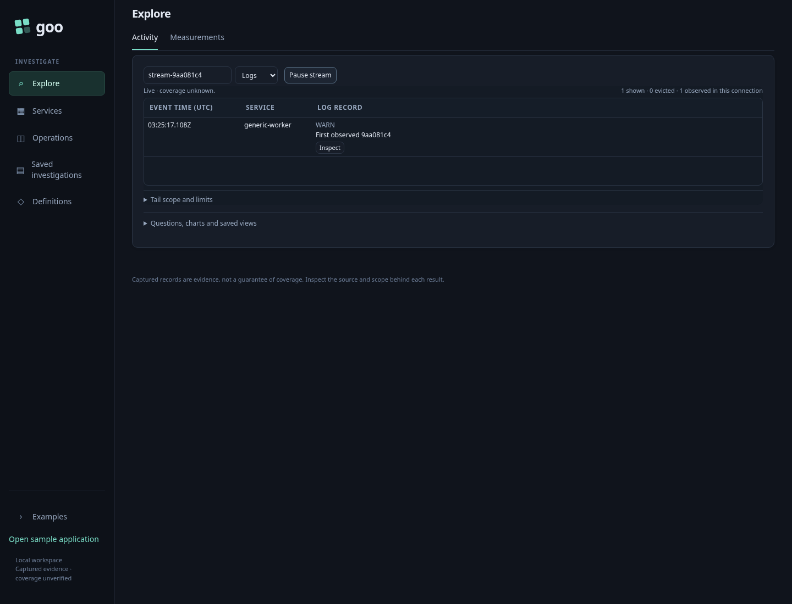
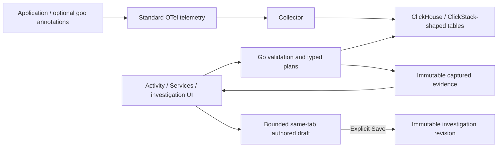

# goo — Grammar of Observability

Start with what is happening now. Narrow logs and spans, inspect a population,
compare evidence, and preserve an explanation you can revisit or reuse. Goo works
with ordinary OpenTelemetry data; application manifests and Go annotations add
shared definitions when available.

[Reviewed roadmap](docs/ROADMAP_2026_10_24.md) · [Execution backlog](docs/BACKLOG_2026_10_24.md) ·
[Actual validation](VALIDATION.md) · [Known limits](docs/KNOWN_ISSUES.md)

## Run the local lab

Install Docker with Compose v2. The lab needs roughly 4 GB of memory and several
GB of disk. Intel/AMD Linux is the primary tested target. If ClickHouse requests
it, configure the host's `vm.max_map_count` as described in its startup log.

```sh
docker compose config --quiet
docker compose up --build -d
python3 scripts/smoke.py
```

Open **http://localhost:8088**. Sample traffic starts automatically; allow 20–40
seconds for telemetry. Published lab ports bind to loopback. The `lab` /
`lab-local` credentials are disposable development credentials.

## Follow an investigation

1. **Explore** opens recent Activity logs. Choose Logs/Spans and an environment.
2. Use record attributes, field choices or chart selections to stage a narrower
   scope, then **Apply scope**. Configure columns to keep useful context visible.
3. **Pause** to inspect a record and its reported trace/span ancestry. Supplied
   ancestry is bounded; it does not establish a complete trace.
   **Investigate → Errors & exceptions** stages an ordinary fixed question; Run
   explicitly reads service/type counts and the matching records.
4. Use **Investigate → Explain this window** to pause a completed Activity window
   and stage an explanation. Brush the held-observation guide, then choose the
   preceding equal-width window or explicitly load a saved capture's **scope**.
   Run rereads both fixed populations; saved counts are not the baseline.
   **Analyze this scope/window** opens broader fixed analysis before an explicit Run.
5. Use **Explain this selection/comparison** to compare up to six chosen fields.
   **Run explanation** reads full aggregates; value actions stage an original-side
   question. **Save observed explanation** preserves that exact run without rereading.
6. Revisit evidence in **Saved investigations**, or save a reusable Activity
   view/definition. **Reuse explanation request** stages its fields and fixed
   scopes before another explicit Run. Saved Activity views reopen paused before
   **Start**; same-tab draft recovery never retries a save automatically.

Activity explanation staging (`cdd5a88`, retained-visit fix `a6533a6`) passes
journey 178 logs/spans, browser ownership and a 60-second actor. Reviewed frames:
[spans](docs/journeys/screenshots/178a-spans-activity-explanation.png),
[logs](docs/journeys/screenshots/178a-logs-activity-explanation.png),
[mobile spans](docs/journeys/screenshots/178b-spans-mobile-explanation.png),
[mobile logs](docs/journeys/screenshots/178b-logs-mobile-explanation.png).
AE2 acceptance is complete: native replay/rejecting controls, 70 Hegel examples
and the separately validated journey 155 paths pass. Execution details, the
combined-wrapper timeout and final review/push status are in [VALIDATION.md](VALIDATION.md).
See [scope and clock boundaries](docs/ACTIVITY_EXPLANATIONS.md).



Services, Operations and Definitions enter the same investigation flow with a
service, declared behavior or reusable definition already selected. Examples
include HTTP, database, messaging and native-metric workflows alongside the
optional reservation lab.

## Core capabilities and boundaries

| Surface | Available now | Boundary |
| --- | --- | --- |
| [Activity](docs/LIVE_ACTIVITY.md) | Compact logs/spans, readable UTC, facets, columns, inspection, retention, contextual [Plot values](docs/CONTEXTUAL_NUMERIC_PLOTS.md) and [completed-window explanation staging](docs/ACTIVITY_EXPLANATIONS.md) | Held occurrences guide selection; explanation Run rereads both scopes, including a saved baseline scope |
| [Fixed analysis](docs/NUMERIC_ATTRIBUTE_PLANNING.md) | Counts, [typed numeric filters](docs/TYPED_NUMERIC_FILTERS.md), numeric measures/coverage, [numeric distributions](docs/NUMERIC_HISTOGRAMS.md), two-field grouping, charts, [numeric comparisons](docs/NUMERIC_COMPARISONS.md) and [aligned distributions](docs/DISTRIBUTION_COMPARISONS.md) | Canonical int64/uint64 and [fixed-scale decimal64](docs/FIXED_SCALE_DECIMALS.md) interpretation and matching bindings are explicit; floating point and conversions remain separate |
| [Population explanations](docs/POPULATION_EXPLANATIONS.md) | Contextual field/value share differences, exact observed captures and reusable fixed-scope requests | Explicit fields, independent reads and bounded groups; descriptive differences do not establish causes |
| [Recorded error triage](docs/ERROR_TRIAGE.md) | Standard span exception events, reported status, intrinsic log severity, service/type groups and passive exception details | Counts are records, not issues or exception-event totals; recorded evidence is not inferred application failure |
| [Log patterns](docs/LOG_PATTERNS.md) | Versioned digit-run shapes, full-window counts, rare-first sorting, exact pattern timelines and service/rest comparisons | Short-body profile; unclassified buckets retained, inferred shapes are not issues or causes |
| [Services](docs/SERVICE_DASHBOARDS.md) | Discovery-driven service views and reported relationships | Missing signals and reported links do not establish health or complete topology |
| [Trace findings](docs/TRACE_FINDINGS.md) | Waterfalls, bounded examples and preserved trace-page anchor diagnostics | Matching reported IDs prove neither unique occurrence nor unchanged attributes/complete traces |
| [Native instruments](docs/NATIVE_INSTRUMENT_DISCOVERY.md) | Supported gauge, counter and histogram plans with unit/reset/temporality semantics | Unsupported instruments, missing identity and incompatible merges stay explicit |
| [Saved work](docs/INVESTIGATION_DRAFT_RECOVERY.md) | Immutable evidence/revisions, reusable questions and bounded same-tab draft recovery | Browser storage can fail/expire; an unknown save may already have committed |
| [Annotations](docs/WORKBENCH_ANNOTATIONS.md) | Tags/notes, exact references and optional XTDB-retained evidence | No shared-draft concurrency, trained classifier or production authorization is implied |

Error triage acceptance is complete: ET1 `982b9e9`, ET2 `0c4ab38`, real OTel
179 spans/logs, ownership, native/model checks and a 55-second actor pass. Actual
[span groups](docs/journeys/screenshots/179a-spans-error-evidence-groups.png),
[log groups](docs/journeys/screenshots/179a-logs-error-evidence-groups.png) and
[mobile details](docs/journeys/screenshots/179b-spans-reported-exception-detail.png)
are retained. Passive SSR/SPA checks use supplied synthetic data, separately from
OTLP acceptance. Final review/push and corrected supplemental-log evidence are
recorded in [VALIDATION.md](VALIDATION.md).

The semantic core is Go, with a Python lab/proxy and framework-neutral display
Web Components. Source adapters lower typed questions to parameterized ClickHouse
queries. Current typed YAML resources are supported; richer expression languages,
arbitrary SQL execution and live Databricks acceptance remain separate work.



[Architecture and process diagrams](docs/ARCHITECTURE_DIAGRAMS.md) cover compilation,
production services and telemetry custody. [Display component contracts](docs/UI_COMPONENTS.md)
describe passive elements usable in server-rendered HTML or an SPA. The [shared question protocol](docs/QUESTION_PROTOCOL.md) separates reusable intent
from workspace navigation. Source reads, subscriptions, scope and publication
remain application-owned.

## API and development

[API usage](docs/API.md) · [OpenAPI 3.1](api/openapi.json) ·
[Browsable local API docs](http://localhost:8088/api-docs) ·
[Executed API acceptance](docs/API_ACCEPTANCE.md)

```sh
go test ./...
npm ci
npm run test:journeys
```

Use the Go version required by each module. The separate [verification module](verification/README.md)
contains Hegel properties/state tests, Quint modeling and quint-go trace validation.
[Executable storyboards](docs/journeys/README.md) distinguish real OTLP integration
journeys from synthetic component checks; Bombadil explores bounded UI actions
and invariants. See [VALIDATION.md](VALIDATION.md) for checks actually executed.

The Python compatibility lab additionally uses `requirements-dev.txt`,
`python -m unittest discover -s tests -v` and `python tests/local_flow.py`.
The local-flow check starts real HTTP/gRPC services against a fake Redis TCP
server and needs ports 8081/50051 free. It is separate from the real Compose smoke.

## Specialized reservation lab (optional)

In Examples, expand **Specialized reservation lifecycle and resource lab**. These
compatibility views illustrate declared business identity; the general workbench
does not require reservation attributes.

1. Query **Completion SLO**, grouped by release or scenario. Good and retried requests usually finish on v1; the v2 cohort contains late, missing, and rejected work.
2. Click a reservation ID to inspect its processing spans. The consumer deliberately starts a separate trace linked to the producer span, so business identity works across trace IDs.
3. Change to **Logs** to inspect events for that selected reservation. Clear the selection to return to the full population.
4. Inspect **Latency heatmap**, click a populated cell, select a span, then open its reservation waterfall. **gRPC latency** also shows percentile summaries. Fast synchronous acceptance can coexist with failed asynchronous completion.
5. Inspect **Native metric points**. These are cumulative exported counter points; the UI does not sum them or claim they are rates.
6. Edit the JSON query and run it. Unknown operations, invalid dimensions, and unsupported metric filters are rejected. Expand the compiled SQL panel to inspect parameters.

The application-owned definition is `definitions/reservations.json`. Edit it and rebuild the application images to change the deadline, target, allowed views, or grouping dimensions. The current JSON subset is designed for portable data authoring; EDN parsing and the full package resource model are not yet implemented.

Example query:

```json
{"view":"completion","minutes":30,"groupBy":"region","scenario":"missing"}
```

Create a chosen scenario manually:

```sh
curl -s http://localhost:8081/reserve \
  -H 'Content-Type: application/json' \
  -d '{"scenario":"retry"}'
```

The gRPC service uses a real unary gRPC method `/lab.Reservations/Create` with an explicit JSON codec, avoiding generated protobuf application code in the minimal sample. OTel signals use standard protobuf OTLP/HTTP.

| Scenario | Behavior |
| --- | --- |
| good | Confirmation after about 0.3 seconds |
| retry | One failed processing attempt, then confirmation |
| late | Confirmation after about 14 seconds |
| missing | Accepted but deliberately never completed |
| reject | Terminal rejection |

The demo deadline is 10 seconds with 3 seconds of ingestion allowance. The fixed traffic mix is intentionally unhealthy and has a 95% target to make comparisons visible quickly. It is not a realistic workload or recommended target.

## Optional HyperDX

```sh
docker compose --profile hyperdx up --build -d
```

Open **http://localhost:8080**, create a local account, and use the preconfigured **Lab** ClickHouse connection. If not prepopulated, use host `http://clickhouse:8123`, user `lab`, password `lab-local`. Add log and trace sources for database `default`, tables `otel_logs` and `otel_traces`; accept the detected mappings. Add a metrics source for the `otel_metrics_*` tables if your HyperDX setup asks for one.

HyperDX 2.41.0 is specified explicitly. The optional profile needs MongoDB and extra memory. The upstream collector is deliberately kept independent of HyperDX authentication/OpAMP. These are baseline exporter schemas, without newer HyperDX-specific materialized views, session replay, or PromQL tables.

## Ports and services

| Port | Purpose |
| --- | --- |
| 8088 | Grammar UI and query API |
| 8081 | Sample HTTP endpoint `POST /reserve` |
| 8123 | ClickHouse HTTP, local credentials required |
| 4318 | Collector OTLP/HTTP |
| 8080 / 8000 | Optional HyperDX UI / API |

The gRPC service and Redis stay internal to Compose. The lab combines Python
compatibility services/proxy with the Go semantic server and woven Go samples.
ClickHouse and Redis use named volumes; no kind cluster is required.

## Operational limits and stopping

This is a development observability workbench. Telemetry absence is not health;
source/event time, read time and immutable custody time remain distinct. Scalar
percentiles are not averaged into fleet percentiles. Captures are bounded,
independent reads; historical evidence is preserved rather than silently refreshed.
The reservation lab's SLO/alarm is an on-demand preview, without scheduling or
notifications; terminal telemetry and queue acknowledgment are not transactional.

```sh
docker compose --profile hyperdx down
```

Named volumes preserve lab data. Removing volumes is a separate explicit reset.
Deployment-specific authentication, tenant isolation, quotas and retention require
a named target and acceptance checks. External Databricks/XTDB expansion and other
proposals stay in the [reviewed backlog](docs/BACKLOG_2026_10_24.md).

[Capability/design reference index](docs/CAPABILITY_GUIDE.md) ·
[Product essence](docs/PRODUCT_ESSENCE.md) ·
[Implementation history](docs/IMPLEMENTATION_PLAN.md) ·
[Original handoff (historical)](START_HERE.md)
