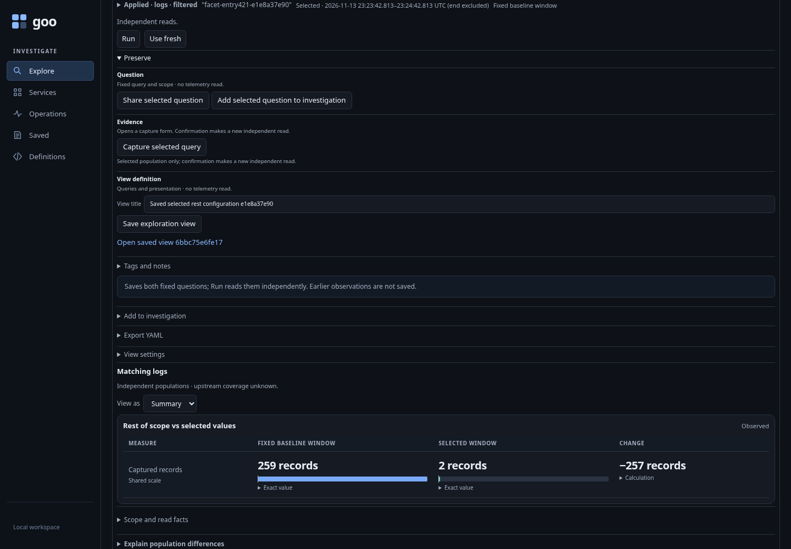

# Goo — Grammar of Observability

Goo is an observability workbench for exploring OpenTelemetry logs, traces and
metrics in ClickHouse. Start with what is happening now, narrow down the records
that matter, follow a trace, compare populations, and save what you learn.

It is for engineers investigating running services. You can use ordinary OTel
data without a Goo manifest. Optional YAML definitions and Go instrumentation
let teams describe measurements and application behavior alongside their code,
then use those definitions in the same investigation interface.

**Status: prerelease, under active development.** The local lab is runnable;
production authentication, tenant isolation and deployment hardening remain work
for a deployment target. See [capabilities and limits](docs/CAPABILITY_GUIDE.md).

## What you can do

- **Watch and narrow activity.** Stream logs or spans, inspect structured attributes,
  choose columns, filter by service or environment, and count field values.
- **Investigate across services.** Open trace waterfalls, follow related logs,
  explore discovered services and resources, and group reported errors.
- **Compare populations.** View distributions and timelines, compare time windows
  or a selected group against the rest, and drill into supporting records.
- **Keep and reuse your work.** Save questions and views, capture observations,
  and collect findings, notes and labels in investigations.
- **Build shared views.** Combine charts, tables, lists and waterfalls with checked
  view definitions and reusable display components.



[Walk through an investigation](docs/journeys/investigation-reuse.md), including
saving, reopening and returning to the original activity.

## Try the demo

With Docker and Compose v2 installed, run from this repository:

```sh
docker compose up --build -d
```

Open **http://localhost:8088**. The lab starts sample services and sends their OTel
telemetry to ClickHouse; allow 20–40 seconds for data. Start in Explore, choose
Logs or Spans, pause a record and inspect its attributes or trace.

The lab needs roughly 4 GB of memory and several GB of disk. It uses local-only
ports and disposable credentials. [Lab instructions](docs/LOCAL_LAB.md) cover
smoke checks, sample scenarios, ports, retention and stopping safely.

## Use your own telemetry

Goo runs as one Go binary with an embedded browser UI and API. It reads existing
ClickStack-shaped ClickHouse tables; it does not install your collector or create
source tables. Build with Go 1.27 or newer (the validated version is in
[.go-version](.go-version)):

```sh
go build -o /tmp/goo ./cmd/goo
CLICKHOUSE_URL=http://127.0.0.1:8123 /tmp/goo serve-http \
  --profile generic --listen 127.0.0.1:8088 \
  --investigations-dir ./goo-data
```

Set `CLICKHOUSE_USER` and `CLICKHOUSE_PASSWORD` as needed. Open the UI, choose your
scope, and **Start stream**. Keep the data directory across restarts.
[Connection and configuration details](docs/GENERIC_STARTUP.md).

## What “grammar” means

Goo aims to make an observability question reusable: which records, which time
window, what calculation, and how to display the result. Those pieces can be
assembled interactively or described in checked definitions, rather than being
locked inside one dashboard.

The distinction between intent and observations matters. A **saved view** keeps a
question and presentation for a future read. A **capture** retains observations
from a particular read. A loaded page is only a bounded set of records; missing
data does not establish health, and independently read populations may reflect
different source states.

## Learn more

- [Documentation](docs/README.md) — choose a guide by task.
- [Capabilities and limits](docs/CAPABILITY_GUIDE.md) — what works today.
- [Architecture overview](docs/SYSTEM_OVERVIEW.md) — runtime, data flow and extension points.
- [API](docs/API.md) · [OpenAPI specification](api/openapi.json).
- [Contributing and testing](CONTRIBUTING.md).
- [Roadmap](docs/ROADMAP_2026_11_14_CHECKPOINT_430.md) · [Validation record](VALIDATION.md).
