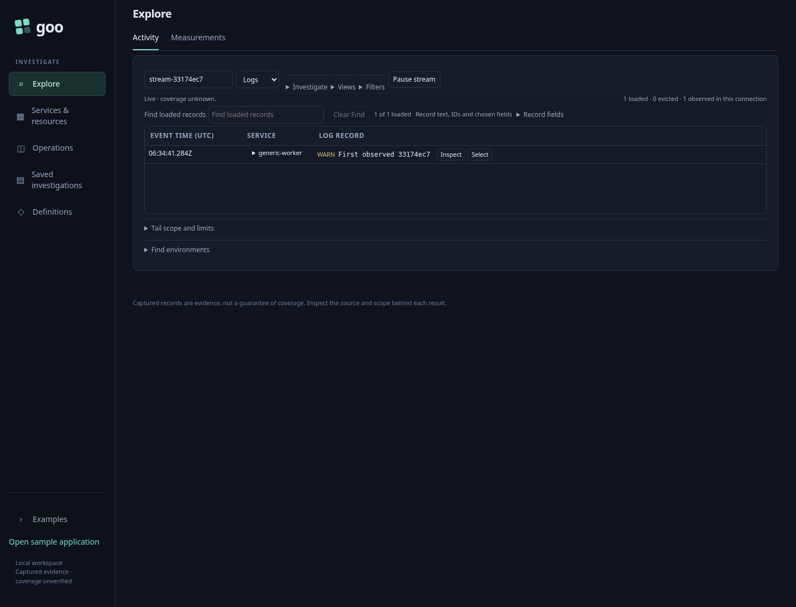
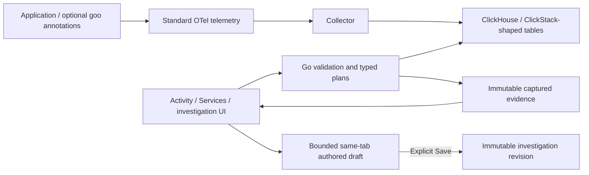

# goo — Grammar of Observability

Start with what is happening now. Narrow logs and spans, inspect a population,
compare evidence, and preserve an explanation you can revisit or reuse. Goo works
with ordinary OpenTelemetry data; application manifests and Go annotations add
shared definitions when available. Logs/Spans switching preserves shared filters;
incompatible fields stay as explicit drafts ([scope continuity](journeys/239-activity-signal-scope-storyboard.md)).
[Open an observed service](docs/ACTIVITY_SERVICE_CONTEXT.md) from Activity with its
original window and [checked environment policy](docs/SERVICE_ENVIRONMENT_POLICIES.md),
including current/legacy precedence, empty and unreported record scopes. Read the
overview explicitly and return to the same paused rows.
[Operation inventory](docs/SERVICE_OPERATION_INVENTORY.md) reads the selected
service before grouping limits; unrelated services cannot exhaust its budget.
Saving inventory explicitly rereads that service's original scope.
[Compare a service widget with its previous window](docs/SERVICE_WINDOW_COMPARISONS.md)
using captured counts, explicit Run and a held service return.
[Incoming HTTP response context](docs/INCOMING_HTTP_RESPONSES.md) keeps reported
codes, missing/empty values and recorded span Error distinct.
[Recurring exception groups](docs/EXCEPTION_GROUPS.md) in Activity → Investigate →
Errors & exceptions count exact type/stack signatures over the full searched population.
Inspect inputs and affected services, then stage matching records without losing the held view.

[Shared record-intent admission](docs/RECORD_INTENT_ADMISSION.md) keeps staged, linked
and recalled queries consistent; malformed links preserve held results.
[Compare captured rates](docs/CAPTURED_RATE_COMPARISONS.md) across different window
lengths with exact count/exposure facts and an explicit Count or records/s choice.
[Shared investigation controls](docs/UI_POLISH_AFTER_423.md) keep field search,
facet selections and comparison calculations compact, with exact read facts on demand.
[Edit a field’s applied constraints](docs/CONTEXTUAL_FIELD_CONSTRAINTS.md) from
its facet controls, or stage removal of one AND condition while retaining the
other filters. Apply explicitly reads a fresh Activity window.
[Compare counted selections](docs/COUNTED_SELECTION_COMPARISONS.md) with the rest
of the same fixed scope. Run reads both independently; return to the held Activity
with selections and focus intact.


[Reusable question packages](docs/TYPED_PACKAGE_SCOPES.md) retain environment
policy, filters and existing measure profiles, including from saved evidence.
Stage opens a fixed question in Explore; Run explicitly reads it.

[Service continuations](docs/TYPED_SERVICE_CONTINUATIONS.md) retain the selected
environment policy and fixed window in wider child records. Service workspaces
also expose saved rolling Activity views under that policy; opening stages the
view’s own selector before explicit Start.
[Reported-edge investigation](docs/REPORTED_EDGES.md) follows an exact observed
parent relationship under the same policy, with capture and source-free reopen.
[Recover a failed service widget](docs/WIDGET_RECOVERY.md) by retrying its original
fixed question while keeping successful sibling results and source clocks.
[Use a saved template](docs/SERVICE_TEMPLATES.md) from a completed service widget.
Inspect and Apply reuse presentation in its exact scope; Run reads explicitly.

[Source-read failures](docs/SOURCE_REFUSALS.md) show a concise reason and safe
technical details. Retry stays explicit; available paired observations retain
their counts and receipts while a refused side remains unknown.
[Trace and log context recovery](docs/CONTEXT_RECOVERY.md) uses the same reasons: retry
a failed trace page or reread linked/surrounding logs in their original checked scope.

Span-duration views can compare the adjacent previous window using the existing
**Compare previous window** action. Run reads both scopes independently; the
summary shows mean duration in milliseconds and each side's contributing spans.
Exact sums/counts remain authoritative; empty data never becomes zero latency.
See the [mean comparison contract](docs/reviews/MEAN_COMPARISON_ARCHITECTURE_341.md)
and [executable journey](docs/journeys/341-mean-comparison.md).
[Explain population differences](docs/FRESH_PAIR_EXPLANATIONS.md) from the applied
fresh pair, then follow a chosen side into supporting records and return locally.
Run explanation rereads count/share composition; its clocks stay separate.

Activity can [reuse a saved baseline in its checked policy](docs/ACTIVITY_BASELINE_POLICIES.md):
latency compares frozen evidence, while Explain explicitly rereads the saved scope.

Activity supports [local Find over loaded logs and spans](docs/HELD_RECORD_FIND.md),
including chosen column values, without changing the source query or selection.
While paused, [select all loaded matches atomically](docs/LOADED_MATCH_SELECTION.md)
for explicit Keep, retaining existing hidden selections and the 20-item limit.
Reopen a kept log or span and [stage its original-window trace Waterfall](docs/KEPT_TRACE_CONTINUATION.md);
Run reads fresh telemetry, and Back restores the retained kept inspector.
For kept logs, [Surrounding logs](docs/KEPT_LOG_CONTEXT.md) stages bounded time
context for the same service and namespace, including without a trace ID. Both
surrounding-log entry points share exact namespace admission; unknown reporting
refuses before a read. Find preserved records later with bounded, literal
[kept content search](docs/KEPT_CONTENT_SEARCH.md), without querying telemetry.
[Open matching record](docs/KEPT_MATCH_NAVIGATION.md) takes a search witness directly
to its original verified record; one kept route visit acquires the receipt once.
Activity's [Compare previous window by service](docs/ACTIVITY_WINDOW_COMPARISON.md)
stages both full fixed populations for explicit Run; loaded rows never supply their
totals. Summary and Groups retain the [actual operand roles](docs/COMPARISON_OPERAND_ROLES.md).
Follow either group into supporting records with that same operand label, exact
window and checked filters; Run reads fresh data and Back restores the comparison
([journey](docs/journeys/334-comparison-record-drill.md)).
[Retained-parent controls](docs/PARENT_RETURN.md) renew locally on Back while
keeping questions, observations and receipts; departed actions remain retired.
[Counted facet publication](docs/FACET_PUBLICATION.md) updates supplied data and
interaction together, avoiding duplicate list builds while keeping reads explicit.
[Saved-view restoration](docs/SAVED_VIEW_RESTORATION.md) joins browser history
notifications without replacing local work. Opening stages configuration; Run
reads telemetry, and a failed opening offers an explicit retry.
General [saved-capture navigation](docs/CAPTURE_NAVIGATION.md) also keeps pending
reads and Save/Refresh display adoption with the current task.
Saved span pages offer [Table or Span waterfall](docs/CAPTURED_SPAN_PAGES.md)
without rereading telemetry. Inspect uses the exact stored occurrence; **Expand
trace (fresh read)** deliberately acquires separate context. A saved page remains
a bounded fragment, not a complete trace.
[Retained span-page comparison](docs/RETAINED_PAGE_COMPARISON.md) pins a whole
stored page as baseline and explicitly compares it with another stored page.
Each side keeps its receipt, window, clock and page limits; opening that exact
side uses its verified opaque cursor, and **Return to comparison** restores the
held pair locally. Store GETs remain separate from telemetry reads. Milestone
361 passes native/model and positive actor checks.
[366 compact headers](docs/COMPACT_PAIRED_EVIDENCE.md) bring the first positive
timing bars into view on desktop/narrow while keeping independent scope/receipts
in disclosures; [validation](VALIDATION.md) records matched measurements.

Temporary and saved count comparisons use [one supplied-pair presentation](docs/COUNT_PAIR_PRESENTATION.md),
with a Summary/Groups choice and explicit operand windows and read clocks.
Fresh fixed comparisons can keep a [categorical facet](docs/PAIRED_FACETS.md):
read [both window category populations](docs/CATEGORY_PAIRS.md), choose
Include/Exclude, then stage **Filter both windows**. Run reads the narrowed pair;
Back restores its original observations.
[Find loaded facet values](docs/LARGE_FACETS.md) searches full literals locally;
long labels show both prefix and identifier suffix. Counts and scoped actions
retain the complete loaded values and independent read receipts.
The [compact scope disclosure](docs/POPULATION_CHROME.md) keeps exact windows and
policies available without duplicating them above the data; opening it reads nothing.

Ordinary count views can [compare the preceding equal-length window](docs/PREVIOUS_WINDOW_COMPARISON.md),
then save both fixed questions for explicit reuse.

[Native service gauges](docs/NATIVE_GAUGE_ENVIRONMENT_POLICIES.md) and
[counter/histogram intervals](docs/TYPED_NATIVE_INTERVALS.md) can read values under
that same policy, retaining distinct current-key and legacy-key streams.

[Shared chart surfaces](docs/CHART_FIRST_EXPLORATION.md) put plotted values before
settings, with visible certainty and expandable exact read facts.

Explore and narrow live telemetry, then [compare captured counts](docs/CAPTURED_COUNT_COMPARISON.md),
[inspect group changes](docs/GROUP_COUNT_COMPARISON.md), and
[stage a chosen group](docs/GROUP_SIDE_STAGING.md) for an independent read.
[Preserve](docs/PRESERVATION.md) a question, reusable view, or independent evidence capture.
Optional [investigation findings](docs/PRESERVE_ATTACHMENT.md) stay behind Add to investigation.

[The active population canvas](docs/POPULATION_WORKSPACE.md) puts its scope and data
first, retaining the original editor for explicit return. Trace/context reads
cancel when their inspector is retired.

[Customize one signal](docs/FOCUSED_VIEWS.md) from an applied population while keeping
its fixed scope and paused parent. Build reusable views with [saved displays](docs/SAVED_DISPLAY_DECLARATIONS.md),
[HTTP service views](docs/HTTP_SERVICE_VIEW_TEMPLATE.md),
[authorable templates](docs/AUTHORABLE_VIEW_TEMPLATES.md), including
[reusable timelines](docs/TIMELINE_VIEW_TEMPLATES.md) and
[comparisons with a chosen baseline](docs/COMPARISON_VIEW_TEMPLATES.md), and
[record/aggregate compositions](docs/RECORD_AGGREGATE_COMPOSITION.md), including
[record lists](docs/RECORD_LIST.md) and [supplied-span waterfalls](docs/SUPPLIED_SPAN_WATERFALL.md)
beside the default table, with
[shared record interactions](docs/RECORD_INTERACTIONS.md).
[Records-only views](docs/RECORD_ONLY_VIEWS.md) also work with ungrouped raw logs or spans.
[Reuse records with selected summary facts](docs/UNGROUPED_SUMMARY_TEMPLATES.md)
without inventing a grouping. Inspect/Apply keeps the destination query; Run is explicit.
[Captured-record rates](docs/CAPTURED_RECORD_RATES.md) are an optional summary or
ungrouped timeline measure, using exact counts and the actual window or bucket duration.
[Reuse numeric histograms beside records](docs/AUTHORED_NUMERIC_HISTOGRAMS.md)
with Histogram/Table views and exact numeric-binding compatibility.
[Fleet service triage](docs/SERVICE_TRIAGE.md) adds a compact Services summary:
captured Server spans and changes, recorded Error fraction and mean duration,
with local ranking and exact namespace-aware service drilldown.
[Compare reported service versions](docs/SERVICE_VERSION_COMPARISONS.md) from a
service span overview: discover versions, choose two, and stage the existing
count, mean duration or recorded Error comparison. Error fractions retain exact
count support and unset status. Run stays explicit; Back restores the held service.
[Contextual action return](docs/CONTEXTUAL_ACTIONS.md) restores the clicked service
action or record-inspector control while retaining its existing evidence.
[Facet an inspected Activity field](docs/ACTIVITY_FACET_ENTRY.md) through the existing
Filters and explicit full-scope counted-value read.
[Select several counted values](docs/MULTI_VALUE_FACETS.md), then Stage once with
OR within the field and the original scope retained.
[Activity scope snapshots](docs/ACTIVITY_SCOPE_SNAPSHOTS.md) remove repeated
retained-row copying from scope checks while preserving fresh owner guards.
[Log volume in Activity](docs/ACTIVITY_LOG_CONTEXT.md) adds optional measured
count bars and severity-text context; select an interval to stage its exact
fixed-window explanation while retaining the stream.
[Result presentation refinement](docs/RESULT_PRESENTATION_POLISH.md) applies the
same shared visual hierarchy to comparisons, timelines and scope recall.
[Operator workbench polish](docs/OPERATOR_WORKBENCH_POLISH.md) unifies compact records,
contextual inspection, field actions and service discovery across desktop/mobile.
[Independent follow-up acceptance](docs/reviews/INDEPENDENT_INTERFACE_REVIEW_2026_11_12.md#remediation-acceptance)
covers readable docked operations, accessible controls and contained 320px records;
the [real-telemetry storyboard](docs/journeys/review-remediation.md) exercises the fixes.
[Compact shared histogram surfaces](docs/QUANTITATIVE_VIEW_COMPOSITION.md) retain
authored titles, read facts and exact values with keyboard scrolling on narrow screens.
[Open an inspected trace as a view](docs/TRACE_AS_VIEW.md) to edit and save its presentation.
[Add a breakdown](docs/ADD_BREAKDOWN.md) to grow a records view into a chart, then
[compare a selected cohort](docs/AUTHORED_COHORTS.md) with its held parent or rest.
[Include a fixed comparison in the view](docs/SAVED_COHORT_QUERIES.md) to save,
export and rerun both questions. Shared
[comparison-window controls](docs/PAIRED_COMPARISON_WINDOWS.md) stage both fixed
questions together before explicit Run. [Fixed baselines](docs/FIXED_BASELINE_READS.md)
acquire aggregates where supported while selected records keep their full read.
[Compact declarative facets](docs/DECLARATIVE_FACETS.md) add a chosen field control to a
view, with explicit scoped value reads and the existing selection workflow.
[Canvas context](docs/COMPACT_CANVAS.md) keeps origin, parent and current scope
distinct while reducing repeated chrome.
[Portable YAML definitions](docs/PORTABLE_VIEWS.md) let teams export and import
these views through the same saved-view catalog.
[CLI validation and import](docs/VIEW_ARTIFACT_CLI.md) connect repository checks
to an explicitly chosen Goo server.
[Record paging](docs/RECORD_PAGE_PROFILE.md) retains any held aggregate and timeline.

[Capture summary correction](docs/CAPTURE_CATALOG_SEARCH.md) · [Roadmap and active backlog](docs/ROADMAP_2026_11_12_CHECKPOINT_411.md) ·
[Actual validation](VALIDATION.md) · [Known limits](docs/KNOWN_ISSUES.md) ·
[Go/frontend library review and proposal](docs/LIBRARY_REFACTOR_PLAN_2026_10_28.md)

[Counted field values](docs/COUNTED_VALUES.md) reads complete scoped groups without
loading record pages or unrelated field inventories. The controlled comparison
records four source reads reduced to two. [Service widget summaries](docs/SERVICE_RECORD_AGGREGATES.md)
similarly skip unused pages and field inventories while retaining full service
inspection and capture paths. See the [service walkthrough](journeys/194-service-dashboard-projection-storyboard.md).
See the [counted-values walkthrough](journeys/193-counted-values-projection-storyboard.md).

Goo runs as **one Go process** with embedded UI and API documentation. Browser
`/api/*` requests go directly to the typed Go handlers; there is no Python proxy.
See the [runtime consolidation](docs/SINGLE_GO_RUNTIME.md) and
[pinned ko/container image builds](docs/CONTAINER_IMAGES.md).

## Use your existing OTel data

[Generic startup](docs/GENERIC_STARTUP.md) runs without sample definitions, bindings
or manifests. Start `goo serve-http --profile generic --listen 127.0.0.1:8088`,
supply your ClickHouse connection and an evidence directory, then choose an
environment and **Start stream**. The existing ClickStack-shaped source adapters
apply; this does not install a collector or create source tables.

## Build from source

All six Go modules require Go 1.27 or newer. [`.go-version`](.go-version)
pins the validated compiler (currently 1.27.3) used by CI and Docker builds.
Keep that file and the three Docker build images aligned when updating it.
The optional XTDB retention driver and verification graph use the current checked
[pgx dependency closure](docs/reviews/GO_DEPENDENCY_UPDATE_336.md), including standard
library PBKDF2; native retention checks require `GOO_XTDB_TEST_URL`.
Instrumentation, examples and verification retain separate dependency graphs;
`go test ./...` at the root does not test nested modules. See
[verification setup](verification/README.md#reproducible-entry-point) for the pinned sibling checkout and native
requirements, and [compiler commands](docs/PORTABLE_COMPILER.md) for local setup.

## Run the local lab

Install Docker with Compose v2. The lab needs roughly 4 GB of memory and several
GB of disk. Intel/AMD Linux is the primary tested target. If ClickHouse requests
it, configure the host's `vm.max_map_count` as described in its startup log.

```sh
docker compose config --quiet
docker compose up --build -d
python3 scripts/smoke.py
```

Open **http://localhost:8088**. Sample traffic starts automatically; allow 20–40
seconds for telemetry. Published lab ports bind to loopback. The `lab` /
`lab-local` credentials are disposable development credentials.

The lab's generated trace table uses calendar-day expiry (`toDate(Timestamp) +
INTERVAL 1 DAY` with part expiry), despite the exporter's `ttl: 24h` setting. It is
not a rolling 24-hour guarantee: fixed questions can lose their source records at
UTC midnight. Immutable captures retain their evidence; a fresh query can return
no data. Inspect the actual ClickHouse table DDL when choosing retention.


## Follow an investigation

1. **Explore** opens recent Activity logs. Choose Logs/Spans and an environment.
   **Recent / Pinned** recalls fixed questions or rolling Activity scopes; Stage
   reads nothing. Held visits return to tab-local results. Browser persistence is
   opt-in. See [scope recall](docs/RECENT_PINNED_SCOPES.md).
2. Use record attributes, field choices or chart selections to stage a narrower
   scope, then **Apply scope**. Configure columns to keep useful context visible.
3. **Pause** to inspect a record and its reported trace/span ancestry. Supplied
   ancestry is bounded; it does not establish a complete trace.
   **Investigate → Errors & exceptions** stages an ordinary fixed question; Run
   explicitly reads service/type counts and the matching records.
4. Use **Investigate → Explain this window** to pause a completed Activity window
   and stage an explanation. Brush the held-observation guide, then choose the
   preceding equal-width window or explicitly load a saved capture's **scope**.
   Run rereads both fixed populations; saved counts are not the baseline.
   **Analyze this scope/window** opens broader fixed analysis before an explicit Run.
5. Use **Explain this selection/comparison** to compare up to six chosen fields.
   **Run explanation** reads full aggregates; value actions stage an original-side
   question. **Save observed explanation** preserves that exact run without rereading.
6. Revisit evidence in **Saved investigations**, or save a reusable Activity
   view/definition. **Reuse explanation request** stages its fields and fixed
   scopes before another explicit Run. Saved captures support [title/scope search and
   capture-time ordering](docs/CAPTURE_CATALOG_SEARCH.md); existing stores need the
   documented metadata rebuild. Saved Activity views reopen paused before
   **Start**; same-tab draft recovery never retries a save automatically.

Activity explanation staging (`cdd5a88`, retained-visit fix `a6533a6`) passes
journey 178 logs/spans, browser ownership and a 60-second actor. Reviewed frames:
[spans](docs/journeys/screenshots/178a-spans-activity-explanation.png),
[logs](docs/journeys/screenshots/178a-logs-activity-explanation.png),
[mobile spans](docs/journeys/screenshots/178b-spans-mobile-explanation.png),
[mobile logs](docs/journeys/screenshots/178b-logs-mobile-explanation.png).
AE2 acceptance is complete: native replay/rejecting controls, 70 Hegel examples
and the separately validated journey 155 paths pass. Execution details, the
combined-wrapper timeout and final review/push status are in [VALIDATION.md](VALIDATION.md).
See [scope and clock boundaries](docs/ACTIVITY_EXPLANATIONS.md).



Definitions separates Records, Measurements and App contracts into keyboard-accessible
family tabs. Switching families preserves drafts and selections and cancels a hidden
HTTP preview; browsing families does not read telemetry. The HTTP lookback appears
only in App contracts and preserves its chosen default when hidden. Editing the
next discovery lookback preserves completed service/host/pod observations and their
fixed-window return paths; pending discovery reads still cancel. Resource drill-downs
share one latest-origin return bar with qualified identity, environment and UTC
window; returning reopens the retained detail without a read. Measurements uses
its own package/fixed-window controls, readable UTC scope and exact timestamp
metadata. Re-previewing an unchanged fixed question preserves native precision. Mobile workspaces share
one compact Menu bar, with Escape to close and return focus.

Services, Operations and Definitions enter the same investigation flow with a
service, declared behavior or reusable definition already selected. Examples
include HTTP, database, messaging and native-metric workflows alongside the
optional reservation lab.

Fixed questions put results before authoring. Use **Edit question** to reveal the
same filters and measures without reading data or changing the fixed window.
Dirty or invalid drafts stay visible until an explicit valid Run. See
[read/Edit behavior](docs/FIXED_QUESTION_PRESENTATION.md).

## Core capabilities and boundaries

| Surface | Available now | Boundary |
| --- | --- | --- |
| [Activity](docs/LIVE_ACTIVITY.md) | Compact logs/spans, readable UTC, service/namespace shortcuts, facets, columns, inspection, retention, contextual [Plot values](docs/CONTEXTUAL_NUMERIC_PLOTS.md) and [completed-window explanation staging](docs/ACTIVITY_EXPLANATIONS.md) | Held occurrences guide selection; explanation Run rereads both scopes, including a saved baseline scope |
| [Fixed analysis](docs/NUMERIC_ATTRIBUTE_PLANNING.md) | Counts, [typed numeric filters](docs/TYPED_NUMERIC_FILTERS.md), numeric measures/coverage, [numeric distributions](docs/NUMERIC_HISTOGRAMS.md), two-field grouping, charts, [numeric comparisons](docs/NUMERIC_COMPARISONS.md) and [aligned distributions](docs/DISTRIBUTION_COMPARISONS.md) | Canonical int64/uint64 and [fixed-scale decimal64](docs/FIXED_SCALE_DECIMALS.md) interpretation and matching bindings are explicit; floating point and conversions remain separate |
| [Population explanations](docs/POPULATION_EXPLANATIONS.md) | Contextual field/value share differences, exact observed captures and reusable fixed-scope requests | Explicit fields, independent reads and bounded groups; descriptive differences do not establish causes |
| [Recorded error triage](docs/ERROR_TRIAGE.md) | Standard span exception events, reported status, intrinsic log severity, service/type groups and passive exception details | Counts are records, not issues or exception-event totals; recorded evidence is not inferred application failure |
| [Log patterns](docs/LOG_PATTERNS.md) | Versioned shapes, full-window counts, rare-first sorting, pattern timelines, service/rest and [time comparisons](docs/LOG_PATTERN_TIME_COMPARISONS.md) with exact rates/shares | Short-body profile; unclassified buckets retained, absence refers only to the compared reads |
| [Services & resources](docs/SERVICE_DASHBOARDS.md) | Service dashboards, [host observations](docs/HOST_RESOURCES.md) and [Kubernetes resource discovery](docs/KUBERNETES_RESOURCES.md) | Reported telemetry and associations do not establish health, verified ownership or complete topology |
| [Trace search](docs/TRACE_SEARCH.md) | Find reported trace IDs across services in checked named/empty/unreported environment scopes, inspect qualified witnesses, then open waterfalls or compare pages; [reuse questions](docs/SAVED_TRACE_SEARCH_QUESTIONS.md) and [capture witnesses](docs/CAPTURED_TRACE_SEARCH.md) | Search intent is separate from captured results; same span may satisfy several conditions; reported IDs and bounded witnesses do not establish unique invocations, complete traces or causal paths |
| [Trace findings](docs/TRACE_FINDINGS.md) | Waterfalls, [observed-page latency breakdowns](docs/TRACE_PAGE_TIMING.md), [local trace-page comparisons](docs/TRACE_COMPARISON.md), bounded examples and preserved anchor diagnostics | Overlapping span sums are not wall time; reported IDs do not establish unique occurrences or complete traces |
| [Native instruments](docs/NATIVE_INSTRUMENT_DISCOVERY.md) | Supported gauge, counter and histogram plans with unit/reset/temporality semantics | Unsupported instruments, missing identity and incompatible merges stay explicit |
| [Saved work](docs/INVESTIGATION_DRAFT_RECOVERY.md) | Immutable evidence/revisions, reusable questions and bounded same-tab draft recovery | Browser storage can fail/expire; an unknown save may already have committed |
| [Annotations](docs/WORKBENCH_ANNOTATIONS.md) | Tags/notes, exact references and optional XTDB-retained evidence | No shared-draft concurrency, trained classifier or production authorization is implied |

[Automatic operational dashboards](docs/AUTOMATIC_DASHBOARDS.md) now include
HTTP, [current and older OTel RPC](docs/CURRENT_RPC_PROFILE_357.md) server-span views, current-key database
client dependencies, and separate messaging consumer/producer views. Discover a service, inspect activity, recorded span errors,
duration and literal route/method/database/destination populations, then narrow the scope and
open a trace. [Current RPC reusable views](docs/CURRENT_RPC_VIEW_TEMPLATE.md) let a
service's method presentation be edited/saved and applied to another exact
compatible service scope, with missing/empty methods retained and Run explicit.
[Service native interval context](docs/SERVICE_NATIVE_RECORD_CONTEXT.md) stages
logs or spans from an exact histogram export interval for explicit Run, then
returns to the held service card without rereading metrics. Shared resource/time
provides context, not contribution or causality.
All spans remains available; native metrics retain separate units,
streams and intervals. Measurements now describes the same
[current RPC duration candidate](docs/RPC_CAPABILITY_PARITY.md) using the pinned
Histogram/seconds shape and bounded attribute coverage. Recognition remains
separate from generic eligibility and explicit Run. Native/model and positive
actor checks include captured evidence reopening with telemetry unavailable. Pool observations, host CPU/memory and the first Go runtime
observations are described below. Pod memory/phase, reported container readiness,
container CPU/memory resources and reported workload context are also available,
preserving exact resource identity and independent evidence. Broader receiver
coverage, verified ownership, workload rollups, database-server/broker health and
complete USE calculations remain separate work. Discovery does not invent missing
health signals.
See the executed [HTTP](journeys/187-http-server-dashboard-storyboard.md),
[older RPC](journeys/188-rpc-server-dashboard-storyboard.md),
[current RPC](docs/journeys/357-current-rpc.md),
[database-client](journeys/189-db-client-dashboard-storyboard.md) and
[messaging](journeys/190-messaging-dashboard-storyboard.md) journeys with desktop/mobile frames.

From the live native Measurements inspector, select a counter or histogram
interval and choose **Logs in interval** or **Spans in interval**. The
[native-context handoff](docs/NATIVE_RECORD_CONTEXT.md) preserves exact event-time
membership and matching resource identity; Run reads records explicitly and Back
restores the held metric view. It provides context rather than a causal or
exemplar relationship. [Journey 192](journeys/192-native-record-context-storyboard.md)
shows the flow and its broader trace-expansion boundary.
[Saved native intervals](docs/SAVED_NATIVE_RECORD_CONTEXT.md) now use the same
context question with an immutable capture citation. **Return to saved measurement**
restores the held result and selection without a metric or store read. UI,
generated ownership, native/recorded-fact replay and positive actor checks pass.

Error triage acceptance is complete: ET1 `982b9e9`, ET2 `0c4ab38`, real OTel
179 spans/logs, ownership, native/model checks and a 55-second actor pass. Actual
[span groups](docs/journeys/screenshots/179a-spans-error-evidence-groups.png),
[log groups](docs/journeys/screenshots/179a-logs-error-evidence-groups.png) and
[mobile details](docs/journeys/screenshots/179b-spans-reported-exception-detail.png)
are retained. Passive SSR/SPA checks use supplied synthetic data, separately from
OTLP acceptance. Final review/push and corrected supplemental-log evidence are
recorded in [VALIDATION.md](VALIDATION.md).

The [display library](docs/UI_COMPONENTS.md#native-module-entrypoints) now has a
native module entrypoint: `<script type="module" src="/display.mjs"></script>`.
[Embedding examples](docs/PASSIVE_DISPLAY_EMBEDDING.md) cover shared charts and
summaries with HTML attributes and detached/pre-registration properties.
Core/chart, attribute/record, exception, field-picker, tag and aligned-numeric
features support direct imports, supplied SSR attributes and SPA properties.
The gallery loads only this public graph. The full application uses one native
`/app.mjs` bootstrap; owners import their dependencies directly, with no global
namespace bridge. Source-query cancellation now stays active through JSON body
consumption; saves and live streams keep separate lifetimes. See the
[request flow](docs/ARCHITECTURE.md) and [test commands](tests/README.md).

The runtime and semantic core are Go, with embedded framework-neutral display
Web Components. Source adapters lower typed questions to parameterized ClickHouse
queries. Current typed YAML resources are supported; richer expression languages,
arbitrary SQL execution and live Databricks acceptance remain separate work.



[Architecture and process diagrams](docs/ARCHITECTURE_DIAGRAMS.md) cover compilation,
production services and telemetry custody. [Display component contracts](docs/UI_COMPONENTS.md)
describe passive elements usable in server-rendered HTML or an SPA. The [shared question protocol](docs/QUESTION_PROTOCOL.md) separates reusable intent
from workspace navigation. Source reads, subscriptions, scope and publication
remain application-owned.

## API and development

[API usage](docs/API.md) · [OpenAPI 3.1](api/openapi.json) ·
[Browsable local API docs](http://localhost:8088/api-docs) ·
[Executed API acceptance](docs/API_ACCEPTANCE.md)

```sh
go test ./...
npm ci
npm run test:journeys
```

Use the Go version required by each module. The separate [verification module](verification/README.md)
contains Hegel properties/state tests, Quint modeling and quint-go trace validation.
`python3 scripts/verify_optional.py` runs a bounded required suite after checking
pinned tools/sibling source; `--suite woven` and `--suite lab` are explicit opt-ins.
[Executable storyboards](docs/journeys/README.md) distinguish real OTLP integration
journeys from synthetic component checks; Bombadil explores bounded UI actions
and invariants. See [VALIDATION.md](VALIDATION.md) for checks actually executed.

Independent Python sample workloads and offline reference tests use `requirements-dev.txt`,
`python -m unittest discover -s tests -v` and `python tests/local_flow.py`.
The local-flow check starts real HTTP/gRPC services against a fake Redis TCP
server and needs ports 8081/50051 free. It is separate from the real Compose smoke.

## Sample workloads

The independent reservation sample emits HTTP/gRPC/messaging telemetry. Explore
it through ordinary Activity, service dashboards and trace views; Goo does not
require its reservation attributes. The former reservation-specific query panel
and its Python API/compiler are retired. Modern YAML examples and Go-backed
operation/measurement workflows remain available under Examples.

Create a chosen scenario manually:

```sh
curl -s http://localhost:8081/reserve \
  -H 'Content-Type: application/json' \
  -d '{"scenario":"retry"}'
```

The gRPC service uses a real unary gRPC method `/lab.Reservations/Create` with an explicit JSON codec, avoiding generated protobuf application code in the minimal sample. OTel signals use standard protobuf OTLP/HTTP.

| Scenario | Behavior |
| --- | --- |
| good | Confirmation after about 0.3 seconds |
| retry | One failed processing attempt, then confirmation |
| late | Confirmation after about 14 seconds |
| missing | Accepted but deliberately never completed |
| reject | Terminal rejection |

The demo deadline is 10 seconds with 3 seconds of ingestion allowance. The fixed traffic mix is intentionally unhealthy and has a 95% target to make comparisons visible quickly. It is not a realistic workload or recommended target.

## Optional HyperDX

```sh
docker compose --profile hyperdx up --build -d
```

Open **http://localhost:8080**, create a local account, and use the preconfigured **Lab** ClickHouse connection. If not prepopulated, use host `http://clickhouse:8123`, user `lab`, password `lab-local`. Add log and trace sources for database `default`, tables `otel_logs` and `otel_traces`; accept the detected mappings. Add a metrics source for the `otel_metrics_*` tables if your HyperDX setup asks for one.

HyperDX 2.41.0 is specified explicitly. The optional profile needs MongoDB and extra memory. The upstream collector is deliberately kept independent of HyperDX authentication/OpAMP. These are baseline exporter schemas, without newer HyperDX-specific materialized views, session replay, or PromQL tables.

## Ports and services

| Port | Purpose |
| --- | --- |
| 8088 | Grammar UI and query API |
| 8081 | Sample HTTP endpoint `POST /reserve` |
| 8123 | ClickHouse HTTP, local credentials required |
| 4318 | Collector OTLP/HTTP |
| 8080 / 8000 | Optional HyperDX UI / API |

The gRPC service and Redis stay internal to Compose. The lab combines Python
sample workload services with the single Go product server and woven Go samples.
ClickHouse and Redis use named volumes; no kind cluster is required.

## Operational limits and stopping

This is a development observability workbench. Telemetry absence is not health;
source/event time, read time and immutable custody time remain distinct. Scalar
percentiles are not averaged into fleet percentiles. Captures are bounded,
independent reads; historical evidence is preserved rather than silently refreshed.
The reservation lab's SLO/alarm is an on-demand preview, without scheduling or
notifications; terminal telemetry and queue acknowledgment are not transactional.

```sh
docker compose --profile hyperdx down
```

Named volumes preserve lab data. Removing volumes is a separate explicit reset.
Deployment-specific authentication, tenant isolation, quotas and retention require
a named target and acceptance checks. External Databricks/XTDB expansion and other
proposals stay in the [reviewed backlog](docs/BACKLOG_2026_10_25.md).

[Current capabilities and gaps](docs/CAPABILITY_GUIDE.md) ·
[Product essence](docs/PRODUCT_ESSENCE.md) ·
[Implementation history](docs/IMPLEMENTATION_PLAN.md) ·
[Original handoff (historical)](START_HERE.md)

[Cumulative-stock measurements](docs/CUMULATIVE_STOCKS.md) support discovery, sum-table reads and frozen replay. [Named-pool connections](docs/POOL_CONNECTIONS.md) add automatic per-instance connection-state views within service dashboards; capacity/wait context is described below; broader USE calculations remain follow-ons.


[Pool capacity and acquisition-wait context](docs/POOL_SIGNALS.md) now stages
independently evaluated exact-stream measurements from a selected named pool.
Default service reads remain bounded; explicit Run and individual capture retain
the original window, identity and separate clocks. Numerical capacity/utilization
joins and causal attribution remain separate; host and Go runtime observations
are described below.

[Gotogether consumer pilot](docs/GOTOGETHER_PILOT.md) records onboarding and
capture-workflow compatibility. The [follow-on pilot](docs/GOTOGETHER_FOLLOWUP.md)
verifies the parser fix and shrinks a real lifecycle cutoff mutant; Goo's existing
testing dependencies remain unchanged.


[Compact pool observations](docs/POOL_VIEW.md) put selected capacity and acquisition
wait beside held state counts. Shared count bars, exact reported used / maximum
eligibility and separate wait intervals support inspection without background
reads or composite custody. See [journey 198](journeys/198-pool-view-storyboard.md)
for actual source effects, controls and desktop/mobile frames.


[Host-resource observations](docs/HOST_RESOURCES.md) discover ordinary host metrics
without service labels or manifests. Explicitly open a resource for bounded CPU
and memory defaults, inspect or capture a native stream, or stage matching-resource
logs/spans. [Journey 199](journeys/199-host-storyboard.md) records actual source,
identity/custody tests and refreshed desktop/mobile frames.


[Go runtime observations](docs/GO_RUNTIME.md) add compact memory usage and reported
GC heap-target views to existing service dashboards, with goroutine count available
through explicit native selection. Exact instance/category streams retain their
own clocks and epochs. The existing two-native-measurement budget stays unchanged;
no memory/goal percentage, GC-pause signal or pressure verdict is inferred.
See [journey 200](journeys/200-runtime-storyboard.md) for the actual ordinary-OTLP
workflow, compact desktop/mobile frames and capture/ownership checks.


[Kubernetes resource discovery](docs/KUBERNETES_RESOURCES.md) shows pod-bearing
resource variants from ordinary logs, spans and metric points. Narrow the held
inventory by reported cluster/namespace or text, then stage matching-resource
logs/spans and Run explicitly. Missing cluster UIDs remain visible as unverified
context; pod names do not replace UIDs. This is telemetry discovery, not a live
Kubernetes API inventory or a readiness/health dashboard.
See [journey 201](journeys/201-kubernetes-storyboard.md) for the executed discovery,
record membership, cancellation and actual desktop/mobile views.


[Pod memory observations](docs/POD_METRICS.md) add an explicit Observe metrics
flow to known-schema Kubernetes resource variants. It loads independent memory
usage/working-set defaults from the supported kubeletstats profile, with native
inspection and individual capture. Semconv usage remains a separate profile;
memory ratios and health inference are not included; phase/readiness use separate state profiles below.
See [journey 202](journeys/202-pod-memory-storyboard.md) for actual default/control
reads, capture reopening, ownership checks and desktop/mobile frames.

[Typed pod states](docs/POD_STATES.md) decode pinned receiver phase codes through
exact-resource native packages and individual captures, independently of observation
quality. Pinned phase discovery now feeds a compact categorical pod/native view;
memory keeps its default read budget and phase can be selected explicitly.
[Journey 203c](journeys/203c-pod-phase-storyboard.md) records actual OTLP/browser,
owner/actor/raw-custody acceptance and compact desktop/mobile frames.


The [container-readiness profile](docs/CONTAINER_READINESS.md) uses exact reported
container IDs and pinned Ready/Not ready observations in discovery, native
inspection and individual capture/replay. Freshness stays separate from readiness;
no pod-health or probe-success inference is made. [Journey 204b](journeys/204b-container-readiness-storyboard.md) tracks live acceptance.


[Reported workload context](docs/KUBERNETES_WORKLOAD_CONTEXT.md) adds local
qualified workload filtering and explicit cross-pod log/span drilldown to
Kubernetes observations. Deployment/ReplicaSet and Job/CronJob remain independent
reported attributes. Readiness cards expose compact literal container identity.
[Journey 205](journeys/205-workload-context-storyboard.md) tracks acceptance.


[Container memory context](docs/CONTAINER_MEMORY.md) explicitly loads working
set, request and limit observations on a shared byte scale. Choose exact reported
source variants and signals; existing automatic defaults stay bounded. Each
signal retains its own quality/UTC, and percentages require strict replay-backed
alignment. [Journey 206](journeys/206-container-memory-storyboard.md) tracks source
and ordinary OTLP/browser acceptance.


[Container CPU context](docs/CONTAINER_CPU.md) adds explicit usage,
request and limit gauges on a shared fractional-core scale, using the same
source-selection and retained-inspection flow as memory. The receiver already
reports CPU usage; no counter derivative is inferred.
[Journey 207](journeys/207-container-cpu-storyboard.md) tracks acceptance.


[Container Resources](docs/CONTAINER_RESOURCES.md) consolidates memory and CPU
under one Kubernetes entry with shared metadata discovery and independent family
loads. [Automatic usage defaults](docs/AUTOMATIC_RESOURCE_DEFAULTS.md) now load
unambiguous usage first; expanding capacity reuses held usage. Each panel retains its own units, clocks and individual native inspection.
[Journey 208](journeys/208-container-resources-storyboard.md) tracks acceptance.


[Resource history](docs/CONTAINER_RESOURCE_HISTORY.md) adds sparse usage/request/
limit timelines over held container evidence. Compare role observations on one
family scale, inspect exact points and stage precise time-scoped logs/spans.
Chart interaction stays local; existing explicit Run owns record reads.
[Journey 209](journeys/209-container-history-storyboard.md) tracks acceptance.

[Journey 210](journeys/210-resource-defaults-storyboard.md) exercises the automatic entrance.

[CPU-time rates](docs/CPU_TIME_RATES.md) add an explicit fractional counter domain
and pinned host CPU activity fallback. Existing integer counters stay unchanged;
logical CPUs/modes retain separate interval evidence. [Journey 211](journeys/211-cpu-time-storyboard.md)
records acceptance.

[Host network throughput](docs/HOST_NETWORK_THROUGHPUT.md) adds explicit
per-interface receive/transmit byte rates without expanding CPU/memory defaults.
It reuses native interval investigation and individual capture; [Journey 212](journeys/212-host-network-storyboard.md)
records acceptance.

[Per-device disk throughput](docs/HOST_DISK_THROUGHPUT.md) adds explicit read/write
byte rates on a shared scale, with native investigation and capture.

[Filesystem usage and reported capacity](docs/HOST_FILESYSTEM_USAGE.md) provides
explicit mount selection and independent byte stocks on a shared scale.

[Reported filesystem utilization](docs/FILESYSTEM_UTILIZATION.md) adds one explicit
gauge read for the selected mount, with a separate fixed fraction scale.

[Host resource controls](docs/HOST_CONTROL_COHERENCE.md) consolidate selection,
explicit Refresh and direct local Evidence without changing telemetry reads.

Go HTTP executables handle SIGINT/SIGTERM with a five-second request drain, then
cancel and close remaining work. The Go samples also flush their SDK providers
with separate five-second budgets. See [shutdown behavior and limits](docs/HTTP_BOUNDARIES.md#executable-shutdown-2026-10-28).

Woven Go instrumentation requires explicit startup: construct
`instrumentation.NewRuntime(Config{MeterProvider: ..., TracerProvider: ...})`,
check its error, then call `instrumentation.BindDefault(rt)` once before serving.
Manual integrations can use Runtime methods without a process binding. See
[the runtime contract](docs/GOO_ANNOTATIONS.md#runtime-ownership-and-startup).

For supplied native observations, `measurements.Evaluate(question, rows, at)` is
storage-free. Lifecycle custody/correction uses `measurements.ObserveLifecycle`
explicitly. See [the Go evaluation boundary](docs/MEASUREMENT_PACKAGES.md#go-evaluation-and-lifecycle-observation).

The [active roadmap](docs/ROADMAP_2026_11_12_CHECKPOINT_411.md) follows delivered outgoing HTTP
(385), gauge display reuse (386), [capture-family consolidation](docs/CAPTURE_FAMILY_ADMISSION.md)
(387) and [records around a gauge observation](docs/GAUGE_OBSERVATION_CONTEXT.md)
(388), [counter display reuse](docs/NATIVE_COUNTER_VIEW_REUSE.md) (389) and
[data-first native composition](docs/NATIVE_DATA_FIRST.md) (390). Ordinary, service
and saved native data now lead their entry layouts; source and return ownership
stay unchanged. [Reusable log-pattern count displays](docs/LOG_PATTERN_DISPLAY_REUSE.md) (391)
are delivered. [Native HTTP-client duration profiles](docs/HTTP_CLIENT_NATIVE_DURATION.md)
(392) are delivered. The [literal transport audit](docs/LITERAL_PARAMETER_TRANSPORT.md)
(393) confirms both source encoders preserve legal values; [405 shares their
parameter encoder](docs/CLICKHOUSE_PARAMETER_ENCODING.md). The audit also fixes typed
question validation before JSON cloning.
[Count, numeric and duration distributions](docs/DISTRIBUTION_CUSTOMIZATION.md) and
[grouped count timelines](docs/GROUPED_COUNT_TIMELINE_REUSE.md) and
[grouped mean-duration views](docs/GROUPED_MEAN_DURATION_REUSE.md) can be customized
and reused through the existing workspace. Configuration retains the exact
question, Run is explicit, and Back restores held evidence without rereading.
[Held presentation ownership](docs/HELD_PRESENTATION_OWNERSHIP.md) keeps local
edits and saved definitions aligned after Back; invalid Find blocks Save and
recovers on correction. Source controls retain their separate lifetime.
[Pure display-helper consolidation](docs/PURE_DISPLAY_HELPERS.md) is complete.
[Compact summary authoring](docs/AUTHORED_POPULATION_SUMMARIES.md) keeps selected
whole-population facts in the same reusable grammar.
[Retained gauge observation context](docs/RETAINED_GAUGE_RECORD_CONTEXT.md) documents
Services/Saved admission, exact nearby-record scope and source-free return alongside
ordinary Measurements. Earlier current RPC view reuse,
service native interval context and measured bounded facets are also delivered.
[Facet pages](docs/LARGE_FACET_INTERACTIONS.md) mount at most
100 matches while Find, totals and comparison scales use the complete admitted
set. Same-read selection/caret and exact child scope survive Return. [Typed error-triage follow-through](docs/TYPED_ERROR_TRIAGE.md) is also delivered:
Inspect and within-service comparison preserve the complete typed question, wait
for Run and return to held groups without rereading.
[Native histogram display reuse](docs/NATIVE_HISTOGRAM_VIEW_REUSE.md) saves
Histogram/Table configuration separately from measurement calculation and evidence.
Apply preserves the current question; Run and export selection remain explicit.
[Gauge display reuse](docs/NATIVE_GAUGE_VIEW_REUSE.md) shares that native-view
contract for retained-observation Timeline/Table displays. It preserves the
complete destination question and fixed-window freshness; missing values occupy
a separate time-aligned rail outside the numeric domain.
[Counter display reuse](docs/NATIVE_COUNTER_VIEW_REUSE.md) uses evaluated intervals
and rates for Timeline/Table. Applicability checks exact unit and integer/decimal
domain; Apply retains the destination's complete question and waits for Run.
Reset/gap semantics and optional exact rates remain evaluator-owned.
[Typed distribution continuation](docs/TYPED_DISTRIBUTION_CONTINUATION.md) now
checks the exact selection intent, stages the complete child question and waits
for Run. Back retains the parent without rereading and visibly pauses selection
until an explicit parent Run.
[Browse saved native displays](docs/NATIVE_VIEW_DISCOVERY.md) in Measurements,
Find loaded metadata and Inspect compatibility before Apply. The bounded
[exponential-histogram readiness gate](docs/EXPONENTIAL_HISTOGRAM_READINESS.md)
is closed with execution deferred: the pinned source loses zero thresholds and
optional presence, and the current native representation needs a distinct contract.
[Grouped rows](docs/GROUP_ROW_PRESENTATION.md) now keep identity, count and
controls together on narrow screens through the existing table components.
[Metric discovery](docs/UNSUPPORTED_METRIC_DISCOVERY.md) now shows observed
exponential instruments with exported-point counts and an unsupported status,
without making them executable. Optional-source absence is explicit.
[Reported histogram exemplars](docs/HISTOGRAM_EXEMPLAR_REFERENCES.md) now stage
scoped trace questions from selected exports. Explicit Run reads spans; Back
retains the native result. Stored Float64 values keep their original-type limit
visible, and source references do not imply causality or complete traces.
[Native recovery](docs/NATIVE_MEASUREMENT_RECOVERY.md) now preserves typed source
refusals and retries the exact fixed question explicitly. Old owners and late
responses stay retired. [Service discovery](docs/METRIC_SERVICE_DISCOVERY.md) also
finds exponential-only emitters through the normal Services catalog. Compact
Scope controls select fixed UTC bounds and exact/missing namespaces; instrument
metadata remains unsupported for exponential evaluation.
[Saved exemplar continuation](docs/SAVED_HISTOGRAM_EXEMPLARS.md) now stages a
reported trace from immutable native exports, preserving capture and sample
identity. Explicit Run reads fresh spans; Back restores the same held evidence
without source or capture-store reads.
[Bounded source decoding](docs/BOUNDED_SOURCE_DECODING.md) now shares object
framing while keeping each source's limits and failure ownership explicit.
[Saved trace-search questions](docs/SAVED_TRACE_SEARCH_QUESTIONS.md) now retain
complete fixed conditions and limits in investigation revisions. Reopening stages
intent; Search reads explicitly. [Captured search evidence](docs/CAPTURED_TRACE_SEARCH.md)
now retains an independent reread and qualified witnesses, reopens without telemetry,
and stays held while a fresh trace is explored. [Data-first fixed results](docs/DATA_FIRST_FIXED_RESULTS.md) now keep the first
record or chosen visual in view with contextual secondary controls.
[Outgoing HTTP observations](docs/OUTGOING_HTTP.md) add an explicit service lens
for Client-span activity, destinations, methods, literal ports and response
status. Full counts stay separate from bounded pages; recorded span Error stays
separate from HTTP response status. Trace expansion visibly discloses its wider
scope, and checked questions/captures use the existing evidence workflow.
Whole-product reviews and proposed work are distinct from
[validated delivery](VALIDATION.md).

Go library entry points: `subjectfacts` provides portable prepared-fact aggregation
and offline ClickHouse/Databricks compilation; `measurements` binds/evaluates native
OTel instruments. See the [portable compiler guide](docs/PORTABLE_COMPILER.md#go-library-boundary)
and its executable external-consumer example.

The [compact native workbench journey](journeys/229-native-actions-storyboard.md)
shows fixed-scope preview, explicit Run, reuse actions and return from supporting records.

The [nested resource/native return journey](journeys/233-nested-native-return-storyboard.md)
keeps one immediate Back action while preserving original scopes and retained results.

[Service and Kubernetes return journeys](journeys/234-service-kubernetes-return-storyboard.md)
restore the retained tab and visible opening control, including mobile navigation.

Prepared subject-fact evaluation rejects malformed UTF-8 before identity/grouping;
see the [text integrity contract](docs/PREPARED_TEXT_INTEGRITY.md).

Native package publication and browsing share [bounded capacity and exact revision
recovery](docs/NATIVE_CATALOG_CAPACITY.md); no stored definitions are deleted to enforce it.

Have OTel data without an environment label? Activity → Find environments offers
[bounded discovery and preview](docs/ENVIRONMENT_ADOPTION.md). Stage the checked
environment in Activity, keep your filters, then Start stream explicitly. The
[record APIs](docs/RECORD_SELECTOR_API.md) support explicit selectors through tails,
context and filesystem captures. Saved can now reopen selector-bearing records,
comparisons and explanations, page/inspect stored records without telemetry reads,
and stage their fixed questions for an explicit Run. See the
[executable Saved journey](journeys/255-saved-environment-storyboard.md).

The [scope propagation audit](docs/ENVIRONMENT_SCOPE_PROPAGATION.md) tracks the
delivered bounded record loop. See the [Activity journey](journeys/256-activity-environment-storyboard.md).
Shared authored question/step links,
reusable view/package intent, native/service families and XTDB selector retention
remain unsupported. Preview responses carry a checked
[versioned selector](docs/ENVIRONMENT_SELECTOR_PROTOCOL.md); absence is never a wildcard.

Activity, fixed results and Saved record pages support **Select → Keep selected → Open saved** without a title,
label, telemetry reread or XTDB. Original observed occurrences, duplicate keys
and read/observation clocks remain separate from fresh population captures.
See [Keep contract and diagram](docs/KEPT_OBSERVATIONS.md) and
[executable journey/screenshots](journeys/257-kept-observations-storyboard.md).
Fixed results preserve page-local positions and Saved selections preserve absolute
stored indexes, with separate source/capture/keep clocks. See the
[fixed/Saved journey](journeys/258-keep-records-storyboard.md). Durable exact links
and bounded browser recent/pending history are implemented. Saved’s **Find kept
observations** now discovers keeps across browsers, with origin/signal filters,
paging and explicit resumable metadata repair. Open verifies original records;
discovery never reads telemetry. See the [cross-browser journey](journeys/259-kept-discovery-storyboard.md).

Trace inspection now closes directly to its opening context: **← Activity**
returns to held rows/selection, while fixed and Saved traces return to their own
rows. The native modal contains keyboard focus and respects nested editor Escape.
See [trace return](docs/TRACE_PARENT_RETURN.md). Shared controls also have clearer
focus, reduced motion, improved contrast and safe form embedding.

The [view grammar proposal](docs/VIEW_GRAMMAR_PROPOSAL_260.md) unifies the shared
UI/product/chart reviews with oscope, Kindly, Plotje and Portal research. It proposes
one public UI composition grammar for built-in and contributed views: typed
scope/data/quality, charts/tables/lists/waterfalls and scope-bound controls, a base
chart with a restricted Plotly adapter, and shared declarative/visual authoring.
Complete-only widgets and explicit uncertainty semantics are core requirements;
all current widgets/screens must be expressible. The app is prerelease, with no
legacy-format or API compatibility floor. [The active roadmap](docs/ROADMAP_2026_11_12_CHECKPOINT_411.md) separates proposed work from
implemented capabilities; the supporting reports include pinned research sources.

Single-group count breakdowns now share a [scoped display contract](docs/SCOPED_VIEW_PILOT.md):
switch bars/table without querying, inspect exact values and stage a facet filter
before Run. Complete-only rendering requires a runtime witness from the checked source-adoption
boundary; upstream sampling stays unknown. Raw JSON imports remain held with unknown extent. [Storyboard](journeys/261-scoped-breakdown-storyboard.md).

[Count intervals and multi-field breakdowns](docs/SCOPED_INTERVALS.md) now use the
same display contract: exact UTC windows, known-zero versus unknown coverage,
true clipped bucket widths, all-dimension tables and explicit staged narrowing.
[Current storyboard](journeys/262-scoped-intervals-storyboard.md).

[Numeric and latency measures](docs/SCOPED_MEASURES.md) now share those views: switch
measures locally, inspect exact fractions and contributing counts, and narrow with
the binding and units intact. Unavailable values remain gaps; duration quantiles
retain their exact empirical method. [Storyboard](journeys/263-scoped-measures-storyboard.md).

[Population summary/comparison views](docs/POPULATION_MEASURE_VIEWS.md) now share
exact measures, independent provenance and common signed comparison scales. The
[model review](docs/MODEL_PIT_OF_SUCCESS_264.md) prioritizes immutable constructors,
safe projections and host action ownership before expanding authoring/renderers.


[Immutable snapshot construction](docs/SNAPSHOT_CONSTRUCTION.md) now normalizes
scoped data once and shares frozen handles. JSON copies lose runtime completeness;
safe supplied-row projections preserve exact cells while dropping whole-query
proof. This adds no local-filter UI or source authentication.

[Scoped action ownership](docs/SCOPED_ACTION_OWNERSHIP.md) now separates execution
bindings from content revisions. Old group/facet/interval actions cannot stage
against a rerun, another role or a suspended visit, even with identical data.
Suspension withdraws action controls while retaining local display. This is the
bounded H1 cut for canonical fixed Explore controls.

[Ordinary breakdowns](docs/ORDINARY_BREAKDOWNS.md) now share one Distribution
surface; Records no longer repeats that group chart. Population shares use the
same exhaustive group read, and local Find/sort keeps the full denominator and
scale. Group selection stages a question; Run reads it. Saved inspection and
trace opening retain their scope. [Recorded span status](docs/STATUS_FRACTIONS.md)
also uses shared breakdown, interval and summary components: exact Error/OK/Unset/
Unknown counts and Error/count fractions, with fixed percentage axes and explicit
empty/unknown states. Status comparisons retain their percentage-point presenter.
[Fixed numeric histograms](docs/SCOPED_HISTOGRAMS.md) now share the same dataset,
histogram/table displays and execution-bound range planning, retaining exact
support and domain edges. [Aligned histogram comparisons](docs/SCOPED_HISTOGRAM_COMPARISONS.md)
retain independent operands and offer count, captured-record share and valid-value
share scales. [Captured span-duration histograms](docs/SCOPED_DURATION_HISTOGRAMS.md)
now share histogram/table displays with exact open-tail bounds and guarded
selected/rest actions. [Native interval histograms](docs/SCOPED_NATIVE_HISTOGRAMS.md)
now project one selected instrument interval into the same display, preserving
observation counts, right-closed buckets and exact bounds. [Fixed-time histogram
buckets](docs/SCOPED_HISTOGRAM_TIME_BUCKETS.md) now share those displays with
anchored windows, whole-export coverage and clipped final buckets. [Native comparisons](docs/SCOPED_NATIVE_HISTOGRAM_COMPARISONS.md) now use one
aligned count/share display in the existing capture-comparison flow. This closes
the histogram migration slice. [Native display configuration](docs/NATIVE_HISTOGRAM_VIEW_REUSE.md)
now reuses Histogram/Table presentation independently of evidence and calculation.
Specialized owners remain explicit rather than blocking authoring.


### Saved count timeline — 281

Fixed saved compositions can add a [count timeline](docs/SAVED_COUNT_TIMELINE.md) beside
aggregates and records. Drag or keyboard-select supplied UTC intervals, stage the shared
window, then Run. Paging holds the timeline; saved reuse checks interval width.


### Saved view findings — 282

Investigations can pin a [saved view definition and
finding](docs/SAVED_VIEW_FINDINGS.md). Opening the definition stages its query and
composition for explicit Run. Frozen captures remain separate evidence.


### Typed saved Activity scopes — 283

Saved Activity views now retain current-only and effective environment scopes, including
empty and unreported labels. The applied-scope catalog distinguishes policies; reopening
stages the exact selector for explicit Start. See [Activity
views](docs/ACTIVITY_VIEWS.md#typed-environment-round-trip--283).


### Typed question links and investigation steps — 284

Fixed record questions retain typed environment scope through sharing, investigation
cards and draft recovery. Reopening stages the exact scope for explicit Run. See
[question handoffs](docs/INVESTIGATION_STEPS.md#typed-record-question-handoffs--284).


### Typed recent populations — 285

Show recent activity now retains typed environment scope through planning, selected-time
links and saved child views. The explicit action reads supported signals independently;
opening a child or saved definition remains staged. See [recent
populations](docs/RECENT_ACTIVITY.md#typed-recent-populations--285).


### Focus one signal for authoring — 286

Customize logs/spans stages one exact root question from recent activity, with the
multi-signal parent retained. Grouped questions open an existing composition; missing
grouping requires an explicit choice. Run remains explicit. See [focused
authoring](docs/RECENT_ACTIVITY.md#customize-one-signal--286).


### Duration measures in saved timelines — 287

Saved timelines now plot count, mean duration or p95 when the span query requests
duration summaries. Canonical charts retain human units, exact values and support, with
distinct zero, no-data and unavailable states. Measure changes are local; selected
windows still stage an explicit Run. See [timeline
contract](docs/SAVED_COUNT_TIMELINE.md).

Dense quantitative, interval and native tables share [overflow and retained
context](docs/TABLE_CONTEXT.md): directional edge cues, pinned identity and
compact UTC interval context, with native keyboard scrolling and no extra reads.

[Trace-search continuation](docs/TRACE_SEARCH_CONTINUATION.md) explicitly reads
later ID-ordered pages while retaining the full fixed search. Save keeps intent;
Capture rereads the current positioned page. Conditions fold after successful
reads, keeping page controls and evidence first.
