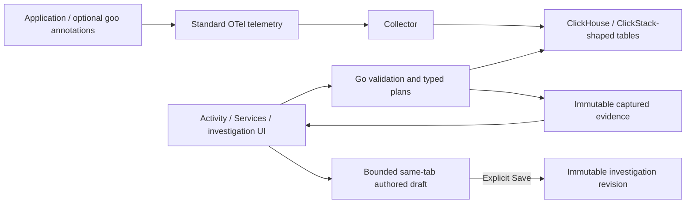

# goo — Grammar of Observability

Start with what is happening now. Narrow logs and spans, inspect a population,
compare evidence, and preserve an explanation you can revisit or reuse. Goo works
with ordinary OpenTelemetry data; application manifests and Go annotations add
shared definitions when available.

[Reviewed roadmap](docs/ROADMAP_2026_10_25.md) · [Execution backlog](docs/BACKLOG_2026_10_25.md) ·
[Actual validation](VALIDATION.md) · [Known limits](docs/KNOWN_ISSUES.md) ·
[Go/frontend library review and proposal](docs/LIBRARY_REFACTOR_PLAN_2026_10_28.md)

[Counted field values](docs/COUNTED_VALUES.md) reads complete scoped groups without
loading record pages or unrelated field inventories. The controlled comparison
records four source reads reduced to two. [Service widget summaries](docs/SERVICE_RECORD_AGGREGATES.md)
similarly skip unused pages and field inventories while retaining full service
inspection and capture paths. See the [service walkthrough](journeys/194-service-dashboard-projection-storyboard.md).
See the [counted-values walkthrough](journeys/193-counted-values-projection-storyboard.md).

## Use your existing OTel data

[Generic startup](docs/GENERIC_STARTUP.md) runs the Go API and Python UI without
sample definitions, bindings or manifests. Set Go `--profile generic` and Python
`GOO_PROFILE=generic`, supply your ClickHouse connection and an evidence directory,
then choose an environment and **Start stream**. The existing ClickStack-shaped
source adapters apply; this does not install a collector or create source tables.
Optional prepared/example capabilities stay explicitly unconfigured.

## Build from source

All six Go modules require Go 1.27 or newer. [`.go-version`](.go-version)
pins the validated compiler (currently 1.27.2) used by CI and Docker builds.
Keep that file and the three Docker build images aligned when updating it.
Instrumentation, examples and verification retain separate dependency graphs;
`go test ./...` at the root does not test nested modules. See
[verification setup](verification/README.md) for the sibling checkout and native
requirements, and [compiler commands](docs/PORTABLE_COMPILER.md) for local setup.

## Run the local lab

Install Docker with Compose v2. The lab needs roughly 4 GB of memory and several
GB of disk. Intel/AMD Linux is the primary tested target. If ClickHouse requests
it, configure the host's `vm.max_map_count` as described in its startup log.

```sh
docker compose config --quiet
docker compose up --build -d
python3 scripts/smoke.py
```

Open **http://localhost:8088**. Sample traffic starts automatically; allow 20–40
seconds for telemetry. Published lab ports bind to loopback. The `lab` /
`lab-local` credentials are disposable development credentials.

## Follow an investigation

1. **Explore** opens recent Activity logs. Choose Logs/Spans and an environment.
2. Use record attributes, field choices or chart selections to stage a narrower
   scope, then **Apply scope**. Configure columns to keep useful context visible.
3. **Pause** to inspect a record and its reported trace/span ancestry. Supplied
   ancestry is bounded; it does not establish a complete trace.
   **Investigate → Errors & exceptions** stages an ordinary fixed question; Run
   explicitly reads service/type counts and the matching records.
4. Use **Investigate → Explain this window** to pause a completed Activity window
   and stage an explanation. Brush the held-observation guide, then choose the
   preceding equal-width window or explicitly load a saved capture's **scope**.
   Run rereads both fixed populations; saved counts are not the baseline.
   **Analyze this scope/window** opens broader fixed analysis before an explicit Run.
5. Use **Explain this selection/comparison** to compare up to six chosen fields.
   **Run explanation** reads full aggregates; value actions stage an original-side
   question. **Save observed explanation** preserves that exact run without rereading.
6. Revisit evidence in **Saved investigations**, or save a reusable Activity
   view/definition. **Reuse explanation request** stages its fields and fixed
   scopes before another explicit Run. Saved Activity views reopen paused before
   **Start**; same-tab draft recovery never retries a save automatically.

Activity explanation staging (`cdd5a88`, retained-visit fix `a6533a6`) passes
journey 178 logs/spans, browser ownership and a 60-second actor. Reviewed frames:
[spans](docs/journeys/screenshots/178a-spans-activity-explanation.png),
[logs](docs/journeys/screenshots/178a-logs-activity-explanation.png),
[mobile spans](docs/journeys/screenshots/178b-spans-mobile-explanation.png),
[mobile logs](docs/journeys/screenshots/178b-logs-mobile-explanation.png).
AE2 acceptance is complete: native replay/rejecting controls, 70 Hegel examples
and the separately validated journey 155 paths pass. Execution details, the
combined-wrapper timeout and final review/push status are in [VALIDATION.md](VALIDATION.md).
See [scope and clock boundaries](docs/ACTIVITY_EXPLANATIONS.md).


Services, Operations and Definitions enter the same investigation flow with a
service, declared behavior or reusable definition already selected. Examples
include HTTP, database, messaging and native-metric workflows alongside the
optional reservation lab.

## Core capabilities and boundaries

| Surface | Available now | Boundary |
| --- | --- | --- |
| [Activity](docs/LIVE_ACTIVITY.md) | Compact logs/spans, readable UTC, facets, columns, inspection, retention, contextual [Plot values](docs/CONTEXTUAL_NUMERIC_PLOTS.md) and [completed-window explanation staging](docs/ACTIVITY_EXPLANATIONS.md) | Held occurrences guide selection; explanation Run rereads both scopes, including a saved baseline scope |
| [Fixed analysis](docs/NUMERIC_ATTRIBUTE_PLANNING.md) | Counts, [typed numeric filters](docs/TYPED_NUMERIC_FILTERS.md), numeric measures/coverage, [numeric distributions](docs/NUMERIC_HISTOGRAMS.md), two-field grouping, charts, [numeric comparisons](docs/NUMERIC_COMPARISONS.md) and [aligned distributions](docs/DISTRIBUTION_COMPARISONS.md) | Canonical int64/uint64 and [fixed-scale decimal64](docs/FIXED_SCALE_DECIMALS.md) interpretation and matching bindings are explicit; floating point and conversions remain separate |
| [Population explanations](docs/POPULATION_EXPLANATIONS.md) | Contextual field/value share differences, exact observed captures and reusable fixed-scope requests | Explicit fields, independent reads and bounded groups; descriptive differences do not establish causes |
| [Recorded error triage](docs/ERROR_TRIAGE.md) | Standard span exception events, reported status, intrinsic log severity, service/type groups and passive exception details | Counts are records, not issues or exception-event totals; recorded evidence is not inferred application failure |
| [Log patterns](docs/LOG_PATTERNS.md) | Versioned shapes, full-window counts, rare-first sorting, pattern timelines, service/rest and [time comparisons](docs/LOG_PATTERN_TIME_COMPARISONS.md) with exact rates/shares | Short-body profile; unclassified buckets retained, absence refers only to the compared reads |
| [Services & resources](docs/SERVICE_DASHBOARDS.md) | Service dashboards, [host observations](docs/HOST_RESOURCES.md) and [Kubernetes resource discovery](docs/KUBERNETES_RESOURCES.md) | Reported telemetry and associations do not establish health, verified ownership or complete topology |
| [Trace search](docs/TRACE_SEARCH.md) | Find reported trace IDs with independent span conditions across services, inspect qualified witnesses, then open waterfalls or compare pages | Same span may satisfy several conditions; reported IDs and bounded witnesses do not establish unique invocations, complete traces or causal paths |
| [Trace findings](docs/TRACE_FINDINGS.md) | Waterfalls, [observed-page latency breakdowns](docs/TRACE_PAGE_TIMING.md), [local trace-page comparisons](docs/TRACE_COMPARISON.md), bounded examples and preserved anchor diagnostics | Overlapping span sums are not wall time; reported IDs do not establish unique occurrences or complete traces |
| [Native instruments](docs/NATIVE_INSTRUMENT_DISCOVERY.md) | Supported gauge, counter and histogram plans with unit/reset/temporality semantics | Unsupported instruments, missing identity and incompatible merges stay explicit |
| [Saved work](docs/INVESTIGATION_DRAFT_RECOVERY.md) | Immutable evidence/revisions, reusable questions and bounded same-tab draft recovery | Browser storage can fail/expire; an unknown save may already have committed |
| [Annotations](docs/WORKBENCH_ANNOTATIONS.md) | Tags/notes, exact references and optional XTDB-retained evidence | No shared-draft concurrency, trained classifier or production authorization is implied |

[Automatic operational dashboards](docs/AUTOMATIC_DASHBOARDS.md) now include
HTTP and explicit legacy OTel RPC server-span views, current-key database
client dependencies, and separate messaging consumer/producer views. Discover a service, inspect activity, recorded span errors,
duration and literal route/method/database/destination populations, then narrow the scope and
open a trace. All spans remains available; native metrics retain separate units,
streams and intervals. Pool observations, host CPU/memory and the first Go runtime
observations are described below. Newer bindings, database-server/broker health,
complete USE calculations and Kubernetes remain staged follow-on work. Discovery does not
invent missing health signals.
See the executed [HTTP](journeys/187-http-server-dashboard-storyboard.md),
[RPC](journeys/188-rpc-server-dashboard-storyboard.md),
[database-client](journeys/189-db-client-dashboard-storyboard.md) and
[messaging](journeys/190-messaging-dashboard-storyboard.md) journeys with desktop/mobile frames.

From the live native Measurements inspector, select a counter or histogram
interval and choose **Logs in interval** or **Spans in interval**. The
[native-context handoff](docs/NATIVE_RECORD_CONTEXT.md) preserves exact event-time
membership and matching resource identity; Run reads records explicitly and Back
restores the held metric view. It provides context rather than a causal or
exemplar relationship. [Journey 192](journeys/192-native-record-context-storyboard.md)
shows the flow and its broader trace-expansion boundary.

Error triage acceptance is complete: ET1 `982b9e9`, ET2 `0c4ab38`, real OTel
179 spans/logs, ownership, native/model checks and a 55-second actor pass. Actual
[span groups](docs/journeys/screenshots/179a-spans-error-evidence-groups.png),
[log groups](docs/journeys/screenshots/179a-logs-error-evidence-groups.png) and
[mobile details](docs/journeys/screenshots/179b-spans-reported-exception-detail.png)
are retained. Passive SSR/SPA checks use supplied synthetic data, separately from
OTLP acceptance. Final review/push and corrected supplemental-log evidence are
recorded in [VALIDATION.md](VALIDATION.md).

The [display library](docs/UI_COMPONENTS.md#native-module-entrypoints) now has a
native module entrypoint: `<script type="module" src="/display.mjs"></script>`.
Core/chart, attribute/record, exception, field-picker, tag and aligned-numeric
features support direct imports, supplied SSR attributes and SPA properties.
The gallery loads only this public graph. The full application uses one native
`/app.mjs` bootstrap; owners import their dependencies directly, with no global
namespace bridge. Source-query cancellation now stays active through JSON body
consumption; saves and live streams keep separate lifetimes. See the
[request flow](docs/ARCHITECTURE.md) and [test commands](tests/README.md).

The semantic core is Go, with a Python lab/proxy and framework-neutral display
Web Components. Source adapters lower typed questions to parameterized ClickHouse
queries. Current typed YAML resources are supported; richer expression languages,
arbitrary SQL execution and live Databricks acceptance remain separate work.



[Architecture and process diagrams](docs/ARCHITECTURE_DIAGRAMS.md) cover compilation,
production services and telemetry custody. [Display component contracts](docs/UI_COMPONENTS.md)
describe passive elements usable in server-rendered HTML or an SPA. The [shared question protocol](docs/QUESTION_PROTOCOL.md) separates reusable intent
from workspace navigation. Source reads, subscriptions, scope and publication
remain application-owned.

## API and development

[API usage](docs/API.md) · [OpenAPI 3.1](api/openapi.json) ·
[Browsable local API docs](http://localhost:8088/api-docs) ·
[Executed API acceptance](docs/API_ACCEPTANCE.md)

```sh
go test ./...
npm ci
npm run test:journeys
```

Use the Go version required by each module. The separate [verification module](verification/README.md)
contains Hegel properties/state tests, Quint modeling and quint-go trace validation.
[Executable storyboards](docs/journeys/README.md) distinguish real OTLP integration
journeys from synthetic component checks; Bombadil explores bounded UI actions
and invariants. See [VALIDATION.md](VALIDATION.md) for checks actually executed.

The Python compatibility lab additionally uses `requirements-dev.txt`,
`python -m unittest discover -s tests -v` and `python tests/local_flow.py`.
The local-flow check starts real HTTP/gRPC services against a fake Redis TCP
server and needs ports 8081/50051 free. It is separate from the real Compose smoke.

## Specialized reservation lab (optional)

In Examples, expand **Specialized reservation lifecycle and resource lab**. These
compatibility views illustrate declared business identity; the general workbench
does not require reservation attributes.

1. Query **Completion SLO**, grouped by release or scenario. Good and retried requests usually finish on v1; the v2 cohort contains late, missing, and rejected work.
2. Click a reservation ID to inspect its processing spans. The consumer deliberately starts a separate trace linked to the producer span, so business identity works across trace IDs.
3. Change to **Logs** to inspect events for that selected reservation. Clear the selection to return to the full population.
4. Inspect **Latency heatmap**, click a populated cell, select a span, then open its reservation waterfall. **gRPC latency** also shows percentile summaries. Fast synchronous acceptance can coexist with failed asynchronous completion.
5. Inspect **Native metric points**. These are cumulative exported counter points; the UI does not sum them or claim they are rates.
6. Edit the JSON query and run it. Unknown operations, invalid dimensions, and unsupported metric filters are rejected. Expand the compiled SQL panel to inspect parameters.

The application-owned definition is `definitions/reservations.json`. Edit it and rebuild the application images to change the deadline, target, allowed views, or grouping dimensions. The current JSON subset is designed for portable data authoring; EDN parsing and the full package resource model are not yet implemented.

Example query:

```json
{"view":"completion","minutes":30,"groupBy":"region","scenario":"missing"}
```

Create a chosen scenario manually:

```sh
curl -s http://localhost:8081/reserve \
  -H 'Content-Type: application/json' \
  -d '{"scenario":"retry"}'
```

The gRPC service uses a real unary gRPC method `/lab.Reservations/Create` with an explicit JSON codec, avoiding generated protobuf application code in the minimal sample. OTel signals use standard protobuf OTLP/HTTP.

| Scenario | Behavior |
| --- | --- |
| good | Confirmation after about 0.3 seconds |
| retry | One failed processing attempt, then confirmation |
| late | Confirmation after about 14 seconds |
| missing | Accepted but deliberately never completed |
| reject | Terminal rejection |

The demo deadline is 10 seconds with 3 seconds of ingestion allowance. The fixed traffic mix is intentionally unhealthy and has a 95% target to make comparisons visible quickly. It is not a realistic workload or recommended target.

## Optional HyperDX

```sh
docker compose --profile hyperdx up --build -d
```

Open **http://localhost:8080**, create a local account, and use the preconfigured **Lab** ClickHouse connection. If not prepopulated, use host `http://clickhouse:8123`, user `lab`, password `lab-local`. Add log and trace sources for database `default`, tables `otel_logs` and `otel_traces`; accept the detected mappings. Add a metrics source for the `otel_metrics_*` tables if your HyperDX setup asks for one.

HyperDX 2.41.0 is specified explicitly. The optional profile needs MongoDB and extra memory. The upstream collector is deliberately kept independent of HyperDX authentication/OpAMP. These are baseline exporter schemas, without newer HyperDX-specific materialized views, session replay, or PromQL tables.

## Ports and services

| Port | Purpose |
| --- | --- |
| 8088 | Grammar UI and query API |
| 8081 | Sample HTTP endpoint `POST /reserve` |
| 8123 | ClickHouse HTTP, local credentials required |
| 4318 | Collector OTLP/HTTP |
| 8080 / 8000 | Optional HyperDX UI / API |

The gRPC service and Redis stay internal to Compose. The lab combines Python
compatibility services/proxy with the Go semantic server and woven Go samples.
ClickHouse and Redis use named volumes; no kind cluster is required.

## Operational limits and stopping

This is a development observability workbench. Telemetry absence is not health;
source/event time, read time and immutable custody time remain distinct. Scalar
percentiles are not averaged into fleet percentiles. Captures are bounded,
independent reads; historical evidence is preserved rather than silently refreshed.
The reservation lab's SLO/alarm is an on-demand preview, without scheduling or
notifications; terminal telemetry and queue acknowledgment are not transactional.

```sh
docker compose --profile hyperdx down
```

Named volumes preserve lab data. Removing volumes is a separate explicit reset.
Deployment-specific authentication, tenant isolation, quotas and retention require
a named target and acceptance checks. External Databricks/XTDB expansion and other
proposals stay in the [reviewed backlog](docs/BACKLOG_2026_10_25.md).

[Capability/design reference index](docs/CAPABILITY_GUIDE.md) ·
[Product essence](docs/PRODUCT_ESSENCE.md) ·
[Implementation history](docs/IMPLEMENTATION_PLAN.md) ·
[Original handoff (historical)](START_HERE.md)

[Cumulative-stock measurements](docs/CUMULATIVE_STOCKS.md) support discovery, sum-table reads and frozen replay. [Named-pool connections](docs/POOL_CONNECTIONS.md) add automatic per-instance connection-state views within service dashboards; capacity/wait context is described below; broader USE calculations remain follow-ons.


[Pool capacity and acquisition-wait context](docs/POOL_SIGNALS.md) now stages
independently evaluated exact-stream measurements from a selected named pool.
Default service reads remain bounded; explicit Run and individual capture retain
the original window, identity and separate clocks. Numerical capacity/utilization
joins and causal attribution remain separate; host and Go runtime observations
are described below.

[Gotogether consumer pilot](docs/GOTOGETHER_PILOT.md) records onboarding and
capture-workflow compatibility. The [follow-on pilot](docs/GOTOGETHER_FOLLOWUP.md)
verifies the parser fix and shrinks a real lifecycle cutoff mutant; Goo's existing
testing dependencies remain unchanged.


[Compact pool observations](docs/POOL_VIEW.md) put selected capacity and acquisition
wait beside held state counts. Shared count bars, exact reported used / maximum
eligibility and separate wait intervals support inspection without background
reads or composite custody. See [journey 198](journeys/198-pool-view-storyboard.md)
for actual source effects, controls and desktop/mobile frames.


[Host-resource observations](docs/HOST_RESOURCES.md) discover ordinary host metrics
without service labels or manifests. Explicitly open a resource for bounded CPU
and memory defaults, inspect or capture a native stream, or stage matching-resource
logs/spans. [Journey 199](journeys/199-host-storyboard.md) records actual source,
identity/custody tests and refreshed desktop/mobile frames.


[Go runtime observations](docs/GO_RUNTIME.md) add compact memory usage and reported
GC heap-target views to existing service dashboards, with goroutine count available
through explicit native selection. Exact instance/category streams retain their
own clocks and epochs. The existing two-native-measurement budget stays unchanged;
no memory/goal percentage, GC-pause signal or pressure verdict is inferred.
See [journey 200](journeys/200-runtime-storyboard.md) for the actual ordinary-OTLP
workflow, compact desktop/mobile frames and capture/ownership checks.


[Kubernetes resource discovery](docs/KUBERNETES_RESOURCES.md) shows pod-bearing
resource variants from ordinary logs, spans and metric points. Narrow the held
inventory by reported cluster/namespace or text, then stage matching-resource
logs/spans and Run explicitly. Missing cluster UIDs remain visible as unverified
context; pod names do not replace UIDs. This is telemetry discovery, not a live
Kubernetes API inventory or a readiness/health dashboard.
See [journey 201](journeys/201-kubernetes-storyboard.md) for the executed discovery,
record membership, cancellation and actual desktop/mobile views.


[Pod memory observations](docs/POD_METRICS.md) add an explicit Observe metrics
flow to known-schema Kubernetes resource variants. It loads independent memory
usage/working-set defaults from the supported kubeletstats profile, with native
inspection and individual capture. Semconv usage remains a separate profile;
memory ratios and health inference are not included; phase/readiness use separate state profiles below.
See [journey 202](journeys/202-pod-memory-storyboard.md) for actual default/control
reads, capture reopening, ownership checks and desktop/mobile frames.

[Typed pod states](docs/POD_STATES.md) decode pinned receiver phase codes through
exact-resource native packages and individual captures, independently of observation
quality. Pinned phase discovery now feeds a compact categorical pod/native view;
memory keeps its default read budget and phase can be selected explicitly.
[Journey 203c](journeys/203c-pod-phase-storyboard.md) records actual OTLP/browser,
owner/actor/raw-custody acceptance and compact desktop/mobile frames.


The [container-readiness profile](docs/CONTAINER_READINESS.md) uses exact reported
container IDs and pinned Ready/Not ready observations in discovery, native
inspection and individual capture/replay. Freshness stays separate from readiness;
no pod-health or probe-success inference is made. [Journey 204b](journeys/204b-container-readiness-storyboard.md) tracks live acceptance.


[Reported workload context](docs/KUBERNETES_WORKLOAD_CONTEXT.md) adds local
qualified workload filtering and explicit cross-pod log/span drilldown to
Kubernetes observations. Deployment/ReplicaSet and Job/CronJob remain independent
reported attributes. Readiness cards expose compact literal container identity.
[Journey 205](journeys/205-workload-context-storyboard.md) tracks acceptance.


[Container memory context](docs/CONTAINER_MEMORY.md) explicitly loads working
set, request and limit observations on a shared byte scale. Choose exact reported
source variants and signals; existing automatic defaults stay bounded. Each
signal retains its own quality/UTC, and percentages require strict replay-backed
alignment. [Journey 206](journeys/206-container-memory-storyboard.md) tracks source
and ordinary OTLP/browser acceptance.


[Container CPU context](docs/CONTAINER_CPU.md) adds explicit usage,
request and limit gauges on a shared fractional-core scale, using the same
source-selection and retained-inspection flow as memory. The receiver already
reports CPU usage; no counter derivative is inferred.
[Journey 207](journeys/207-container-cpu-storyboard.md) tracks acceptance.


[Container Resources](docs/CONTAINER_RESOURCES.md) consolidates memory and CPU
under one Kubernetes entry with shared metadata discovery and independent family
loads. [Automatic usage defaults](docs/AUTOMATIC_RESOURCE_DEFAULTS.md) now load
unambiguous usage first; expanding capacity reuses held usage. Each panel retains its own units, clocks and individual native inspection.
[Journey 208](journeys/208-container-resources-storyboard.md) tracks acceptance.


[Resource history](docs/CONTAINER_RESOURCE_HISTORY.md) adds sparse usage/request/
limit timelines over held container evidence. Compare role observations on one
family scale, inspect exact points and stage precise time-scoped logs/spans.
Chart interaction stays local; existing explicit Run owns record reads.
[Journey 209](journeys/209-container-history-storyboard.md) tracks acceptance.

[Journey 210](journeys/210-resource-defaults-storyboard.md) exercises the automatic entrance.

[CPU-time rates](docs/CPU_TIME_RATES.md) add an explicit fractional counter domain
and pinned host CPU activity fallback. Existing integer counters stay unchanged;
logical CPUs/modes retain separate interval evidence. [Journey 211](journeys/211-cpu-time-storyboard.md)
records acceptance.

[Host network throughput](docs/HOST_NETWORK_THROUGHPUT.md) adds explicit
per-interface receive/transmit byte rates without expanding CPU/memory defaults.
It reuses native interval investigation and individual capture; [Journey 212](journeys/212-host-network-storyboard.md)
records acceptance.

[Per-device disk throughput](docs/HOST_DISK_THROUGHPUT.md) adds explicit read/write
byte rates on a shared scale, with native investigation and capture.

[Filesystem usage and reported capacity](docs/HOST_FILESYSTEM_USAGE.md) provides
explicit mount selection and independent byte stocks on a shared scale.

[Reported filesystem utilization](docs/FILESYSTEM_UTILIZATION.md) adds one explicit
gauge read for the selected mount, with a separate fixed fraction scale.

[Host resource controls](docs/HOST_CONTROL_COHERENCE.md) consolidate selection,
explicit Refresh and direct local Evidence without changing telemetry reads.

Go HTTP executables handle SIGINT/SIGTERM with a five-second request drain, then
cancel and close remaining work. The Go samples also flush their SDK providers
with separate five-second budgets. See [shutdown behavior and limits](docs/HTTP_BOUNDARIES.md#executable-shutdown-2026-10-28).

Woven Go instrumentation requires explicit startup: construct
`instrumentation.NewRuntime(Config{MeterProvider: ..., TracerProvider: ...})`,
check its error, then call `instrumentation.BindDefault(rt)` once before serving.
Manual integrations can use Runtime methods without a process binding. See
[the runtime contract](docs/GOO_ANNOTATIONS.md#runtime-ownership-and-startup).

For supplied native observations, `measurements.Evaluate(question, rows, at)` is
storage-free. Lifecycle custody/correction uses `measurements.ObserveLifecycle`
explicitly. See [the Go evaluation boundary](docs/MEASUREMENT_PACKAGES.md#go-evaluation-and-lifecycle-observation).

Current priorities and acceptance are in the [2026-10-28 roadmap](docs/ROADMAP_2026_10_28.md),
based on the [whole-product review](docs/WHOLE_PRODUCT_REVIEW_2026_10_28.md).
