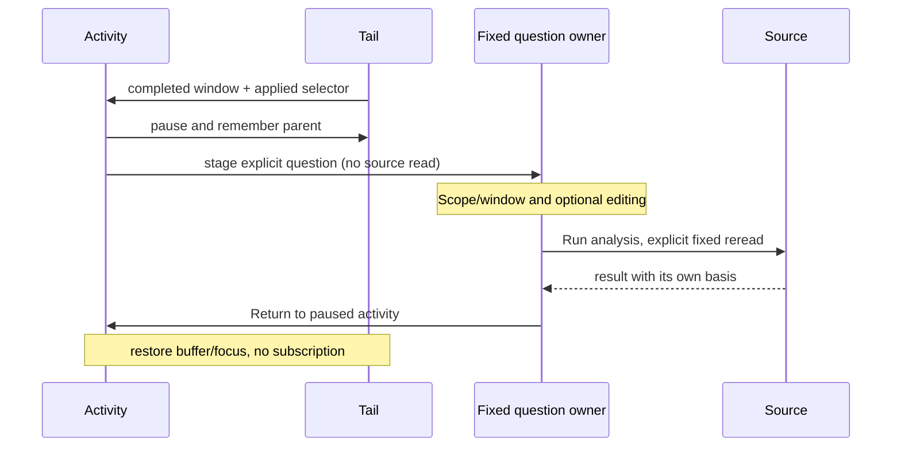

# Activity → fixed analysis

Implemented bounded continuation from the 2026-10-22 whole-product reviews.
This changes the handoff, not the record query, capture or tail protocol.

**Investigate → Analyze this scope/window** stages the applied live selector and the last
completed source-read window. It requires applied filters/environment and works
when that completed window contained no rows. It never constructs a window from
record timestamps or the current clock. A new scope clears the previous window.

The inspector's **Analyze this observation window** retains the selected record's
original source window and its current staged filter draft. These are deliberately
different choices: scope analysis uses applied filters; record analysis supports
refining the held observation before a fixed reread. Neither claims the later
query will reproduce the held page or preserve that observation.

The fixed continuation shows the signal, environment, selector and UTC window,
with **Run analysis** and **Edit analysis**. Editing disclosure makes no source
request. Successful execution changes the primary action to **Rerun fixed window**.
Shared fixed-question links use neutral staged-question wording rather than
claiming an investigation from Activity is a restored shared question.

**Return to paused activity** restores the parent buffer, scroll and focus without
resubscribing. Existing fixed drafts remain in the bounded in-memory trail;
returning suspends a running fixed owner and rejects obsolete completions.
The same Investigate menu opens the retained fixed editor through **Build fixed
question**. Rolling configurations live in Views. [Navigation and focus
contracts](ACTIVITY_NAVIGATION.md) keep these entrances separate; a separate blank
New question flow remains outside this cut.

## Ownership

`GooTail.snapshot()` supplies the last completed 60-second window, cleared on
scope reset. `GooStreamEntry` owns the continuation and parent anchor.
`GooInvestigationTrail` retains independent fixed visits; `GooExploration` owns
fixed execution. Web components remain passive. No new API, custody promise,
process-global scope store or execution framework is introduced.

## Acceptance

[Journey 115](../journeys/activity-analysis.spec.js) uses real ordinary OTel logs
and an empty span scope. It checks applied/draft refusal, exact read bounds and
selector, zero telemetry reads/publication while staging or disclosing edits,
one explicit read, mobile containment and source-free paused return/focus.
[Staged mobile view](journeys/screenshots/115a-staged-activity-analysis.png) ·
[Fixed result](journeys/screenshots/115b-fixed-activity-analysis.png).

Existing journeys 104–106 and 49 protect staged empty-value filters, delayed
completion, retained drafts, record presentation and shared-link history. Their
observed ledgers retain existing Go/Quint validation where applicable.
[Bombadil actions/invariants](../verification/bombadil/activity-analysis.ts)
exercise staging, editing disclosure and paused return; Playwright accounts for
network effects. Runtime validation scope and actual outcomes are recorded in
[VALIDATION.md](../VALIDATION.md); a storyboard does not claim all checks ran.
