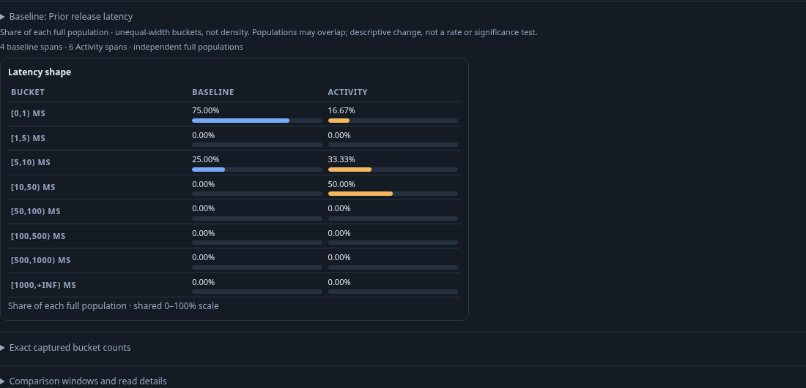
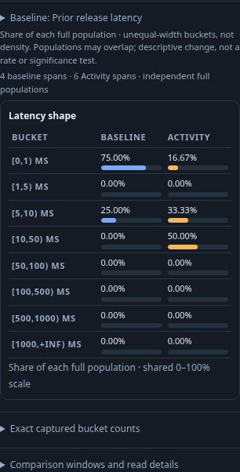
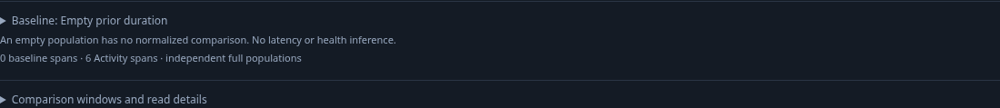

# Captured baselines for Activity latency

Open the optional span latency panel, then **Baseline**. Load a page of saved
duration captures and choose one, or paste a capture link from this workspace.
The catalog uses existing 20-receipt pages and explicit Next; opening the
Baseline disclosure itself does not read anything. Catalog and capture GETs read
stored evidence only. A saved Activity view is configuration, not a captured
population, and cannot silently become a frozen baseline.

Candidates must be raw-span captures grouped solely by `column:duration_bucket`.
Loading validates the exact returned receipt ID, original question, source-read
metadata, native state, bucket identities and full group accounting. Captures
without complete duration groups, native metric histograms, numeric transforms,
changed-between-reads results and mismatched receipts are refused. Record pages
cannot reconstruct missing full-population buckets. Empty captured populations
remain usable as explicit no-data, without a normalized shape or health inference.

A chosen baseline is a detached immutable captured result. Each successful
Activity latency read supplies the other side to the existing Go `/compare`
operation. That operation calculates over supplied complete counts; it never
queries telemetry. Comparison outputs are checked against both original counts,
bases and individual bucket populations before display. Existing passive
comparison histogram/context components render readable paired bucket rows on a common
0–100% scale, with exact counts in a disclosure. Percentages describe each full
captured population, not inspection pages, probability density or traffic rates.
Neither baseline time bounds nor predicates are rewritten to match Activity.

Both sides retain their independent fixed windows and source-read times; the
baseline also retains its immutable custody clock and exact receipt ID. Compact
counts have a tooltip with both exact dated UTC windows/read times. The context
disclosure includes each selector and basis. Different selectors or window
lengths are called out; source completeness and overlap remain unverified.
The existing comparison contract requires the same environment and distribution
field. It does not infer equivalence between different selectors or OTel profiles.

Activity's explicit manual/10/30-second cadence continues to own source reads.
The baseline comparison adds no monitor or timer. Opening a catalog, choosing,
clearing, retrying a failed comparison or switching baselines cannot read telemetry.
At the start of a new Activity read the old comparison is withdrawn, so a pending
comparison cannot appear current beside a newer histogram. A slow stored-receipt
load and current-window refresh have independent generations; the receipt can
finish against the latest successful Activity result. Scope edits, hiding,
leaving, pause/disposal, and newer explicit baseline choices cancel stale work.
An old response cannot restore a cleared or replaced baseline. The selected
receipt stays pinned across scope changes; incompatible environments refuse a
comparison until a suitable baseline is chosen or cleared.

**Capture this window**, inside Baseline, pauses Activity and opens the existing
capture dialog. Confirming explicitly rereads the displayed fixed question and
stores a new capture; it does not freeze the browser snapshot verbatim. Cancel
publishes nothing. Saved view/capture formats, retention membership and OpenAPI
operations are unchanged. Panel/cadence choices remain tab-local. The selected exact capture reference can now be persisted in an [Activity view](SAVED_ACTIVITY_BASELINE.md); reopening does not start or resolve it.

```mermaid
sequenceDiagram
    participant User
    participant Activity as Activity latency owner
    participant Baseline as Baseline comparison owner
    participant Store as Immutable capture store
    participant Source as Go / ClickHouse
    participant Compare as Existing Go comparison
    participant Display as Passive shared displays
    User->>Baseline: Load catalog / choose capture or paste link
    Baseline->>Store: GET captured evidence
    Store-->>Baseline: Receipt, full groups, original clocks
    User->>Activity: Refresh or opt into cadence
    Activity->>Source: Applied selector, completed 60-second window
    Source-->>Activity: Full duration distribution and read time
    Activity->>Baseline: Supplied successful Activity result
    Baseline->>Compare: Frozen groups + Activity groups
    Compare-->>Baseline: Validated accounting and normalized shares
    Baseline->>Display: Aligned bins and independent scope metadata
    User->>Baseline: Clear or replace
    Baseline->>Baseline: Cancel obsolete publication; no telemetry read
```

Storyboard 156 ingests ordinary OTLP spans into real ClickHouse. It captures
four prior spans, then demonstrates that a late source arrival changes that
window to five while the saved baseline stays four. The Activity side advances
from five to six at an actual 10-second cadence. It checks source-free selection,
unchanged stored bytes, both clocks, shared bin geometry, no-data, selector/window
differences, late comparison after Clear, receipt replacement via capture link,
negative comparison transport failure/retry and capture-dialog cancellation.
Hegel generates counts above 2^53 across Go/JS; quint-go replays observed read and
baseline-choice boundaries with rejecting controls. Bombadil starts a real saved
span stream and exercises load/use/clear while enforcing the source-read budget.




