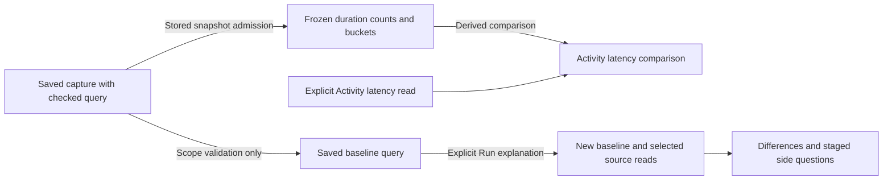

# Saved baselines in a typed Activity scope

322 completes the existing Activity baseline paths for checked environment policies.
It uses the existing capture, duration-comparison and population-explanation models;
there is no new store, endpoint, evaluator or baseline picker.

## Two ways to use the same capture

**Show latency → Baseline** loads a captured raw-span duration distribution as
frozen evidence. Catalog and capture GETs read stored data. The comparison uses
that capture's original counts, buckets, source-read basis and custody clock against
the independently read Activity latency distribution. The derived comparison does
not query telemetry. Late source arrivals cannot change the captured baseline.

**Investigate → Explain this window → Saved capture scope** loads only the
capture's original query. **Run explanation** explicitly rereads both fixed
populations using the saved and selected selectors and windows. Late arrivals can
change the baseline counts in this new explanation. Saved counts are not reused;
the original capture remains immutable. Source-read and custody clocks remain
separate from the explanation's new read clocks.

Both paths accept the same checked environment policy as the selected Activity:
current-only named, effective named, effective present-empty or effective
unreported. A matching literal environment name is insufficient when policies
differ. Empty and unreported are distinct. Namespace and predicate fields stay
qualified and exact; the baseline retains its own fixed window and full selector.

## Shared checks, separate authority

The stored receipt and returned exploration must agree on their canonical query
scope. One shared scope validator checks that relationship, ignoring inspection
paging only. It does not attest counts, rows, source membership or completeness.
The latency path additionally admits the stored source snapshot, validates paging,
duration buckets and whole-population accounting. The explanation path needs only
a checked query because it will read new observations explicitly.

Loading, editing, navigating a staged side question and returning to paused
Activity do not read telemetry. An explicit side-question Run is an independent
read. Explanation filters retain the selected operand's checked policy and exact
window; the shared question-link protocol stages them without a name fallback.
Scope changes, cancellation and retired requests cannot publish into a replacement
visit. Generated capture titles use a bounded default if the full policy label
exceeds the title budget; the saved query retains the full exact scope. No migration or compatibility wrapper is introduced for this prerelease.

See [latency baselines](ACTIVITY_BASELINE.md),
[Activity explanations](ACTIVITY_EXPLANATIONS.md),
[journey](journeys/322-activity-baseline-policy.md),
[architecture](reviews/ACTIVITY_BASELINE_ARCHITECTURE_322.md) and
[design](reviews/ACTIVITY_BASELINE_DESIGN_322.md).
