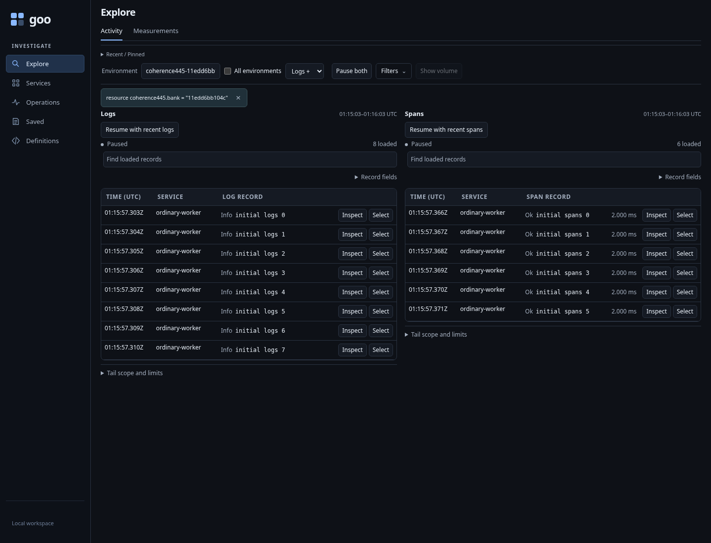
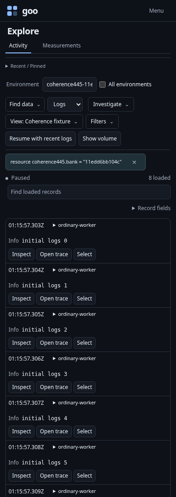

# Activity controls and retained inspection

Logs and spans use the same Find, selection, field picker and record table.
Wide single streams keep Find and field actions on one row. Narrow views and
paired lanes use two stable rows. Tables respond to their available width,
so a half-width span lane still leaves room for its name and duration.

Paused Activity shows its state and loaded count. Open **Tail scope and limits**
for observation and eviction facts; positive evictions and continuity gaps stay
visible. Loaded observations are never presented as population totals.
Inspectors render event time as UTC with the exact timestamp available on focus
or hover, using the same renderer in both modes.

## Start and Return

A paired Start checks both lane owners before adopting a draft. Both selectors
are staged before the first connection opens. If admission is withdrawn, the
parent keeps the draft rather than claiming it has applied. Local admission is
not a promise that either source request will succeed. Source outcomes remain
independent per lane.

Inspect reads held data. Analyze stages the original fixed window; Run remains
explicit. Return restores the paused records and keyboard focus without a source
read. Resume starts a fresh recent window.

## Exercised storyboard

The [browser journey](../journeys/activity-coherence.spec.js) sends real OTLP logs
and spans, independently checks their stored identities, then exercises:

1. Recall a single-stream definition; Start explicitly.
2. Pause, Inspect, keyboard-activate Analyze, then Return to the same held bank.
3. Stage Logs + spans without reading, then Start both lanes.
4. Repeat inspection and Return with both lane windows retained.
5. Fill the real four-stream server limit. Refuse one resumed lane while its
   sibling retains its connection; release a slot and resume successfully.

The existing paired journey also checks an unavailable family, late completion,
shared-filter refusal, and saved-single-view adoption. Its Bombadil actions and
native Quint trace gate continue to run against the same owners.

[Independent acceptance](reviews/ACTIVITY_COHERENCE_445_ACCEPTANCE.md) covers
architecture, interaction semantics and the refreshed layouts.

## Measured comparison

Compared the embedded 444 binary with 445 using the same fixture sizes, paused
state, applied scope, columns, and viewport sizes. These are browser geometry
measurements, not performance benchmarks.

| Viewport | Single: first record moves earlier | Paired: first record moves earlier |
| --- | ---: | ---: |
| 1440 px | 0 px | −36 px (stable two-row controls) |
| 390 px | 25 px | 25 px |
| 320 px | 43 px | 25 px |

On desktop, the paired span name receives about **147 px instead of 38 px**.
No document overflow occurred at any measured width. Narrow paired lanes remain
stacked; this does not imply both streams are simultaneously above the fold.

Cold single Start used one connection and one log SQL request. Cold paired Start
used two connections and one SQL request per family. Staging, local inspection
and retained Return added **zero connections and zero source SQL requests**.
The real capacity response remained HTTP 429 with automatic retry; its visible
message now says it will reconnect in two seconds. No capacity or polling policy
was changed, and no readiness cache was added.
