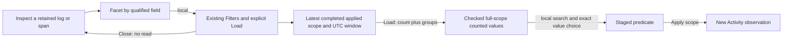

# Facet from an inspected Activity field

In Activity, inspect a log or span and choose **Facet by…** on a categorical field.
Goo reveals that qualified field in the existing Filters surface and focuses
**Load values for this scope**. Entry, disclosure and focus are local. Load is the
explicit source operation; it reuses the existing counted-values API and controls.

The preview names the **latest completed Activity window** in UTC. An inspected
buffered record may come from an older window; the preview says when they differ.
The fixed lookup preserves the applied environment policy, full predicate and
qualified field namespace. A resource field and an attribute with the same key
remain separate. Buffer observations discover fields; they do not supply the
lookup's population counts.

Loading pauses Activity and reads independent full-scope count and group
aggregates. Counts must conserve the whole population. Missing keys and present
empty strings stay distinct. Search filters the loaded values locally; choosing
one stages a predicate. **Apply scope** explicitly starts a new observation.
Neither selecting a field nor staging a value automatically reads telemetry.

Closing Filters returns to the original field action while that inspector/scope
lease remains current. After a staged scope change, focus goes to Apply scope.
The existing inspector and observations remain held; this is not a new workspace
or saved evidence. Reentering Facet by withdraws the previous counted result and
cancels its pending read without acquiring another result.

The shared attribute renderer only emits field intent. The filter editor owns
supplied controls, disclosure and local selection. Activity supplies the current
owner/window lease; the existing counted-values owner acquires and validates
source data. A late result cannot restore a retired field or changed scope.
Hidden, disabled, inert and stale entry/load/stage controls refuse invocation.

Counted values require categorical string fields. Numeric columns use existing
numeric exploration instead. Long observed strings can identify a field even
when a particular value cannot become a predicate. Unsupported returned values
remain visible but cannot be staged. Existing bounds remain: at most 1,000 groups
and a fixed window no longer than 120 minutes; these are captured-record counts,
not sampling completeness or service health.

[Storyboard](journeys/activity-facet-entry.md),
[independent review](reviews/ACTIVITY_FACET_ENTRY_REVIEW_421.md), and
[validation](../VALIDATION.md) record actual checks and their limits.
