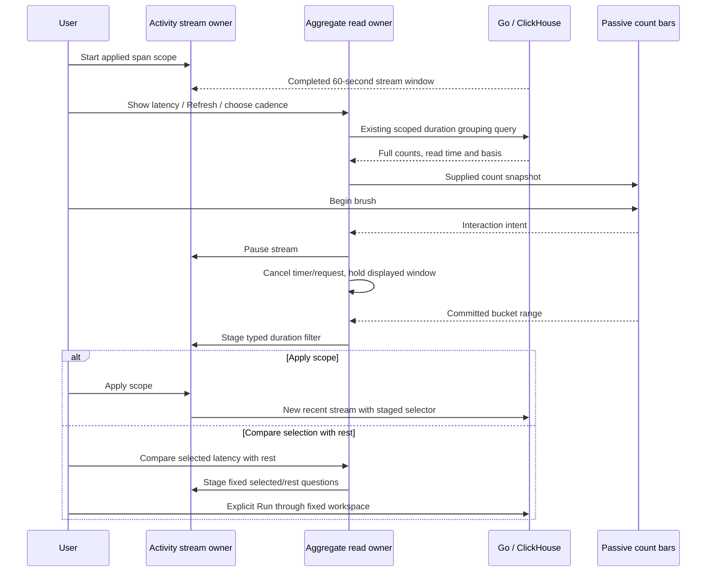
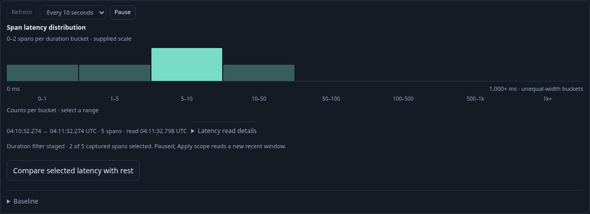
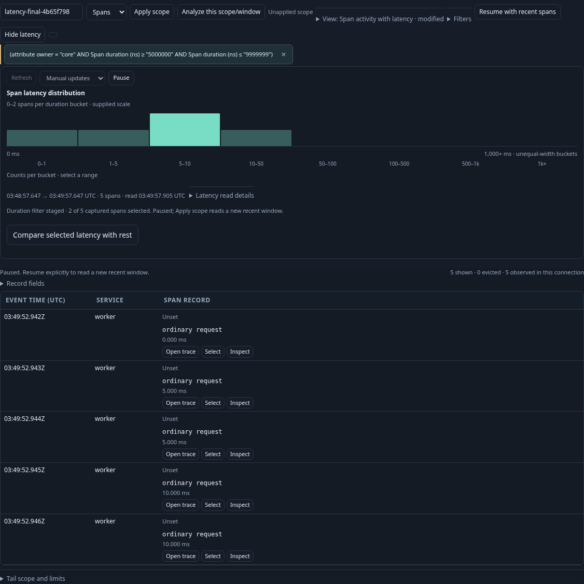
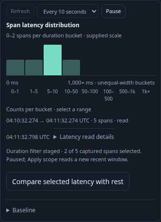

# Optional latency in Activity

Span Activity has a compact **Show latency** action. The panel is off by default;
fresh entry, saved-view reopening and ordinary stream batches add no aggregate
read. Opening loads once over the applied selector and latest completed 60-second
stream window, using the existing duration-bucket grouping route with a one-row
inspection limit. Its full grouped count is independent of the held stream buffer.
Logs do not offer a raw-span latency panel.

Choose Manual, Every 10 seconds or Every 30 seconds. Choosing a cadence schedules
the next read; it does not immediately issue another query. Refresh explicitly
reads now and can restart the selected cadence when the stream is running. One
owner serializes reads. A slow response does not overlap the next scheduled read.
Pause latency pauses aggregate updates independently of the stream. Closing,
editing scope, pausing the stream, hiding the document, changing modes, leaving
Activity or disposing the owner cancels pending/scheduled work. Updates resume
explicitly. Opening the saved Activity configuration stays source-free until Start.
The latency panel/cadence is ephemeral and is not stored in Activity view records.

The histogram uses the existing passive supplied count bars: eight unequal-width
span-duration buckets, count heights rather than density, keyboard range intent
and pointer capture. On first interaction both stream and aggregate updates pause.
A committed brush replaces the staged duration range relative to the displayed
histogram's original applied selector; it does not accumulate earlier brush bounds.
Apply scope starts a new recent span stream with those typed predicates. The held
histogram is withdrawn when the applied selector changes. Other draft edits also
withdraw it. Invalid or over-budget predicates remain refused.

Compare selected latency with rest freezes the histogram's UTC window and stages
a fixed disjoint pair through the existing Activity continuation and population
workspace. Run population view performs the separate source reads. Parent
predicates, environment and full window remain intact. Returning to paused
Activity adds no source read and keeps its duration draft available for Apply.
Existing fixed-view save and capture actions own reuse and durable evidence.
The chart itself is an ephemeral observation, not a row-membership receipt.

The visible window and source-read UTC clocks remain separate. Compact clock
labels have exact dated timestamps in their tooltip/disclosure. Counts derive
from full grouped measurements; held stream counts describe buffered occurrences.
The group/count/row reads are independent and completeness remains unknown.
Changed-between-reads or invalid responses cannot produce a selectable chart.
No-data displays unavailable latency, never a healthy/zero-latency inference.
Failures stop recurring updates and require explicit retry; stale responses cannot
repaint a changed draft/scope. Native OTel histograms retain their own semantics.

Executable storyboard 155 uses ordinary OTLP spans in real ClickHouse. Six spans
are independently counted; the applied parent includes five. It verifies no
aggregate read before opening, one-row presentation/full totals, actual 10-second
refresh, keyboard staging with an 11-second no-read observation, exact 2+3
comparison, paused return, Apply, delayed actual response invalidation, cadence changes during a slow read without overlapping requests, empty
scope, negative transport failure and retry. Bombadil starts a real saved span
view, opens latency and brushes while checking read budgets, pause/draft behavior,
progress, overflow and uncaught errors. Hegel generates ownership state sequences
and compiles query plans in Go. Actual browser navigation replays through the
existing quint-go drilldown model with rejecting controls.

[Captured baseline comparison](ACTIVITY_BASELINE.md) now adds a collapsed Baseline picker, stored-capture/link selection and shared normalized shape comparison to each successful Activity read. It adds no source timer and preserves the selected capture unchanged. Capture this window opens the existing explicit reread-and-save dialog.

An optional [saved baseline reference](SAVED_ACTIVITY_BASELINE.md) now accompanies Activity view scope/layout. It resolves only after explicit Start and Show latency; panel/cadence remain ephemeral and old views retain their original IDs.
