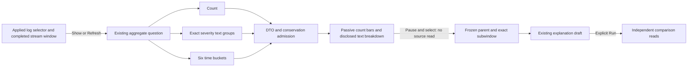

# Log volume in Activity

Status: delivered, with real-source validation and independent acceptance.
Milestone 413 adds an optional compact log context strip to the existing Activity
stream. Span latency keeps its separate meaning and presentation.

## Operator flow

Start a log stream, then choose **Show volume**. The strip measures the last
completed 60-second stream window, with six ten-second count bars, a captured
log rate, and a disclosed **Severity text** table. The retained stream buffer is
not the denominator. Opening Activity or a saved Activity configuration does not
read these aggregates automatically.

Refresh is explicit. Manual, 10-second and 30-second cadences use the same bounded
read mechanism as optional span latency. Selecting a cadence schedules its next
read rather than issuing an immediate request. Reads never overlap. Interaction
pauses automatic updates and the stream before selecting a time interval.

**Explain interval** stages the existing population explanation with that exact
interval and an adjacent preceding comparator. It does not query or save data.
Run explanation remains a separate explicit source operation. The selected bounds
come from the displayed aggregate, even if the stream has since completed a newer
window. The new entry focuses the explanation; Close returns to its volume action.

## Semantics and bounds

- One existing `/api/record-aggregates` request reads count, exact severity-text
  groups and overall time buckets: **three aggregate SQL statements**. It reads
  no record page or field inventory and introduces no endpoint or evaluator.
- The question preserves the applied signal, typed environment policy and complete
  predicate, including OR, empty values and numeric-severity conditions. Only its
  fixed source window/projection are chosen for this measurement.
- `column:severity` is literal producer **SeverityText**. Empty text, case and
  whitespace remain distinct. SeverityNumber remains independently available in
  record fields and filters; there is no number-to-text fallback or inferred error
  classification. Empty stored text does not prove whether the producer omitted it.
- Groups cover the full queried window, not a per-bucket severity stack. Volume
  bars cover all matching log records per ten-second bucket. Counts, groups and
  buckets are separate observations; disagreement is non-actionable. More than
  1,000 text groups fails rather than producing a truncated legend.
- Captured rate is exact count/window arithmetic, rounded only for display. It
  does not establish unsampled application throughput, pipeline completeness,
  statistical anomaly significance or service health. Zero remains no captured
  records; unavailable data is not zero.
- A gesture cancels a pending refresh while retaining its last admitted snapshot.
  Late responses cannot replace a selected interval. Scope edits, hiding,
  departure and disposal retire pending work; failure stops recurring updates
  and requires explicit retry. Stable paused manual reads remain usable.
- The shared `aggregate-read-gate.mjs` is a pure token gate used by both optional
  readers. Application adapters own queries, timers, selection and navigation;
  `goo-time-bars` consumes supplied data and emits intent only. Its old render's
  bar callbacks cannot acquire a replacement plot's identity.

## Verification

The [executable storyboard](journeys/activity-log-context.md) and
[two browser journeys](../journeys/activity-log-context.spec.js) pass against real
OTLP/ClickHouse data: the log workflow includes a 30-second Bombadil campaign;
a second journey checks nonempty span latency after the shared-gate extraction.
Actual [desktop](journeys/screenshots/activity-log-context-1440.png),
[390px](journeys/screenshots/activity-log-context-390.png) and
[320px](journeys/screenshots/activity-log-context-320.png) frames document the strip.

[Isolated verification](../verification/activitylogs/README.md) checks 64 generated
projections and 60 actual shared-gate commands per seed against independent Go
arithmetic/state oracles, strict Quint protocol rules and the actual browser
read ledger. Source-failure, stale timer/control/chart callbacks, pending-refresh
selection, pointer/keyboard interaction, exact old-window explanation and held
return also have focused owner/browser checks.

The [independent review](reviews/ACTIVITY_LOG_CONTEXT_REVIEW_413.md) records the
reviewed scope and limits; [validation](../VALIDATION.md) records actual outcomes.
Configuration and ephemeral aggregate display are not immutable captured evidence.
