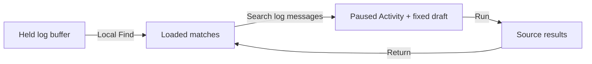

# Search stored log messages from Activity

Enter text in **Find loaded records**, then choose **Search log messages** to
stage a fixed source query. The action appears beside Find after a successful
log poll. The visible UTC interval is the latest completed 60-second event-time
window, including its start and excluding its end.

| Interaction | Meaning | Source read |
| --- | --- | --- |
| Find loaded records | Case-insensitive literal match across loaded text, IDs and chosen fields | None |
| Search log messages | Stage case-sensitive literal Body search in the displayed window | None |
| Run | Execute the staged question against stored logs | Explicit |
| Return to paused activity | Restore held rows, Find, columns and selection | None |

The source search preserves the exact typed text, including spaces, punctuation
and Unicode. It is not a regular expression or SQL pattern. An ID-only local
match can produce zero source-message matches. Case differences can also produce
fewer results. Counts belong to the source query; loaded-match counts describe
only the local buffer.

The applied environment policy and entire original predicate remain in scope.
The message condition is added with AND; an existing OR subtree is preserved.
This action neither widens the window nor removes filters. The ordinary fixed
editor lets you review or edit the question before Run. A later Run can observe
late arrivals in that same fixed event-time window.

Search requires a clean applied log scope, nonempty supported text and a completed
poll. A failed or reconnecting source has no current completed poll, even if old
rows remain visible. A limited successful poll can stage a query: this does not
claim the loaded rows are complete. Unsupported terms or predicate budgets leave
local Find available without offering a source action. Spans have no Body action.

## Ownership and implementation

`tail.mjs` owns Find text/revision and lightweight observation metadata.
`activity-search.mjs` validates a detached ordinary record question and owns the
native staging control. `stream-entry.mjs` owns dirty-scope, navigation and paused
return. Display components never fetch or subscribe.

The action rechecks native visibility and its term, scope epoch, connection and
completed-read revision before and after synchronous pause. Retired callbacks
cannot adopt a different term, poll or unapplied scope. A refused handoff restores
the paused parent and focus. Only the existing fixed executor reads source data.

See the [executed storyboard](journeys/activity-search.md) and
[validation record](../VALIDATION.md) for coverage and limits.
