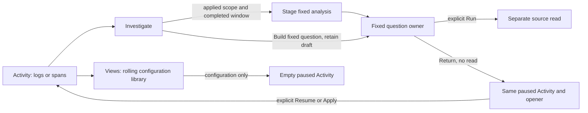
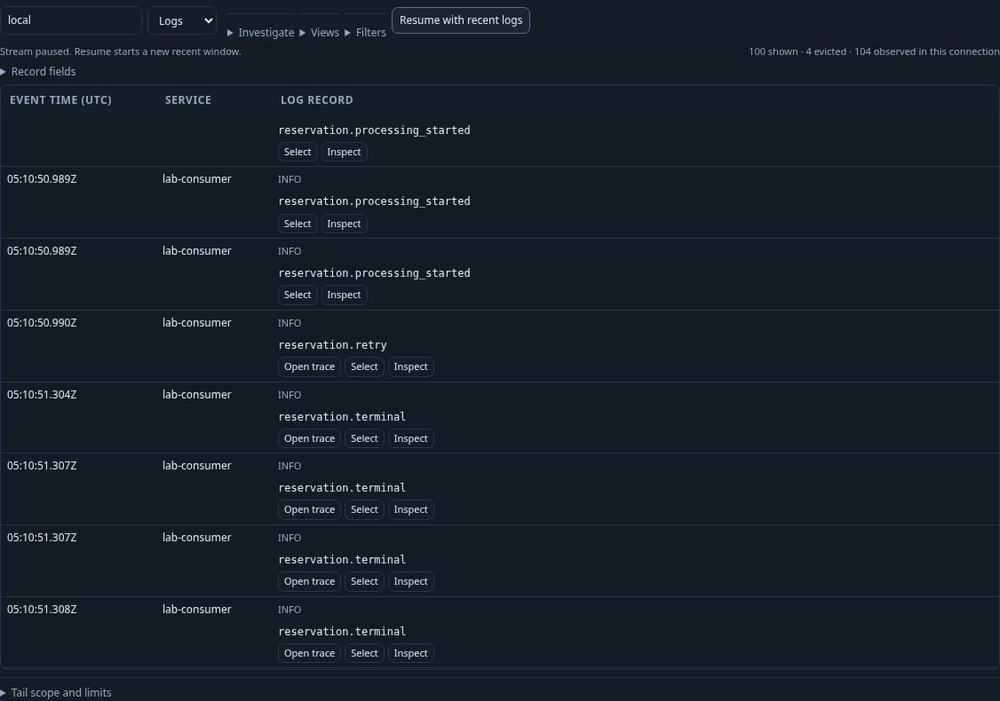
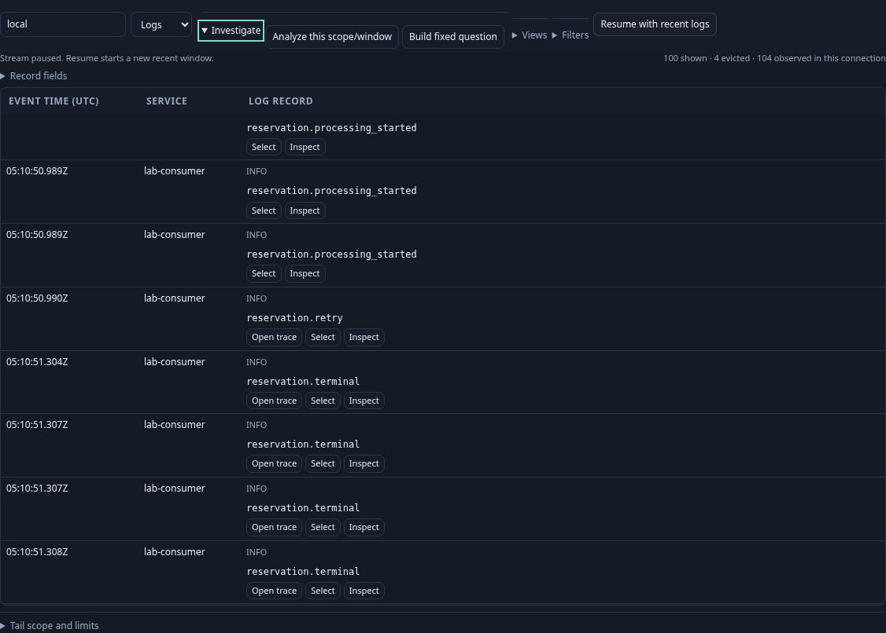
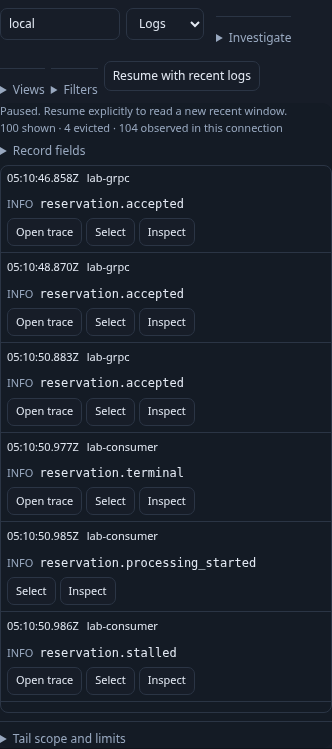

# Activity navigation

Activity has one **Investigate** menu for fixed-question work and one **Views**
menu for rolling configurations. Both are folded initially so logs/spans remain
the main canvas. The old below-stream “Question tools and saved views” entrance
is removed from the live layout; the fixed owner remains independently mounted
only when requested.

Investigate offers two distinct intents:

- **Analyze this scope/window** stages the applied selector and last completed
  source window. It stays unavailable before a completed read. Run remains explicit.
- **Build fixed question** opens the existing fixed editor, retaining any earlier
  draft. It pauses Activity and remembers the Investigate opener without querying.

The record inspector still offers **Analyze this observation window** because a
held record's original read window and staged filters can differ from the current
applied stream. These windows are never inferred from row timestamps.

**Return to paused activity** restores held rows, draft filters, inspector and
scroll without resubscribing. Returning from the generic editor focuses
Investigate; returning from scope analysis focuses its Analyze action; returning
from a record continuation restores the record opener. Reopening the editor
restores its same in-memory draft. Resume, Apply and Run remain explicit reads.
Existing fixed/shared links retain their source-free staging behavior.

## Flow and ownership

`GooStreamEntry` owns the menu and transition. It hides the old editor container
while Activity is enabled, then pauses and remembers the parent before asking the
existing fixed owner to resume. Passive components do not navigate or fetch.
The record and definition-library inspectors are separate owners; browser and
Bombadil selectors address the record inspector directly rather than accidentally
selecting the folded saved-view inspector.

## Executable storyboard

1. Arrive in Activity: no fixed editor, folded Investigate/Views, bounded monitor.
2. Open Investigate with the keyboard. No additional source read or fixed editor
   appears until an action is selected.
3. Build a fixed question; edit its environment, then return. Activity stays paused
   and focus returns to Investigate.
4. Repeat the keyboard action. The same editor and draft return without a read.
5. Alternatively analyze a completed Activity window; explicitly Run, then return
   to the held stream with its original selection and scroll.

[109](../journeys/lazy-authoring.spec.js) exercises keyboard entry, draft identity,
paused return, mobile layout and shared-link staging against the local lab.
Its observed Quint trace uses the existing entry model with four relevant
rejecting controls: hidden reads, duplicate automatic start, over-budget retention
and unexpected queries. It does not claim Resume coverage; the existing entry
and paused-return journeys retain that control. A 25-second Bombadil actor opens,
edits, returns, reopens and verifies the retained draft with no source execution.
The Hegel entry-intent state/swarm check still exercises the actual JavaScript gate.
Actual run outcomes are recorded in [VALIDATION](../VALIDATION.md).

Activity now uses the [compact mobile record layout](COMPACT_MOBILE_RECORDS.md),
with UTC/service together and inline row actions. The navigation and parent
transition remain owned by the stream adapter.
