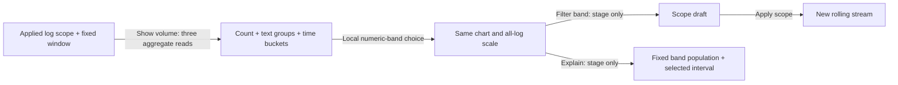

# Numeric severity in Activity

Choose **Show volume**, then use **Numeric severity** to inspect a band over the
held log window. Counts cover the full queried population, independently of the
100 records retained by the stream. Changing the selected band is local: the
existing six time buckets replot supplied counts on the same all-log scale.

| Band | OTel SeverityNumber |
| --- | --- |
| Trace | 1–4 |
| Debug | 5–8 |
| Info | 9–12 |
| Warn | 13–16 |
| Error | 17–20 |
| Fatal | 21–24 |
| Unspecified | 0 |
| Invalid | Above 24 in the exporter's unsigned column |

The option labels include exact whole-window counts, including zero. The chart
and rate describe the selected numeric band; they do not infer application health.
**Severity text** remains a separate, exact producer-text breakdown. A log whose
text says `FATAL` and number is 9 belongs to Info. Storage represents omitted and
explicit zero SeverityNumber as 0, so Goo cannot distinguish them afterward.

## Follow a band

- **Filter Error** (or another selected band) stages an exact numeric condition
  inside the whole applied parent predicate. **Apply scope** reads a new rolling
  window; it does not modify the held observations or filter by SeverityText.
- **Explain window** uses the selected band's fixed window. A chart selection
  narrows that band's event-time interval for **Explain interval**. Explanation
  reads remain explicit in the existing explanation UI.
- **Refresh** rereads the volume window explicitly. Optional cadence retains the
  existing visibility, pause and scope gates. Choosing a band freezes updates and
  pauses Activity for inspection.

Parent OR conditions are retained as an AND subtree. An exceeded predicate budget
disables Filter/Explain for that band while leaving local count inspection usable.
Dirty scope, hidden/retired controls and replaced reads cannot stage another band.

## Data contract

The ordinary record grammar accepts `logSeverity: true` for logs without numeric
measurement/histogram or split-series projections. A supplied summary contains
canonical uint64 decimal strings:

```yaml
logSeverity:
  count: "8"
  trace: "1"
  debug: "1"
  info: "1"
  warn: "1"
  error: "1"
  fatal: "1"
  unspecified: "1"
  invalid: "1"
```

Activity requests that projection together with its existing exact SeverityText
groups and 10-second buckets. The same three source reads return overall, grouped
and temporal summaries; band changes add no read. Every summary must partition its
own count. Each band must also conserve across groups and time buckets. Equal
grand totals with different band distributions are `changed_between_reads`, not an
actionable snapshot. Empty intervals contain all-zero summaries.



Source read clocks remain independent. Agreement is checked, not proof of a
transactional snapshot, unsampled traffic or complete ingestion. Ordinary raw
exploration, captures and measurement packages preserve this projection. Generic
view datasets and count-cohort/rate consumers do not yet admit it; unsupported
continuations withdraw or refuse explicitly. Filter/Explain continuations use
ordinary record predicates and remove the aggregate-only projection flag.

The explanation handoff names a closed numeric band separately from its ordinary
parent/selection questions. Its owner reconstructs the expected original scope
AND that band and validates exact equality, rather than accepting arbitrary
replacement selectors. The held time guide counts only matching reported numeric
values; missing or malformed values do not become unspecified or invalid logs.
The shared log-row adapter supplies physical `SeverityNumber` independently of
the optional canonical `severity_number` derived field. Source readiness requires
the exporter's UInt8 column, and deterministic row ordering includes its value.

See the [storyboard](journeys/activity-severity.md), [API](API.md) and
[validation](../VALIDATION.md).
