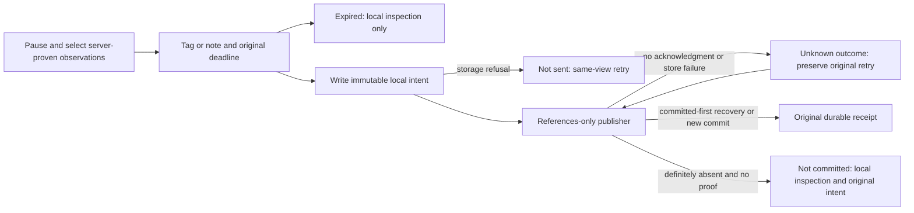

# Bounded Activity retention acceptance

This cut closes S3/F1 for up to 20 server-proven log/span observations. It preserves
the existing distinction between local inspection, a new source read, ephemeral
membership and durable evidence. See [custody and API flow](TAIL_SELECTION_CUSTODY.md).
It does not introduce a distributed membership store or physical event identity.

## Interaction and failure contract

Nothing is added above the stream before selection. Select pauses, and the held
selection reveals one retention action with tags/note disclosure. A tag or note is
required by the existing meaning contract; the UI explains this before submission.
Rows with unavailable or expired proof retain Inspect, with a compact explanation
below the stream. An expired selected row can still be removed locally.

| Observed state | User-facing behavior |
| --- | --- |
| Configuration being checked | Saving waits; no store-health inference. |
| Retention unconfigured | Local inspection remains available; Check retention only rereads configuration. |
| Configuration request unavailable | Distinct from unconfigured; Check retention explicitly retries that check. |
| Selection proof expired locally | A new save is disabled. Inspection and Clear selection remain usable. |
| Journal cannot be written | “Save was not sent”; same-view retry remains, without promising a Saved retry. |
| Save has no acknowledgment / storage transport fails | Commit outcome stays unknown. Original intent is journaled and edits stay locked. |
| Submitted intent reaches local expiry | Retry stays available and sends exactly the original references, ID, tags and note. The server decides whether it committed or proof remains valid. |
| Server returns 410 after a definitely absent request | Explicitly not committed; observation proof expired or is unavailable. Original local intent is kept. |
| Changed intent conflicts / invalid intent is refused | The status policy distinguishes conflict/refusal from transport uncertainty. No rewrite or new automatic request ID. |
| Save acknowledged | Original receipt identity is linked. Periodic expiry updates preserve that link and keyboard focus. |

The shared pure `GooRetentionStatus` policy formats native save failures for both
Activity and Saved recovery. `GooRetentionClient` preserves HTTP status and whether
a request was attempted, without changing journal bodies or v1 receipt formats.
Neither the policy nor display components fetch, subscribe or publish. Activity
still owns selection, configuration and intent lifetime. Completion from an old
selection generation cannot replace a newer selection's status. Keyboard focus
returns to the retry button after a failure, to the evidence link after success,
and to Inspect when clearing a selection whose Select control has expired.

## Executable evidence

Journeys 140–145 use an isolated instance of the actual Go CLI and Python server,
with actual OTLP records independently checked in ClickHouse. A disposable TCP
forwarder interrupts only that instance's XTDB connection. Capacity is exhausted
by 64 genuine source-poll/SSE issuances in its own bank. Restart runs the same Go
CLI with an empty process-local bank. There are no production test endpoints,
fabricated SSE frames, successful UI response stubs or client-supplied records.

- 140: browser-clock expiry, no publication, continued inspection, mobile layout
  and keyboard focus after clearing expired selection.
- 141: actual unconfigured server, failed configuration-check transport and explicit
  recheck. The failed GET alone is a negative browser transport injection.
- 142: actual database transport failure returns 502; expiry of the browser's local
  deadline does not block retry; restored transport commits the unchanged intent
  without telemetry rereads. The server clock remains real, so this specifically
  verifies browser expiry versus submitted retry, not acceptance of expired server proof.
- 143: browser journal quota failure sends no publication and promises no Saved retry.
- 144: real issuance capacity refusal keeps records inspectable; Bombadil exercises
  the unavailable stream without publication or generated workload.
- 145: actual Go restart loses uncommitted proof; real 410 is distinguished from
  unknown outcome. Saved retries the identical request with mobile keyboard focus.

Existing journeys 66, 138 and 139 cover late duplicates, FIFO eviction, reconnect,
exact retained presentation, pinned correction/review and commit/response-loss
recovery. Native tests/Hegel cover mixed-poll provenance, server-clock expiry,
capacity/bytes and canonical exact records; these are not claimed as browser-clock
proof. The observed 142 ledger is replayed through Quint with rejecting controls
for false 410, hidden reads, blocked submitted retry, changed references and a
publication count before acknowledgment. Conflict/refusal formatting has focused
unit coverage; a browser concurrency-conflict campaign remains outside this cut.

Run `playwright test journeys/tail-acceptance.spec.js` with the normal Go/Quint
verification environment and running OTLP/ClickHouse/optional XTDB lab. The helper
builds a temporary Go binary unless `GOO_TEST_BINARY` is supplied. Owned servers,
forwarder sockets and temporary stores are closed in `finally`; telemetry/evidence
volumes are preserved. Actual commands/results are in [VALIDATION.md](../VALIDATION.md).
