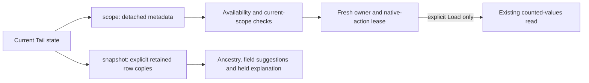

# Activity scope snapshots

Milestone 423 removes repeated copying of the retained Activity buffer from
scope-only checks. The mounted Tail owner’s `scope()` returns detached current metadata: selector,
window, phase, connection and display-state facts. `snapshot()` still
explicitly copies retained rows for inspection, observed-field discovery and
held Activity explanation.
There is no new source read, cache, persisted format or global action registry.

Activity now asks for rows only where it consumes them. Availability and current
scope/lease checks use fresh metadata; they do not turn a render-time observation
into permission to invoke or complete an operation. The owner still enforces its
current generation, inspector containment, clean scope and native action guards.



## Measured result

The same actual Activity workflow ran before and after adoption with 100 retained
OTLP logs. The wide fixture adds 48 string attributes per record. All local steps
retain zero source acquisitions and SQL reads; each explicit counted read retains
one acquisition and two SQL reads.

| Fixture / interaction | Row copies before | Row copies after | Synchronous time before → after |
| --- | ---: | ---: | ---: |
| Normal: inspection, median of five | 5,200 each | 200 each | 150.0 → 61.2 ms |
| Wide: inspection, median of five | 24,400 each | 200 each | 824.2 → 277.1 ms |
| Normal: contextual facet entry | 2,700 | 0 | 69.0 → 28.9 ms |
| Wide: contextual facet entry | 12,300 | 0 | 466.2 → 325.3 ms |
| Checkbox, search or Clear, either fixture | 200 each | 0 | Individual samples; no latency gate |
| Normal: atomic Stage | 1,600 | 0 | 56.0 → 130.7 ms |
| Wide: atomic Stage | 1,600 | 0 | 81.2 → 117.4 ms |

The two remaining inspection copies of the 100-row buffer serve actual field
suggestion and record-context consumers. Scope-only interaction no longer copies
those rows. Explicit counted reads also drop from 3,400/13,000 row copies to 100,
while preserving their source effects.

These are controlled Chromium samples, not production percentiles or a claim
that every action became faster. In particular, Stage was slower in these runs.
The deterministic result is removal of row-copy work from metadata-only paths;
wall times also contain DOM/layout work and vary with the shared environment.
The normal and wide record JSON encodings were 43,968 and 364,568 bytes. Those
sizes describe fixtures, not V8 physical allocation. No byte serialization or
stack capture occurs inside the timed clone counter.

The 200 inspection copies retain two explicit 100-row consumers: field discovery
and inspector ancestry. Activity explanation is closed in this profile and still
uses full snapshots when it needs held rows. The zero-local-copy budget belongs
to the measured flow, not every possible combination of open surfaces.

The profile covers first, second and repeated inspection, contextual entry,
counted read, checkbox selection, hidden choices, search, Clear and atomic Stage.
The [compact evidence](evidence/activity-snapshots-423.json) retains counters,
timing samples, binary/report hashes and read-effect checks without raw records.
The [profiling journey](../journeys/activity-snapshot-profile.spec.js) can run
against either reviewed binary:

```sh
GOO_GENERIC_BINARY=/absolute/path/to/goo \
GOO_SNAPSHOT_PROFILE_LABEL=candidate \
GOO_SNAPSHOT_PROFILE_EXPECT_NO_LOCAL_ROWS=1 \
  npx playwright test journeys/activity-snapshot-profile.spec.js --workers=1
```

Use a different label such as `baseline` when recording the pre-adoption binary.
Timing remains informational. The default `candidate` label enforces at most 200
item copies per inspection and zero for local non-inspection actions; the flag
can enforce those budgets for another label. Functional owner/data isolation and
live 421/422 behavior are separate acceptance checks in [validation](../VALIDATION.md)
and the [independent review](reviews/ACTIVITY_SNAPSHOT_REVIEW_423.md).
