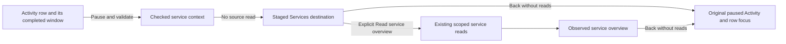

# Open a service from paused Activity

Open a row's **Service actions → Open service** to stage its service context.
The stream pauses and Services shows the observed identity, exact fixed window,
environment policy and a named **Back to paused Activity** action. Opening this
context performs no telemetry read. **Read service overview** explicitly runs the
existing service discovery and observation workflow; supported profiles come from
those observations, not the originating row's signal.

## What carries, and what does not

The context carries the row's reported service name, resource-qualified
`service.namespace`, checked environment policy and that occurrence's
completed read window. A later tail poll must not replace that window. The row's
resource map must be known: absent namespace key and present empty namespace are
distinct; an omitted resource map is unknown, not proof of a missing namespace.
A same-named log attribute never substitutes for the resource namespace.

The source predicate tree remains available under **Activity filters are not
carried**. It is not copied into service queries. Services rebuilds only its own
service/namespace identity predicates within the carried environment and window.
A log-body condition therefore cannot silently become a span predicate, and this
handoff is labelled service context rather than the exact Activity population.

316 delivered the current-only named cut. 318 adds typed effective named, empty
and unreported selection through record service discovery, dashboards and
Customize. The exact selector representation is retained: a legacy name remains
current-only; a typed selector does not become an equivalent-looking string.
Current-key presence wins over the legacy key, including present empty values.
See [service environment policies](SERVICE_ENVIRONMENT_POLICIES.md) for membership
and the explicit unavailable native/entity bindings on other policies.

Unknown resource reporting, empty service name, malformed identity and unsupported
windows still refuse with an explanation in the service menu. They do not fall
back to a broader query. 319 supports typed service gauges through the existing native interface; other
typed native families and entity stores remain outside that capability.

## Return and lifetime

Back before or after Read restores the same paused buffer, row focus and viewport
without a new tail. Cancel returns to the staged context; leaving pending reads
cancels them and prevents late dashboard publication. A replaced source, resumed
Activity, changed selector or retired row invalidates the private return lease.
The continuation is in-memory navigation configuration, not captured evidence,
a saved view or a durable URL. Keep/capture remain separate actions.

See [the actual journey and frames](journeys/316-service-handoff.md),
[scope/source contract](reviews/SERVICE_HANDOFF_SOURCE_316.md),
[architecture review](reviews/SERVICE_HANDOFF_ARCHITECTURE_316.md) and
[interaction review](reviews/SERVICE_HANDOFF_DESIGN_316.md).
