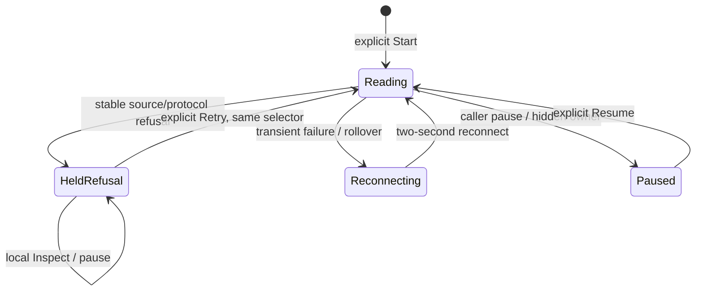

# Recover a failed Activity source

Activity distinguishes a failed source read from a successful read with no loaded
observations. A missing source table, denied access or incompatible exporter schema
shows its specific safe reason and **Retry**. Malformed data/protocol, a known read
or identity budget, and unclassified source HTTP failures also stop for an explicit
new read. Technical details remain in the existing disclosure.

## Retry without losing the held view

Retry reads the **same applied selector**—signal, environment policy and complete
predicates—with a new rolling one-minute event-time window. It is not a replay of
the failed attempt or a fixed historical window. Held observations keep their
original row windows and handles until the first accepted new batch replaces the
buffer. Source failure does not manufacture a no-data result.

Inspect remains local while the source is unavailable. It preserves the refusal,
open Technical details and original rows. Retired, hidden or dirty-scope Retry
callbacks cannot read. If Retry fails again, keyboard focus returns to Retry when
its disappearing stream control owned focus; row or inspector focus is not stolen.
Changing scope still requires the existing Apply/Start action.

## Automatic reconnect is a different state

| Outcome | Recovery |
| --- | --- |
| Missing table, access denied, schema mismatch, known DNS name failure | Explicit Retry after checking the source configuration |
| Malformed response/protocol, read/identity limit, unknown source HTTP failure | Explicit Retry; a narrower applied scope may be appropriate for limits |
| Proven transport interruption or source timeout | Automatic reconnect after two seconds |
| Expected server connection rollover | Automatic reconnect after two seconds |
| Tail capacity/server availability response | Automatic reconnect after two seconds |
| Caller cancellation, hidden view or navigation | No automatic restart; the current owner decides the next explicit action |

A category does not promise that another read succeeds or establish service
health. Known DNS name failure uses structured network metadata; source failures
use HTTP status and ClickHouse exception headers. Goo never interprets database
error prose or shows source URLs, credentials or SQL as a diagnostic.

Unknown or contradictory HTTP/SSE diagnostics stop as a protocol refusal. The
stream must begin with its matching reset; valid frame sequence alone cannot make
a first-frame gap a legitimate rollover. The retry disposition is explicit in the
wire contract and is not inferred from the shared refusal kind.

[Search wider window](ACTIVITY_SPARSE_RECOVERY.md) remains for a **successful**
recent read with no loaded observations. It is not offered after a failed read and
never serves as an automatic workaround for source failure.

[Executable storyboard](journeys/tail-refusal.md) ·
[Source refusal vocabulary](SOURCE_REFUSALS.md) ·
[API](API.md) · [Validation](../VALIDATION.md).
