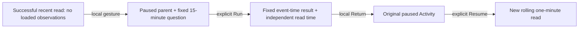

# Search beyond the recent Activity window

A quiet Activity stream can have useful older telemetry. After a successful recent
read leaves no loaded observations, **Search wider window** opens the existing
fixed question for 15 minutes ending at that completed poll. It preserves the
applied signal, environment policy, predicates and record columns.

The click pauses Activity and stages a question locally. **Run** reads telemetry.
The existing fixed editor can adjust the time bounds before Run. **Return to
paused activity** restores the held parent; **Resume** explicitly reads a new
rolling one-minute window.

## What an empty stream means

Activity receives deduplicated observations, not a source population count. An
empty batch can mean that a previous poll already loaded those rows. The recovery
entry therefore requires an empty retained buffer and a completed, successful,
unlimited read. Unstarted, loading, stale, unavailable and partial reads do not
qualify. Pending scope edits withdraw the action.

“No recent observations loaded” is not a claim that ingestion stopped or the
service is healthy. The fixed result reports its own checked population state.
Source refusal remains a failure rather than becoming a zero count.

The recovery window is half-open and uses **event time**. Its end stays fixed at
the last completed poll's end, even if the operator waits before staging or Run.
The source **read time** is separate. A later read can find a late-inserted event
inside the same fixed window; a newer read timestamp does not establish ingestion
freshness. Widening does not diagnose clock skew, bypass retention or include
future-dated records beyond the chosen end.

## Ownership

Recovery reuses ordinary record questions and the existing fixed-query executor.
There is no new endpoint, polling loop or saved format. Staging validates a detached
question, remembers the held parent, pauses and rechecks the owner before handing
it off. Hidden, retired or edited controls cannot stage an old scope. Return does
not restart a stream or substitute a new window for the retained parent.

[Executable storyboard](journeys/sparse-data-recovery.md) ·
[Roadmap](ROADMAP_2026_11_14_CHECKPOINT_430.md).
