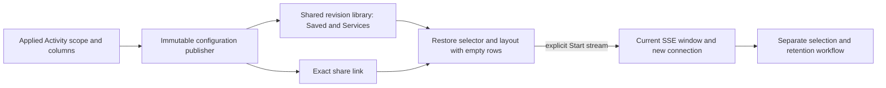

# Reusable Activity views

Activity views save a rolling log/span selector and record-column layout. Open a
view from its exact share link, Saved, or a service's environment-scoped library;
then explicitly Start stream. Opening, inspection, sharing and reload do not read
telemetry. The view contains no fixed time window, observations, totals, read or
custody clocks, membership tokens or instruction to execute.

## Product flow

The compact Activity bar has a **Views** disclosure. After applying a scope, enter
a title and save its environment, signal, predicates, core-column order and up to
eight qualified field columns. Unapplied scope changes block saving. Saving does
not stop or start a source read. The saved link and Copy view link share only an
immutable configuration ID. Subsequent edits produce a new configuration identity.

A reopened view starts with empty rows and a visible Start stream action. Its
selector and columns are restored locally; the first actual read receives a new
connection, current rolling window and optional membership capability. Old held
observations are not restored from a configuration. Existing pending evidence
intents remain in their separate journal. Analysis remains disabled until a read
has completed. Later edits mark the view modified. Opening another view while
scope/title/layout changes are unsaved offers explicit discard or keep-current
controls; delayed view responses cannot replace a different route's draft.

Saved exposes a bounded searchable Activity library using the existing revision
rows and selected inspector. The bar's Browse saved Activity views opens that
library directly. Services exposes the same library filtered by the selected
service's **environment**. This is configuration discovery, not an inferred proof
that an arbitrary Boolean selector matches that service or that data exists.
Service names/namespaces remain ordinary typed OTel resource fields in selectors.

## Contracts and ownership

`workbench.ActivityView` version 1 contains title, `exploration.TailSelector`,
columns and optional field columns. The immutable file publisher, ID hashing,
integrity reads, bounded catalog and existing fixed-view layout validation are
reused. Tail-selector validation uses its existing validation window internally;
that question is never saved or executed. Fixed exploration views keep their
existing shape, IDs, storage and `/exploration-views` contract.

| API | Effect |
| --- | --- |
| `POST /activity-views` | Strict 16 KiB configuration publication, 201. No client execution/custody fields. |
| `GET /activity-views/{id}` | Exact validated configuration, no query parameters; missing/corrupt refuses. |
| `GET /activity-views?environment=…&cursor=…` | Up to 20 configurations; exact optional environment filter and content-ID cursor. |

The Python `/api` proxy forwards these routes with the same 16 KiB publication
limit. No optional XTDB store is required. The list has explicit next/first paging;
search covers its loaded page and does not claim global search or an atomic
catalog snapshot. Identical titles remain distinguishable by revision and scope.

`GooActivityViews` owns configuration reads, library composition and sharing.
`GooStreamEntry` owns draft guards and staged/applied scope. `GooTail.stage` uses the
same local preparation as Start, but creates no connection. Native display
components remain passive. Qualified predicates, including OR/missing/empty
semantics, remain intact as a disclosed saved selector; new Include/Exclude
filters compose with it. Remove saved selector explicitly removes that base.

## Validation and limits

Journey 146 uses ordinary OTLP logs independently counted in ClickHouse, selects a
real field value, reorders/adds columns, saves through the actual Go/Python API,
shares via clipboard, reloads/stages and reopens from Saved and Services. Source
requests remain zero during configuration operations, including mobile and draft
keep/discard. Explicit Start reads the selected recent population. Observed Quint
replay rejects hidden reads, fabricated staged rows, missing Start and unsupported
layout. Bombadil opens/folds view controls while guarding paused/empty staging.
Journey 147 holds an actual committed save response while another view opens,
then verifies the newer keep/discard decision and draft survive its release.
Go checks cover deterministic identity, integrity, rejected execution fields,
unsupported layouts/signals, environment filtering and pagination; Hegel checks
content-bound immutable configuration identity. Actual results: [VALIDATION](../VALIDATION.md).

No mutable aliases, automatic startup preference, arbitrary predicate-branch
editor, service-selector satisfiability inference, access control, durable browser
draft or cross-store evidence search is added by this cut.

Saved predicate trees can now be edited through the shared [Filters
editor](FILTER_EDITOR.md), including AND/OR, missing keys and present-empty
strings. Edits stay staged; invalid input blocks source actions and saving.
