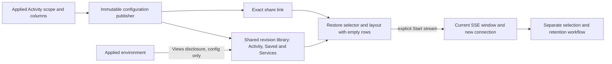
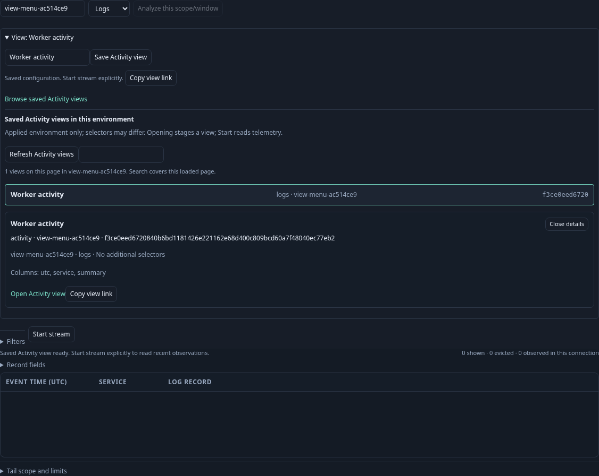
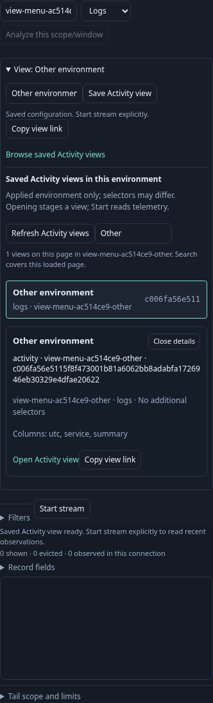
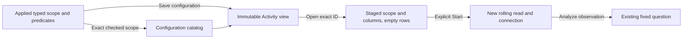

# Reusable Activity views

Activity views save a rolling log/span selector, record-column layout and optional exact captured latency baseline reference. Open a
view from Activity’s Views menu, its exact share link, Saved, or a service's environment-scoped library;
then explicitly Start stream. Opening, inspection, sharing and reload do not read
telemetry. The view contains no fixed time window, observations, totals, read or
custody clocks, membership tokens or instruction to execute.

## Product flow

The compact Activity bar has a **Views** disclosure. After applying a scope, enter
a title and save its environment, signal, predicates, core-column order and up to
eight qualified field columns. Unapplied scope changes block saving. Saving does
not stop or start a source read. The saved link and Copy view link share only an
immutable configuration ID. Subsequent edits produce a new configuration identity.

A reopened view starts with empty rows and a visible Start stream action. Its
selector and columns are restored locally; the first actual read receives a new
connection, current rolling window and optional membership capability. Old held
observations are not restored from a configuration. Existing pending evidence
intents remain in their separate journal. Analysis remains disabled until a read
has completed. Later edits mark the view modified. Opening another view while
scope/title/layout changes are unsaved offers explicit discard or keep-current
controls; delayed view responses cannot replace a different route's draft.

Activity’s Views menu embeds the same bounded library directly, using the **applied environment**. Opening Views loads configurations only; closing, leaving Activity or changing the applied environment cancels pending catalog publication. Editing a draft environment does not retarget the library. Scope changes clear its search and selected inspector so an old environment’s details cannot remain actionable. A successful save refreshes the open catalog. Both log and span configurations may appear; relevance means exact checked environment-policy equality, not predicate satisfiability.

Saved exposes a bounded searchable Activity library using the existing revision
rows and selected inspector. The bar's Browse saved Activity views opens that
library directly. Services exposes the same library filtered by the selected
service's **environment**. This is configuration discovery, not an inferred proof
that an arbitrary Boolean selector matches that service or that data exists.
Service names/namespaces remain ordinary typed OTel resource fields in selectors.

## Contracts and ownership

`workbench.ActivityView` version 1 contains title, `exploration.TailSelector`,
columns, optional field columns and optional `baselineCapture`. Omitted/empty references preserve the original version-1 serialization and IDs; publication validates referenced stored evidence without source reads. The immutable file publisher, ID hashing,
integrity reads, bounded catalog and existing fixed-view layout validation are
reused. Tail-selector validation uses its existing validation window internally;
that question is never saved or executed. Fixed exploration views keep their
existing shape, IDs, storage and `/exploration-views` contract.

| API | Effect |
| --- | --- |
| `POST /activity-views` | Strict 16 KiB configuration publication, 201. No client execution/custody fields. |
| `GET /activity-views/{id}` | Exact validated configuration, no query parameters; missing/corrupt refuses. |
| `GET /activity-views?environment=…&cursor=…` | Up to 20 configurations; current-only named filter and content-ID cursor. |
| `GET /activity-views?environmentSelector=…&cursor=…` | JSON-encoded checked environment selector; exact policy/scope filter. |

The single Go server serves these routes under `/api` with the same 16 KiB
publication limit. No optional XTDB store is required. The list has explicit next/first paging;
search covers its loaded page and does not claim global search or an atomic
catalog snapshot. Identical titles remain distinguishable by revision and scope.

`GooActivityViews` owns configuration reads, library composition and sharing.
`GooStreamEntry` owns draft guards and staged/applied scope. `GooTail.stage` uses the
same local preparation as Start, but creates no connection. Native display
components remain passive. Qualified predicates, including OR/missing/empty
semantics, remain intact as a disclosed saved selector; new Include/Exclude
filters compose with it. Remove saved selector explicitly removes that base.

## Validation and limits

Journey 146 uses ordinary OTLP logs independently counted in ClickHouse, selects a
real field value, reorders/adds columns, saves through the actual API,
shares via clipboard, reloads/stages and reopens from Saved and Services. Source
requests remain zero during configuration operations, including mobile and draft
keep/discard. Explicit Start reads the selected recent population. Observed Quint
replay rejects hidden reads, fabricated staged rows, missing Start and unsupported
layout. Bombadil opens/folds view controls while guarding paused/empty staging.
Journey 147 holds an actual committed save response while another view opens,
then verifies the newer keep/discard decision and draft survive its release.
Go checks cover deterministic identity, integrity, rejected execution fields,
unsupported layouts/signals, environment filtering and pagination; Hegel checks
content-bound immutable configuration identity. Actual results: [VALIDATION](../VALIDATION.md).

No mutable aliases, automatic startup preference, arbitrary predicate-branch
editor, service-selector satisfiability inference, access control, durable browser
draft or cross-store evidence search is added by this cut.

Saved predicate trees can now be edited through the shared [Filters
editor](FILTER_EDITOR.md), including AND/OR, missing keys and present-empty
strings. Edits stay staged; invalid input blocks source actions and saving.

[Saved baseline references](SAVED_ACTIVITY_BASELINE.md) extend modified-view and late-save guards. Reopen stages the reference without a receipt read; Start and Show latency remain explicit. Missing evidence does not hide the immutable configuration.

## Activity entry storyboard (159)

1. Reopen a saved worker view. Rows remain empty and Views stays folded; no catalog or telemetry read starts.
2. Open Views to browse configurations in its applied environment. Inspect, search the loaded page or refresh; the current stream remains paused.
3. Edit the environment. The library keeps the applied scope until Apply or another view is explicitly accepted. Keep current scope preserves that draft.
4. Open a different-environment view and discard the draft. The old selection/search clears; delayed old catalog responses cannot restore it.
5. Open the selected configuration, then explicitly Start to read current OTel data.

[Executable journey 159](../journeys/activity-view-menu.spec.js) exercises this against real Go/Python and OTLP/ClickHouse, including a held actual catalog response, explicit negative catalog transport/retry, keyboard activation and mobile overflow checks. Its observed Quint replay has six rejecting controls; Bombadil opens, inspects and folds the configuration menu while guarding zero source reads and empty rows.

## Typed environment round trip — 283

Activity views preserve the existing checked environment selector: current-only
named, effective named, effective empty label or effective unreported. Current-only
`prod` and effective `prod` select different populations and never share an
applied-scope catalog merely because their text matches. The current key wins when
present; an empty current value does not fall back to a legacy value.

Save the applied scope from Views, then reopen its exact link. The environment
policy, predicates and columns remain configured; rows and rolling read windows do
not travel. Start stream remains explicit. Typing a replacement environment name
is still an explicit change to current-key-only selection.

The embedded library follows the applied checked scope, including empty and
unreported populations. Draft edits leave that library on its applied scope until
applied. Scope changes cancel stale catalog/detail work. The unfiltered Saved
library can list all scopes and labels each policy; service libraries retain their
current-only named scope.

`GET /activity-views` accepts either `environment` (current-only named filter) or
`environmentSelector` (a JSON-encoded checked selector), plus the existing cursor.
Filters compare checked policy identity. Omit both to list all scopes; malformed,
ambiguous and repeated filter parameters refuse before listing. Saved duration
baseline references must match the same checked environment policy and retain
independent captured windows. No new source operation or endpoint is added.

Reusable measurement packages, shared question-step codecs and named-only service
or native bridges retain their explicit capability limits. This cut enables the
Activity view round trip; it does not invent rolling semantics for fixed saved
compositions.
