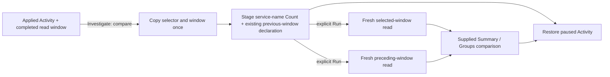

# Compare an Activity window with the preceding window

Status: implemented; actual validation is recorded in [VALIDATION.md](../VALIDATION.md).

In Activity, use **Investigate → Compare previous window by service** after a
completed read. Goo pauses the stream and stages the existing fixed count
comparison. **Run** reads both full populations independently. A loaded buffer,
local Find count or held time bin supplies neither total.

The selected interval is the applied Activity read's completed [from,to) window.
The previous interval is [from−width,from), where width=to−from. Activation copies
that window once; later wall-clock changes do not move either operand. Signal,
typed environment policy, namespace conditions and all applied predicates survive.
The default breakdown is reported service name, not qualified service/entity
identity: namespaces may share a group unless the applied filter separates them.
The grouping and exact scopes are visible and can be customized in the existing
fixed-view editor.

Dirty scope, inactive/disposed owners, missing completed windows, loading or stale
transport states and unavailable previous bounds refuse staging. A closed or
retired action cannot silently change the query. Staging reads no telemetry,
comparison results or kept evidence and publishes nothing. Existing recipe and
retention-configuration metadata reads are counted separately.

The existing composition and executor own Run. Selected records can be inspected
through the ordinary record page; full count/group witnesses remain distinct from
that limited page. Source reads have independent clocks and uncertain upstream
coverage. A preceding interval is a temporal baseline, not a causal explanation.
Saving or reopening preserves the fixed query/comparison declaration, not a copy
of the Activity buffer or its in-tab return path.

**Back to Activity** restores the paused parent and its original loaded rows and
scope without a new stream or source read. Resume is an explicit separate action.

The earlier route remains available: Analyze stages records, and the ordinary
population editor can add grouping/count comparison. The direct action removes
those discovery prerequisites; it does not add another evaluator, executor,
endpoint or navigation manager.

See [operand roles](COMPARISON_OPERAND_ROLES.md),
[architecture](reviews/ACTIVITY_WINDOW_COMPARISON_ARCHITECTURE_333.md),
[design](reviews/ACTIVITY_WINDOW_COMPARISON_DESIGN_333.md) and the
[executable journey](journeys/333-activity-window-comparison.md).
