# Grow a records view into a breakdown — 304

> Delivered in milestone 304. Executed checks are recorded in
> [VALIDATION.md](../VALIDATION.md).

A raw records view is a starting point for analysis. **Add breakdown** in the
existing View settings lets it grow into an aggregate-and-records composition.
Choose a qualified grouping field and the existing count Bars or Table display,
then stage the change. **Run population view** reads the configured population.
The record kind, columns and qualified fields remain in the same view.

## Make the question change explicit

The selected field becomes the question's single grouping. An existing matching
single grouping is retained. A different or multiple grouping requires explicit
replacement; the editor never silently chooses a group from supplied rows.
Environment policy, predicates, fixed bounds and other ordinary query options
stay unchanged. The staged root starts at page zero.

Staging changes configuration only and withdraws the held records read. It cannot
turn a page of rows or its matching count into an aggregate snapshot. Explicit Run
uses the existing full exploration profile to acquire the aggregate and records
aspects independently, with their existing uncertainty and source-read semantics.
Changing Bars/Table afterward is a local presentation change. Unfinished
breakdown edits must be added or discarded before saving or applying another
configuration; retired controls cannot stage a prior question.

## Continue through the existing authoring flow

Once the view has a breakdown, existing measure, timing, comparison and template
controls apply under their own eligibility rules. Preserve saves the composition
through the same catalog. Ordinary Apply composition retains the destination
query and held inputs; a display declaration neither copies the source service
nor acquires missing data. A capture or investigation finding remains a separate
explicit operation.

The whole-flow review selected this bridge because records-only authoring had
become a dead end: the new natural trace/raw-data entry could change record
presentation but could not add a chart through visual controls. This cut adds no
new editor, catalog, query owner, endpoint or public component.

```mermaid
flowchart LR
  R[Raw Table, List or Span waterfall] --> E[Existing View settings: Add breakdown]
  E --> G[Explicit qualified grouping and count display]
  G -->|Stage: no read| S[Aggregate plus preserved records configuration]
  S -->|Explicit Run| A[Existing full exploration acquisition]
  A --> C[Existing chart, comparison and record controls]
  C --> P[Existing Preserve and ordinary catalog reuse]
```

See [records-only views](RECORD_ONLY_VIEWS.md),
[composition](RECORD_AGGREGATE_COMPOSITION.md),
[architecture review](reviews/AUTHORING_ARCHITECTURE_304.md) and
[design review](reviews/AUTHORING_DESIGN_304.md).
