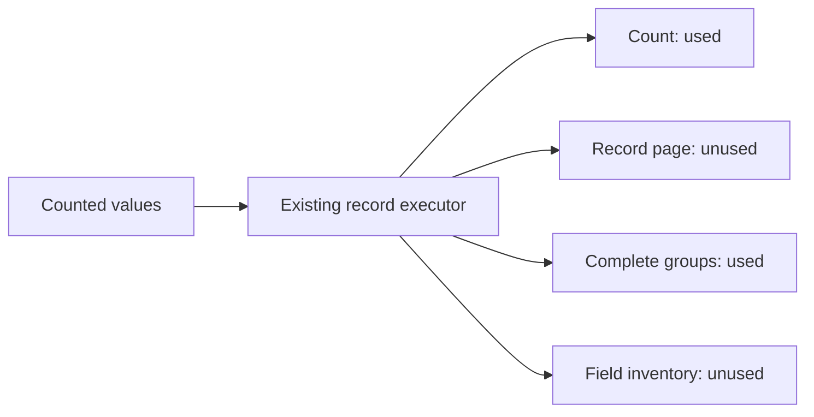

# Record aggregate read-set baseline

C4 prerequisite audit, 2026-10-25 UTC. This delivers a repeatable measurement
command and a measured baseline, **not an aggregate projection or a speedup**.
The application, UI, `/explore` result shape and existing captures are unchanged.

## Reproduce

`go build -o /tmp/goo-read-audit ./cmd/goo-read-audit`, then supply the trusted local
ClickHouse URL via `GOO_AUDIT_ENDPOINT`, optional `GOO_AUDIT_USER` and
`GOO_AUDIT_PASSWORD`, and a fixed exploration query on stdin:

```sh
/tmp/goo-read-audit < docs/evidence/aggregate-read-audit/small-question.json
```

The command runs the actual `exploration.Source.Fetch` path. It adds no telemetry,
SQL writes, capture or query-log lookup. Existing source transport limits apply:
10-second server execution, 15-second HTTP timeout per statement, 256 MiB memory /
read budget, 8 MiB response and 1,001-group sentinel. An error exits nonzero while
retaining completed/partial read measurements. Never point it at an untrusted
endpoint; it is a developer tool, not an admitted public API.

Output contains statement kinds, SQL byte counts/hashes, status, consumed response
body bytes, elapsed time and allowlisted canonical uint64 ClickHouse summary
strings. It omits SQL text, parameters, record bodies, endpoint and credentials.
Missing header metrics remain absent. Body bytes are bytes actually consumed after
HTTP decoding, **not network traffic**; a failed/partial read is not a full response.
ClickHouse's header summary is source-reported, not independently authenticated;
its `result_rows=0` does not replace observed group cardinality.

## Measured baseline

Actual source was the existing local ClickHouse lab. The generated ordinary OTLP
fixture from [journey 192](../journeys/192-native-record-context-storyboard.md)
contains 123 span records in the fixed audit window, including namespace missing,
empty and distinct values. No fixture was added or modified for this audit. Both
queries preserve identical environment/window and request `limit:1`, `offset:0`.
The small grouping is resource `service.namespace` (4 groups); the larger grouping
is span `name` (123 groups). These are different dimensions, not a controlled
cardinality-only benchmark. They are modest cardinalities, not a >1,000 test.

| Case | Matching records | Complete groups | Source reads | Serialized executor result | Elapsed |
| --- | ---: | ---: | ---: | ---: | ---: |
| Small | 123 | 4 | 4 | 5818 bytes | 94.154 ms |
| Larger | 123 | 123 | 4 | 9473 bytes | 193.373 ms |

| Case / statement | SQL bytes | Consumed body bytes | CH read rows | CH read bytes |
| --- | ---: | ---: | ---: | ---: |
| Small / count | 330 | 16 | 5191 | 756997 |
| Small / rows | 1276 | 1588 | 5191 | 2343030 |
| Small / groups | 496 | 106 | 5191 | 756997 |
| Small / fields | 502 | 232 | 5191 | 1350421 |
| Larger / count | 330 | 16 | 5218 | 761065 |
| Larger / rows | 1276 | 1588 | 5218 | 2355838 |
| Larger / groups | 430 | 3866 | 5218 | 768677 |
| Larger / fields | 502 | 232 | 5218 | 1357934 |

Committed receipts: [small query](evidence/aggregate-read-audit/small-question.json),
[small reads](evidence/aggregate-read-audit/small-final.json),
[larger query](evidence/aggregate-read-audit/larger-question.json),
[larger reads](evidence/aggregate-read-audit/larger-final.json).
The lab traffic generator remained active: unrelated rows grew between cases.
Identical matching counts do not imply identical physical scan work. These single
observations establish issued read sets and sizes, not latency distributions or
before/after performance. Fresh controlled baselines must accompany the eventual
projection comparison using the same fixture/settings and declared traffic state.
An initial tool run preceded summary-output hardening; final receipts above were
rerun with the reviewed binary. Initial local diagnostics remain in artifacts.

## Narrow implementation decision

`ui/filter-values.js` consumes only question identity, state, count, complete groups,
basis and capturedAt. Its `limit:1` still issues count → rows → groups → fields;
the row query actually requests two rows to detect paging. Neither the row page
nor field inventory is used in its display. Implement this caller first through
a separate typed aggregate response, retaining two independent count/group reads
and their conservation/changed-between-reads checks. Do not fabricate an inspection
result with empty rows or promote it into an existing captured result.



Retain numeric predicates, reported-edge scope, missing/empty dimensions, exact
question identity, cancellation and bounded failures. More than 1,000 groups must
still refuse the whole lookup. Count/group agreement does not establish an atomic
snapshot. Keep legacy `/explore` serialization and capture bytes/IDs intact.

The second caller, `ui/service-dashboard.js`, consumes duration, span-status and
series/group summaries in addition to counts. Its own projection needs explicit
richer requirements. Preserve original widget navigation/capture questions; a
widget capture currently performs a separate complete read. Do not use a count-only
response as though it contained those summaries or frozen captured evidence.

Independent source review supports this boundary. A regression test rejects
arbitrary, malformed, overflowing and noncanonical ClickHouse summary fields;
`go test ./cmd/goo-read-audit` passes. The final live executions each returned
`observed`, count 123, all four successful statements and the expected cardinality.
No UI, semantic evaluator, owner, or formal state machine changed, so screenshots,
Bombadil and additional property/model campaigns were not rerun for this tool.
