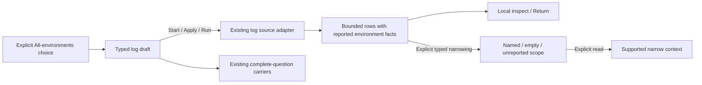

# Explicit All-environments logs

437 adds an explicit wide log scope within the configured workspace source.
Choosing **All environments** changes the draft; Start or Apply remains the read
action. Blank input, failed discovery and a named label such as `all` never imply
a wildcard. Environment selection is query scope, not source authorization.

## Checked selection and reported facts

The wire value is an environment selector, not an observed label:

```json
{"version":"goo/environment-selector/v1","policy":"effective","scope":{"mode":"all"}}
```

An omitted or empty `value` normalizes to the same unnamed selection; a nonempty
value, null or current-only policy refuses. Existing named, empty and unreported
questions keep their meanings. The checked semantic selection has an explicit
All constructor/policy. Observed environment scopes and discovery groups retain
only named, empty and unreported categories; no event is classified as All.

For each row, current-key **presence** wins over legacy fallback, including an
empty current label masking a named legacy label. Both keys absent means
unreported. An unavailable or malformed resource map is not proof of unreported
environment. Rendering and explicit narrowing use validated source facts, never
a displayed label or an inferred producer identity.
All membership itself does not depend on environment metadata availability. A
reported label that exceeds the supported query-name budget remains a fact in
the wide population, with narrowing unavailable; it must not disappear or become
unreported.

## Supported owners

| Path | All scope in 437 |
| --- | --- |
| Log Activity and bounded tail | Explicit draft selection; existing rolling event-time window, limits and refusal semantics |
| Fixed log Query, rows, groups, counted values and aggregate plans | Complete typed selector retained; existing fixed bounds, predicates and budgets |
| Local log inspection and retained Return | Supplied data only; no new source authority |
| Log links, saved views, captures and checked CEL planning | Complete log question/selector retained through existing carriers; their existing publication/read choices remain explicit |
| Scope discovery and preview | Observed named/empty/unreported choices remain separate; All is not a discovery result |
| Spans, trace search/expansion, service inventory and native measurement execution | Refuse wide scope before source execution; choose a supported explicit narrow scope first |
| Surrounding/context reads and implicit linked-population/recent-population builders | Require a narrow scope; existing implicit companion-family meaning is not silently changed |
| Linked-population planning with an implicit companion signal | Refuse before execution; do not silently remove its spans companion to make a wide log scope fit |

The shared selector parser resolves meaning. Owning query/profile validators
decide whether execution is supported. Environment-only identity comparisons do
not fabricate a signal just to parse the selector. Native lowering also refuses
All defensively rather than accidentally treating its unnamed value as empty.

## Narrow and continue

Local inspection stays available in a wide log population. Cross-signal or trace
context is unavailable until the operator explicitly stages a supported typed
environment. A row action may stage the observed winning scope from its actual
resource map; it does not read telemetry. Existing environment discovery can also
preview and stage a specific scope. The next explicit Start, Apply or Run reads.
Parent filters and fixed bounds remain intact where that handoff supports them.
Unsupported handoffs retain the current question and explain the refusal.
Existing comparison compatibility also remains intact: a typed named selection
does not become comparable to its All parent by dropping either selector. No
carrier admission rule is loosened to force an All-versus-named pair.



Staging does not assert complete ingestion, unique requests or a shared database
snapshot. A bounded row bank is not the complete population. Source errors remain
errors; they cannot become empty data or an implicit wider retry.

Executed browser, property, model and source checks are recorded in
[validation](../VALIDATION.md). The [architecture review](reviews/ALL_ENVIRONMENTS_437_ARCH.md)
distinguishes contract/source review from actual runtime acceptance.
