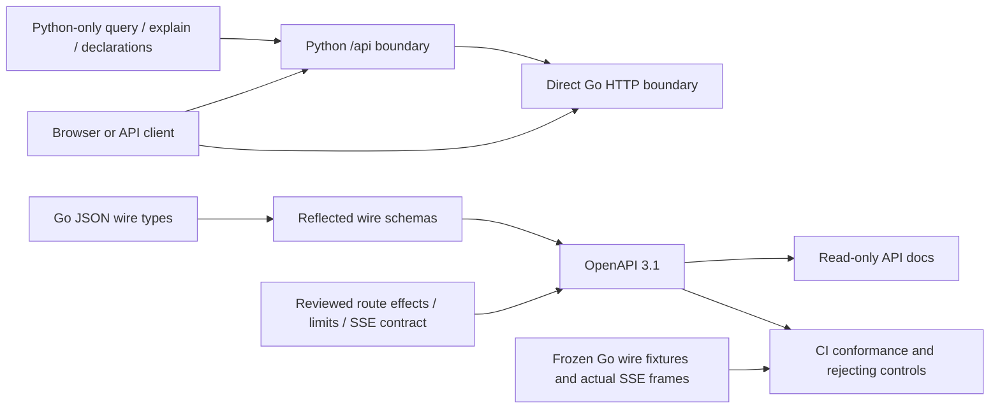

# HTTP API contract

The current OpenAPI 3.1 contract is [api/openapi.json](../api/openapi.json).
Run the Python UI server and open [API docs](http://localhost:8088/api-docs), or
[download the spec](http://localhost:8088/openapi.json). The docs are read-only,
searchable and self-contained: no CDN, telemetry query or API execution widget.
The running server must include the current routes and assets; changing the
checkout alone does not update an existing process. Rebuild an older image, or
use the supported local code/asset installation and restart procedure.

The spec inventories 76 supported operations: 70 Go operations, five Python-only
`/api` operations and the Python root `/health` probe. Go paths are unprefixed on
port 8089; the browser proxy exposes them under `/api` on port 8088. Python-only
operations override the server list. `/api-docs`, `/openapi.json`, the UI, static
assets and unsupported prefix suffixes are documentation/application resources,
not additional observability API operations. Go's automatic HEAD/mux refusal
behavior is not a separately supported browser endpoint. These counts come from
the checked-in spec's method entries and `x-go-source` ownership, not from the
number of path strings. [Executed acceptance](API_ACCEPTANCE.md) and
[known limits](KNOWN_ISSUES.md) are separate from structural API coverage.



## What the schemas promise

All supported Go request and response envelopes have typed shapes. Nested
`json.RawMessage`, dynamic record rows, arbitrary exporter maps and interface
values remain open where the implementation is open. Python legacy query results
have a typed envelope with adapter-shaped rows; the legacy package keeps its
extensible declaration shape. This is the implemented development API, not a
stability promise or a replacement for semantic validation.

The Go generator reflects JSON field names, embedded structs, pointers, arrays,
maps and omission behavior. Input models allow omitted/null fields where Go's
decoder does, with unknown canonical fields refused. Go's case-insensitive JSON
matching and duplicate-field handling still apply; clients should use the canonical
names in the spec. Response fields without `omitempty` are required. Nanosecond
bounds, counts, revisions and exact telemetry values remain strings where the Go
wire types use strings. Do not convert them through JavaScript `Number`.

Schemas express structural encoding, not every valid question, combination, finite
integer range, lineage relationship, count accounting rule or capability state.
Go remains responsible for validated fields/operators, units, temporality,
resets, complete-population totals, query compilation and evidence identity.
A structurally valid request may return 400. OpenAPI validation does not prove
source-free reopen, custody ordering or absence of hidden reads; behavioral tests
do. No generated handler/client or request-validation middleware was introduced.

## Two boundaries, with existing differences

Every Go POST operation documents `x-go-body-limit-bytes` and
`x-browser-body-limit-bytes`. These are byte ceilings, not string lengths. The
Python proxy checks positive Content-Length before forwarding. In particular:

| Route | Go | Browser proxy |
| --- | --- | --- |
| `/dashboards/plan` | 256 KiB | 16 KiB |
| `/metric-discovery` | 64 KiB | 16 KiB |
| `/annotations`, `/deployments` | 128 KiB | 16 KiB |
| `/compare` | 1 MiB | 1 MiB |

Direct Go decoders accept JSON without enforcing Content-Type; application/json
is the documented client encoding. Trailing-input errors differ by owner. The
proxy reparses/reserializes JSON, so byte-identical response fixtures describe Go,
not Python's JSON formatting. Direct operation GET validation uses text/plain
`http.Error` bodies containing JSON-looking text; the browser re-encodes parsed
errors as JSON. The proxy does not forward all upstream headers (including query
budget Retry-After). These are current discrepancies, not changes made by this spec.

`x-effects` distinguishes pure plans/supplied-summary comparisons, source reads,
source reads with possible custody/capture publication, saved reads, file
publication, optional XTDB operations and cancellation. GET does not imply no
telemetry execution. `/captures/live` reads fresh evidence or freezes a held draft;
its 200 draft and 201 frozen-page responses are separate. Opening saved evidence
does not imply a telemetry reread. Optional XTDB configuration status is not health;
per-operation read basis remains distinct from the configured connection.

The lab has no authentication layer. `X-Goo-Query-ID` and draft/result tokens are
short-lived local capabilities, not authorization. Do not infer authentication
from ClickHouse credentials held by the server. See the fuller
[HTTP ownership contract](HTTP_BOUNDARIES.md) for budgets and effects.

## Nullable grouping values

Fixed physical columns such as `column:service` are always present in valid source
records. `/compare` now refuses caller-supplied null groups for those fields with
HTTP 400; earlier validation admitted that malformed representation. Attribute and
resource keys remain nullable, and the new derived `column:exception_type` explicitly
allows null when no unique reported event type exists. Its present empty string
remains separate. This is a request-validation tightening; valid legacy source
captures, hashes and unrequested row SQL are unchanged. See [error triage](ERROR_TRIAGE.md).

## Population explanations

Three Go routes are exposed through the browser proxy under `/api`:

| Route | Effect | Request |
| --- | --- | --- |
| `POST /population/explain/plan` | Pure projection/validation | `ExplanationRequest` |
| `POST /population/explain` | Explicit aggregate source read | `ExplanationRequest` |
| `POST /population/explain/filter` | Pure original-side predicate plan | Request, field, required null-or-string value, side and include/exclude mode |

All three have a 64 KiB body ceiling at Go and browser boundaries. The source route
uses the existing controlled query ID/cancellation mechanism and a 55-second total
budget; each source operation has a three-second child budget. Planning and filter
staging do not read telemetry. The versioned request names both original queries
and one to six explicit qualified fields. The result contains independent counts,
field statuses/read bases, exact rational shares/differences and ranked row
references. Structural API validation is not proof that a field is complete or a
population difference is causal.

`POST /captures` also accepts `{title,resultToken}` for an observed explanation.
The server loads its typed held result and derives the saved request; clients do
not submit aggregate data as evidence. This publication performs no telemetry
read. Repeating the same held token/title/store returns the same capture ID.
Expiry/refusal never starts another explanation automatically. The existing
16 KiB capture-body limit remains unchanged because the token avoids resending
two potentially large queries. Ordinary capture creation and explanation promotion
retain different effect contracts; an explanation cannot be refreshed by silently
rerunning its questions through the ordinary capture path.

`CapturePage.explanation` contains the saved result without its ephemeral token.
Its source clocks/bases remain separate from receipt custody time. See
[the explanation contract and UX](POPULATION_EXPLANATIONS.md) for bounds, partial
fields and source-free reuse.

## Tail event contract

POST `/tail` returns `text/event-stream` after validation/admission. Each frame
has a connection-local numeric `id`, an `event` and JSON `data`, followed by a blank
line. `x-sse-events` binds event names to schemas:

| Event | Meaning |
| --- | --- |
| `reset` | Connection ID, rolling window 60,000 ms, selector, unknown continuity, no replay |
| `batch` | Supplied rows, limited flag, fixed poll bounds/observation time and explicit membership state; available batches carry an optional preservation capability |
| `gap` | Source unavailable, identity budget exhausted, or connection ended |

The Go stream has four local slots, a 60-second context, two-second polls and
five-second write deadlines. Python's upstream socket timeout is 45 seconds, not
a guaranteed stream duration. Disconnect releases the upstream slot. Use POST
fetch streaming; browser EventSource cannot submit the selector body. Last-Event-ID
does not provide replay/resume. This polls an event-time window, not an ingestion
cursor or complete capture. A gap after headers remains HTTP 200, and disconnect
can prevent delivery of a final frame. Successful streams set no-store and
X-Accel-Buffering: no; direct early JSON errors omit no-store, whereas the proxy's
JSON errors include it. The JSON response helper must not buffer SSE.

Actual reset/source-unavailable gap bytes are frozen in
[testdata/http/tail.sse](../testdata/http/tail.sse) and executed by
`TestAPITailSSEWireContract`. Batch schema examples and rejecting controls complement
existing real-loopback batch/disconnect tests; they do not replace those tests.

## Updating and checking

From the repository root:

```sh
go run ./scripts/openapi-schema api/go-schemas.json
python3 scripts/build_openapi.py
python3 -m venv /tmp/goo-api-tools
/tmp/goo-api-tools/bin/pip install -r requirements-api.txt
/tmp/goo-api-tools/bin/python scripts/check_openapi.py
go test ./cmd/goo -run 'Test(APITailSSEWireContract|PlanningHTTPWireFixtures|TelemetryHTTPWireFixtures|NativeJSONHTTPWireFixtures|ExplorationJSONHTTPWireFixtures|TraceSearchHTTPWireFixtures)$' -count=1
python3 -m unittest discover -s tests -p test_api_docs.py -v
node scripts/check_api_docs.cjs
```

[CI](../.github/workflows/api-contract.yml) regenerates both checked-in artifacts,
refuses drift, validates OpenAPI/references and every Go route, and checks typed
requests/responses against the existing wire fixtures. Unknown-field, wrong-error-
type and malformed SSE controls must fail. The 236 HTTP response cases comprise
222 documented-operation responses and 14 default mux refusals; the checker also
validates 56 admitted request bodies. The workflow executes those wire tests plus the actual SSE fixture,
and tests the Python docs routes. The browser journey runs locally with the
existing Playwright/Chromium setup and captures a real docs screenshot; it does
not start the full lab or mutate telemetry.

The fast CI tier also installs locked npm dependencies on Node 24.19.0, runs
`go test ./... -count=1` for the root Go module and runs all `tests/*.test.js`
through `npm run test:visualizations`. The explicit wire selection includes the
trace-search HTTP handler fixtures. Source-dependent tests remain opt-in and
report skips without their configured source; nested `verification/` and
`instrumentation/` modules and real browser/store campaigns are separate tiers.
The local checks do not establish that a GitHub-hosted CI run has completed.

Schema roots and inline request envelopes live in
[scripts/openapi-schema/main.go](../scripts/openapi-schema/main.go); reviewed
route policy lives in [scripts/build_openapi.py](../scripts/build_openapi.py).
Route discovery is an inventory aid, not authority to invent an endpoint policy:
new routes must have reviewed effects, request/response roots, limits, supported
statuses and fixture coverage. Extensions describe current behavior and do not
change runtime enforcement. Executed coverage now also includes the capture/live-freeze/document workflow and
browser proxy contracts. The optional local XTDB branch covers retention, correction,
pinned review and source-free document reopen. Broader endpoint/branch coverage and
the remaining C2 acceptance work are still explicit gaps. The spec pauses further mechanical
JSON migration while those contracts become the common API reference.


## Observed workflow and proxy contracts

`TestAPISavedEvidenceObservedContracts` exports actual handler observations when
`GOO_API_OBSERVATIONS` is set. Its base branch has 12 responses: source-backed
capture and live draft, source-free/idempotent freeze, capture/receipt/list reads,
document publication/reopen/list, and optional-store status/refusal. With
`GOO_XTDB_TEST_URL`, seven more responses cover real retention, correction, manifest,
current/pinned review, pinned document creation and offline file reopen. The test
refuses any telemetry read after the source is marked unavailable. CI runs the
base branch; the real XTDB branch requires the lab explicitly.

`tests/test_api_proxy.py` puts real HTTP servers on both sides of the Python
proxy. It checks exact/overflow browser limits using the spec's byte ceilings,
query-string and cancellation-ID forwarding, deliberately unforwarded Retry-After,
JSON re-encoding of text/plain Go errors, early tail headers and idle upstream
closure within two seconds of browser abort. It can export 20 actual proxy JSON
responses using `GOO_PROXY_OBSERVATIONS`. Both observation files are validated by:

```sh
python scripts/check_openapi.py --observations /path/saved.json --proxy-observations /path/proxy.json
```

These tests found and corrected two contract issues: `/documents` takes an outer
`{document, parent}` envelope, and browser cancellation requires a nonempty body
(send `{}`) even though Go ignores it. They also found a runtime bug: non-JSON
upstream HTTP errors previously disconnected clients while handling the error.
GET, POST and pre-stream tail now return a bounded-description JSON 502 instead;
valid JSON errors retain their status. No backend error body is echoed by this
fallback. Existing limit/header differences remain unchanged.

`scripts/check_deployed_api.py` validates the running spec against the checkout
and performs readonly real API checks. The API-docs browser journey can target the
running lab with `GOO_API_DOCS_URL=http://127.0.0.1:8088/api-docs`; otherwise it
starts its own ephemeral server. These are distinct from synthetic loopback data.

## Managed lab rebuild

The Go build now binds source read-only in one build step, so `internal` packages
are included and VFS builders avoid copying a complete toolchain for each package.
The same Go version uses the smaller Alpine build image; the binary stays
CGO-disabled and the runtime remains Python slim. Go caches are disposable build
mounts. For a managed TLS proxy, use an optional trusted combined CA bundle:

```sh
GOO_BUILD_CA_BUNDLE=/etc/ssl/certs/ca-certificates.crt docker compose -f compose.yaml -f compose.xtdb.yaml -f compose.build-ca.yaml build query packages
docker compose -f compose.yaml -f compose.xtdb.yaml up -d --no-deps --no-build query packages
```

The overlay mounts trust only for dependency downloads and keeps certificate
verification enabled; it does not copy certificates into layers or alter runtime
configuration. Omit the XTDB overlay if the optional store is not deployed. Build
and recreate only these two owned services; preserve telemetry volumes, stream
entries, capture ledgers and the previous image for rollback.

[Executed API conformance and deployed acceptance](API_ACCEPTANCE.md) records the
workflow layers, replay commands, fixes, build recovery and remaining coverage.

Record pages now offer a compact [observed-field picker](RECORD_COLUMNS.md) with local
column visibility/order and explicit Include/Exclude intents. Population view
configuration accepts optional ordered `fieldColumns` (up to eight qualified
fields); saved layouts do not change query predicates or capture evidence.

Saved exploration-view breakdown `comparisonMetric` now also accepts `count`.
It remains display configuration alongside share/mean/p95/p99/error-rate; no
query semantics or receipt formats change. Go owns semantic validation.

Live record comparison responses optionally include `recordSeries: {baseline, selection}` when the saved record question requests buckets. These are existing retained `TimePoint` arrays, with question/state/read metadata on the corresponding comparison sides. The field is omitted for native and nonbucketed questions. Freeze returns those exact selection intervals without another source read.

Metric discovery responses now include an optional typed `capabilityPlan` per
instrument, version `goo/instrument-capability-plan/v1alpha1`. It reports metadata
eligibility and bounded observed-stream presence, not value/interval verification.
The request, source-read budget and generated package bindings are unchanged;
response types are reflected in the OpenAPI schema. See
[the contract](NATIVE_INSTRUMENT_DISCOVERY.md#typed-server-plan-and-observed-stream-presence).

Exploration predicates also accept `column:timestamp_ns` as UInt64 event time for
exact [time/duration region partitions](REGION_PARTITIONS.md). It uses the existing
typed predicate wire shape; it is not a new endpoint or an ingestion clock.


Origin-aware retained reads now have two explicit routes:

| Route | Response and effect |
| --- | --- |
| `GET /retained-evidence/catalog` | `EvidenceCatalog`: saved-capture/result-page/tail-selection metadata and named capture/custody clocks. Optional origin and existing exact filters; metadata only. |
| `GET /retained-evidence/{id}/content` | `EvidenceContent`: exactly one capture/tail manifest plus exact `manifestJSON`, and tail recorded custody time. Optional bounded `awaitToken` read lower bound. |

Legacy `GET /retained-evidence` and `GET /retained-evidence/{id}` keep their v1
shapes. Review/correction and exact document validation keep existing meaning wire
shapes. The new response union is reflected and constrained in OpenAPI; actual
handler observations cover both origins and reject complete mixed-origin values.
Content reads distinguish definite absence (404), unavailable/corrupt store (502)
and unconfigured optional store (503). No telemetry read or publication occurs.
The browser catalog/inspector/citation adapter now uses these origin-aware reads.
The subsequent tail-preservation contract below now issues SSE membership
capabilities and registers references-only publication. See
[the origin boundaries](TAIL_SELECTION_CUSTODY.md#public-read-and-presentation-adapters).

Activity preservation uses `POST /retained-evidence/tail` with a typed
`TailIntent` (version, requestID, connection, selector, token/key refs, tags, note).
No client rows, read clocks or windows are accepted. `/tail` reset includes a
random connection ID; batch `membershipState` is available/unavailable/empty, and
only available batches carry token/expiry/basis metadata. Expiry is anchored to
the original read, not browser selection. Existing page retention stays separate.
201 returns the original typed tail receipt on both commit and unchanged retry;
409 rejects changed intent; 410 means definitely uncommitted proof is unavailable;
502 retains retryable storage uncertainty; 503 means optional XTDB is unconfigured.
Committed recovery precedes membership lookup and never rereads telemetry.

## Current native publication conflict boundary

`POST /measurement-packages` validates a duplicate's existing regular-file winner
through a bounded 32 KiB read, package validation and expected revision identity.
An unreadable, invalid, oversized or wrong-revision winner is refused with the
existing 400 convention; it is not overwritten, repaired or reported successful.
Valid duplicate success remains 201, including noncanonical YAML that validates
to the same definition/revision; the existing file is not rewritten. File-only
sync remains unchanged. This is the delivered
M2 correction (`49b31c2`), not a claim of power-loss durability or universal
conflict policy. See [publication contracts](IMMUTABLE_PUBLICATION.md).

## Subsequent Activity-view contract

Reusable [Activity views](ACTIVITY_VIEWS.md) use a typed rolling configuration in
workbench's existing immutable file publisher, separate from fixed exploration
views. Shared revision-library display appears in Saved and Services. The stream
adapter restores configuration through `GooTail.stage`; Start alone opens SSE.
No observations or capabilities cross the configuration boundary. The linked
flow diagram documents publication, staging and later separate retention.

Activity-view browsing adopts `GooDefinitionLibrary` with an explicit `activity`
family and exact revisions, keeping same-title scopes distinct. The existing
record-column picker projects both streamed and staged layouts. Configuration
reads, clipboard sharing and library paging stay in `GooActivityViews`; scope and
draft lifetime stay in `GooStreamEntry`. `GooTail.stage` prepares local display
without a subscription. No display component fetches or starts telemetry.

`POST /activity-views`, `GET /activity-views/{id}` and `GET /activity-views` expose
immutable version-1 rolling selector and column configuration. Publication has a
16 KiB Go/proxy bound and rejects execution/custody fields. List supports exact
optional environment and cursor parameters, returning up to 20 items. These
source-free file routes are independent of fixed `/exploration-views` and XTDB.
Opening configuration never opens a tail connection. See [Activity views](ACTIVITY_VIEWS.md).


## Typed numeric predicate leaf

Record predicates accept the optional `numeric` binding leaf described in
[typed numeric filters](TYPED_NUMERIC_FILTERS.md). It is exclusive with `field`,
`all` and `any`; the existing question-level numeric measure remains independent.
Go validates declared type/unit/parsing and exact decimal-string thresholds before
SQL lowering. State operators partition missing/empty/invalid/valid values;
comparisons, including ne, match valid values only. The feature adds no route and changes no existing omitted-field bytes. Shared
editor/protocol and real telemetry capture/reuse acceptance are documented in
the linked TF2/TF3 contract.

The source-free `POST /numeric-histograms/selection` planner derives exact integer
range and remainder questions from half-open bin indices. Its `/api` proxy has
the same contract. See [integer distributions](NUMERIC_HISTOGRAMS.md).

Numeric measure comparison is an explicit `numeric: true` mode on `POST /compare`.
Both caller-held cohorts must include complete numeric totals and group summaries
with the same declared binding. Exact integer/rational changes are additive under
`measures.numeric`; no source access occurs in this endpoint. Omitting the flag
preserves legacy count-only comparison behavior. The histogram selection planner
also supplies a separate `numericComparison` query pair alongside its unchanged
count-only pair. Numeric stored-evidence decisions use algorithm v4; older frozen
receipt algorithms remain readable without reevaluation. See
[numeric comparison semantics](NUMERIC_COMPARISONS.md).

Aligned distribution comparison is explicit `distribution: true` with numeric
mode and both validated histogram payloads. `POST /numeric-histograms/comparison-selection`
accepts the comparison, side and half-open bin indices, plans without source reads
and permits 1 MiB request bodies. Stored capture comparison accepts the explicit
`distribution=true` query option; publication freezes v5 intent, preserving old
v1–v4 results. See [distribution comparisons](DISTRIBUTION_COMPARISONS.md).

## Fixed-scale decimal numeric bindings

[Decimal64](FIXED_SCALE_DECIMALS.md) extends existing numeric binding objects
with optional integer `scale`. Decimal bindings require scale 1–9; int64/uint64
bindings require zero (normally omitted). Typed thresholds are human literals
with exactly that many fractional digits. There are no new endpoints.

Summary `sum`, `min` and `max`, histogram bounds and comparison differences
remain exact coefficient strings. Decimal summaries include matching `scale`;
comparison bindings and histogram questions carry the interpretation. Mean in
input units is `sum / (valid × 10^scale)`. Scale participates in binding identity,
saved definitions and immutable evidence. No implicit rescaling is performed.
Capability planning reports unsupported scale as diagnostics; execution rejects
invalid bindings. A fractional or string-valued JSON scale is malformed transport.
Older integer questions/results omit scale and retain their wire representation.

## Contextual numeric continuation

[Plot values](CONTEXTUAL_NUMERIC_PLOTS.md) adds no API operation or wire field.
The client stages the existing numeric binding/histogram question with original
membership/window/edge predicates, reset pagination and replaced presentation
measures. Existing explore, selection, comparison, capture and reusable-package
operations retain their contracts. Dialog opening/editing/confirmation performs
no telemetry request; saved-origin Run is a fresh read of the retained scope.

## Versioned log-body pattern field

`column:body_pattern_v1` is log-only and always present, including explicit
unclassified `lp1:e/o/u` buckets. Exact eq/ne predicates require a canonical
profile identity, at most 518 bytes; contains is refused. Display labels are
not predicate values. Existing grouping, time series, comparisons, captures
and YAML carry this field without new operations or wire-shape changes.
Unreferenced row SQL and older captures remain unchanged. See the
[profile contract](LOG_PATTERNS.md) for byte limits and immutable semantics.

Caller-held `/api/compare` pattern groups also require canonical profile IDs,
including on empty or changed-read branches. This validation does not authenticate
caller-supplied source metadata. [Time comparisons](LOG_PATTERN_TIME_COMPARISONS.md)
stage ordinary fixed scopes and reuse existing explore/compare/capture operations.
Counts, per-second rates and shares are display calculations over complete
validated groups, with each side's original window and population denominator.
Saved baseline scope selection does not reuse saved totals; explicit Run rereads
both scopes. Reopening a captured comparison uses stored aggregates and clocks.

## Trace page display projection

[Observed page timing](TRACE_PAGE_TIMING.md) adds no HTTP operation, query flag or
capture field. `exploration.AnalyzeTracePage` defines exact direct-child interval
accounting over public row fields `timestamp_ns`/`duration_ns`; the passive client
projection consumes existing source or stored rows. It does not augment saved
capture bytes or substitute bounded page sums for the independent query aggregate.
Row selection retains the existing linked-log action; disclosure/group display
does not issue telemetry requests.


## Trace search across span conditions

`POST /trace-search` (browser `/api/trace-search`) reads one full scoped source
aggregation for 1–4 span predicates. Its `TraceSearchRequest` declares version
`goo/trace-search/v1`, one environment, a fixed half-open window of at most two
hours and a trace-page limit of 1–100. The request body ceiling is 64 KiB at
both HTTP boundaries. Conditions use the existing typed span predicate tree,
with at most 64 nodes across the request and a 256 KiB compiled-SQL ceiling.
The HTTP boundary compiles and validates before any source effect; oversize
plans return 400 with an instruction to simplify the conditions.

A trace ID qualifies when each condition has at least one matching observed
record in that scope. One record may satisfy several conditions. Conditions
do not require distinct spans, a reported parent edge, matching services or a
complete trace. Canonical nonzero lowercase 32-hex trace IDs define the grouping
identity; the result is a count of observed reported IDs, not requests or
unique invocations. A contextual original record predicate belongs to the
first condition, not a global filter restricting all other conditions.

`TraceSearchResult` returns the exact same-query `matchedTraces` count, bounded
items, a `hasMore` flag and a representative witness for each condition. Witnesses
include full matching-record counts and qualified predicate field values; missing
keys remain null instead of empty strings. Numeric values, timestamps and
counts retain string encoding. Witness selection does not establish a unique
occurrence, root span, causality or telemetry completeness. The source and full
JSON response are bounded to 8 MiB; overflow refuses the entire result.

The route shares source-query admission and optional `X-Goo-Query-ID`
cancellation. It has a 55-second handler deadline under the existing 60-second
query owner. Validation failures return 400; source/response-bound failures
return 502. No result-retention token, capture publication or paired-evidence
format is introduced. Opening a trace from a result is a separate explicit
existing record-context read. See [the semantic contract](TRACE_SEARCH.md).


## Automatic service dashboard families

`POST /dashboards/plan` remains a pure planning operation. It accepts optional
`DashboardRequest.profile`: `auto`, `all-spans` or `http-server`. Omitting it
(including its existing empty/null decoding) preserves the legacy v2 response
without new profile/family fields. Existing request ceilings are unchanged: Go
256 KiB and the browser proxy 16 KiB. No source execution or new route is added.

Opt-in plans add selected `profile`, `families` descriptors and optional widget
`family` identities. A descriptor carries key, title, state, grain, selected
state and optional reason/rule-set identity. HTTP metadata is explicitly a
**candidate**, not proof that the service has HTTP server observations, follows
a particular semantic-convention version or is healthy. `auto` selects HTTP only
with both current span-key metadata and an advisory positive `httpServerObserved`
hint, or a compatible native HTTP instrument. The hint comes from already-held
same-scope observations; false/omitted means no positive hint, not absence. Flat
keys alone leave All spans selected while offering the HTTP candidate. An
explicit unsupported HTTP profile returns 400 instead of silently changing intent.

HTTP span questions retain service/environment/namespace/window and require exact
physical `SpanKind = Server` plus a present nonempty current
`attribute:http.request.method`. Legacy `http.method` is not silently unioned.
HTTP keys observed only on client spans can suggest the candidate but do not
automatically admit it without a positive server hint or compatible native
instrument. An explicitly selected HTTP query can return known empty; the UI
offers an explicit All spans switch without a hidden fallback query. Recorded span status, HTTP status and
business outcome stay distinct. Counts are span observations, not deduplicated
requests. Related native instruments keep separate stream identity, units and
evidence bases. See [automatic dashboards](AUTOMATIC_DASHBOARDS.md).


Incoming RPC uses the same planning route and additive v2 contract. The optional
`rpc-server` profile is distinct from HTTP. For this supported legacy RPC family,
span questions require exact `SpanKind = Server` and present, nonempty
`rpc.system` **and** `rpc.method` on each matching row. Flat keys offer a candidate;
`rpcServerObserved` is an advisory positive hint from already-held same-scope rows,
not an authenticated observation or a convention-compliance assertion. Automatic
selection prefers eligible HTTP, then eligible RPC, then All spans. Explicit RPC
without eligible metadata returns 400. The previously unsupported `rpc-server`
request now reports missing RPC metadata instead of an unsupported-profile error.
All omitted-profile responses and existing successful HTTP plans retain their
wire bytes; an RPC descriptor is added only when RPC metadata is supplied or RPC
is explicitly requested.

Only the supported legacy `rpc.server.duration` native histogram in milliseconds
can independently admit this RPC family. Newer duration/identity conventions are
not silently aliased or mixed with it. Span observations and native metrics retain
separate populations, clocks and units. No request deduplication, RPC status-to-
business-outcome rule, source probe or fallback read is inferred. Profile and hint
additions do not alter route counts, byte limits or publication effects.
