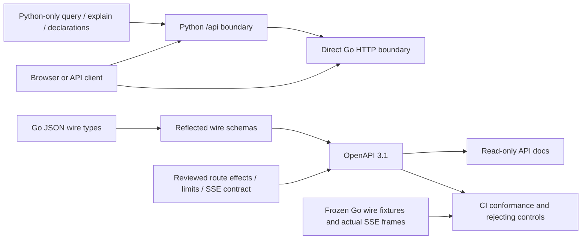

# HTTP API contract

The current OpenAPI 3.1 contract is [api/openapi.json](../api/openapi.json).
Run the Python UI server and open [API docs](http://localhost:8088/api-docs), or
[download the spec](http://localhost:8088/openapi.json). The docs are read-only,
searchable and self-contained: no CDN, telemetry query or API execution widget.
They run from the current checkout; an older container image must be rebuilt to
serve these routes.

The spec inventories 64 supported operations: 58 Go operations, five Python-only
`/api` operations and the Python root `/health` probe. Go paths are unprefixed on
port 8089; the browser proxy exposes them under `/api` on port 8088. Python-only
operations override the server list. `/api-docs`, `/openapi.json`, the UI, static
assets and unsupported prefix suffixes are documentation/application resources,
not additional observability API operations. Go's automatic HEAD/mux refusal
behavior is not a separately supported browser endpoint.



## What the schemas promise

All supported Go request and response envelopes have typed shapes. Nested
`json.RawMessage`, dynamic record rows, arbitrary exporter maps and interface
values remain open where the implementation is open. Python legacy query results
have a typed envelope with adapter-shaped rows; the legacy package keeps its
extensible declaration shape. This is the implemented development API, not a
stability promise or a replacement for semantic validation.

The Go generator reflects JSON field names, embedded structs, pointers, arrays,
maps and omission behavior. Input models allow omitted/null fields where Go's
decoder does, with unknown canonical fields refused. Go's case-insensitive JSON
matching and duplicate-field handling still apply; clients should use the canonical
names in the spec. Response fields without `omitempty` are required. Nanosecond
bounds, counts, revisions and exact telemetry values remain strings where the Go
wire types use strings. Do not convert them through JavaScript `Number`.

Schemas express structural encoding, not every valid question, combination, finite
integer range, lineage relationship, count accounting rule or capability state.
Go remains responsible for validated fields/operators, units, temporality,
resets, complete-population totals, query compilation and evidence identity.
A structurally valid request may return 400. OpenAPI validation does not prove
source-free reopen, custody ordering or absence of hidden reads; behavioral tests
do. No generated handler/client or request-validation middleware was introduced.

## Two boundaries, with existing differences

Every Go POST operation documents `x-go-body-limit-bytes` and
`x-browser-body-limit-bytes`. These are byte ceilings, not string lengths. The
Python proxy checks positive Content-Length before forwarding. In particular:

| Route | Go | Browser proxy |
| --- | --- | --- |
| `/dashboards/plan` | 256 KiB | 16 KiB |
| `/metric-discovery` | 64 KiB | 16 KiB |
| `/annotations`, `/deployments` | 128 KiB | 16 KiB |
| `/compare` | 1 MiB | 1 MiB |

Direct Go decoders accept JSON without enforcing Content-Type; application/json
is the documented client encoding. Trailing-input errors differ by owner. The
proxy reparses/reserializes JSON, so byte-identical response fixtures describe Go,
not Python's JSON formatting. Direct operation GET validation uses text/plain
`http.Error` bodies containing JSON-looking text; the browser re-encodes parsed
errors as JSON. The proxy does not forward all upstream headers (including query
budget Retry-After). These are current discrepancies, not changes made by this spec.

`x-effects` distinguishes pure plans/supplied-summary comparisons, source reads,
source reads with possible custody/capture publication, saved reads, file
publication, optional XTDB operations and cancellation. GET does not imply no
telemetry execution. `/captures/live` reads fresh evidence or freezes a held draft;
its 200 draft and 201 frozen-page responses are separate. Opening saved evidence
does not imply a telemetry reread. Optional XTDB configuration status is not health;
per-operation read basis remains distinct from the configured connection.

The lab has no authentication layer. `X-Goo-Query-ID` and draft/result tokens are
short-lived local capabilities, not authorization. Do not infer authentication
from ClickHouse credentials held by the server. See the fuller
[HTTP ownership contract](HTTP_BOUNDARIES.md) for budgets and effects.

## Tail event contract

POST `/tail` returns `text/event-stream` after validation/admission. Each frame
has a connection-local numeric `id`, an `event` and JSON `data`, followed by a blank
line. `x-sse-events` binds event names to schemas:

| Event | Meaning |
| --- | --- |
| `reset` | Rolling window 60,000 ms, selector, unknown continuity, no replay |
| `batch` | Supplied rows, limited flag, fixed poll bounds and observation time |
| `gap` | Source unavailable, identity budget exhausted, or connection ended |

The Go stream has four local slots, a 60-second context, two-second polls and
five-second write deadlines. Python's upstream socket timeout is 45 seconds, not
a guaranteed stream duration. Disconnect releases the upstream slot. Use POST
fetch streaming; browser EventSource cannot submit the selector body. Last-Event-ID
does not provide replay/resume. This polls an event-time window, not an ingestion
cursor or complete capture. A gap after headers remains HTTP 200, and disconnect
can prevent delivery of a final frame. Successful streams set no-store and
X-Accel-Buffering: no; direct early JSON errors omit no-store, whereas the proxy's
JSON errors include it. The JSON response helper must not buffer SSE.

Actual reset/source-unavailable gap bytes are frozen in
[testdata/http/tail.sse](../testdata/http/tail.sse) and executed by
`TestAPITailSSEWireContract`. Batch schema examples and rejecting controls complement
existing real-loopback batch/disconnect tests; they do not replace those tests.

## Updating and checking

From the repository root:

```sh
go run ./scripts/openapi-schema api/go-schemas.json
python3 scripts/build_openapi.py
python3 -m venv /tmp/goo-api-tools
/tmp/goo-api-tools/bin/pip install -r requirements-api.txt
/tmp/goo-api-tools/bin/python scripts/check_openapi.py
go test ./cmd/goo -run 'Test(APITailSSEWireContract|PlanningHTTPWireFixtures|TelemetryHTTPWireFixtures|NativeJSONHTTPWireFixtures|ExplorationJSONHTTPWireFixtures)$' -count=1
python3 -m unittest discover -s tests -p test_api_docs.py -v
node scripts/check_api_docs.cjs
```

[CI](../.github/workflows/api-contract.yml) regenerates both checked-in artifacts,
refuses drift, validates OpenAPI/references and every Go route, and checks typed
requests/responses against the existing wire fixtures. Unknown-field, wrong-error-
type and malformed SSE controls must fail. All 236 HTTP cases are accounted for:
222 documented-operation responses, 56 admitted requests and 14 default mux
refusals. The workflow executes those wire tests plus the actual SSE fixture,
and tests the Python docs routes. The browser journey runs locally with the
existing Playwright/Chromium setup and captures a real docs screenshot; it does
not start the full lab or mutate telemetry.

Schema roots and inline request envelopes live in
[scripts/openapi-schema/main.go](../scripts/openapi-schema/main.go); reviewed
route policy lives in [scripts/build_openapi.py](../scripts/build_openapi.py).
Route discovery is an inventory aid, not authority to invent an endpoint policy:
new routes must have reviewed effects, request/response roots, limits, supported
statuses and fixture coverage. Extensions describe current behavior and do not
change runtime enforcement. Remaining work is to broaden executed fixture coverage
beyond the four current JSON groups, add browser-proxy contract fixtures, and
complete C2's deployed integration acceptance. The spec pauses further mechanical
JSON migration while those contracts become the common API reference.
