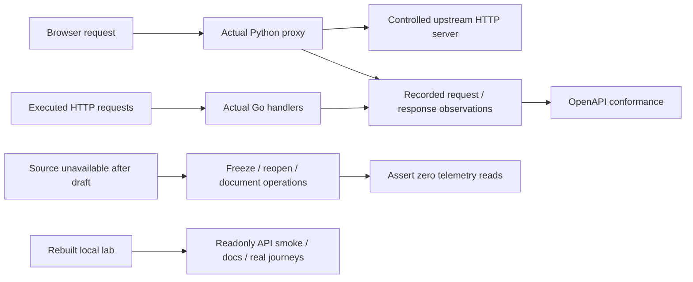

# API conformance and deployed acceptance

This continues the [OpenAPI contract](API.md), with executed behavior rather than
schema generation alone. It does not close every C2 endpoint/branch acceptance gap.

## Executed contract layers

| Layer | What it establishes | Boundary |
| --- | --- | --- |
| Frozen direct-Go fixtures | 236 cases, exact response bytes/headers, limits and rejection/admission | Four JSON groups; not every endpoint |
| Saved workflow observations | Capture, live draft/freeze/idempotency, capture/receipt/list, document/reopen/list and optional-store status/refusal | Injected source; fails on telemetry reads after source goes offline |
| Optional XTDB observations | Retention, correction, manifest/current/pinned reviews and pinned document/offline reopen | Real native local XTDB; explicitly skipped without URL |
| Browser proxy contracts | Real HTTP on both sides; byte ceilings, header/query forwarding, error envelopes and idle SSE abort cleanup | Injected upstream; records actual proxy responses for schema checks |
| Deployed readonly API smoke | Matching running spec, catalogs, native discovery, actual span page/count and validation errors | Real running Python/Go/ClickHouse lab |
| Deployed browser journeys | Core investigation, capture/reopen and retained-evidence flows | Actual UI and telemetry; see current run evidence in VALIDATION.md |

The saved workflow exports 12 observations without XTDB and 19 with it. Proxy
contracts export 20 JSON observations. The schema checker validates actual request
and response envelopes, including dynamic IDs/times/bases; stable fixtures still
protect byte equality. No observations include credentials. Raw retained telemetry
and ledgers remain local ignored artifacts, not checked-in examples.

The executed tests identified and fixed an incorrect initial document request
schema: its outer `document` and `parent` fields are now explicit. Cancellation
also records the browser's required nonempty body (`{}`), despite direct Go ignoring
that body. A runtime proxy bug is fixed: non-JSON upstream HTTP errors now become
JSON 502 instead of disconnecting clients. Valid upstream JSON status/body behavior,
request limits, Retry-After omission and early-tail cache-header differences remain
as documented.

## Replay

```sh
GOO_API_OBSERVATIONS=/tmp/saved-api.json go test ./cmd/goo -run '^TestAPISavedEvidenceObservedContracts$' -count=1
GOO_PROXY_OBSERVATIONS=/tmp/proxy-api.json python3 -m unittest discover -s tests -p test_api_proxy.py -v
python3 scripts/check_openapi.py --observations /tmp/saved-api.json --proxy-observations /tmp/proxy-api.json
python3 scripts/check_deployed_api.py
GOO_API_DOCS_URL=http://127.0.0.1:8088/api-docs node scripts/check_api_docs.cjs
bash scripts/run_journeys.sh journeys/core-basics.spec.js journeys/captures.spec.js journeys/retained-evidence.spec.js
```

Use the isolated API dependencies and Go/browser toolchains in [API.md](API.md).
Set `GOO_XTDB_TEST_URL` for the positive native-store branch. CI executes the base
branch and proxy observations; it does not claim a deployed ClickHouse/XTDB lab.
The journey wrapper pauses/restores only the demo traffic generator and preserves
existing pending entries/volumes. Existing browser verification includes Quint
observed-trace replay and its rejecting controls where the journey invokes them.



## Build and data preservation

The prior Dockerfile omitted the new `internal` packages. The build now includes
all source through a read-only bind mount in one Go build step. It uses the same Go
version with an Alpine build image and CGO disabled, and avoids VFS amplification
from copying a full toolchain snapshot for every source directory. Optional CA
secrets preserve TLS verification without copying session trust into image layers.
See the [managed rebuild commands](API.md#managed-lab-rebuild).

During this run, the original Debian toolchain build exhausted disk. Recovery
removed a verified disposable compiler cache, exact unused failed-toolchain/source
cache records and an untagged intermediate image created by this task. No global
prune, volume removal or ledger deletion was performed. Both current images and
the earlier rollback image remain. Only query/packages were recreated; ClickHouse,
Redis, XTDB, sample services and their data remain in place.

## Remaining acceptance

Broaden observed coverage for investigation captures, annotations/views/deployments,
comparison publication, invalid lineage, paging and optional-store recovery errors.
Some are already behavior-tested independently, but they do not yet all export
OpenAPI observations. Decide documented proxy-limit/header inconsistencies as
separate behavior changes. Do not silently standardize them through decoder
refactors. Resume remaining mechanical JSON migration only behind the contract
coverage appropriate to the touched owner. Authentication, durable draft recovery
and a stable external API version are not supplied by OpenAPI.
