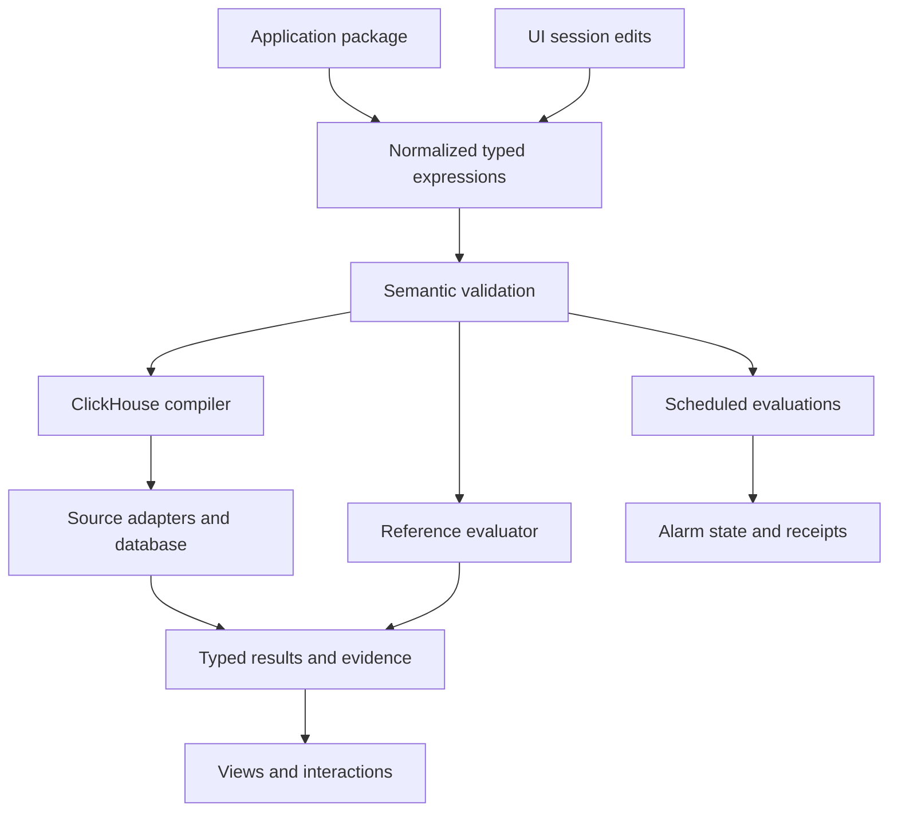

# Architecture

See the [architecture and process diagrams](ARCHITECTURE_DIAGRAMS.md) for the
source/build path, illustrative production service topology, OTel/ClickStack
capture, investigation sequence and separate Databricks artifact boundary.
The [implementation plan](IMPLEMENTATION_PLAN.md) distinguishes completed slices
from remaining work; [validation](../VALIDATION.md) records actual checks.

## Current implementation

| Component | Source | Responsibility |
| --- | --- | --- |
| Local stack | compose.yaml | Twelve default services: capture/storage, Python sample roles, two woven Go apps, query and Go packages; optional MongoDB/HyperDX |
| OTel pipeline | config/collector.yaml | Receive OTLP logs/traces/metrics, batch, export to ClickHouse baseline tables |
| Sample roles | sample.py | HTTP gateway, unary gRPC acceptance, Redis publisher, consumer attempts, traffic generator |
| Telemetry setup | telemetry.py | Python SDK providers, explicit always-on demo tracing, OTLP/HTTP exporters |
| Prototype query compiler | grammar.py | Validate the original lab request and select bounded SQL templates |
| Query service | server.py | Serve static UI, package definition, query and explain endpoints |
| Browser workspace | ui/workspace.js, ui/product.css, ui/index.html | Service-neutral navigation and visual system; Examples contains the original Python reservation workflow |
| Telemetry package authoring | exploration/package*.go, cmd/goo/telemetry_packages_http.go, ui/telemetry-packages.js | Manifest-free reusable selectors/counts, strict YAML, immutable definition revisions, preview plans and optional annotation handoff |
| Observed service inventory | exploration/inventory.go, ui/inventory.js | Single-read captured service/span-name counts, Error statuses and duration buckets; fixed-window Explore/package navigation; no membership inference |
| General exploration | exploration/, ui/exploration.js, ui/distributions.js | Arbitrary retained OTel attributes, population counts, distributions, fixed-window cohort comparison and cross-service trace/log context |
| Prototype package data | definitions/reservations.json | Demo deadline, target, permitted views, grouping choices |
| Annotation build/runtime | annotations/, instrumentation/, scripts/build_*_app.sh | Validate selected source contracts, weave opt-in Go builds, emit standard OTel spans/events/metrics |
| Operation package planner | annotations/package.go, config/operations/ | Shared strict YAML bindings, identity, enabled views, counter/histogram contracts and content revisions |
| Go investigation service | cmd/goo/serve_http.go | Serve configured HTTP/operation plans and bounded ClickHouse-backed observations |
| Physical operation sources | annotations/clickhouse.go, annotations/counters.go, annotations/histograms.go | Normalize and validate exporter rows without presentation limits defining totals |
| Native counter kernel | metrics/counter.go | Exact deltas, temporality/epoch/gap handling, unknown intervals and separate evidence bases |
| Fleet coverage | metrics/fleet.go, annotations/fleet.go, ui/fleet.js | Fixed expected membership, bounded peer queries, exact aligned totals or unknown coverage |
| Error-ratio kernel | metrics/ratio.go, annotations/ratios.go | Exact aligned outcome counts, unknown/idle semantics, declared policy and shared counter basis |
| Native histogram kernel | metrics/histogram.go | Exact bucket deltas, unknown boundaries, explicit aligned merges and P95 bucket ranges |
| Shared aggregate/lifecycle kernels | measurement/, lifecycle/ | Prepared-fact evaluation and compiler targets; normalized lifecycle fixtures and receipts |
| Operation browser components | ui/operations.js, ui/visualizations.js, ui/histograms.js, ui/ratios.js | Package-driven overview, raw heatmaps, scoped subject navigation, waterfalls, native histograms and counter/context views |

The sample has no durable business outbox or complete acceptance ledger. It emits application-defined log attributes and can lose telemetry independently of queue acknowledgement. The consumer deliberately creates a new trace with a producer link. gRPC application payloads use a JSON codec; telemetry uses standard protobuf OTLP.

The original Python query backend uses fixed table names and logical assumptions embedded in SQL. Values are passed through ClickHouse typed parameters. The result summary is calculated from the bounded returned rows. The alarm is a preview calculated when a user queries. None of these constitute a general package compiler or operational SLO evaluator.

The Go operation path now separates [YAML package planning](OPERATION_PACKAGES.md),
source normalization and evaluation. [Native counter rates](NATIVE_COUNTERS.md)
use actual metric points; span links from rate intervals are contextual, with a
separate basis. [Subject navigation](SUBJECT_NAVIGATION.md) uses declared scoped
identity, not inferred causality or durable completion. Neither path repairs the
original Python reservation-preview accounting gaps automatically.

## Target boundaries (partly implemented)

The diagram above is a target decomposition, not a claim that scheduled evaluations,
managed alarm state or general template resolution exist. The current YAML
operation planner and portable aggregate compiler implement bounded subsets.

Normalization resolves names, expands pinned templates, and produces a stable representation. Semantic validation determines subject grain, units, dimensions, time bounds, aggregation state, and evidence assumptions. Backend compilation chooses physical field bindings and query plans. Rendering consumes typed results; changing a geometry should not silently change a measurement.

SLO measurement and evidence inspection are separate requests sharing the same population definition. SLO totals aggregate all eligible subjects; the inspector returns a page of subjects. A trace relation changes the evidence being inspected, and cannot multiply the original SLI denominator accidentally.

## Suggested source layout as the code grows

Keep current entrypoints initially. Extract a small core package containing AST schema, normalization, type checks, reference evaluation, ClickHouse compilation, and source profiles. Separate service-level package resolution from pure expression evaluation. Add an evaluator service only when scheduled resources are implemented; no microservice split is required to establish these module boundaries.

## Representation and language

JSON remains the browser/result transport. Strict YAML operation packages and
prepared aggregate definitions are implemented; CEL/KCL remain authoring candidates. The original design uses EDN and Clojure-style expressions because plain values and functional composition fit the project. The next implementation must preserve semantic structure across transport, regardless of syntax. Prefer a small normalized data model over a decision to port the entire app before its semantics are established.

Plotje may serve as a renderer or design influence. Trace waterfalls and related-record browsing need explicit result contracts even if they use a different rendering adapter. Native metric points and span-derived measurements also need distinct typed semantics.

Native duration histograms now have a separate Go kernel (`metrics/histogram.go`), strict YAML contracts, bounded histogram-table adapter and per-stream heatmap. Explicit aligned merging is core/CLI only. See [semantics and evidence](NATIVE_HISTOGRAMS.md) and [diagram 5](ARCHITECTURE_DIAGRAMS.md#5-native-histogram-intervals-and-bounded-investigation).

[Operation error ratios](OPERATION_ERROR_RATIOS.md) now derive from one counter
result with exhaustive outcome membership. Diagram 6 follows explicit SDK zero
baselines through the guided contextual investigation.

[Fleet coverage](FLEET_COVERAGE.md) now separates observed members from valid
aligned intervals. Diagram 7 shows guarded fleet totals and the selected-instance
path. Membership is declarative; discovery and automatic alignment remain planned.

Two live checkout instances now support [bounded-skew comparison](FLEET_COMPARISONS.md) through `metrics/comparison.go`, keeping actual member populations distinct from exact fleet totals. Diagram 8 includes the sample-only export fault gate.

Immutable capture storage lives in `investigations/`; the Go packages HTTP boundary captures trusted source results, retains separate bases/errors and publishes receipts to a local named volume. Browser reopening renders stored evidence and refresh creates a successor with the same fixed question. See [Saved investigations](SAVED_INVESTIGATIONS.md) and architecture diagram 9.

The bounded general exploration AST, reference predicates and ClickHouse compiler/source executor live in `exploration/`; `cmd/goo/exploration_http.go` exposes the Go API and the CLI shares its compiler. The UI retains original query and expanded trace/log bases separately. See [design](EXPLORATION_DESIGN.md) and architecture diagram 10.

Application-specific examples and general-purpose product boundaries are documented
in [the workspace contract](PRODUCT_WORKSPACE.md#general-purpose-boundary).
