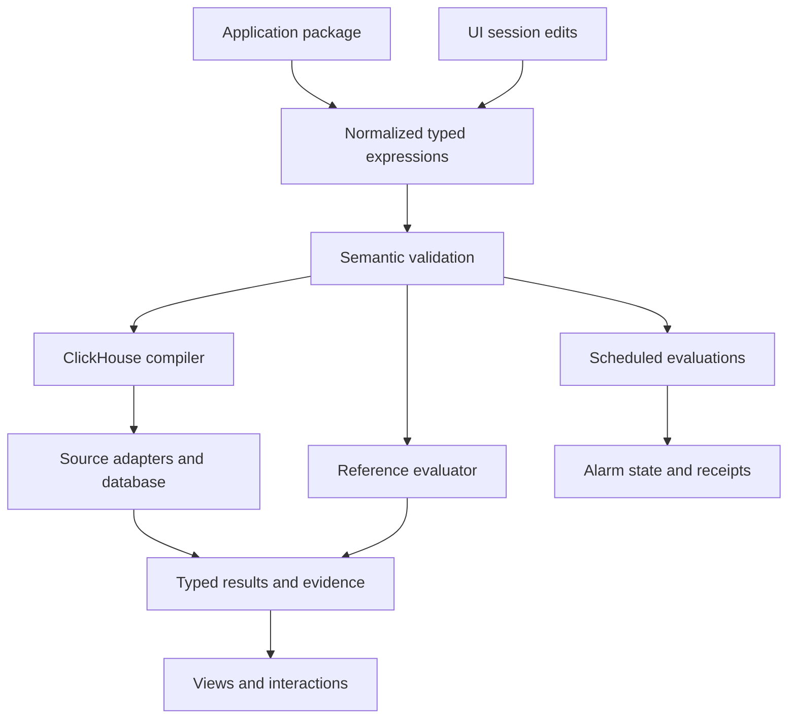

# Architecture

[Record population gestures](RECORD_POPULATIONS.md) reuse the attribute viewer and typed selection owner. Shared-field discovery is local string intersection; query evaluation remains in Go. [Shared annotations](WORKBENCH_ANNOTATIONS.md) attach exact-target revision sidecars; optional native retention freezes selected server-owned observations. The broader reviewed-label design remains proposed.

[Categorical selection](FACET_SELECTION.md) constructs bounded typed predicates in the population adapter, then delegates validation/compilation and measurement to Go. Staging and child return are source-free.

[Range drilldowns](RANGE_DRILLDOWNS.md) retain connected parent DOM/owners while
staging an independently namespaced child population. Display components emit
selection intent; the adapter projects checked fixed bounds without source reads.
Only explicit Run executes existing Go questions. Back disposes the child's
requests/descendants and restores the paused parent without reads. There are at
most three child levels; this session state is separate from immutable evidence
and stored view configuration. The linked sequence diagram documents ownership.

[Recent activity](RECENT_ACTIVITY.md) enters the existing Go population planner
directly from Explore. The adapter resolves fresh fixed bounds, runs at most two
typed exploration requests and composes existing charts/facets/record pages;
those requests retain their independent backend read bases. Local signal switching,
view settings and range preview do not query telemetry. Live owners remain explicit.

The [population workspace](POPULATION_WORKSPACE.md) composes existing record queries through a data-only Go planner, reuses aligned timeline/record display adapters, and stores immutable exploration-view configuration in the workbench. Query kernels, captured evidence and saved presentation configuration remain separate.

[Linked timeline architecture](LINKED_TIMELINE.md) composes existing Go widget results into passive shared-time lanes. `goo-time-range` emits bounded selections; the service adapter preserves identity and native definitions while rereading the overview.

The [trace finding flow](TRACE_FINDINGS.md) keeps exact page-example selection in Go, navigation and two sequential capture requests in application adapters, and immutable custody in existing capture/document stores. Passive display elements perform no source reads. The sequence diagram documents compilation/query boundaries and the capture-to-finding handoff.

See the [architecture and process diagrams](ARCHITECTURE_DIAGRAMS.md) for the
source/build path, illustrative production service topology, OTel/ClickStack
capture, investigation sequence and separate Databricks artifact boundary.
The [implementation plan](IMPLEMENTATION_PLAN.md) distinguishes completed slices
from remaining work; [validation](../VALIDATION.md) records actual checks.

## Current implementation

| Component | Source | Responsibility |
| --- | --- | --- |
| Local stack | compose.yaml | Twelve default services: capture/storage, Python sample roles, two woven Go apps, query and Go packages; optional MongoDB/HyperDX |
| OTel pipeline | config/collector.yaml | Receive OTLP logs/traces/metrics, batch, export to ClickHouse baseline tables |
| Sample roles | sample.py | HTTP gateway, unary gRPC acceptance, Redis publisher, consumer attempts, traffic generator |
| Telemetry setup | telemetry.py | Python SDK providers, explicit always-on demo tracing, OTLP/HTTP exporters |
| Prototype query compiler | grammar.py | Validate the original lab request and select bounded SQL templates |
| Query service | server.py | Serve static UI, package definition, query and explain endpoints |
| Browser workspace | ui/workspace.js, ui/product.css, ui/index.html | Service-neutral navigation and visual system; Examples contains the original Python reservation workflow |
| Telemetry package authoring | exploration/package*.go, cmd/goo/telemetry_packages_http.go, ui/telemetry-packages.js | Manifest-free reusable selectors/counts, strict YAML, immutable definition revisions, preview plans and optional annotation handoff |
| Observed service inventory | exploration/inventory.go, ui/inventory.js | Single-read captured service/span-name counts, Error statuses and duration buckets; fixed-window Explore/package navigation; no membership inference |
| General capture custody | exploration/capture_store.go, cmd/goo/captures_http.go, ui/captures.js | Immutable manifest-free evidence, bounded stored row bank, receipt-bound paging, local catalog and fixed-question/plan successor refresh |
| General exploration | exploration/, ui/exploration.js, ui/distributions.js | Arbitrary retained OTel attributes, population counts, distributions, fixed-window cohort comparison and cross-service trace/log context |
| Prototype package data | definitions/reservations.json | Demo deadline, target, permitted views, grouping choices |
| Annotation build/runtime | annotations/, instrumentation/, scripts/build_*_app.sh | Validate selected source contracts, weave opt-in Go builds, emit standard OTel spans/events/metrics |
| Operation package planner | annotations/package.go, config/operations/ | Shared strict YAML bindings, identity, enabled views, counter/histogram contracts and content revisions |
| Go investigation service | cmd/goo/serve_http.go | Serve configured HTTP/operation plans and bounded ClickHouse-backed observations |
| Physical operation sources | annotations/clickhouse.go, annotations/counters.go, annotations/histograms.go | Normalize and validate exporter rows without presentation limits defining totals |
| Native counter kernel | metrics/counter.go | Exact deltas, temporality/epoch/gap handling, unknown intervals and separate evidence bases |
| Fleet coverage | metrics/fleet.go, annotations/fleet.go, ui/fleet.js | Fixed expected membership, bounded peer queries, exact aligned totals or unknown coverage |
| Error-ratio kernel | metrics/ratio.go, annotations/ratios.go | Exact aligned outcome counts, unknown/idle semantics, declared policy and shared counter basis |
| Native histogram kernel | metrics/histogram.go | Exact bucket deltas, unknown boundaries, explicit aligned merges and P95 bucket ranges |
| Shared aggregate/lifecycle kernels | measurement/, lifecycle/ | Prepared-fact evaluation and compiler targets; normalized lifecycle fixtures and receipts |
| Operation browser components | ui/operations.js, ui/visualizations.js, ui/histograms.js, ui/ratios.js | Package-driven overview, raw heatmaps, scoped subject navigation, waterfalls, native histograms and counter/context views |

The sample has no durable business outbox or complete acceptance ledger. It emits application-defined log attributes and can lose telemetry independently of queue acknowledgement. The consumer deliberately creates a new trace with a producer link. gRPC application payloads use a JSON codec; telemetry uses standard protobuf OTLP.

The original Python query backend uses fixed table names and logical assumptions embedded in SQL. Values are passed through ClickHouse typed parameters. The result summary is calculated from the bounded returned rows. The alarm is a preview calculated when a user queries. None of these constitute a general package compiler or operational SLO evaluator.

The Go operation path now separates [YAML package planning](OPERATION_PACKAGES.md),
source normalization and evaluation. [Native counter rates](NATIVE_COUNTERS.md)
use actual metric points; span links from rate intervals are contextual, with a
separate basis. [Subject navigation](SUBJECT_NAVIGATION.md) uses declared scoped
identity, not inferred causality or durable completion. Neither path repairs the
original Python reservation-preview accounting gaps automatically.

## Target boundaries (partly implemented)

The diagram above is a target decomposition, not a claim that scheduled evaluations,
managed alarm state or general template resolution exist. The current YAML
operation planner and portable aggregate compiler implement bounded subsets.

Normalization resolves names, expands pinned templates, and produces a stable representation. Semantic validation determines subject grain, units, dimensions, time bounds, aggregation state, and evidence assumptions. Backend compilation chooses physical field bindings and query plans. Rendering consumes typed results; changing a geometry should not silently change a measurement.

SLO measurement and evidence inspection are separate requests sharing the same population definition. SLO totals aggregate all eligible subjects; the inspector returns a page of subjects. A trace relation changes the evidence being inspected, and cannot multiply the original SLI denominator accidentally.

## Suggested source layout as the code grows

Keep current entrypoints initially. Extract a small core package containing AST schema, normalization, type checks, reference evaluation, ClickHouse compilation, and source profiles. Separate service-level package resolution from pure expression evaluation. Add an evaluator service only when scheduled resources are implemented; no microservice split is required to establish these module boundaries.

## Representation and language

JSON remains the browser/result transport. Strict YAML operation packages and
prepared aggregate definitions are implemented; CEL/KCL remain authoring candidates. The original design uses EDN and Clojure-style expressions because plain values and functional composition fit the project. The next implementation must preserve semantic structure across transport, regardless of syntax. Prefer a small normalized data model over a decision to port the entire app before its semantics are established.

Plotje may serve as a renderer or design influence. Trace waterfalls and related-record browsing need explicit result contracts even if they use a different rendering adapter. Native metric points and span-derived measurements also need distinct typed semantics.

Native duration histograms now have a separate Go kernel (`metrics/histogram.go`), strict YAML contracts, bounded histogram-table adapter and per-stream heatmap. Explicit aligned merging is core/CLI only. See [semantics and evidence](NATIVE_HISTOGRAMS.md) and [diagram 5](ARCHITECTURE_DIAGRAMS.md#5-native-histogram-intervals-and-bounded-investigation).

[Operation error ratios](OPERATION_ERROR_RATIOS.md) now derive from one counter
result with exhaustive outcome membership. Diagram 6 follows explicit SDK zero
baselines through the guided contextual investigation.

[Fleet coverage](FLEET_COVERAGE.md) now separates observed members from valid
aligned intervals. Diagram 7 shows guarded fleet totals and the selected-instance
path. Membership is declarative; discovery and automatic alignment remain planned.

Two live checkout instances now support [bounded-skew comparison](FLEET_COMPARISONS.md) through `metrics/comparison.go`, keeping actual member populations distinct from exact fleet totals. Diagram 8 includes the sample-only export fault gate.

Immutable capture storage lives in `investigations/`; the Go packages HTTP boundary captures trusted source results, retains separate bases/errors and publishes receipts to a local named volume. Browser reopening renders stored evidence and refresh creates a successor with the same fixed question. See [Saved investigations](SAVED_INVESTIGATIONS.md) and architecture diagram 9.

The bounded general exploration AST, reference predicates and ClickHouse compiler/source executor live in `exploration/`; `cmd/goo/exploration_http.go` exposes the Go API and the CLI shares its compiler. The UI retains original query and expanded trace/log bases separately. See [design](EXPLORATION_DESIGN.md) and architecture diagram 10.

Application-specific examples and general-purpose product boundaries are documented
in [the workspace contract](PRODUCT_WORKSPACE.md#general-purpose-boundary).

The shared Explore Go query now includes optional duration summaries/time buckets;
`query_budget.go` bounds general execution/cancellation, while service discovery
keeps event age and reported-parent uncertainty explicit. See
[core workbench](CORE_WORKBENCH.md) and architecture flow 20 for code contracts
and remaining production boundaries.

Built-in recipes are pure transforms in `exploration/recipes.go` followed by the
same source compiler. Sample investigation entry points now consume ordinary
telemetry packages rather than adding example-specific query branches. See
[the contract](INVESTIGATION_RECIPES.md) and architecture flow 24.

## Display component boundary

[UI components](UI_COMPONENTS.md) are native custom elements with declarative
JSON attributes and structured properties, usable from server-rendered HTML or
an SPA. They own semantic DOM, formatting and native disclosure behavior. The
application owns source reads, typed questions, scope changes, navigation and
custody. Shared component styling is separate from page layout; light-DOM adapters
must scope table/viewport rules to their own children. Current adoption covers
Services/Explore latency and stat lists, grouped latency comparisons, native-table
viewports and explicit result states. Table/state shells retain caller-authored
children across upgrade, attribute changes and reconnects; adapters own row
patches and status explanations. Future live transport remains outside elements.

Facets retain caller rows and filter them locally; typed field values render
JSON-compatible snapshot values with explicit presence. `attributes.js` remains
the app adapter for record mapping and query actions while exporting the reusable
value/list elements. Components do not interpret OTel namespaces or issue reads.

## Live observation adapter

The Go tail handler validates a log selector, performs bounded rolling row reads
and emits SSE observations through the Python streaming proxy. Explore owns
connection generations, reconnect gaps, retention and focus/follow behavior.
The passive table and attribute components retain caller rows. No tail buffer
becomes a measurement population. See the [sequence diagram](LIVE_LOG_TAIL.md).
Waterfall and count-time geometry are separate passive components; app adapters
own details, interval actions and source questions.

### Rolling record comparison and snapshot custody

The [live comparison sequence](LIVE_COMPARISON.md) describes the current path:
app-owned polling → frozen baseline question → equal-duration Go source read →
compatibility kernel → passive shared chart frame/paired bars. Freeze publishes
an expiring server-owned snapshot through the capture store without a source
read. The local tail buffer never enters this measurement path. `goo-chart-frame`
updates metadata without replacing caller-owned plots, native controls or focus.

The live span adapter now renders count, duration and status from one aggregate
result. Its single response supplies the current basis/read/window and all
summaries; synchronous rendering replaces those measures together. Paired
`goo-latency` elements accept the same app-supplied `ceiling-ns` while recorded
error share uses a fixed percentage axis. Freeze retains the original aggregate
and basis. The [sequence diagram](LIVE_COMPARISON.md) and journey 71 include this
path; inspection rows/field discovery are still separate source reads.

Population breakdowns reuse the existing distribution/comparison adapter with
per-signal DOM namespaces. Field selection and value intersections produce typed
Go queries; comparison uses the existing Go cohort kernel and shared zero-based
visual renderer. `ExplorationView.breakdowns` optionally stores display choices
and baseline queries, never results. Validation requires compatible signal,
environment and grouping; source reads occur only after explicit Run/compare.
See [population contract and flow](POPULATION_WORKSPACE.md#attribute-breakdowns-and-comparisons).

Population live subscriptions use the existing Go SSE tail transport with an
optional signal selector (omitted means logs for compatibility). The source
adapter compiles span/log predicates uniformly; observation identity remains a
bounded per-connection multiplicity tracker. Independent baseline captures and
rolling comparison reads use existing Go kernels, never the display buffer.
See the [live process diagram](POPULATION_WORKSPACE.md#watching-a-population).

## Authored context and optional retained evidence

[Shared tags and notes](WORKBENCH_ANNOTATIONS.md) use typed exact targets and
immutable parent-linked revisions in `workbench/meaning.go`. UI adapters share
`ui/meaning.js`; its `goo-tag-list` element remains display-only. Scoped service
assertions name an applicability window; exact saved artifacts do not manufacture
one. Active heads derive from parent edges, preserving parallel reviews.

The optional `retention` Go package writes selected **server-owned live-page or
saved-capture** observations and their initial annotation atomically into XTDB
through pgx. `exploration/result_snapshots.go` holds bounded exact result pages
for two minutes; client records never become authoritative evidence. Refresh and
paging create new tokens, while original page indexes remain stable until expiry.
Native member projections support joins while exact JSON payloads remain retained.
Initial and correction request receipts recover uncertain responses without
additional revisions. New connections apply the caller's XTDB await-token lower
bound; the UI retains it across reloads in the same tab. This does not pin a
historical knowledge cutoff. The capture store, ephemeral pages, live ClickStack
source and native evidence store remain distinct boundaries; reopening retained
evidence reads neither live telemetry nor the original capture/page. The
[contract and process diagram](WORKBENCH_ANNOTATIONS.md) identify limits including
cross-store search, cross-client basis sharing and authentication. No ClickHouse
external-source connector is implemented.

## Retained evidence in investigations

`retention/catalog.go` enumerates bounded immutable manifests and explicit current
review heads; metadata filtering never reads ClickStack. `ui/retention.js` owns the
catalog, attachment actions and reference reads. Retained document cards pin both
a manifest ID and an exact review revision with an await-token lower bound.
`workbench/documents.go` validates the typed reference and a native resolver checks
it before publication. Opening the file-backed narrative does not require the
native database; resolving its reference body does. The native retry journal in
`ui/pending-saves.js` performs no network work: application adapters persist the
original request before sending and require explicit recovery after reload. Passive
custom elements remain display-only. See the [process diagram and limits](WORKBENCH_ANNOTATIONS.md#find-cite-and-recover-retained-evidence).

The [whole-product usability review](WHOLE_PRODUCT_USABILITY_REVIEW.md) proposes
entry/action/layout consolidation across these existing adapters. It is a review
of the preceding runtime, not a claim those structural changes are implemented.

## Application composition ownership

[Live and saved operations](LIVE_SAVED_OWNERSHIP.md) now have separate destinations
and selection controllers. Workspace navigation never reparents the live editor.
`GooOperations.overview` renders supplied operation evidence for both owners;
saved component IDs are scoped. No receipt hash or Go semantic contract changes.

Population owns its applied scope, total, timeline and record page. Its facet
adapter uses `GooDistributions.mountFacets`, which shares the existing facet and
comparison mechanics without constructing a second count/chart/measure workspace.
Recent timeline controls and mobile facets are source-free disclosures. The full
single-question distribution and service timeline compositions remain available.

## Fresh live entry

[Live Activity](LIVE_ACTIVITY.md) classifies visit intent before subscribing, reuses the existing bounded tail core and keeps its local inspector separate from fixed execution. Saved/shared entry remains inert. The [whole-product architecture review](STREAM_FIRST_WHOLE_PRODUCT_ARCHITECTURE.md) identifies the next shared record/context extraction and removal gates; its broader refactoring is proposed, not completed by this entry slice.

Live Activity now keeps signal-local `ScopeFilters` draft/applied predicates in its
application owner. Shared `GooAttributes` emits typed Include/Exclude intents;
chip edits pause locally, Apply starts a new tail generation, and the inspector's
fixed continuation stages the original row read window in `GooExploration` without
fetching. Only the existing Run action rereads it. The existing trail exposes
suspend/resume of its retained fixed view; Live Activity uses these to cancel hidden
work and restore its paused parent without a read. Shared record bodies are now
implemented as described below; wider table-shell consolidation remains planned.

The [shared record presentation](RECORD_PRESENTATION.md) adapter now removes
parallel row-formatting paths from Live and fixed results. Its custom elements
render supplied data only; application adapters retain reads, scope/basis, selection,
fixed/trace continuations and retention. Supplied-parent context has bounded exact
ID traversal and explicit ambiguity/missing/cycle states, with no wider lookup.
