# Architecture

This describes implemented module and lifetime boundaries. The explicitly labeled
target diagram is design context, not another execution queue; current priorities
are in the [reviewed roadmap](ROADMAP_2026_10_28.md). See
[known limits](KNOWN_ISSUES.md) and [executed validation](../VALIDATION.md) for
capability/acceptance boundaries. HTTP paths and native/browser entry points are
indexed in [the API contract](API.md).

[HTTP boundary inventory](HTTP_BOUNDARIES.md) distinguishes pure planning, source
execution, custody/publication, optional XTDB and SSE lifetimes. Native measurement
and record/operation/capture registrations receive configured source or connection
values from one startup snapshot. Query, SSE and held-draft owners retain distinct
lifetimes. Operation GET registration is separate from startup loading; its source
bindings and investigation lineage remain family-owned. Recipes and
dashboard planning share explicit-policy bounded JSON decoding/writing;
semantic validation, status mapping and SSE lifetimes remain in their owners.
Retention routes and document citation checks share an injected optional XTDB URL;
each operation receives its own read basis, and document file loading remains
independent of XTDB. Native measurements now adopt shared POST/auth/context and
bounded-body primitives, while compilation, escaping, status/row guards, evidence
basis and custody remain in the native adapter. Native, record, operation and
prebuilt HTTP mechanics now share bounded `internal/sourcehttp` primitives behind
their distinct adapter contracts. The [HTTP acceptance inventory](HTTP_BOUNDARIES.md#c2-acceptance-audit--2026-10-22)
records adopted transports and remaining endpoint/branch coverage; no common
semantic evaluator or universal request owner is implied.

Application startup activates optional declaration catalogs by workspace. Examples
mounts its galleries/workflows on first visit and shares one example-question
response as independent consumer snapshots. Definitions loads legacy metadata on
first visit; Operations/Definitions share one operation declaration load. Explicit
refreshes remain fresh and source query owners are unchanged. See
[startup work and measured limits](../journeys/219-startup-catalogs-storyboard.md).

Native `measurements.Evaluate(question, rows, at)` is now storage-free and rejects
lifecycle definitions. `ObserveLifecycle` explicitly owns first-observation custody
and correction; the HTTP `Source.Run` adapter dispatches by definition kind. Result
encoding and saved replay remain unchanged. See [evaluation boundaries](MEASUREMENT_PACKAGES.md#go-evaluation-and-lifecycle-observation).

Instrumentation uses an explicit `NewRuntime(Config)` with application-selected
providers and eagerly checked instrument creation. Direct runtimes own their
initialization state; woven hooks use a one-time `BindDefault` process binding.
Applications retain SDK/exporter shutdown. See [runtime ownership and flow](GOO_ANNOTATIONS.md#runtime-ownership-and-startup).

Legacy operation source GETs (including implicit HEAD) now use the shared source
budget and family-declared post-validation deadlines through `internal/operationhttp`.
The operation-package declaration remains outside source admission. Mixed
publication/retention endpoints and SSE keep their distinct owners.

Executables own [bounded shutdown](HTTP_BOUNDARIES.md#executable-shutdown-2026-10-28).
The Go HTTP server drains for five seconds before cancelling its request root and
closing remaining connections. Go sample apps then shut down their own SDK
providers with independent five-second flush budgets; Compose allows 20 seconds.
No exporter is owned by the goo query server or instrumentation library.

Browser source reads use `ui/queries.mjs` → `postJSON(url, body, signal)` or
`getJSON(url, signal)` for the four admitted legacy source GETs.
It returns `{ok, status, data}` after decoding the body; owners keep their HTTP
error messages and question/generation checks. The abort listener remains attached
through both fetch and JSON consumption, then is removed on every exit. An abort
also sends a best-effort, independent cancellation control with the same query ID.
A late result from a transport that ignores abort is rejected before returning.
Legacy operation/HTTP owners cancel pending work on leave, scope change and hiding;
late responses cannot start sequential reads in hidden workspaces. Pure POST planners can use `jsonResponse(fetch(...))` without creating query IDs;
publications and SSE retain their separate owners and retry/continuity semantics.

```mermaid
sequenceDiagram
    participant Owner as Query owner
    participant Read as postJSON
    participant Go as Single Go UI/API server
    Owner->>Read: fixed question + AbortSignal
    Read->>Go: /api POST + X-Goo-Query-ID
    Go-->>Read: headers, then JSON body
    Note over Read,Go: Cancellation remains active while bodies are consumed
    opt owner cancels before JSON read completes
        Owner->>Read: abort
        Read->>Go: independent POST /api/queries/ID/cancel
        Read-->>Owner: AbortError, no result
    end
    Note over Read: Finally removes abort listener; completed reads cannot cancel later
```

`internal/nativehttp` composes native metric/host/pod discovery, measurement Run
and supplied-data host/pod planning. Its policy table and `recordhttp` share the
internal `queryhttp.Policy`, `ReadHandler` and `PlanHandler` mechanics. Source
contexts start after typed validation; bounded pure-plan contexts begin before
JSON decoding and are checked before/after computation. Lifecycle Run retains
its configured custody-directory effect, while discovery/planning do not write.
The [native boundary diagram](HTTP_BOUNDARIES.md#native-measurementdiscovery-policy-extraction-2026-10-28)
shows the two configured source adapters and separate planner/custody paths.

Server startup now creates the result/explanation snapshot bank beside the existing
tail membership bank and passes both explicitly to their producers and consumers.
Capture promotion and retention share their own server's results; neither consults
a package global. Comparison drafts remain registration-local. New server instances
forget live capabilities while durable captures and request recovery retain their
configured storage semantics. See the [ownership diagram](HTTP_BOUNDARIES.md#server-owned-snapshot-capabilities-2026-10-28).

Explanation plans/reads and general capture/promotion/live drafts now live in
`internal/explanationhttp` and `internal/capturehttp`. Each family declares the
POST effect/byte/deadline policy used by its handlers and command admission.
Mixed capture handlers preserve source-versus-held branches, status mapping and
publication retries; they cannot use the generic source-only `ReadHandler`.
The command composes four family lookups instead of a separate path list. See
[the publication flow](HTTP_BOUNDARIES.md#explanation-and-capture-family-policies-2026-10-28).

[Immutable publication](IMMUTABLE_PUBLICATION.md) shares write/sync/link mechanics
across reusable telemetry packages, workbench artifacts, capture stores, lifecycle
custody and native YAML. The latter two retain explicit file-only sync.
Investigation captures retain exclusive collision errors; other adopters accept
existing names and retain their family-specific integrity behavior. Native YAML
POST now validates the existing regular-file winner with a bounded read, package
validation and expected revision; invalid/unavailable winners are refused without
repair or false success (M2, `49b31c2`). Valid noncanonical duplicate winners
still return 201 without rewriting the existing file. Family stores retain encoding, digests,
lineage, catalogs and distinct reload/sync policies.
The documented inventory keeps digest/custody/native YAML differences explicit.

[Native presentation](NATIVE_PRESENTATION.md) shares supplied latest values and coverage across measurements, services and native comparisons. Go evaluation and application read/custody owners remain separate.

[Record population gestures](RECORD_POPULATIONS.md) reuse the attribute viewer and typed selection owner. Shared-field discovery is local string intersection; query evaluation remains in Go. [Shared annotations](WORKBENCH_ANNOTATIONS.md) attach exact-target revision sidecars; optional native retention freezes selected server-owned observations. The broader reviewed-label design remains proposed.


[Population explanations](POPULATION_EXPLANATIONS.md) extend the same contextual
comparison/range workflow. `ui/explanation.mjs` owns explicit execution, staged
original-side filters and source-free request reuse; supplied result rendering
does not infer causes or execute queries. `exploration/explanation.go` projects
count-only questions, validates complete groups, preserves per-read bases and
ranks exact descriptive share changes. `internal/explanationhttp/routes.go`
keeps pure plans/filter plans separate from the controlled aggregate read.
Observed promotion uses the configured server's bounded `ResultSnapshots` pool and immutable
capture publication: the server-held result is saved without a second source
read. Durable explanation captures hold aggregate facts and reusable questions,
not raw inspection rows or ephemeral result tokens. Final journey 177 acceptance
is recorded separately in VALIDATION.md.

[Categorical selection](FACET_SELECTION.md) constructs bounded typed predicates in the population adapter, then delegates validation/compilation and measurement to Go. Staging and child return are source-free.


[Range drilldowns](RANGE_DRILLDOWNS.md) retain connected parent DOM/owners while
staging an independently namespaced child population. Display components emit
selection intent; the adapter projects checked fixed bounds without source reads.
Only explicit Run executes existing Go questions. Back disposes the child's
requests/descendants and restores the paused parent without reads. There are at
most three child levels; this session state is separate from immutable evidence
and stored view configuration. The linked sequence diagram documents ownership.

[Recent activity](RECENT_ACTIVITY.md) enters the existing Go population planner
directly from Explore. The adapter resolves fresh fixed bounds, runs at most two
typed exploration requests and composes existing charts/facets/record pages;
those requests retain their independent backend read bases. Local signal switching,
view settings and range preview do not query telemetry. Live owners remain explicit.

The [population workspace](POPULATION_WORKSPACE.md) composes existing record queries through a data-only Go planner, reuses aligned timeline/record display adapters, and stores immutable exploration-view configuration in the workbench. Query kernels, captured evidence and saved presentation configuration remain separate.

[Linked timeline architecture](LINKED_TIMELINE.md) composes existing Go widget results into passive shared-time lanes. `goo-time-range` emits bounded selections; the service adapter preserves identity and native definitions while rereading the overview.

The [trace finding flow](TRACE_FINDINGS.md) keeps exact page-example selection in Go, navigation and two sequential capture requests in application adapters, and immutable custody in existing capture/document stores. Passive display elements perform no source reads. The sequence diagram documents compilation/query boundaries and the capture-to-finding handoff.

See the [architecture and process diagrams](ARCHITECTURE_DIAGRAMS.md) for the
source/build path, illustrative production service topology, OTel/ClickStack
capture, investigation sequence and separate Databricks artifact boundary.
The [implementation plan](IMPLEMENTATION_PLAN.md) distinguishes completed slices
from remaining work; [validation](../VALIDATION.md) records actual checks.

## Current implementation

| Component | Source | Responsibility |
| --- | --- | --- |
| Local stack | compose.yaml | Default services: capture/storage, Python sample roles, woven Go apps and one Go UI/API server; optional MongoDB/HyperDX |
| OTel pipeline | config/collector.yaml | Receive OTLP logs/traces/metrics, batch, export to ClickHouse baseline tables |
| Sample roles | sample.py | HTTP gateway, unary gRPC acceptance, Redis publisher, consumer attempts, traffic generator |
| Telemetry setup | telemetry.py | Python SDK providers, explicit always-on demo tracing, OTLP/HTTP exporters |
| Historical offline reference | grammar.py | Original reservation SQL templates used only by offline tests; no runtime route |
| Product runtime | cmd/goo/serve_http.go, cmd/goo/serve_ui.go | One Go process serves embedded UI/docs and same-process typed API routes; Compose exposes the same listener on 8088/8089 |
| Browser workspace | ui/workspace.js, ui/product.css, ui/index.html | Navigation/layout facade and visual system; Examples uses Go-backed packages and ordinary YAML questions |
| Pure question protocol | ui/question-protocol.js | Browser/Node step/link/capture projection and comparison-only native-default equivalence; compatibility exports retain identical function references |
| Activity and retained analysis | ui/stream-entry.js, ui/investigation-trail.js, ui/exploration.js | Visit-gated live entry, explicit lazy fixed-owner mounting, paused-parent return and independent source generations |
| Ordinary draft recovery | ui/investigation-draft.js, ui/documents.js | Bounded same-tab authored checkpoints and explicit source-free Restore/Discard, separate from immutable publication and native retry journals |
| Telemetry package authoring | exploration/package*.go, cmd/goo/telemetry_packages_http.go, ui/telemetry-packages.js | Manifest-free reusable selectors/counts, strict YAML, immutable definition revisions, preview plans and optional annotation handoff |
| Observed service inventory | exploration/inventory.go, ui/inventory.js | Single-read captured service/span-name counts, Error statuses and duration buckets; fixed-window Explore/package navigation; no membership inference |
| General capture custody | exploration/capture_store.go, internal/capturehttp/routes.go, ui/captures.mjs | Immutable manifest-free evidence, bounded stored row bank, receipt-bound paging, local catalog and fixed-question/plan successor refresh |
| General exploration | exploration/, ui/exploration.js, ui/distributions.js | Arbitrary retained OTel attributes, population counts, distributions, fixed-window cohort comparison and cross-service trace/log context |
| Prototype package data | definitions/reservations.json | Demo deadline, target, permitted views, grouping choices |
| Annotation build/runtime | annotations/, instrumentation/, scripts/build_*_app.sh | Validate selected source contracts, weave opt-in Go builds, emit standard OTel spans/events/metrics |
| Operation package planner | annotations/package.go, config/operations/ | Shared strict YAML bindings, identity, enabled views, counter/histogram contracts and content revisions |
| Go investigation service | cmd/goo/serve_http.go | Serve configured HTTP/operation plans and bounded ClickHouse-backed observations |
| Physical operation sources | annotations/clickhouse.go, annotations/counters.go, annotations/histograms.go | Normalize and validate exporter rows without presentation limits defining totals |
| Native counter kernel | metrics/counter.go | Exact deltas, temporality/epoch/gap handling, unknown intervals and separate evidence bases |
| Fleet coverage | metrics/fleet.go, annotations/fleet.go, ui/fleet.js | Fixed expected membership, bounded peer queries, exact aligned totals or unknown coverage |
| Error-ratio kernel | metrics/ratio.go, annotations/ratios.go | Exact aligned outcome counts, unknown/idle semantics, declared policy and shared counter basis |
| Native histogram kernel | metrics/histogram.go | Exact bucket deltas, unknown boundaries, explicit aligned merges and P95 bucket ranges |
| Shared aggregate/lifecycle kernels | measurement/, lifecycle/ | Prepared-fact evaluation and compiler targets; normalized lifecycle fixtures and receipts |
| Operation browser components | ui/operations.js, ui/visualizations.js, ui/histograms.js, ui/ratios.js | Package-driven overview, raw heatmaps, scoped subject navigation, waterfalls, native histograms and counter/context views |

The sample has no durable business outbox or complete acceptance ledger. It emits application-defined log attributes and can lose telemetry independently of queue acknowledgement. The consumer deliberately creates a new trace with a producer link. gRPC application payloads use a JSON codec; telemetry uses standard protobuf OTLP.

The original Python reservation query runtime and its UI panel are retired. Its
offline SQL reference is not a product API or an operational SLO evaluator.
See [single-runtime rationale and diagram](SINGLE_GO_RUNTIME.md).

The Go operation path now separates [YAML package planning](OPERATION_PACKAGES.md),
source normalization and evaluation. [Native counter rates](NATIVE_COUNTERS.md)
use actual metric points; span links from rate intervals are contextual, with a
separate basis. [Subject navigation](SUBJECT_NAVIGATION.md) uses declared scoped
identity, not inferred causality or durable completion. Neither path infers durable completion from missing observations.

## Target boundaries (partly implemented)

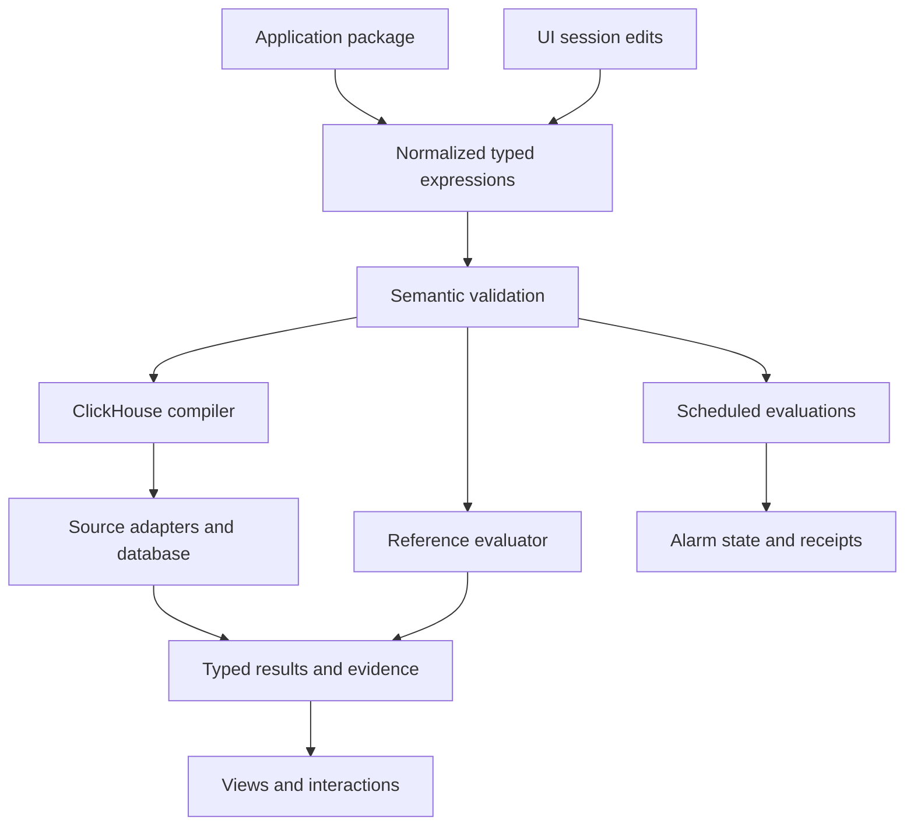

The diagram above is a target decomposition, not a claim that scheduled evaluations,
managed alarm state or general template resolution exist. The current YAML
operation planner and portable aggregate compiler implement bounded subsets.

Normalization resolves names, expands pinned templates, and produces a stable representation. Semantic validation determines subject grain, units, dimensions, time bounds, aggregation state, and evidence assumptions. Backend compilation chooses physical field bindings and query plans. Rendering consumes typed results; changing a geometry should not silently change a measurement.

SLO measurement and evidence inspection are separate requests sharing the same population definition. SLO totals aggregate all eligible subjects; the inspector returns a page of subjects. A trace relation changes the evidence being inspected, and cannot multiply the original SLI denominator accidentally.

## Source layout and design rationale

The original proposal favored a small typed core rather than a frontend rewrite
or premature service split. Current Go packages now implement bounded record
planning/evaluation (`exploration`), native metric kernels (`metrics`), measurement
packages (`measurements`), reusable artifacts (`workbench`) and prepared
aggregate/lifecycle logic. Shared mechanics live in `internal/httpjson`,
`internal/sourcehttp` and `internal/immutablefile`, behind their distinct owners.
General scheduled evaluation remains a separate undeployed design; no new
evaluator service or module rewrite is required by this documentation repair.

## Representation and language

JSON remains the browser/result transport. Strict YAML operation packages and
prepared aggregate definitions are implemented; CEL/KCL remain authoring candidates. The original design uses EDN and Clojure-style expressions because plain values and functional composition fit the project. The next implementation must preserve semantic structure across transport, regardless of syntax. Prefer a small normalized data model over a decision to port the entire app before its semantics are established.

Plotje may serve as a renderer or design influence. Trace waterfalls and related-record browsing need explicit result contracts even if they use a different rendering adapter. Native metric points and span-derived measurements also need distinct typed semantics.

Native duration histograms now have a separate Go kernel (`metrics/histogram.go`), strict YAML contracts, bounded histogram-table adapter and per-stream heatmap. Explicit aligned merging is core/CLI only. See [semantics and evidence](NATIVE_HISTOGRAMS.md) and [diagram 5](ARCHITECTURE_DIAGRAMS.md#5-native-histogram-intervals-and-bounded-investigation).

[Operation error ratios](OPERATION_ERROR_RATIOS.md) now derive from one counter
result with exhaustive outcome membership. Diagram 6 follows explicit SDK zero
baselines through the guided contextual investigation.

[Fleet coverage](FLEET_COVERAGE.md) now separates observed members from valid
aligned intervals. Diagram 7 shows guarded fleet totals and the selected-instance
path. Membership is declarative; discovery and automatic alignment remain planned.

Two live checkout instances now support [bounded-skew comparison](FLEET_COMPARISONS.md) through `metrics/comparison.go`, keeping actual member populations distinct from exact fleet totals. Diagram 8 includes the sample-only export fault gate.

Immutable capture storage lives in `investigations/`; the Go packages HTTP boundary captures trusted source results, retains separate bases/errors and publishes receipts to a local named volume. Browser reopening renders stored evidence and refresh creates a successor with the same fixed question. See [Saved investigations](SAVED_INVESTIGATIONS.md) and architecture diagram 9.

The bounded general exploration AST, reference predicates and ClickHouse compiler/source executor live in `exploration/`; `internal/recordhttp` owns record/inventory/discovery/trace-search HTTP decoding,
source deadlines and effects, with `cmd/goo/exploration_http.go` composing the
configured source/snapshot bank and adjacent families. The CLI shares the same
compiler. Family policy declarations also drive admission; shared cancellation
mechanics live in `internal/queryhttp`. See the
[record-family boundary diagram](HTTP_BOUNDARIES.md#record-family-policy-and-handler-extraction-2026-10-28). The UI retains original query and expanded trace/log bases separately. See [design](EXPLORATION_DESIGN.md) and architecture diagram 10.

Application-specific examples and general-purpose product boundaries are documented
in [the workspace contract](PRODUCT_WORKSPACE.md#general-purpose-boundary).

The shared Explore Go query now includes optional duration summaries/time buckets;
`internal/queryhttp` bounds selected execution/cancellation through application
effect classification in `cmd/goo/query_budget.go`, while service discovery
keeps event age and reported-parent uncertainty explicit. See
[core workbench](CORE_WORKBENCH.md) and architecture flow 20 for code contracts
and remaining production boundaries.

Built-in recipes are pure transforms in `exploration/recipes.go` followed by the
same source compiler. Sample investigation entry points now consume ordinary
telemetry packages rather than adding example-specific query branches. See
[the contract](INVESTIGATION_RECIPES.md) and architecture flow 24.

## Display component boundary

[UI components](UI_COMPONENTS.md) are native custom elements with declarative
JSON attributes and structured properties, usable from server-rendered HTML or
an SPA. They own semantic DOM, formatting and native disclosure behavior. The
application owns source reads, typed questions, scope changes, navigation and
custody. Shared component styling is separate from page layout; light-DOM adapters
must scope table/viewport rules to their own children. Current adoption covers
Services/Explore latency and stat lists, grouped latency comparisons, native-table
viewports and explicit result states. Table/state shells retain caller-authored
children across upgrade, attribute changes and reconnects; adapters own row
patches and status explanations. Implemented live transport remains application-owned, outside display elements.

Facets retain caller rows and filter them locally; typed field values render
JSON-compatible snapshot values with explicit presence. `attributes.mjs` maps
supplied records and renders local actions; owners receive explicit intent
callbacks and execute any query/navigation. It imports field presentation and a
shared visibility rule, never an application visualization owner. All supplied-data
elements are available through the closed native `display.mjs` graph. Numeric
formatting/bins, pattern identity decoding and tag rendering are pure display
helpers shared with legacy application owners. The gallery uses that entry alone;
the main app imports owners directly through `app.mjs`, without a namespace
adapter or script-order dependency. Owner imports themselves perform no source
reads or screen mounting. Shared request/listener ownership and predicate
validation have separate internal modules; the retained transport also has an
isolated `createClient` factory while existing callers use its default client.
Components do not infer OTel aliases or issue source reads.

## Live observation adapter

The Go tail handler validates a supported log/span selector, performs bounded rolling row reads
and emits SSE observations directly to the browser from the same Go server. Explore owns
connection generations, reconnect gaps, retention and focus/follow behavior.
The passive table and attribute components retain caller rows. No tail buffer
becomes a measurement population. See the [sequence diagram](LIVE_LOG_TAIL.md).
Waterfall and count-time geometry are separate passive components; app adapters
own details, interval actions and source questions.

### Rolling record comparison and snapshot custody

The [live comparison sequence](LIVE_COMPARISON.md) describes the current path:
app-owned polling → frozen baseline question → equal-duration Go source read →
compatibility kernel → passive shared chart frame/paired bars. Freeze publishes
an expiring server-owned snapshot through the capture store without a source
read. The local tail buffer never enters this measurement path. `goo-chart-frame`
updates metadata without replacing caller-owned plots, native controls or focus.

The live span adapter now renders count, duration and status from one aggregate
result. Its single response supplies the current basis/read/window and all
summaries; synchronous rendering replaces those measures together. Paired
`goo-latency` elements accept the same app-supplied `ceiling-ns` while recorded
error share uses a fixed percentage axis. Freeze retains the original aggregate
and basis. The [sequence diagram](LIVE_COMPARISON.md) and journey 71 include this
path; inspection rows/field discovery are still separate source reads.

Population breakdowns reuse the existing distribution/comparison adapter with
per-signal DOM namespaces. Field selection and value intersections produce typed
Go queries; comparison uses the existing Go cohort kernel and shared zero-based
visual renderer. `ExplorationView.breakdowns` optionally stores display choices
and baseline queries, never results. Validation requires compatible signal,
environment and grouping; source reads occur only after explicit Run/compare.
See [population contract and flow](POPULATION_WORKSPACE.md#attribute-breakdowns-and-comparisons).

Population live subscriptions use the existing Go SSE tail transport with an
optional signal selector (omitted means logs for compatibility). The source
adapter compiles span/log predicates uniformly; observation identity remains a
bounded per-connection multiplicity tracker. Independent baseline captures and
rolling comparison reads use existing Go kernels, never the display buffer.
See the [live process diagram](POPULATION_WORKSPACE.md#watching-a-population).

## Authored context and optional retained evidence

[Shared tags and notes](WORKBENCH_ANNOTATIONS.md) use typed exact targets and
immutable parent-linked revisions in `workbench/meaning.go`. UI adapters share
`ui/meaning.js`; its `goo-tag-list` element remains display-only. Scoped service
assertions name an applicability window; exact saved artifacts do not manufacture
one. Active heads derive from parent edges, preserving parallel reviews.

The optional `retention` Go package writes selected **server-owned live-page or
saved-capture** observations and their initial annotation atomically into XTDB
through pgx. `exploration/result_snapshots.go` holds bounded exact result pages
for two minutes; client records never become authoritative evidence. Refresh and
paging create new tokens, while original page indexes remain stable until expiry.
Native member projections support joins while exact JSON payloads remain retained.
Initial and correction request receipts recover uncertain responses without
additional revisions. New connections apply the caller's XTDB await-token lower
bound; the UI retains it across reloads in the same tab. This does not pin a
historical knowledge cutoff. The capture store, ephemeral pages, live ClickStack
source and native evidence store remain distinct boundaries; reopening retained
evidence reads neither live telemetry nor the original capture/page. The
[contract and process diagram](WORKBENCH_ANNOTATIONS.md) identify limits including
cross-store search, cross-client basis sharing and authentication. No ClickHouse
external-source connector is implemented.


## Retained evidence in investigations

`retention/catalog.go` enumerates bounded immutable manifests and explicit current
review heads; metadata filtering never reads ClickStack. Browser ownership is split
into `retention-client.js` (transport/read basis/journal boundary),
`retention-catalog.js` (filters/cursors/snapshot selection), `retention-citations.js`
(pinned reads/attachment), and `retention-recovery.js` (explicit retry/forget).
`retention.js` composes selection authoring and retained observation views.
See the [owner diagram](DEFINITION_LIBRARY.md#retained-catalog-snapshots). Retained document cards pin both
a manifest ID and an exact review revision with an await-token lower bound.
`workbench/documents.go` validates the typed reference and a native resolver checks
it before publication. Opening the file-backed narrative does not require the
native database; resolving its reference body does. The native retry journal in
`ui/pending-saves.js` performs no network work: application adapters persist the
original request before sending and require explicit recovery after reload. Passive
custom elements remain display-only. See the [process diagram and limits](WORKBENCH_ANNOTATIONS.md#find-cite-and-recover-retained-evidence).

The [whole-product usability review](WHOLE_PRODUCT_USABILITY_REVIEW.md) proposes
entry/action/layout consolidation across these existing adapters. It is a review
of the preceding runtime, not a claim those structural changes are implemented.


## Application composition ownership

[Live and saved operations](LIVE_SAVED_OWNERSHIP.md) now have separate destinations
and selection controllers. Workspace navigation never reparents the live editor.
`GooOperations.overview` renders supplied operation evidence for both owners;
saved component IDs are scoped. No receipt hash or Go semantic contract changes.

Population owns its applied scope, total, timeline and record page. Its facet
adapter uses `GooDistributions.mountFacets`, which shares the existing facet and
comparison mechanics without constructing a second count/chart/measure workspace.
Recent timeline controls and mobile facets are source-free disclosures. The full
single-question distribution and service timeline compositions remain available.


## Fresh live entry

The investigation trail now registers handlers without constructing a fixed editor
on fresh Activity or unrelated initial routes. Explicit fixed authoring, record
question/step/view links and supported service/package/trace continuations mount
one. First legacy continuation events are delivered once after mounting; later
ones restore the retained owner. Mounting itself never executes telemetry. Existing
continuations keep their original staged-versus-explicit-read behavior. Suspended
editors keep their draft/DOM identity; they are not rebuilt on paused Activity return.

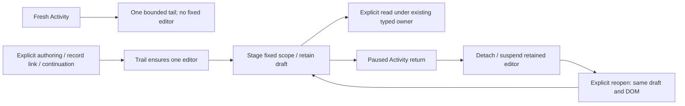

[Live Activity](LIVE_ACTIVITY.md) classifies visit intent before subscribing, reuses the existing bounded tail core and keeps its local inspector separate from fixed execution. Saved/shared entry remains inert. The [whole-product architecture review](STREAM_FIRST_WHOLE_PRODUCT_ARCHITECTURE.md) records the original shared record/context rationale. Delivered adoption is
described below; its broader proposals do not override the current roadmap.

Live Activity now keeps signal-local `ScopeFilters` draft/applied predicates in its
application owner. Shared `GooAttributes` emits typed Include/Exclude intents;
chip edits pause locally, Apply starts a new tail generation, and the inspector's
fixed continuation stages the original row read window in `GooExploration` without
fetching. Only the existing Run action rereads it. The existing trail exposes
suspend/resume of its retained fixed view; Live Activity uses these to cancel hidden
work and restore its paused parent without a read. Shared record bodies are now
implemented with the shared table shell described below.

The [shared record presentation](RECORD_PRESENTATION.md) adapter now removes
parallel row-formatting paths from Live and fixed results. Its custom elements
render supplied data only; application adapters retain reads, scope/basis, selection,
fixed/trace continuations and retention. Supplied-parent context has bounded exact
ID traversal and explicit ambiguity/missing/cycle states, with no wider lookup.

Live, fixed/frozen pages and held service observations share the passive record
table builder. The Services adapter lazily presents its existing supporting span
page, validating the returned question before adoption. It does not bind that page
to independently reread overview selections. See the [ownership diagram](RECORD_PRESENTATION.md#held-service-observations).

The [saved record presenter](SAVED_RECORD_PRESENTATION.md) maps capture pages and
metadata-only document references to shared frozen display facts. The capture owner
supplies the single scope summary; its compatibility viewer retains paging and
context reads. A record's fixed continuation stages a draft; Run owns the fresh read.

Stored record pages now use `GooSavedRecords`, independent of the live query
editor. `GooRecordResults` supplies record/group tables and named context actions
to both owners, with independent generations and retained evidence bases. Capture
switch/leave/document transitions invalidate old context publication. See the
[updated ownership diagram](SAVED_RECORD_PRESENTATION.md).

## Selected definition revision libraries

The first [B1 library slice](DEFINITION_LIBRARY.md) shares loaded-catalog paging,
compact rows and a cached inspector between record/native Definitions, fixed reusable-question
and document revision adapters. Retained catalogs share the row/inspector primitives
with load-specific snapshot keys, retaining independent server filtering and cursors.
List fetch/refresh generations, compiler previews, execution and authoring stay in
typed adapters. Selection preserves exact family/revision identity; it does not
replace the editor draft or infer lineage from a name/title. Record annotation
panels mount only in selected detail; their existing publication/basis owners are
unchanged. Only the row list scrolls; the inspector sits outside that viewport.

The fixed reusable-question owner invalidates pending plans on selection/close,
workspace/mode changes and suspension. After its compiler response, it checks the
owner generation, active visit and exact revision before explicit source dispatch.
Local selection does not mutate the fixed draft or execute a query.


## Record field display boundary — B2 first slice

`field-presentation.mjs` shares qualified field/operator labels and record predicate
text across fixed chips, the existing live selector summary and record package
handoffs. It consumes supplied predicates without changing them. Shared Go/JS wire
fixtures pin omitted empty defaults, field-family separation and exact decimal
strings; native binding semantics remain independent. See the [contract and flow](FIELD_PRESENTATION.md).
The source exploration owner and retained metadata catalog have different abort,
visit, snapshot and cursor lifetimes; this slice introduces no common request owner.


The B2 service namespace continuation shares `GooServiceIdentity.label` with
annotation summaries, preserving the existing selector/key/name owners. Shared
Go/JS namespace wire fixtures pin wildcard, missing, empty and literal populations
without changing native bindings or server digests. See the [namespace flow](FIELD_PRESENTATION.md#service-namespace-identity--b2-continuation).


## Shared question protocol — B2 continuation

`ui/question-protocol.js` is the pure browser/Node owner for question/step/link
transport, capture-question projection, fixed-scope checks and comparison-only
native default equivalence. N1 was independently approved and delivered in
`9277f5b`. `ui/workspace.js` owns navigation/layout and reexports the same function
references for existing consumers; it is not a second protocol implementation.
Server HTML loads the protocol before workspace. The lazy fixed-owner mount and
existing navigation/read/publication lifetimes remain unchanged.

Evidence comparison resolves `question-session.identity` at call time, retaining
the existing browser pre-session stable fallback. Loading the protocol does not
create a Session, touch DOM, fetch, subscribe, read storage or publish. Node's
identity helper is likewise resolved only when comparison needs it. Recovery,
trace findings and fresh comparison consume the pure module directly; other
callers may retain the compatibility facade.

Go/JS fixtures pin accepted/refused record/native steps, exact bounds, error/wire
behavior and native definition digests across actual serialization. Native reuse
comparison keeps its cloned Go-default projection; record predicate identity is
not used to normalize stored native definitions. Go remains authoritative for
full semantic validation. See [the protocol contract and executed acceptance](QUESTION_PROTOCOL.md).

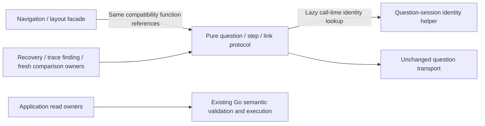

Activity exact retention now injects one process-local membership bank into the
trusted SSE poll issuer and references-only publisher at startup. Issuance freezes
original read provenance; publication first resolves committed request identity,
then consults ephemeral proof only for a definitely new intent. The browser holds
at most 20 original refs and journals immutable writes before sending. Shared
origin readers/citations remain downstream of XTDB, with no telemetry reread.
The custody flow and limits are in [Activity selection](TAIL_SELECTION_CUSTODY.md).

## Subsequent Activity, filtering and record composition

Reusable [Activity views](ACTIVITY_VIEWS.md) use a typed rolling configuration in
workbench's existing immutable file publisher, separate from fixed exploration
views. Shared revision-library display appears in Saved and Services. The stream
adapter restores configuration through `GooTail.stage`; Start alone opens SSE.
No observations or capabilities cross the configuration boundary. The linked
flow diagram documents publication, staging and later separate retention.

The [shared predicate editor](FILTER_EDITOR.md) is a supplied-input helper, reused
by Activity and fixed population adapters. It normalizes Go's empty-value wire
shape but does not evaluate, read or publish telemetry. Activity owns draft/apply;
fixed adapters stage child configurations and retain their parent's source basis.

Single-question filtering now uses that same supplied editor. Full restored ASTs
remain editable; shortcuts become explicit draft predicates. The existing session
continues owning generations, fixed bounds and requested/applied evidence, and
the query owner continues owning cancellation and reads. Environment edits retain
the draft and fixed bounds; incompatible signal edits reset predicates.

[Observed suggestion flow](FILTER_EDITOR.md#observed-fields-and-values) reuses successful applied record reads. The source adapter projects bounded qualified fields/values; the editor presents supplied observations and emits draft predicates. Scope ownership, invalidation, clocks and source execution remain in Activity/single/fixed adapters. Saved configuration never persists sampled suggestions.

[Explicit value lookup](FILTER_VALUES.md) adds an application owner over the existing exploration grouping route. The passive editor emits a Load intent; each Activity/single/fixed adapter supplies its applied scope and lifetime. Lookup results retain their own read clock/basis and never replace page evidence, source capabilities or custody.

Latency distribution interaction reuses passive `goo-time-bars` range intent. `latency-histogram.js` validates complete raw-span bucket counts and translates keys into existing `population-selection.js` transforms; the population/trail owners stage and execute queries. No new evaluator, route, source adapter or component subscription is introduced. See [flow and limits](LATENCY_SELECTION.md).

`activity-latency.js` owns optional aggregate refresh/cancellation over the latest completed stream window. It supplies snapshots and interaction callbacks to the existing histogram adapter, stages predicates through `stream-entry.js`, and uses the existing fixed continuation for disjoint comparison. Components never read or subscribe. [Activity flow and clock boundaries](ACTIVITY_LATENCY.md).

`activity-baseline.js` owns immutable capture selection and cancellable pure comparisons over supplied Activity latency groups. Receipt loading and current-result comparison use independent generations; component lifecycles own neither reads nor subscriptions. Existing Go comparison and shared histogram/context displays retain accounting and presentation contracts. [Flow and clock boundaries](ACTIVITY_BASELINE.md).

Activity views now have an optional exact `baselineCapture` reference. Go publication resolves and validates stored duration evidence; GET/catalog validate only configuration integrity. The baseline owner stages the ID separately from loaded data, and resolves it after explicit current-window loading. Legacy omitted-field hashes remain unchanged. [Reference flow](SAVED_ACTIVITY_BASELINE.md).

Activity’s Views menu reuses the configuration-library adapter with explicit applied-environment and visibility inputs. Scope changes cancel publication and clear the passive library’s rows/inspector cache. No telemetry, baseline receipt, source clock or subscription is loaded by browsing. [Flow and storyboard](ACTIVITY_VIEWS.md#activity-entry-storyboard-159).

The [Activity navigation adapter](ACTIVITY_NAVIGATION.md) now exposes fixed-window staging and retained authoring through one Investigate disclosure. It pauses/remembers before mounting the existing fixed owner and hides the old entrance during Activity; parent return and explicit execution contracts are unchanged.

[Compact mobile records](COMPACT_MOBILE_RECORDS.md) are a supplied presentation opt-in shared by SSR and SPA tables. Responsive styles stay with the record component; legacy tail formatting excludes opt-in tables. Existing Activity owners retain selection, query windows, timestamps, navigation and source execution.

The shared record-result owner now selects the [responsive record layout](COMPACT_MOBILE_RECORDS.md#fixedsaved-adoption-storyboard-162) for fixed, saved and explicitly read context tables. Presentation does not change stored receipts, result models or read clocks. Mobile formatting is independent from preview clipping; spanning inspectors and accessible action identities remain with the existing owner.

[Service-held observations](SERVICE_BROWSING.md#held-service-observations) adopt the same passive responsive record table. Service detail still supplies the original supporting page, retains its inspector and stages the fixed-question link. Disclosure, inspection and resizing introduce no source read or new custody semantics.

The [record renderer audit](RECORD_RENDERER_AUDIT_2026_10_24.md) keeps custody, diagram and declared-operation semantics in their owners while sharing identity/time/attribute presentation. Operation tables use bounded passive table viewports; local trace/subject selection still uses the held snapshot. [Independent operation status](OPERATION_STATUS.md) now retains exact optional exporter status alongside declared outcome. Conformance uses outcome; waterfall error color uses reported Error. Legacy captures remain immutable and explicitly mark status as Not retained. The passive waterfall receives separate display facts, without source policy or source reads.

[OTel field hints](OTEL_FIELD_HINTS.md) add an advisory exact-qualified-key lookup to the shared field presenter. Filter and attribute adapters reuse it for names, descriptions and local search. Source adapters, query types, saved identities and execution owners remain separate; recognizing a name never rewrites a key or infers schema compliance.

[Observed grouping](OBSERVED_GROUPING.md) reuses the existing regroup transform across Activity and fixed owners. The field browser emits exact field/opener intent; app adapters freeze or retain scope, stage drafts/children and preserve companion questions. Go remains the execution validator; no source client lives in the editor.

[Two-field composition](COMPOSED_GROUPING.md) keeps exact ordered grouping transforms in the population/query owner. Same-membership grouping drafts can hold scoped observation metadata, while explicit reads, changed scope and saved reopen withdraw it. Unread population drafts update in place; applied parents remain separate. No observation metadata enters saved query schemas.

[One grouping control](GROUPING_CONTROL.md) replaces selector DOM state with the shared editor’s canonical grouping array. The passive custom element receives cloned display DTOs and emits intent; scope owners retain validation, staging, reads and publication. Legacy immediate population dropdowns are removed.


## Typed numeric record predicates

[Numeric filter leaves](TYPED_NUMERIC_FILTERS.md) reuse explicit NumericBinding
metadata while remaining independent of question-level numeric aggregates.
`exploration/` shares canonical parsing and nullable SQL value guards between
reference matching, numeric aggregates and predicates; typed threshold parameters
stay exact. Missing/empty/invalid/valid form an explicit partition, and comparison
inequality is valid-only. Physical map/column choices remain in source adapters.
The existing editor, protocol/recovery guard and field presenter preserve authored
intent; they do not evaluate captured source values. Query/capture/definition and
read-time versus immutable-custody owners retain their existing lifetimes.


## Activity explanations reuse the population engine

[Activity explanation staging](ACTIVITY_EXPLANATIONS.md) is source-approved in
`cdd5a88`, with retained-visit ownership fixed in `a6533a6`. Journey 178 spans/logs,
browser ownership and its 60-second actor pass; the reviewed
[desktop](journeys/screenshots/178a-spans-activity-explanation.png) and
[mobile](journeys/screenshots/178b-spans-mobile-explanation.png) frames show this flow.
AE2 acceptance is complete, including native main/ownership/baseline rejecting
controls and 70 Hegel examples. Journey 155 native/actor checks passed separately
after a combined-wrapper timeout; see [executed validation](../VALIDATION.md).
`stream-entry.js` supplies the last
completed applied 60-second window and selector. `activity-explanation.js` pauses
the stream and optional latency updates, then stages that scope in the existing
explanation owner. Its compact held-occurrence chart guides a fixed time brush;
its displayed occurrences never define full counts or the window boundaries.

The default baseline is the immediately preceding equal-width window. An explicit
capture metadata load can instead supply the original same-signal/environment
query window and selector. This is scope reuse: **Run explanation** independently
rereads both populations through the shared Go count/group engine. Frozen capture
counts are not substituted for that baseline read. The originating capture link
and original source/custody clocks are UI context; the saved explanation retains
its request and newly observed aggregates, without that originating capture ID.

Opening, brushing, choosing fields and paused return do not execute telemetry
queries. Loading a saved scope is an explicit metadata request. Scope edits, Apply,
resume and replacement withdraw obsolete results/tokens; hiding or leaving cancels
pending work. Component lifecycle owns no subscription. **Save observed explanation**
promotes the exact held observation through the existing bounded snapshot bank and
immutable capture store, without rereading either population.


## Recorded error triage over ordinary telemetry

[Error triage](ERROR_TRIAGE.md) reuses applied Activity scope, existing fixed
questions, count/group/time reads and captured investigation work. ET1 is deployed
in `982b9e9`, and ET2 staging/passive details in `0c4ab38`. ET3 acceptance is
complete: real OTel spans/logs, ownership, native/model rejecting controls and
actor checks pass. The passive SSR/SPA cases use supplied synthetic data, not
OTLP. [Actual frames and evidence](journeys/README.md) distinguish these checks;
VALIDATION.md records corrected supplemental-log probes and final review/push.

`exploration/exception_fields.go` projects one span record from named `exception`
events. Event presence is names-only; type/state projection requires aligned
name/attribute arrays. A nullable type exists only for one distinct reported
`exception.type`, including a present empty value. Unreported or multiple types
have no unique type, with a separate reporting-state field. Grouping counts
records once without exploding events or choosing the first type. Logs retain raw
severity text and gain intrinsic numeric severity; explicit rules preserve the
independent reported signals without inferring failures or issue identity.

Derived row aliases appear only when requested, preserving non-opt-in row SQL
and valid legacy captures. Shared nullable-field rules allow missing map keys and
`column:exception_type`; caller-held `/compare` groups with null nonnullable fixed
columns now return 400 instead of accepting malformed logical-source data.

The Activity adapter stages and pauses; the fixed owner executes only explicit
Run. Existing group links stage exact service/type questions, and service-scoped
single-type grouping enters existing comparison controls. Captures, reusable YAML
packages and investigation notes retain those typed scopes and evidence.

The passive `goo-exception-details` Web Component accepts supplied `{record,signal}`
through SSR's JSON `data` attribute or a cloned SPA `.data` property, including
pre-definition assignment. It shows bounded local event/structured-log evidence,
UTC times, messages and disclosed stack traces; lifecycle and disclosure do not
fetch, subscribe or publish. Source policy and query lifetime remain in owners.
Raw nested-event Databricks lowering remains unsupported; prepared-fact export
requires an explicit grain/alignment/nullability contract.

## Fixed-scale decimal interpretation

[Decimal bindings](FIXED_SCALE_DECIMALS.md) extend the existing numeric adapter,
not the query runtime or physical OTel schema. An explicit scale defines a signed
int64 coefficient lattice. Pure validation, reference evaluation and guarded
ClickHouse integer parsing share the literal contract; sums widen to exact
integer arithmetic. No floating point parser or Decimal cast defines coverage.

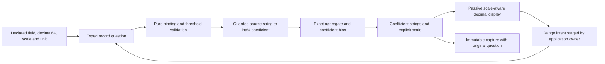

Scale is part of measurement identity. Incompatible scales withhold comparison
arithmetic. Legacy integer bindings/results omit scale. Source-read budgets,
record grain, independent-read uncertainty and capture custody are unchanged.

## Contextual numeric declaration ownership

[Plot values](CONTEXTUAL_NUMERIC_PLOTS.md) is an application-owned adapter over
the existing question, numeric binding and histogram contracts. Attribute and
observed-field presenters emit qualified field intent only. The shared dialog
locks that field and collects explicit type/unit/scale without parsing a sample.
Activity, applied fixed results, immutable saved pages and population children
supply their own exact question and lifecycle authority.

The pure transformation clones membership predicates and reported-edge scope,
resets page/presentation measures and adds one validated numeric binding/histogram.
Native question-trail staging retains fixed/saved parents; population children
retain their separate parent and companions; Activity preserves its paused
window, inspector and opener. Run uses the existing source adapter and custody
owners. Hidden/disconnected or obsolete dialog owners cannot publish staging.
No display component, new API, numeric cast policy or evidence store owns this
continuation. The flow diagram is in the contextual contract.

## Log-pattern projection

The [versioned body profile](LOG_PATTERNS.md) is a derived logical log column in
the existing Go source adapter. Reference and ClickHouse lowering map one body
to one collision-safe identity; the stored Body is not rewritten. Length is
checked before UTF-8 validation or tokenization, preserving bounded evaluation
with short-circuiting disabled. Empty/oversize/invalid inputs contribute explicit
unclassified buckets rather than truncated apparent shapes.

Activity stages the applied completed window. Existing fixed queries own full
counts/groups and overall time series; per-pattern children and selected/rest
service comparisons reuse the same query/capture/publication paths. Shared
display adapters decode identities for labels, while typed predicates retain
the exact canonical IDs. No sampled classifier, ingestion processor, ML model
or independent pattern store is introduced. The process diagram is in the guide.

### Pattern comparison across time

[Time comparisons](LOG_PATTERN_TIME_COMPARISONS.md) reuse complete fixed-query
cohorts and the existing population owner. Baseline selection stages questions;
explicit Run owns independent source reads. The comparison boundary validates
canonical pattern identities before returning even an empty or changed state.
A pure display adapter aligns complete groups and computes exact integer ratios
for duration-normalized rates and all-record shares. Stored-evidence adapters
load immutable full group aggregates from storage, never infer them from a record
page, and do not start telemetry reads. Source and evidence ownership remain in
application adapters; no display element subscribes or fetches.

## Supplied-page trace interval accounting

[Trace page timing](TRACE_PAGE_TIMING.md) is a source-free Go projection over
existing public span rows, mirrored in the passive JavaScript display with exact
parity tests. No new endpoint, query flag or persisted capture field is needed.
Reported IDs resolve unique direct-parent edges; ambiguous or incompatible
intervals remain unavailable locally. Union length uses exact integer intervals,
and nullable service/operation groups retain original row indexes and separate
known/unavailable measure coverage. Group sums may overlap across spans.

The component emits controlled selection intents. The waterfall application
adapter validates current ownership and visible local controls, then coordinates
page/aggregate highlights and the existing inspector. Its separate target-level
linked-log listener has the same generation and visibility guard. A closed or
superseded component cannot bypass it through a retained native button. Existing
full-query aggregates remain independent of this bounded-page calculation.

The trace inspector can compare two supplied pages locally. Reference custody is
bounded to its record-results owner; no new API, token or persistent resource is
introduced. Relative clocks are normalized per supplied page, while original
fixed bounds, source clocks and bases remain visible.

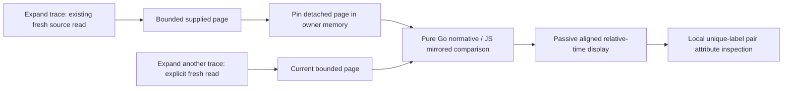

Repeated labels remain ambiguous instead of being zipped. Group span-duration sums
may overlap, and missing page observations are not zero durations. Comparison
selection is independent of native waterfall selection, which retains its existing
explicit linked-log read behavior.

Contextual trace search preserves the distinction between a span predicate and
independent conditions that may be witnessed by different spans. Its common scope
is only the applied environment and fixed window; the original WHERE is retained
inside condition one, so additional conditions can match other services.

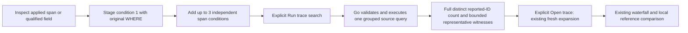

The same span record can witness multiple conditions. No topology or unique
invocation is inferred, and conditions remain fixed to the original window.
Cancellation, scope edits, hidden/disposed ownership and stale generations
withdraw pending results. This contextual adapter introduces no capture format.

## Counted field values as a bounded source projection

The first counted-values adoption adds `Source.FetchCountedValues` and
`POST /explore/counted-values` (browser `/api/explore/counted-values`). This is a
separate `goo/counted-values/v1` result, not a new mode on the full record result.
Existing `Source.Fetch`, record/capture DTOs, saved bytes and their custody paths
remain unchanged.

A valid request has one string grouping field, offset zero and no numeric result,
duration/status summary or time-series projection. It retains the original fixed
environment/window, WHERE (including typed numeric predicates) and reported-edge
scope. The source detaches caller-owned state before I/O and uses the existing
compiler/transport to read only the independent count and complete groups. It
does not read inspection rows or discover fields as hidden prerequisites.

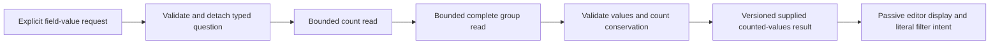

The result retains separate count/group read clocks and raw-read bases, plus a
combined result basis independent of those clocks. Missing values are null and
present empty strings remain distinct. Groups require unique canonical values and
positive canonical uint64 counts; nonnullable dimensions and log-pattern IDs keep
their existing validation rules. More than 1000 groups refuses the entire result,
without partial grouping totals. Count/group disagreement returns explicit
`changed_between_reads` diagnostic groups, not a coherent actionable population.
These sequential reads are not a transactional snapshot.

`ui/filter-values.js` owns explicit execution, cancellation and generation/scope
binding. The filter editor receives supplied values and emits filter intent; it
does not fetch telemetry. Opening the editor or changing local conditions does not
automatically load counted values. Stale, failed, malformed and changed-scope
responses cannot become usable value suggestions. Counts derive from full query
populations, not the visible record page. [Journey193](../journeys/193-counted-values-projection-storyboard.md) accepted
143 matching logs with a 100-row inspection page and four complete value groups,
a separate five-record population, and explicit missing-value selection of one
record. Numeric WHERE retained the exact integer threshold above 2^53. A held real
response could not publish after a scope edit. The bounded native raw-fact check
passed in 0.177s with eight changed controls; it validates this observed scope and
membership, not all internal SQL or arbitrary schedules. The browser journal's
five telemetry API POSTs exclude one cancellation control and the separately
recorded small-population API/readiness probes. The architecture does not claim
universal adoption by every grouped read or a replacement for capture semantics.

## Service record aggregates without inspection reads

The second narrow-projection adoption adds `Source.FetchRecordAggregates` and
`POST /record-aggregates` (browser `/api/record-aggregates`), with version
`goo/record-aggregates/v1`. Service widgets execute their existing exact typed
questions through this aggregate-only path. The service browser's initial full
Explore metadata page remains a separate positive witness and inspection source;
opening a widget question, explicit record Run and capture still use their existing
full-result owners. No synthetic record page is attached to a widget result.

A request retains one string group, environment/window, WHERE and reported-edge
scope. Count can include requested duration/status aggregates in the same read;
groups are a second read, and requested overall time series is a third. No record
rows, field discovery, plan or held-result token are returned. For the measured
primary and dimension shapes this removes the old inspection/discovery reads:
five to three and four to two, respectively. This describes query shape, not a
universal latency or scan-cost bound.

Legacy and narrow paths share group decoding and additive conservation helpers.
Counts, status classes and duration sum/min/max can identify disagreement across
independent groups/series reads. Quantiles remain values from their own full
source populations; they are never averaged, merged or reconstructed from group
quantiles. Disagreement retains diagnostics as `changed_between_reads`, not an
actionable snapshot. Receipts identify each requested aggregate read separately;
the result basis excludes read clocks. These are not transactional reads.

The old full-result/capture shapes and saved evidence bytes remain separate.
Counted field values retain their existing dedicated endpoint and DTO. This is
not a universal result adapter or migration of all observation families.

Actual journey194 accepted three rich widgets over the exact HTTP population
(137 spans), independent logs (155) and four route groups, with varying durations
that expose exact-quantile boundaries. The original 100-row supporting witness,
full log/operation/trace reads and a fresh full capture remain distinct paths.
The capture retained 137 rows (100 on its public page), and its complete stored
bytes and content-addressed receipt remained unchanged after subsequent navigation
and range reads. Fixed-question Back reused held dashboard evidence. After capture,
the accepted journey used explicit Services navigation, not an invented browser
history edge; that particular retained navigation also performed no source reads.

The held-response scenario deliberately switches to All spans (198) before
leaving. Its actual plan and complete upstream DTO are retained, while late
completion cannot reveal the departed service. Recovery returns to the original
exact HTTP question. Header-only cancellation acknowledgements are controls, not
telemetry bodies or proof that upstream work completed. Focused fake-transport
properties establish decoder parity/read shape; bounded actual raw-fact checks
establish these observed populations, quantiles, custody and ownership. Neither
proves arbitrary schedules or a transactional dashboard snapshot.

## Cumulative nonmonotonic sums as stock observations

The stock integration uses the native sum source with a distinct measurement
`kind: stock` and `result.stocks`. Cumulative nonmonotonic samples are observed
levels: decreases remain valid, and accumulation start timestamps retain their
epoch identity. They are not converted to counter deltas/rates or silently
reclassified as gauges. Stream resource, instrumentation and metric identity
remain exact; separate instances are not summed into a fleet level.

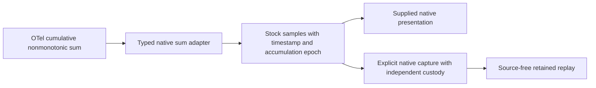

The existing stock kernel uses finite floating-point sample values; this does not
introduce exact-integer arithmetic, capacity/utilization inference, interpolation
or delta-sum integration. Integration acceptance and its source/capture receipts
are recorded below. Existing kernel properties already cover decreases, epochs and
arrival/replay stability; the new checks focus on adapter identity, physical
source rows and immutable stored evidence rather than another kernel campaign.


The stock integration fixture uses generic `pool`/`state` labels to distinguish
streams. Signed fractional values under a connection-count instrument exercise
the generic engine; they do not establish physical connection-count validity or
semantic-convention conformance. No stock-to-record interval action is inferred:
stock samples retain their accumulation epochs and are not counter intervals.


[Journey195](../journeys/195-cumulative-stocks-storyboard.md) accepted eleven
physical stock reports across seven exact streams, including descending levels,
signed fractions, a new epoch, stale and missing samples, and a real conflicting
timestamp retained by the exporter. The main passed 9.5s and its browser actor
passed 30.3s with one explicit source read. A bounded native raw-fact/custody check
passed in 0.037s and rejected six changed controls. Local observation selection and
frozen reopen performed no source read. The complete 12964-byte capture remained
unchanged, with SHA256
`599056e688d0ed0627049978d9d89d8f09191359ad4b13f0faee191330cbd37b`.
Discovery and the supplemental pure dashboard plan admit generic stock evidence;
this is not a completed database-pool health dashboard or utilization inference.

## Automatic pool connection stock observations

An eligible `db.client.connection.count` instrument can produce a
`database-pool-connections` native widget within the existing two-instrument
budget, rather than a new record profile. Admission requires the exact 1.37 schema,
`{connection}` unit, cumulative nonmonotonic stock shape and one complete stream
witness containing a nonempty service instance, `db.client.connection.pool.name`
and `db.client.connection.state`. Custom nonempty states remain literal. The first
25 supplied coverage streams provide positive witnesses only; keys from different
streams cannot be joined into evidence, and no witness does not establish absence.
Existing role-specific native priority remains ahead of pool candidates.

The planner derives a detached definition with
`stockDomain: nonnegative-integer` before hashing selection options and executing
questions. Caller metadata is not mutated. This optional stock-only policy
certifies every recorded selected source value as an exact decimal integer,
nonnegative and below 2^53, before accepting or displaying a Float64-backed count.
The original decimal text is certified even if floating-point parsing would round it.
Missing-value flags remain unknown rather than zero. Generic stock definitions
without the policy retain signed/fractional behavior and their original wire/hash
contract; this is not a migration of existing captures.

Pool display groups retain the full stream identity except the state attribute.
Different instances, pools, remaining dimensions, resource/instrumentation schema
and scope/version are not merged. Rows expose reported states and their own
observations; side counts describe coverage, not capacity or utilization ratios.
Unknown/stale latest observations do not fall back to earlier healthy values.
Filters and disclosure are source-free supplied-data operations. No fleet sum,
capacity ratio, broker/dependency inference or stock-to-record interval is added.
[Journey196](../journeys/196-pool-connections-storyboard.md) accepted 13 physical
reports in ten exact streams, presented as five eligible groups with two explicitly
ineligible streams. The shared bar ceiling 21 is a display scale, not capacity.
Worker-B idle 0 remains a real reported zero; missing/conflicting values stay
unavailable, archive values stay stale and the custom reserved state stays literal.
The exact opted question persists through Native Open, fresh capture and reopen.
The complete 16904-byte capture retained its content ID and unchanged SHA256
`e659f1ddbc9da4dad4e441e88b136b920849873e336765b7ae9219b454ae6b0e`.
The raw-fact/model/DOM/custody check passed in 0.362s with six changed controls rejected.

The accepted main passed 23.9s after a negative caller-metadata test exceeded the
existing 16 KiB request budget; compacting redundant display metadata preserved the
actual identities and the same admission control. The actor passed 30.6s using a
separately ingested ordinary fixture (eight phases, 478 snapshots), not journey195's
reused data. These are bounded supplied-telemetry observations, not a complete pool
health, capacity or acquisition-wait dashboard.

### Independent capacity and acquisition-wait questions

The named-pool view can ask the pure `goo/pool-signals/v1` planner to inspect supplied discovery metadata. A compatible capacity stream uses `db.client.connection.max` in `{connection}` as an independent cumulative stock with the nonnegative-integer domain. A compatible acquisition-wait stream uses `db.client.connection.wait_time` in seconds as a delta or cumulative histogram. The selected count stream's complete resource, resource schema, instrumentation scope/version/schema and attributes must match; only the count's connection-state attribute is removed. The parent window, including explicit nanosecond bounds, is preserved. Names and titles do not identify streams.

This metadata check does not read telemetry or certify aligned observations. It examines at most16 instruments and25 preview streams per instrument, offers at most two options per signal, and reports omissions without claiming absence. Preview stages an exact independent question; Run and capture each perform their existing explicit reads. No count/capacity ratio, aligned snapshot, pool health or causal relationship follows from compatibility. Returning to the retained service view and reopening frozen evidence remain source-free.

Journey197 exercised ordinary OTLP count/capacity reports and raw wait buckets, including capacity20→0 across epochs and an observed P95 bucket range `(0.05, 0.1]` seconds from four reports. Its main and held-plan ownership journeys passed in14.4s and4.5s; a separately ingested actor fixture passed31.0s across nine phases. The offline raw-ledger gate checks independent values, exact identity/window, source effects and both complete content-addressed capture files; it does not add a new lifecycle model or a production completeness claim.

### Compact pool evidence and qualified reported utilization

`POST /api/pool-signals/view` is a pure `goo/pool-view/v1` composition over held count, optional capacity and optional acquisition-wait Results. It replays the raw Result inputs before exposing their evidence. Count states retain exact pool/resource/instrument identity; only the connection-state attribute partitions rows. Each signal keeps its original question, source read clock and basis. Related measurements still use explicit existing measurement reads; local selection, cached return and pure composition do not add telemetry reads.

A reported used/maximum fraction is available only for literal `used` and the selected opted-domain capacity: both latest samples must be observed, have exactly equal observation nanoseconds and nonzero equal start epochs, capacity must exceed zero, and used must not exceed capacity. The fraction is reduced exactly; zero used remains an observed zero. Unknown epoch0, stale/conflicting samples, different clocks or epochs, zero capacity and used above maximum retain explicit unavailable/inconsistent reasons. Neither matching reported clocks nor this fraction certifies a transactional snapshot, aligned idle/custom-state totals, capacity health or causality. Wait remains an independent histogram interval and bucket-bound P95, never the ratio denominator.

Individual signal capture remains an independent fresh read with its original exact question and content-addressed custody. The compact composed view does not create a durable paired receipt. The observed journey198 exercises an aligned3/10 fraction and six actual-source boundary compositions; epoch0 is covered by properties rather than claimed as live-fixture evidence. Existing native ownership is retained: held related-source responses cannot publish a view after close, changed selection or navigation. No additional formal lifecycle model is asserted for this reuse.

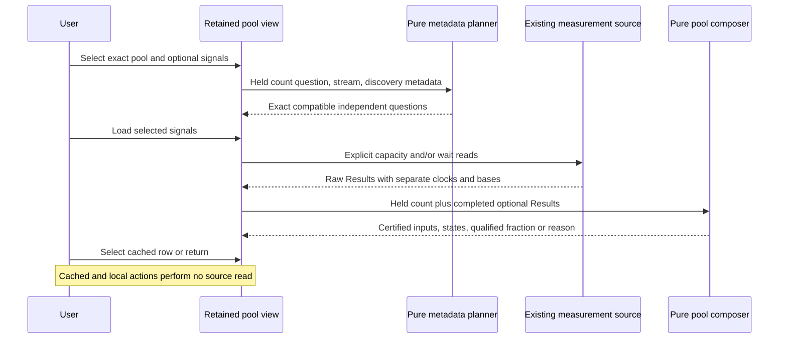

### Explicit host resource authority

Host observations use `source.resource: {kind: host, id: ...}` and a mandatory exact stream. This is separate authority from service observations: only gauge and stock kinds are admitted, service selectors must be empty, and namespace selection cannot substitute for the exact raw resource. Host kernels require the reported nonempty `host.id`; old service kernels still require service and instance identity. The source preserves the full raw resource map and resource schema rather than fabricating service labels. Missing and present-empty `service.name` remain different identities; equal host IDs or display names across different resource maps do not collapse cloud accounts or otherwise certify a physical host.

An explicit Find hosts action performs one bounded host-ID-bearing inventory read. The pure planner stages at most two defaults, each an exact schema1.37 stream: logical-CPU utilization and memory usage stock, with memory utilization gauge as fallback. Each default performs its own existing measurement read. These observations do not constitute a whole-host aggregate, health assessment or complete resource inventory. Native preview, individual capture and retained navigation reuse existing owners and custody.

Matching-resource Logs/Spans context conjoins the reported parent resource fields; absence of a metric's service identity does not require application records to lack service identity. The ordinary source fixture includes application records with a real service name that match the host resource. Gauge/stock zero remains visible, stale or missing/conflicting values remain unavailable as declared; no counter or integer-domain policy is relaxed. The host-only canonical normalization detaches maps and normalizes equivalent empty attribute maps without erasing missing-versus-empty resource keys.

Journey199 accepted sixteen ordinary OTLP metadata observations/eight exact resources and independently checked CPU0.25 plus memory4096→2048 across reported epochs. The main11.9s and held-response owner4.5s runs passed, followed by a separate30.6s actor run. The bounded offline raw/custody gate passed0.225s with thirteen changed controls rejected. Its matching-resource application context returned one log and one span with real service identity; its individual full capture remained byte-identical at5618 bytes. These receipts establish the bounded ordinary-source workflow, not host completeness or a new host-counter interpretation.

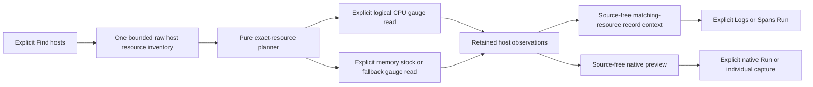


Fresh host YAML authoring canonicalizes only empty host services and exact-stream
attribute collections before definition hashing, ensuring immutable package
publication/reload agrees. Direct JSON questions, evaluated results and existing
captures do not pass through this canonicalization; old service serialization
stays unchanged. Host-only UI comparison/recovery aliases operate on copies or
local validation values, preserving authored payloads. Actual duplicate publication
and fresh catalog reads cover the nine empty-collection combinations.

### Exact Go runtime stock observations

The service planner recognizes schema1.37 cumulative nonmonotonic `go.memory.used` and `go.memory.gc.goal` in bytes, and `go.goroutine.count` in `{goroutine}`. Each admitted preview stream becomes an independent pinned stock question with the nonnegative-integer domain; no gauge, delta/monotonic sum, wrong-unit/schema or host-resource authority is silently reinterpreted. The first25 preview streams are positive metadata only; omissions do not prove absence. The original complete resource, resource schema, service/instance, instrumentation scope/version/schema and measurement attributes are retained.

At most two native defaults remain automatic. When available, one memory component and one GC heap goal are selected for the same reported process identity. Components such as stack, other, custom values and missing memory type remain separate explicit candidates; no heap total is manufactured. Goroutine observations require explicit selection. A shared process context is not an atomic GC snapshot: each measurement retains its own source read time, basis, epochs and freshness. These stocks do not expose GC pause/activity intervals, leak diagnosis or memory pressure. Existing explicit native preview/read, individual capture and retained service navigation carry the selected question without adding another source owner.

Journey200 used generated ordinary OTLP reports rather than claiming a running instrumented Go workload. The accepted main17.3s and owner5.2s runs retained one worker-a memory component16384By and GC heap goal262144By as defaults, then explicitly selected goroutines7. Its separate32.0s actor exercised eight bounded phases. The independent native raw/custody gate passed0.329s with thirteen changed controls rejected, including exact identity, component separation and source clocks. The individual capture remained byte-identical at6132 bytes. Source costs were explicit:8 initial page reads,9 after native Run,10 after fresh capture and12 after goroutine-only Apply (one record aggregate and one measurement reread). Pure selection and retained/frozen navigation remained source-free.

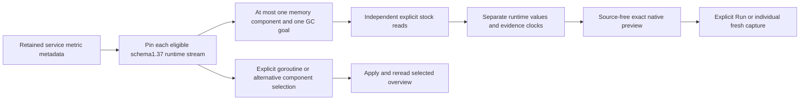

### Pod-bearing resource observations

`Source.DiscoverPods` performs one bounded grouped union across logs, spans, gauge points, sum points and histogram points for an explicit environment and fixed window. Each returned observation is an exact full raw resource-map plus resource-schema variant, not a physical pod or Kubernetes API object. The five family counts retain their own record/data-point grain and time extent; they are never combined into requests, messages or health. Trace schema availability is unknown (`null`), while log/metric schema is reported as a string, including literal empty. These remain different identities.

Pod UID and cluster UID distinguish missing, present-empty and present-nonempty. Only a nonempty reported pod UID enables contextual record actions. Missing cluster UID remains an unverified qualifier, rather than evidence that the cluster does not exist. Pod names, workload/node labels and equal UIDs do not merge different complete resource variants or establish ownership. No metric evaluation authority is created by this inventory.

The source refuses more than1000 source-family groups as a whole, then returns at most100 resource variants with explicit omissions. Evidence basis includes decoded omitted variants as well as visible ones, while excluding arrival order and read clock. Identities are bounded to16KiB/64 labels and the source response to8MiB. Local cluster/namespace facets and staging reuse held metadata without another source read; explicit record Run and retained Back use the established owner protocol.

The ordinary OTLP journey201 observed18 raw resource/schema variants,22 family groups and24 physical source rows. Its explicit contextual reads returned four logs and three spans while retaining missing cluster-UID/namespace qualifiers and allowing real-service application attributes. Main discovery and contextual Runs consumed1→2→3 source calls; local facets, staging and retained Back did not read. No inventory capture or Kubernetes state store was added. Separate held discovery and Services supporting/widget tests check pending work cannot publish or start follow-on reads after edit or tab departure; completed service views still support retained return and explicit goroutine Apply.

```mermaid
flowchart LR
  Find[Explicit Find pods] --> Union[One grouped five-family source read]
  Union --> Variants[Full raw resource and schema variants]
  Variants --> Facets[Local reported cluster and namespace facets]
  Facets --> UID[Nonempty reported pod UID]
  UID --> Stage[Source-free qualified contextual record question]
  Stage --> Run[Explicit Logs or Spans read]
  Run --> Back[Retained Back with no source read]
```

The final journey201 actor passed31.2s (33.2s invocation), nine phases/428 snapshots, ending with two source reads and an exact four-log contextual population. A separate9.6s bounded display replay used a fresh ordinary fixture, one inventory read and no contextual Run; full-width details, scoped nested-table geometry, qualifiers, UTC labels and source-free toggles/stage/Back passed. Its passive presentation commit did not change the source binary or repeat semantic/native acceptance.

### Explicit pod-native gauge authority

Pod native lookup requires a known resource-schema string (including reported empty) and a nonempty pod UID for one exact raw resource variant. A trace's unknown/null schema cannot acquire native authority. Execution uses `source.resource.kind: kubernetes-pod`, gauge-only, with a mandatory exact stream and no service/namespace selector. This separate entry does not relax host/service kernels or grant stock/counter authority.

The first supported receiver profile is Collector kubeletstats0.137.0: exact receiver scope path and version, empty scope schema, `k8s.pod.memory.usage` and `k8s.pod.memory.working_set` gauges in `By`. The semconv1.37 usage-only profile stays separate; no working-set alias, container sum, limit ratio, ordinal pod-phase or container-readiness health panel is inferred. Full resource/schema/scope/version/attribute identity is retained. Positive preview metadata is bounded to25 streams and16 displayed candidates; default usage/working-set selection precedes candidate truncation so component variants cannot displace both defaults.

Raw gauge evidence may contain zero, negative, fractional or unsafe byte values. The gauge engine preserves it; presentation must mask invalid byte counts rather than rewrite stored evidence or fall back from stale/missing/conflicting latest reports. Fresh YAML authoring canonicalizes nil attribute maps on its detached definition; direct JSON evidence/capture retains its original bytes and identity. Existing independent read clocks, explicit native Run/individual capture and retained-owner cancellation apply.

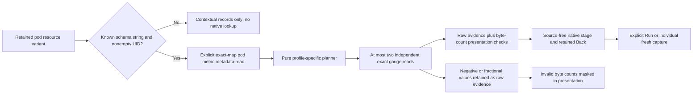

Journey 202 used generated ordinary OTLP reports, not a running receiver or cluster. The main and owner runs passed in 14.8s and 11.6s. Primary usage 32768 By and working set 16384 By were independent default reads; eight later control panels were explicitly opened for partial/semconv, stale, conflicting, missing and invalid-byte evidence. The final page journal contained 22 source operations (one inventory, nine exact metadata reads, eleven gauges and one fresh capture) and eleven pure plans. This does not increase the two-default budget.

The corrected bounded native gate passed in 0.545s with fourteen changed controls rejected. Full individual capture custody remained byte-identical at 6062 bytes, SHA256 `3f09e5b7e315f322ffe65b41314feb63fbdc12aa23f5896cf474b89946b9070a`; invalid presentation never rewrote the stored raw gauge. The actor passed in 32.4s across nine phases and 449 snapshots. Existing read/panel-owner semantics were exercised directly without a new formal model or a broader scheduling/completeness claim.

[Typed pod states](POD_STATES.md) add a categorical native measurement path over
physical gauges: explicit pinned profile and exact pod authority → parameterized
source compilation → independent observation quality/domain decoding → ordinary
immutable capture and source-free replay. Scalar kernels remain separate;
categorical comparison is explicitly unsupported. Discovery and presentation now use the same exact-resource path, with generic
passive categorical display separated from the pinned application decoder. Live
acceptance is tracked in the phase contract; the earlier API-level scope is recorded in the
[API-level storyboard](../journeys/203b-pod-state-contract-storyboard.md).


[Container readiness](CONTAINER_READINESS.md) extends the existing native state
path with a real reported container-ID authority. Required pod UID/container-name
context remains in the exact resource; no synthetic service or composite ID is
introduced. A private shared quality kernel separates pinned domain decoding
from stale/missing/conflicting data. Source decimal validation certifies both
supported codes, including zero. Existing pod-bearing discovery derives container
state authority; the pure planner preserves memory priority and at most two
independent default reads. The passive categorical element receives validated
labels and quality from the shared app adapter. No receiver deployment, complete
container enumeration or pod-health inference is implied.

[Reported Kubernetes workload context](KUBERNETES_WORKLOAD_CONTEXT.md) is a pure
application adapter over existing full resource maps, rather than another
inventory endpoint or entity store. The pinned six-kind catalog and exact
qualifier-state-to-predicate conversion are centralized in kubernetes-context.js.
Kubernetes owns local filtering and navigation; existing record owners execute,
capture and restore fixed questions. Shared readiness rendering adds a literal
container cue without changing the passive component, source or stored bytes.

[Container memory context](CONTAINER_MEMORY.md) extends scalar resource authority
without changing service kernels: literal container/pod/name identity and exact
raw streams → existing metadata/planning → explicit independent gauge reads → a
pure Go replay-validating composer. Full context qualifiers govern independent
display, while stricter resource/schema/attribute/time/domain/policy proof governs
percentages. No SQL join or fabricated denominator is introduced. The browser
owner retains up to four explicitly discovered variants and selects at most
three reads; shared table/bar/UTC primitives only render supplied values.


[Container CPU context](CONTAINER_CPU.md), accepted in 207, follows the
same explicit gauge composition boundary. Reported fractional-core usage is
already a receiver gauge; cumulative CPU time remains a separate instrument.
CPU domain validation operates on bounded exported decimal values rather than
integer bytes. The shared browser owner is parameterized by the domain adapter;
source effects and native retention remain in the same application layer.


[Container Resources](CONTAINER_RESOURCES.md) now owns one exact-question metadata
cache for both families. Separate family owners retain native reads, choices and
held results; metadata-only withdrawal does not cancel unchanged sibling work.
Global scope/close withdraws all pending operations. The private Go composition
kernel shares authority/replay/alignment mechanics behind unchanged concrete CPU
and memory DTOs and domain callbacks. Public APIs and capture formats are unchanged.


[Resource history](CONTAINER_RESOURCE_HISTORY.md) reuses held native results and
shared exact-container admission, then indexes original rows by timestamp for
linear all-point domain certification. The additive pure endpoint leaves latest
composers and individual custody unchanged. The app supplies bounded paged dots
to the generic timeline, retains full-family numeric/time domains, and turns
local brush choices into qualified exact-NS record questions. Existing record
Run/capture/retained Back own effects; a gauge point supplies no invented interval.


[Automatic resource defaults](AUTOMATIC_RESOURCE_DEFAULTS.md) reuse the shared
metadata owner and separate family generations. Opening composes one exact
metadata discovery with at most two primary reads. Capacity expansion reuses the
exact held primary result and adds only selected capacity reads. Visibility and
generation guards precede effects; failed/canceled automatic primary reads revoke
automatic expansion. This remains application orchestration above unchanged Go
measurement/history contracts and supplied-data display components.


[Decimal counter rates](CPU_TIME_RATES.md) use an explicit arithmetic domain above
the existing interval kernel. Integer omission semantics remain unchanged;
private value arithmetic is exact rational, and source decoder policy checks
original token types before canonicalization. Separate host authority never
manufactures service labels. A pinned host CPU-time definition is cumulative-only;
generic decimal delta evaluation remains separate. Existing supplied-data
resource/native presenters consume the result, while app navigation stages
reported host.id/environment plus exact time context.


[Network throughput](HOST_NETWORK_THROUGHPUT.md) extends pinned host interval
counter authority without a new API or numeric kernel. Original-token and exact
byte certification precede evaluation. Retained metadata supplies explicit
network candidates; a separate application generation owns interface selection,
two direction reads and cancellation, leaving CPU/memory evidence untouched.
Common display domains are supplied to passive resource/timeline presenters;
this visual comparison does not join or sum independent streams.

Host Network and Disk use the same app-owned `host-counter-pair.js` factory with
closed profile metric/dimension/role/label parameters and independent owners.
Neither passive display lifecycle nor disclosure subscribes to telemetry. Disk
adds pinned system.disk.io/By cumulative admission, not a new numerical primitive.

Filesystem 214 extends the app-owned paired-reader with closed frozen profile
policies for stock candidates, exact group/role/result validation and display scale.
Network/Disk retain their counter branches and independent owners. Passive native
resource charts now honor supplied scales for stocks as well as counter rates.
No numerical primitive or automatic usage/capacity join is introduced.

Reported filesystem utilization 215 is a nested one-role app adapter sharing the
selected filesystem group through an external selection callback. The parent
paired-reader owns child reset/withdrawal/disposal; the child retains its own
request generation and fixed fraction domain. Passive charts have no new reads.
Source validation certifies the original gauge decimal in 0..1 before trusting
its Float64 representation; no new numerical primitive or ratio is introduced.

Host-control presentation 216 opts into compact shared resource rendering through
the host facade. Inspect remains an app-owned action; Evidence builds once from a
cloned supplied stream with the existing attribute viewer and no source callbacks.
Selection/defaults/withdrawal/refresh budgets stay in the paired application owner.
The unchanged backend binary and numerical/query/wire contracts are retained.
