# How goo connects application code to captured evidence

Goo defines how telemetry is interpreted and explored. Applications emit standard
OTel telemetry; goo reads the captured records through an explicit source adapter.
The diagrams separate source/build declarations, the application data path, and
the investigation path. They describe implemented local components unless marked
**production pattern** or **planned**. They are not evidence of a production deployment.

## 1. From source code and YAML to executable services and observation plans

There are two separate compilation/planning paths. Instrumentation changes an
opt-in application build. An operation package configures goo's interpretation of
that application's telemetry; it does not compile or deploy the application.

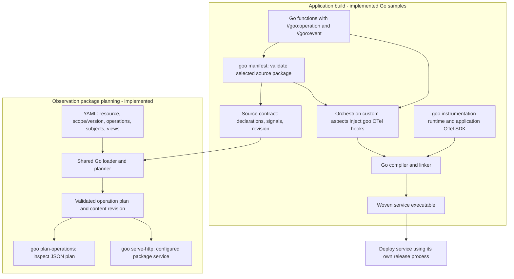

The build helpers validate annotations before actual weaving. `goo weave` is a
test wrapper; the sample build scripts invoke Orchestrion for executable builds.
Plain Go builds ignore the annotations. Applications configure SDK providers and
exporters; the instrumentation runtime does not install them. The current manifest
scans one source package, not the linked binary or complete dependency graph.
The operation planner currently needs that local source package to remain present.

YAML selects fixed supported adapters and views, with strict validation. It is not
a general IaC apply engine, arbitrary query language, CEL/KCL implementation or
production rollout system. See [annotations](GOO_ANNOTATIONS.md),
[build tooling](INSTRUMENTATION.md) and [operation packages](OPERATION_PACKAGES.md).

## 2. Production service topology and the standard telemetry boundary

This **production pattern** shows where the implemented components fit. Replicated
services, external brokers and downstream services are illustrative deployment
roles. Today's independent checkout/report Go samples and the separate Python
HTTP/gRPC/Redis/consumer lab do not implement this as one distributed application.

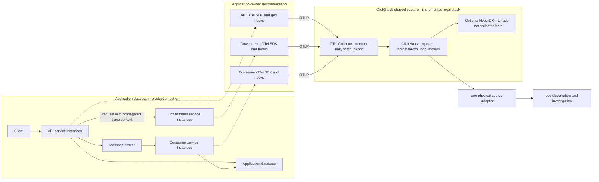

Goo is outside the application request path. The collector accepts standard OTLP;
custom goo operation/event attributes travel inside normal OTel spans and events.
Other standard instrumentation can coexist. Automatic HTTP/database/library
instrumentation is not implied by a goo operation annotation.

Each production process needs meaningful resource identity, including distinct
`service.instance.id` values. Replicas and cross-service subject joins need an
explicit aggregation/identity contract; current operation packages bind one
service/environment/instance and instrumentation scope/version. The built-in
subject key retains environment, service, namespace, tenant and ID, so identical
IDs in different tenants or services do not silently become one subject.

The actual Go samples export **traces**, including subject span events. The
checkout sample also exports native OTel metrics for the bounded counter-rate and native histogram
views; the report sample remains trace-only. The collector has logs, metrics and
trace pipelines; the Python lab supplies additional telemetry. Trace propagation,
async span links, sampling, credentials and collector topology are application/
deployment responsibilities. This lab's shared disposable database account and
loopback ports are not a production authorization model. See
[live operation integration](LIVE_OPERATIONS.md) and [subject scope](SUBJECT_NAVIGATION.md).

## 3. From captured records to an investigation

```mermaid
sequenceDiagram
  actor User
  participant UI as Investigation browser
  participant Proxy as Query proxy - Python today
  participant Goo as Go package service
  participant CH as ClickHouse
  User->>UI: Select package and time window; inspect operations
  UI->>Proxy: Same-origin operation request
  Proxy->>Goo: Forward selected package and bounds
  Goo->>Goo: Validate bound plan; freeze span-start window
  Goo->>CH: Bounded SQL with typed values and explicit resource/scope
  CH-->>Goo: Captured completed spans and nested events
  Goo->>Goo: Validate records; deduplicate exact copies; reject conflicts/overflow
  Goo->>Goo: Compare source contract; summarize observed invocations
  Goo-->>Proxy: Rows, exact span evidence, diagnostics, query and evidence basis
  Proxy-->>UI: Captured response
  User->>UI: Select operation/errors; select duration cell
  UI->>UI: Filter exact contributing spans within captured evidence
  User->>UI: Open trace waterfall; inspect declared subject event
  UI->>UI: Follow scoped subject to related event-bearing traces
  Note over UI,CH: These drilldowns reuse the captured response; no new operation fetch
  User->>UI: Refresh observation
  UI->>Proxy: New query; late arrivals may change evidence and basis
```

Overview counts are observed **invocations**, not unique business requests or
subjects. Raw-duration heatmaps use captured span samples, not reconstructed
percentiles. Trace waterfalls preserve observed parent relationships but contain
only matching operation spans in the selected resource/library/span-start window.
Subject navigation relates declared event-bearing invocations; it does not infer
retries, transaction commit or durable completion.

The adapter refuses an oversized observation instead of presenting partial totals
as exact. Unsupported/malformed records and conflicting duplicates fail validation.
Unobserved declarations remain unknown, not zero. The current exporter drops scope
schema URLs, so schema compatibility is explicitly declared rather than observed.
Sampling and capture completeness remain unverified. These evidence checks are
conformance checks against declared contracts, not proof of application correctness.

The content-derived evidence basis includes plan/source revisions, resource binding,
fixed window and returned evidence. It identifies the response being explored; it
is not an immutable custody snapshot. Changing packages clears old evidence and
stale responses cannot repopulate the new package's view. See
[trace drilldown](OPERATION_DRILLDOWN.md) and [package switching](OPERATION_PACKAGES.md).

## 4. Portable measurement compilation is a separate bounded path

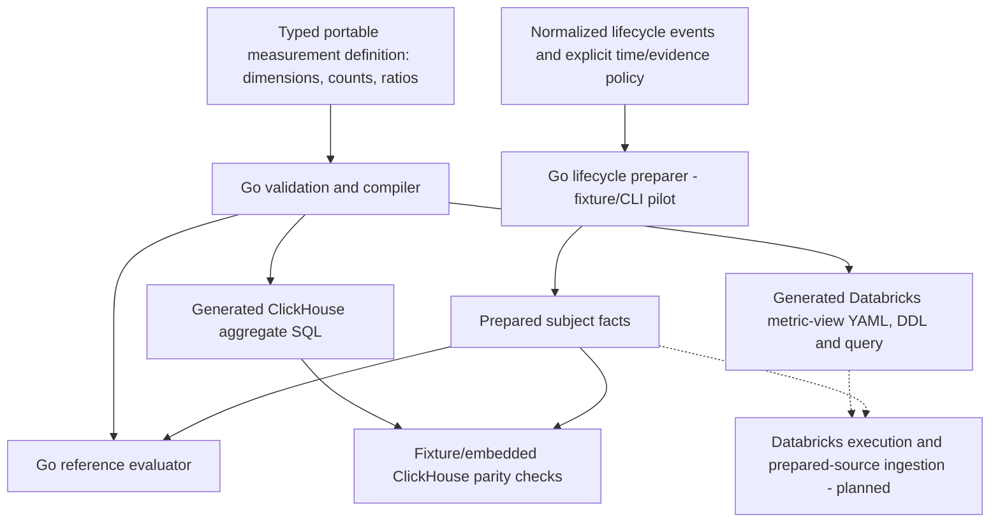

This compiler supports a bounded prepared-fact count/ratio model. Lifecycle
preparation handles explicit event/custody/evaluation-time rules in its separate
pilot. The live operation-package UI does not automatically lower to this compiler,
Databricks or durable lifecycle accounting. Generated Databricks artifacts require
prepared sources; there is no validated Databricks deployment or instance execution.
Data ingestion and timestamp representation remain separate portability contracts.
See [portable compiler](PORTABLE_COMPILER.md),
[lifecycle preparation](LIFECYCLE_PREPARATION.md) and
[Databricks compatibility](DATABRICKS_METRIC_VIEWS.md).

## Reading the evidence and the roadmap

Executable local journeys validate source annotations → woven sample → collector
→ ClickHouse → Go adapter → UI exploration. They are linked from the
[journey index](journeys/README.md); current checks and limitations are recorded in
[VALIDATION.md](../VALIDATION.md). These diagrams are architectural documentation,
not additional runtime or production test evidence.

[Native counter interval rates](NATIVE_COUNTERS.md) now supply explicit temporality,
reset, gap and resource semantics in a bounded Go evaluator and operation-rate
view. Metric and span results retain separate bases; their time links are contextual. Automatic fleet discovery,
full distributed-trace retrieval, source-free build manifests, durable subject
records and production deployment automation are further work. Preserve these
boundaries when adapting the diagrams for a particular production deployment.


## 5. Native histogram intervals and bounded investigation

Implemented for the checkout package; this path is separate from the raw-span
heatmap and the portable prepared-count compiler.

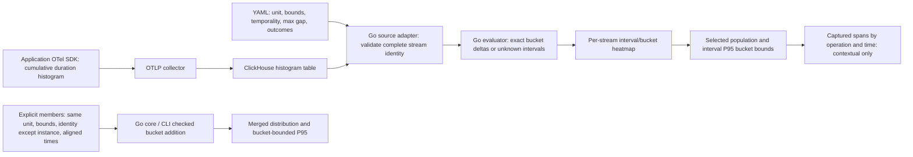

No cumulative subtraction crosses an epoch reset or invalid layout/decrease.
Missing intervals remain unknown. Merge inputs are explicitly supplied; the UI
neither discovers fleet membership nor merges percentiles. See
[native histogram semantics](NATIVE_HISTOGRAMS.md) and journey 14 for executed
browser evidence. These semantics do not establish exact metric-to-span attribution.

## 6. From aligned counters to an error investigation

Implemented for the checkout package. Errors are a declared outcome subset of
calls, not a separately fetched population. This is per-instance, not fleet-wide.

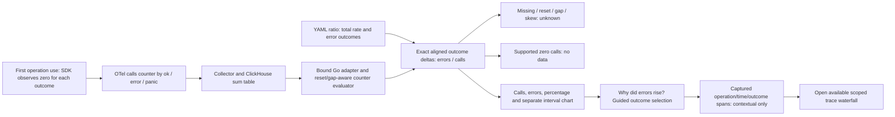

No separate numerator query is used for a ratio. Counts and exact fractions are
retained; percentages are presentation values. The guide does not establish an
increase, exact contributors or cause. See [ratio semantics](OPERATION_ERROR_RATIOS.md)
and [journey 15](journeys/README.md#15-from-operation-error-ratios-to-traces).

## 7. Fleet membership and coverage before totals

Implemented fixed-window membership; discovery and automatic time alignment are
planned. The default local fleet now deploys both expected instances; bounded comparisons are separate from exact totals (diagram8).

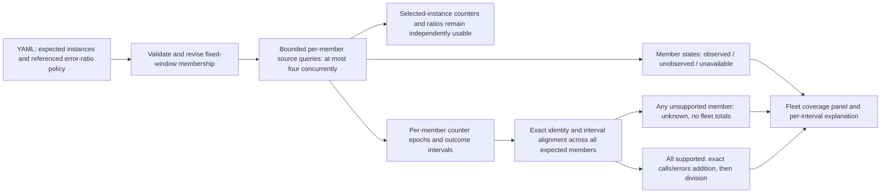

Observed membership is distinct from supported interval coverage and ingestion
completeness. The live journey separates observed membership from exact coverage; aligned fleet
population arithmetic retains fixture/property/model verification. Live independent
windows are compared separately without claiming an exact combined population. See [fleet semantics](FLEET_COVERAGE.md) and journey 16.

## 8. Two live instances and bounded comparisons

Both sample instances are now deployed in the default lab. This diagram separates
reported-time comparison from exact population aggregation.

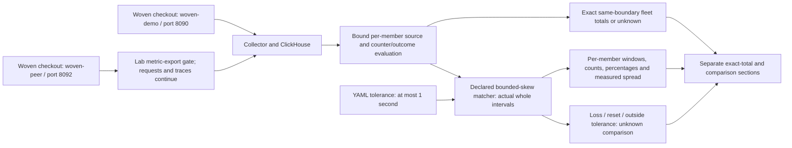

Comparisons never shift timestamps or create a common-window population. Host
clock accuracy remains unverified. Journey 17 exercises traffic imbalance,
metric-export loss, recovery and a controlled peer restart. See
[comparison semantics](FLEET_COMPARISONS.md).

## 9. Captured investigations and explicit refresh

```mermaid
sequenceDiagram
 participant U as Investigator
 participant UI as Goo UI
 participant G as Go packages service
 participant CH as ClickHouse
 participant S as Local capture volume
 U->>UI: Select fixed operation window and context
 UI->>G: Capture question, package revision and selection
 G->>CH: Read operations, metrics and histograms separately
 CH-->>G: Results with separate bases or optional source errors
 G->>S: Publish immutable hashed receipt
 G-->>UI: Display precisely the saved evidence
 U->>UI: Reopen capture ID or link
 UI->>G: Read ID
 G->>S: Load and verify receipt
 G-->>UI: Stored evidence without telemetry queries
 U->>UI: Refresh saved evidence
 UI->>G: Parent ID
 G->>CH: Repeat same fixed question and package revision
 G->>S: New immutable successor; retain parent
 G-->>UI: Compare component bases and span identities
```

Capture time is server receipt time, not ingestion custody. Reads are not a
transactional source snapshot. This supports reproducible inspection; raw metric
inputs, renderer versions and evaluator re-execution are not archived.

## 10. General exploration and independent expanded evidence

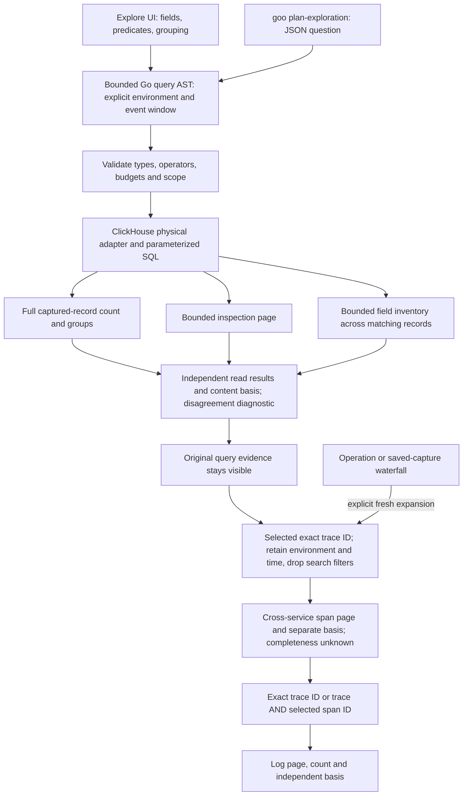

The database optimizes the generated SQL. The reference predicate evaluator is
for verification. Expanded context is live evidence and does not mutate saved
operation captures. This is implemented local behavior, not a production RBAC,
transactional snapshot, whole-trace completeness or Databricks-runtime claim.

## 11. Workspace navigation and captured distribution comparison

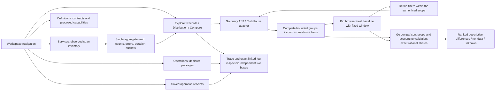

Navigation does not query or mutate evidence. Baselines are volatile client-held
captures; comparison hashes their supplied contents without authenticating source
provenance. Saved operation receipts remain a separate server-side persistence
path. See [workspace contract](PRODUCT_WORKSPACE.md) and journey 23.

## 12. Ad hoc telemetry packages and optional instrumentation

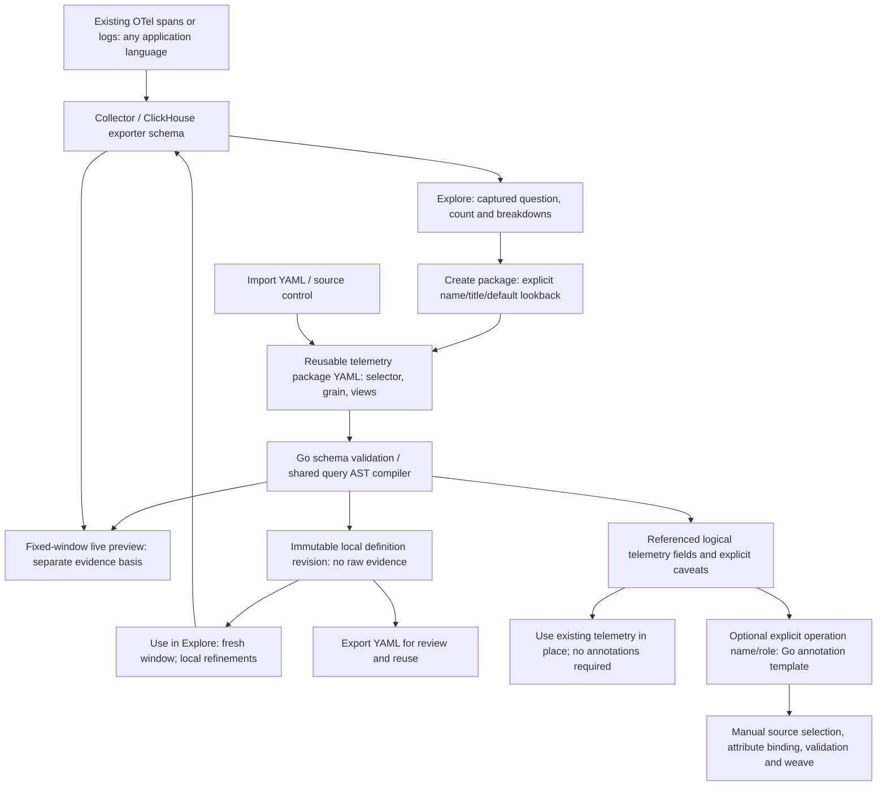

The application needs no goo manifest for this path. Definition revision, preview
evidence basis and optional source instrumentation remain distinct. The generated
Go template is scanner-validated; automatic source editing/promotion, new native
metric contracts and Databricks lowering of this package kind remain future work.
See [authoring contract](TELEMETRY_PACKAGES.md).

## 13. Coordinated application and investigation testing

Implemented local test path; the separate browser actors run concurrently.

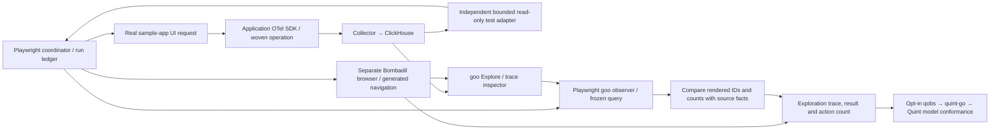

The first campaign covers one successful report request. Its four coordinator
checkpoints retain acceptance, source readiness, displayed evidence and completed
exploration. The model checks identity/scope/window/membership and order, with an
explicit complete-ledger gate. It does not model browser scheduling or prove
telemetry completeness. The opt-in generated extension is shown next. See [testing contract](BOMBADIL_TESTING.md)
and [executable storyboard](journeys/README.md#26-correlate-a-real-application-with-goo-during-generated-ui-exploration).

## 14. Quint-generated checkpoints and two Bombadil actors

Implemented opt-in, bounded to successful reports and evidence revisits.

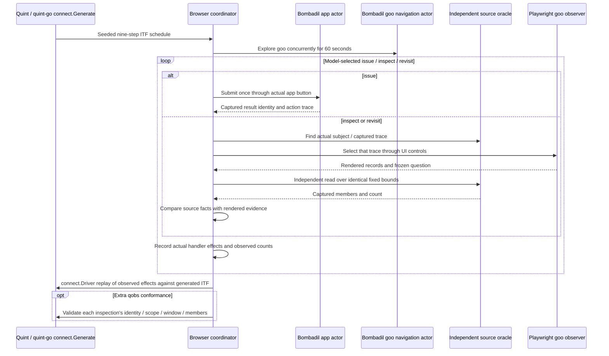

The model varies revisits and their targets. Fresh app profiles prevent a prior
result from satisfying a new request; an artifact gate requires exactly one real
submission and one returned identity per issue. Capture failure or missing
checkpoints fail the campaign. The schedule models test coordination, not business
durability, random browser scheduling or production capture completeness.

## 15. Fault evidence without inventing business outcomes

Implemented opt-in Python sample campaign; these are test interpretations of
captured evidence, not a new production health evaluator.

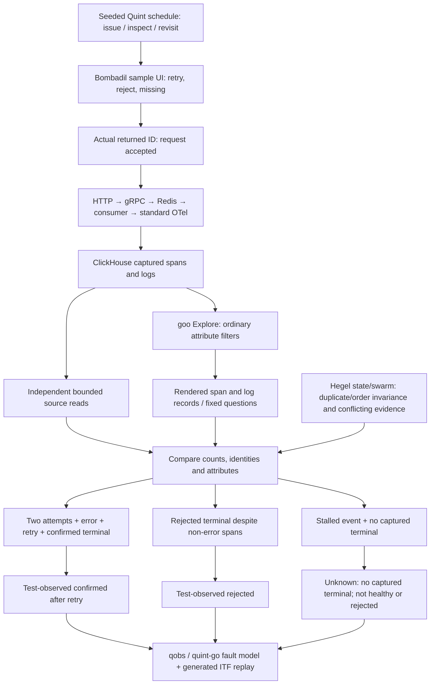

The positive stalled event is required; empty capture or ingestion failure cannot
pass that case. Terminal presence is separate from terminal outcome, so an empty
or conflicting terminal payload is not silently treated as absence. The wrapper
pauses/restores only owned lab traffic and retains stale queue entries and volumes.
See [fault testing contract](BOMBADIL_TESTING.md#retry-rejection-and-missing-terminal-campaign).

## 16. Structured investigation and local refinement

Implemented in Explore and the shared trace waterfall. Search and disclosure are
local display operations; source queries retain their own explicit evidence basis.

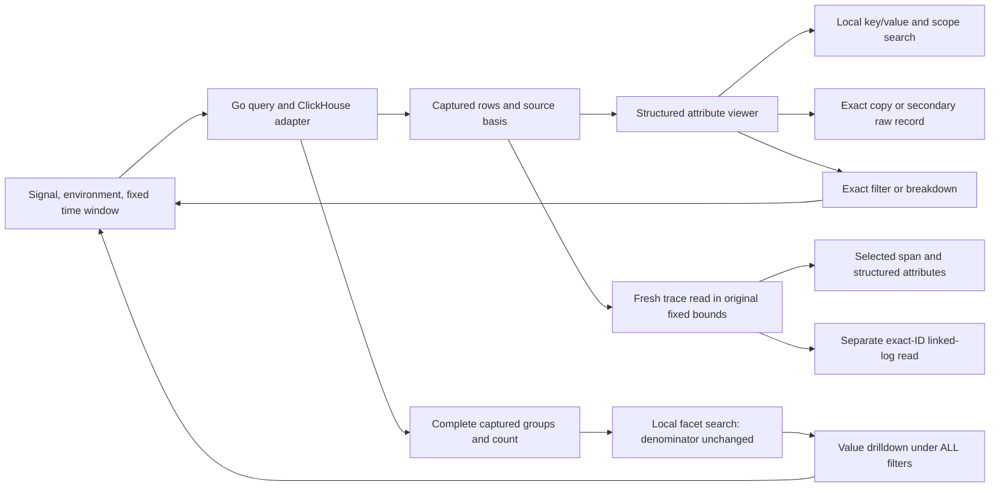

Cross-signal linked-log inspection offers local search/copy without filter or
breakdown actions against the span question. Trace scope and limitations remain
expandable. [Journey 29](journeys/README.md#29-structured-inspection-and-filter-composition)
executes this path against collector-ingested records, including keyboard/mobile
checks; the diagram does not claim snapshot consistency or complete capture.

## 17. Discover logs and spans, then reuse the question

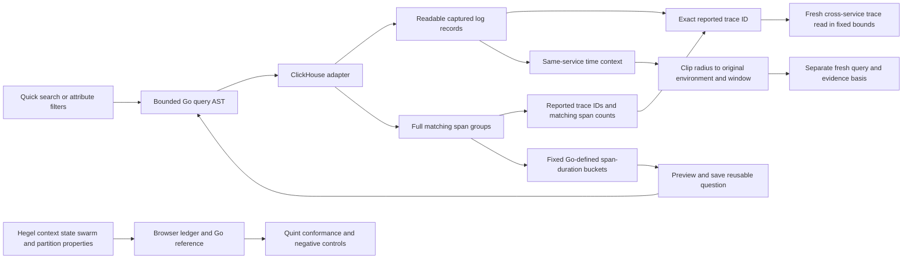

Implemented locally. Time context omits original identity/search/package predicates
and does not assert causality. Duration groups count captured spans, including
retries/duplicates; they are not root latency or native histogram streams. Suggested
breakdowns and saved packages use the same logical field/compiler contract.
[Journey 30](journeys/README.md#30-from-log-search-to-reusable-span-distributions)
provides executable frames and live-ledger validation.

## 18. Discover services and promote an investigation question

```mermaid
flowchart LR
    Services[Services: environment and lookback] --> Scope[Go bounded fixed-window question]
    Scope --> Adapter[Shared OTel ClickHouse adapter]
    Adapter --> Aggregate[One read: service and span-name groups]
    Aggregate --> Check[Validate complete counts, errors and duration partition]
    Check --> Inventory[Captured inventory with plan and basis]
    Inventory --> Search[Local search preserves captured totals]
    Inventory --> Open[Exact service and name selector in original bounds]
    Open --> Explore[Separate live Explore read and basis]
    Explore --> Package[Strict YAML package and independent preview]
    Ledger[Observed browser questions] --> Quint[Quint protocol and rejecting controls]
    Bombadil[Read-only UI actor and data invariants] --> Ledger
    Hegel[Accounting state and swarm checks] --> Check
```

Implemented locally. Span names are observed labels, not business-operation
contracts. Counts describe spans, not unique requests or healthy fleet members.
The [inventory contract](SERVICE_INVENTORY.md) and
[journey 31](journeys/README.md#31-from-observed-services-to-a-reusable-question)
cover drilldown, local filtering, preview and scope invalidation.

## 19. Capture a question, page frozen evidence and refresh explicitly

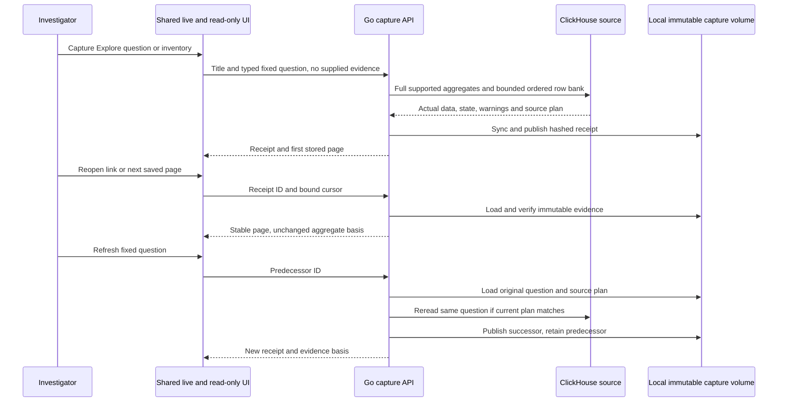

Implemented locally. Up to 1,000 inspection records are retained; aggregate totals
are independent of that bound. Counts/rows/groups are not a transactional source
snapshot. Expanded context is a separate live read; saved pages themselves never
query the source. Current workspace source identity is assumed, not a production
multi-tenant custody guarantee. [Contract](GENERAL_CAPTURES.md),
[journey 32](journeys/README.md#32-preserve-general-evidence-and-page-a-stored-record-bank)
and [collaboration research](COLLABORATIVE_INVESTIGATIONS_RESEARCH.md) connect this
foundation to proposed investigation cards and later shared editing.

## 20. Core measures, reusable questions and execution controls

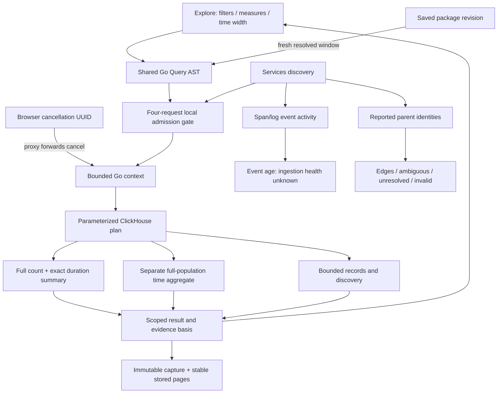

Implemented local behavior and limits: [core contract](CORE_WORKBENCH.md). Read
components are not a database snapshot. Cancellation is best effort, and local
request IDs/admission do not provide authentication or distributed tenant quotas.

## 21. Full-population duration breakdowns

```mermaid
flowchart LR
  UI[Measures and breakdown controls] --> Q[Shared Go query]
  Q --> SQL[One aggregate expression]
  SQL --> TOTAL[Full total summary]
  SQL --> GROUPS[Full group summaries]
  GROUPS --> VALIDATE[Validate count / sums / extrema / unique keys]
  TOTAL --> VALIDATE
  VALIDATE --> STATE[Observed or changed between reads]
  STATE --> RANK[Exact rational UI ranking]
  RANK --> SEARCH[Local search preserves scale]
  SEARCH -->|explicit refinement| Q
  STATE --> CAPTURE[Immutable group evidence]
  CAPTURE --> PAGES[Stable stored record pages]
  Q --> PACKAGE[Reusable YAML question and preview]
```

[Contract](GROUPED_MEASURES.md). Group percentiles are not averaged into a total.
Comparison baselines still use captured record proportions. Stored count-only
groups remain readable, and fixed-plan refresh may require a new capture after
compiler changes.


## 22. Error and latency change investigation

```mermaid
sequenceDiagram
    actor User
    participant UI as Explore workbench
    participant Go as Go semantic core
    participant CH as ClickHouse OTel tables
    participant Store as Local immutable capture store
    User->>UI: Apply span question with status, duration and breakdown
    UI->>Go: Current fixed question
    Go->>CH: Full total, group and optional interval aggregates
    CH-->>Go: Exact duration and exhaustive status counts
    Go-->>UI: Validated evidence or source-read disagreement
    User->>UI: Compare previous window
    UI->>Go: Adjacent fixed question with same selectors
    Go->>CH: Independently read previous population
    CH-->>Go: Previous aggregates
    Go-->>UI: Baseline evidence
    UI->>Go: Compare both captured aggregate cohorts
    Go-->>UI: Exact differences, absent groups and explicit unknowns
    User->>UI: Capture comparison
    UI->>Go: Two fixed questions, no caller evidence
    Go->>CH: Reread both questions and bounded inspection banks
    Go->>Store: Publish two child captures, then comparison receipt
    Store-->>UI: Pair ID and child capture links
    User->>UI: Reopen pair and inspect current child
    UI->>Store: Read immutable pair and stored records
    Note over UI,Store: Pair reopening does not query telemetry
    User->>UI: Explicitly expand a reported trace and linked logs
    UI->>Go: Original selection bounds, exact reported identity
    Go->>CH: Fresh bounded trace and log reads
    Go-->>UI: Separate evidence with coverage unknown
```

[Contract](ERROR_COMPARISONS.md) and journey 35 distinguish captured-span error
fractions from application SLIs. Publication is sequential, not an atomic
multi-object transaction; failed pairs can leave valid child captures.


## 23. Deployment context, notes and frozen evidence

```mermaid
flowchart LR
    APP[Running application] --> OTEL[OTel collector]
    OTEL --> CH[ClickHouse telemetry]
    UI[Explore fixed question] --> CORE[Go source adapter]
    CORE --> CH
    CORE --> CAP[Immutable general capture]
    HUMAN[Authored deployment claim] --> MARK[Go local deployment store]
    MARK --> TIMES[Event time plus server custody time]
    UI -->|explicit context read| CONTEXT[Window-scoped local markers]
    MARK --> CONTEXT
    CAP -->|exact capture ID| NOTES[Ordered narrative draft]
    CONTEXT -->|exact marker ID| NOTES
    NOTES --> SAVE[Immutable document revision]
    SAVE -->|explicit parent| CHILD[Successor revision]
    SAVE -->|another explicit parent save| BRANCH[Preserved branch]
    CHILD -->|open exact reference| CAP
    CHILD -->|open exact reference| MARK
    CAP -->|explicit live expansion only| CORE
```

[Contract](WORKBENCH_CONTEXT.md): marker context never changes captured aggregates
or proves causality. Document/capture/deployment histories are distinct. Opening a
narrative or its stored reference does not execute telemetry; live expansion is
explicit. This slice has a local immutable revision forest, not shared editing or
automatic CI provenance. Journey 36 executes the authored-context workflow over
real sample-app telemetry and generates its storyboard frames.

## 24. Shared example packages and scoped recipe planning

Implemented local paths; built-in recipes are question transforms, not an
independent measurement language. Instrumentation prerequisites remain declared.

```mermaid
flowchart LR
  Samples[Reservation / Go checkout / Go reports] --> OTEL[OTel collector and ClickHouse]
  YAML[Ordinary example telemetry packages] --> Package[Existing package planner]
  Package --> Applied[Applied Explore question]
  Applied --> Preview[Go recipe transform and source compiler]
  Preview --> Explicit[Explicit Run this question]
  Explicit --> OTEL
  OTEL --> Result[Full aggregates and bounded records]
  Preview --> Hypothesis[Plain-text hypothesis without evidence]
  Result --> Save[Server reread and immutable capture]
  Save --> Ref[Exact capture ID]
  Ref --> Notes[Ordered investigation notes]
  Hypothesis --> Notes
  Result --> Definition[Create reusable package revision]
  Save --> Definition
```

Preview retains environment, fixed half-open window and the entire predicate;
execution replaces breakdown/measures only and resets record paging. Saving a
capture is another source read. The legacy lifecycle/resource lab is explicit;
its specialized semantics have not been replaced by span/log counts.

## Shared typed measurements and investigation flow (implemented local path)

```mermaid
flowchart LR
  P[Python OTel SDKs] --> C[OTel collector]
  G[Woven Go spans and metrics] --> C
  L[Go example OTLP JSON logs] --> C
  C --> CH[ClickHouse OTel tables]
  Y[Versioned measurement YAML] --> V[Strict validation and typed plan]
  W[Data-only ordered workflows] --> V
  V -->|explicit Run, bounded read| CH
  CH --> A[Go source adapter]
  A --> K[Gauges / counters / histograms / lifecycle kernels]
  A --> O[Persistent first Goo observation custody]
  O --> K
  K --> UI[Explore Measurements]
  UI -->|server rereads fixed question| S[Immutable general capture]
  S -->|source-free reopen| R[Saved typed evidence]
  R --> N[Ordered notes with exact capture reference]
  R -->|same question, later knowledge| S
  R -->|definition, fresh window| V
```

The same capture store serves captured records, service inventory, comparison
pairs and typed measurements. Source services, queue names, tenant scopes and business outcomes come from
YAML bindings. The generic renderer dispatches on measurement family. Native stream instances remain separate; charts do not perform
implicit fleet aggregation. The Go log transport here is explicitly example-only.

```mermaid
sequenceDiagram
  actor User
  participant UI as Goo UI
  participant Go as Go measurement service
  participant CH as ClickHouse
  participant Custody as Local custody store
  participant Capture as Immutable capture store
  User->>UI: Select workflow step / edit YAML
  UI->>Go: Preview package and resolve fixed bounds
  Go-->>UI: Typed plan (no telemetry read)
  User->>UI: Run measurement
  UI->>Go: Fixed question
  Go->>CH: Parameterized bounded source read
  CH-->>Go: Captured observations
  opt Lifecycle source
    Go->>Custody: Retain first observation per immutable payload
    Custody-->>Go: Exact received time (not completeness)
  end
  Go-->>UI: Typed result and evidence basis
  User->>UI: Capture investigation
  UI->>Go: Fixed question (no supplied evidence)
  Go->>CH: Reread same source scope
  Go->>Capture: Publish input, result, plan and receipt
  Capture-->>UI: Immutable capture ID
  User->>UI: Reopen cited capture
  UI->>Capture: Load exact stored revision
  Capture-->>UI: Evidence without telemetry/custody query
```

Lifecycle refresh retains business evaluation T and advances local knowledge
cutoff under an explicit policy. It may reveal past events; it never moves the
business question or licenses future events. Coverage stays unverified, so missing
terminal events remain unknown. See [measurement contract](MEASUREMENT_PACKAGES.md).


### Observed metrics to reusable packages

```mermaid
flowchart LR
  SDK[Ordinary OTel SDK / no goo manifest] --> Collector
  Collector --> CH[ClickHouse metric tables]
  CH --> Discover[Bounded service and environment discovery]
  Discover --> Draft[Observed identity → editable package]
  Draft --> Preview[Source-free typed preview]
  Preview --> Run[Explicit fixed-window measurement]
  Run --> Capture[Immutable capture]
  Capture --> Notes[Investigation notes]
  Draft --> Library[Saved YAML revision]
```

Discovery reports observed metadata only; omitted scope version/schema remain
empty exact identity values. It never computes measurements or creates evidence.

### One product loop, shared evidence

```mermaid
flowchart LR
  Services[Observed service] -->|environment + service / no read| Discovery[Instrument discovery]
  Discovery -->|explicit bounded read| Draft[Reusable definition]
  Library[Definitions catalog] -->|source-free preview| Draft
  Draft -->|explicit fixed-window run| Evidence[Investigate evidence]
  Evidence --> Capture[Immutable capture]
  Capture --> Notes[Explain in investigation notes]
  Draft -->|save revision| Library
  Capture -->|fresh question / old evidence retained| Draft
```

The product centers definitions, evidence and explanations. Traces, logs, native
metric streams and lifecycle subjects provide different inspection tools within
that loop. UI navigation cancels abandoned measurement/discovery work; it does
not run a source question or mutate a capture.

### Question-first investigations and exact evidence attachments

```mermaid
flowchart LR
  Question[Question / finding / open questions] --> Draft[Investigation draft]
  Draft -->|explicit save| Revision[Immutable investigation revision]
  Revision --> Explore[Explore records or measurements]
  Explore -->|explicit source read| Capture[Immutable capture]
  Capture -->|add to current draft| Draft
  Capture -->|append to selected saved revision| Child[New child revision]
  Revision -->|explicit parent| Child
  Child -->|receipt metadata / no telemetry read| Handoff[Cross-signal handoff]
  Capture -->|reuse definition / new live read| Fresh[New capture]
  Fresh --> Child
```

Capture and document publication are separate; attachment failure retains the
capture. A delayed attachment may publish its authorized child revision, but cannot
replace an unrelated or changed draft. Old capture and investigation IDs remain
exact; new evidence never silently advances an earlier citation.

### Evidence-led follow-up questions

```mermaid
flowchart LR
  Capture[Verified immutable capture] -->|stored read only| Planner[Go contextual question planner]
  Planner --> Preview[Relationship / preserved and changed scope]
  Preview -->|explicit run| Records[Explore traces / logs / reported status]
  Preview -->|source-free open| Metrics[Fixed-window instrument discovery]
  Metrics -->|explicit discover and measure| Evidence[New evidence]
  Records --> Evidence
  Evidence --> Investigation[Capture and cite in investigation]
  Preview -->|authored question / no source read| Gap[Missing evidence in draft brief]
  Gap --> Investigation
```

The planner derives IDs/services from retained evidence and validates generated
queries through existing compilers. Exact reported IDs and service/time context
are distinct relationships. No suggestion changes the original capture or asserts
a cause; all source execution remains an explicit user action.

### Shared scope and question transforms

```mermaid
flowchart LR
  Typed[Existing typed questions] --> Scope[Detached semantic scope]
  Typed --> Transform[Recipe or capture-owned follow-up]
  Transform --> Check[Validate relationship and compute changes]
  Scope --> Check
  Check --> Preview[Shared source-free preview]
  Preview -->|explicit execution| Source[Existing source adapter and kernels]
  Source --> Capture[Existing immutable capture format]
```

Scope retains exact OTel/custom selectors and declared bindings; unknown schema or
convention metadata stays unknown. Inspection paging/aggregation presentation is
outside record population scope. Descriptors are planning metadata only; persisted
capture formats and hashes are unchanged. See QUESTION_SCOPE.md for boundaries.

### Typed record measures and grouped time evidence

```mermaid
flowchart LR
  Question[Existing record question and shared scope] --> Adapter[Typed count / duration / status operators]
  Adapter --> SQL[Bounded ClickHouse lowering]
  SQL --> Total[Totals and global time chart]
  SQL --> Groups[Breakdown summaries]
  SQL --> Cells[Optional group plus interval read]
  Total --> Check[Compare additive count / sum / status states]
  Groups --> Check
  Cells --> Check
  Check --> Chart[Shared-scale chart and immutable capture]
  Chart -->|definition reuse| Question
```

Reads remain independent. Disagreement stays explicit; agreement does not establish
a transaction. Per-cell percentiles use raw durations, never averaged scalar
percentiles. Old unsplit plans/definitions retain their representation. See
RECORD_MEASURES.md for budgets, typed-model scope and OTel boundaries.

## Explicit numeric attributes across the investigation loop

The [numeric attribute process diagram](NUMERIC_ATTRIBUTE_PLANNING.md#charts-custody-and-disagreement)
connects optional question/YAML bindings, parameterized source lowering, exact
reference checks, coverage/accounting, Explore and immutable capture/reuse. This
path uses ordinary OTel string-map records without code annotations or inferred
semantic-convention conformance. Native metric kernels remain distinct.

## One question execution lifecycle

The [question-workbench state diagram](QUESTION_WORKBENCH.md#evidence-questions-and-investigations)
connects draft composition, explicit generation-checked execution, contextual
one-gesture reads and immutable evidence. Shortcut and advanced controls share one
executor. Native discovery remains a separate signal population, retaining explicit
service/time bounds from inventory. It is not an automatic cross-signal correlation.

## Service browsing

The [service browsing flow](SERVICE_BROWSING.md#scope-and-return-behavior) shows
independent bounded metadata reads, convention-based record questions and native
measurement preview feeding the existing typed executors.

The [all-signal discovery diagram](METRIC_SERVICE_DISCOVERY.md) adds native metric
point-presence groups to service discovery without changing dependency inference
or native measurement kernels.

The [unified catalog diagram](UNIFIED_SERVICE_CATALOG.md) connects one discovery
entry, fixed-window service detail, existing executors and local return navigation.

## Resumable record questions

[Question links](QUESTION_LINKS.md) serialize fixed record scope and view into a
versioned fragment. Restoring a link or browser history stages a draft; only an
explicit Run again reaches the source adapter. Capture links continue to retrieve
immutable stored evidence. The handoff sequence is documented in that contract.

## Mixed investigation intent and evidence

The [investigation-step flow](INVESTIGATION_STEPS.md) connects both record and
measurement definitions to immutable document revisions. Reopening dispatches
to a staged record question or source-free measurement planner; an explicit run
reaches existing adapters and evaluators. Capture IDs retain separate custody
and read semantics. Equal scope bounds never merge signal populations.

## Capturing evidence for a saved question

[Question evidence history](LINKED_QUESTION_EVIDENCE.md) documents the explicit
source-read → immutable capture → child document-revision flow. Publication can
fail after capture; the retained ID can be linked without another source read.
Read time, custody time and question scope remain separate.

## Stored evidence comparison

The [capture comparison sequence](CAPTURE_COMPARISON.md) follows selected linked
IDs through Go validation and immutable capture storage. It shares the full
span-summary kernel with exploration and has no source-query or publication step.

## Sharing a frozen comparison

The [saved-comparison sequence](SAVED_COMPARISONS.md) separates source captures,
a server-verified comparison receipt, an authored finding and a shared document
revision. The recipient reads the receipt directly, without engine reevaluation.

## Complete native window comparison

The [native window flow](NATIVE_WINDOW_COMPARISON.md) validates full coverage and
stream identity before computing exact rates or compatible bucket populations.
Supported changes and refusal reasons enter version 2 receipts; version 1
snapshots remain readable without engine reevaluation.

## Observed support to new exact evidence

[Observed-window discovery](OBSERVED_WINDOW_DISCOVERY.md) is source-free until
the user explicitly captures both selected sub-scopes.

```mermaid
flowchart LR
  Old[Two immutable native captures] --> Support[Go all-stream supported-boundary intersection]
  Support --> Preview[Exact candidates and coverage exclusions]
  Preview --> Pick[User selects both sub-scopes]
  Pick --> Compatible{Same streams, temporality and layout?}
  Compatible -->|yes / explicit capture| Read[Two bounded Nano source reads]
  Compatible -->|no| Withhold[Explain incompatibility]
  Read --> New[Two new immutable captures]
  New --> Compare[Existing complete-window comparison]
  Compare --> Frozen[Explicitly saved comparison and investigation revision]
```

The original capture question and evidence remain unchanged. Partial publication
retains completed capture IDs for recovery; separate source reads are not atomic.

## Comparison evidence to reusable intent

```mermaid
flowchart LR
  Side[Stored comparison side] -->|explicit add / no source read| Draft[New typed question and linked capture in draft]
  Draft -->|save| Revision[Immutable investigation revision]
  Revision -->|reopen / no source read| Fixed[Exact fixed question]
  Fixed -->|run and capture| Read[Explicit source read]
  Read --> Child[Child revision appends capture ID]
  Fixed -->|preview fresh window / no source read| Fresh[Same definition, new proposed scope]
```

[Contract and journey](REUSABLE_COMPARISON_QUESTIONS.md): new question keys keep
evidence distinct, and fresh previews do not rewrite the saved question.

## Resume an investigation with fresh evidence

```mermaid
flowchart LR
  Saved[Saved typed question] --> Preview[Pure same-duration scope proposal]
  Old[Linked immutable captures] --> Prior[Explicit prior-evidence selection]
  Preview --> Consent[Capture and compare]
  Prior --> Consent
  Consent --> Read[One new source read / existing Go adapter]
  Read --> New[New immutable capture]
  Prior --> Compare[Existing stored-evidence comparison]
  New --> Compare
  Compare --> Finding[Explicit frozen finding and document revision]
```

[Contract](FRESH_COMPARISON.md): the prior evidence and saved fixed question remain
unchanged. Scope, source read and custody times are displayed separately.

## Captured change breakdowns and product direction

[Captured group comparisons](COMPARISON_BREAKDOWNS.md) reuse full stored
aggregates and open focused questions. New dimensions require explicit recapture.
[Whole-product review](WHOLE_PRODUCT_REVIEW.md) guides automatic service
overviews and distributed relationships within Services. The first bounded slice
is implemented; remaining graphical topology and broader dashboard recommendations
are planned. Observed, declared and executed-supported evidence remain distinct.

## Automatic service overviews

[Service dashboards](SERVICE_DASHBOARDS.md) now derive bounded typed widgets
from observed signals, convention keys and native instruments. Matching registry
contracts retain declared revision IDs. Services also offers a local distributed
view of resolved parent relationships and diagnostics, with fixed-scope handoffs
into questions and immutable investigation evidence. Async/declaration topology,
whole-dashboard snapshots and declared-only catalog entries remain future work.

### Live native counter windows

The [counter export-window sequence](LIVE_COMPARISON.md#exact-stream-counter-rates)
shows bounded endpoint discovery, exact-window evaluation and source-free freeze.
The evaluator owns coverage/reset semantics; the app adapter owns polling,
freshness and stable domains. Passive chart components accept rational rates.

### Selecting a native stream

The [exact-stream sequence](EXACT_STREAM_SELECTION.md) connects broad observed
inventory, read-free focus preview, source-level identity predicates, immutable
package/capture storage and live counter freeze. Focus is application intent;
passive display components continue to own no reads or subscriptions.

### Retained native inventory browsing

The [native navigation diagram](NATIVE_STREAM_NAVIGATION.md) separates typed
source evidence from local search/review/paging and the explicit Focus/Run read
boundary. Coverage explanations use evaluator states; they do not rewrite or
re-evaluate stored evidence or manufacture rates from displayed rows.

### Discovered native service views

The [native service sequence](SERVICE_DASHBOARDS.md#native-service-cards-and-exact-stream-questions)
connects observed instrument planning, independent typed widget reads, passive
compact values/coverage, source-free retained browsing and exact stream preview
through capture custody. Latest interval values and whole-window coverage are
separate; no browser measurement evaluator or automatic fleet aggregation is added.

### Choosing native service instruments

The [selection sequence](SERVICE_DASHBOARDS.md#choose-native-instruments-for-this-service-visit)
separates metadata-only draft edits, Go validation of offered definition keys,
explicit bounded rereads and current-generation publication. Empty selection
means no native reads; changing the selection leaves stored captures intact.

### Retained native temporal inspection

The [native timeline sequence](NATIVE_TIMELINES.md#interaction-and-custody) keeps
Go-classified observations/coverage separate from bounded passive geometry and
read-free local selection. Ordinary explicit capture rereads the same question;
stored charts reopen without telemetry reads. P95 remains a bucket range and
unknown intervals never inherit previous distributions.

## Native histogram display path

The [native histogram heatmap design](NATIVE_HEATMAPS.md) diagrams the Go evaluator, retained interval adapter, passive grid and existing selection panel. Go remains responsible for captured-window compatibility.

## Explicit time-bucket aggregation

The [histogram time-bucket diagram](HISTOGRAM_TIME_BUCKETS.md) places whole-interval aggregation after the Go native evaluator and before shared passive display adapters. Width belongs to the immutable question, while raw/fixed-time switching uses retained results. The [whole-product component sweep](WHOLE_PRODUCT_COMPONENT_SWEEP.md) documents proposed evidence and investigation compositions.

## Evidence presentation boundary

The [evidence-summary diagram](EVIDENCE_SUMMARIES.md) shows full captures, existing receipt metadata and validated service-widget results flowing through application-owned presentation into the shared passive element. Clocks and scope interpretation stay in adapters; buttons and reads stay outside the component.

Service widgets pass their validated plan/result to the application presenter, then the passive summary. The widget adapter still owns two bounded concurrent reads, generation guards and capture actions. UTC/tooltips are a display projection of exact timestamp strings, never rounded query bounds or a new evaluator.

See [comparison presentation](COMPARISON_PRESENTATION.md) for aligned scalar pairs, compact metric matrices, frozen-side summaries and UTC tooltip adoption.

The shared selected-item shell is now adopted in waterfall spans, span/log record inspection and native timeline/bucket selections. See [selected-item inspectors](SELECTED_ITEM_INSPECTORS.md) for lifecycle, retention, focus and source-action boundaries.

## Core experience refinements

See [the implemented workflow](CORE_EXPERIENCE_REFINEMENTS.md) for retained
application visits, typed population selection, compact diagnosis, trace
breakdowns and independently loaded context. These compose passive display
elements; application adapters own navigation, read lifecycle and scope. Journey
85 exercises real OTLP data and refreshed screenshots; the core-refinements
Bombadil actor covers selection and returning to retained evidence. Hegel
selection properties and the question-session state swarm complement observed
quint-go validation against the existing question-links model.

The [Saved work composition diagram](SAVED_WORKSPACE.md#secondary-tools-and-relevant-recovery)
shows the delivered narrative/evidence/catalog/tool boundaries and relevant
browser-local retry entrance. These remain separate from production ingestion
and query execution.

## Supplied record fields

```mermaid
flowchart LR
  O[Application read owner] --> R[Supplied rows and fixed read basis]
  R --> P[Passive record field picker and table projector]
  P --> L[Local column layout]
  P --> I[Include or Exclude intent]
  I --> S[Owner stages scope or fixed predicate]
  S --> E[Explicit Apply or Run]
  L --> V[Explicit saved population configuration]
```

The picker never reads a source or publishes evidence. Saved field layouts are
configuration alongside the original fixed questions. See the
[executable field storyboard](RECORD_COLUMNS.md).

Reopened population record fields now dispatch to the same staged facet owner
as recent records. Its child owner retains the parent, stages before Run and
restores it without rereading; field controls do not create another query owner.
