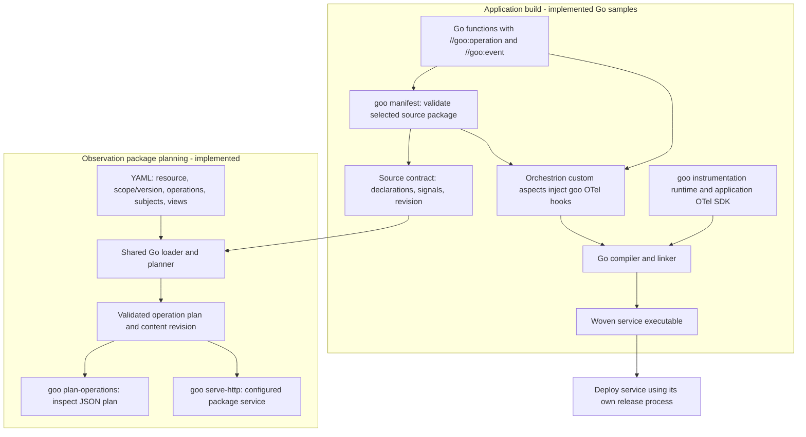
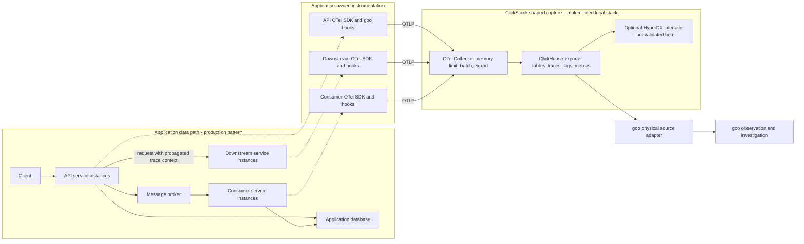
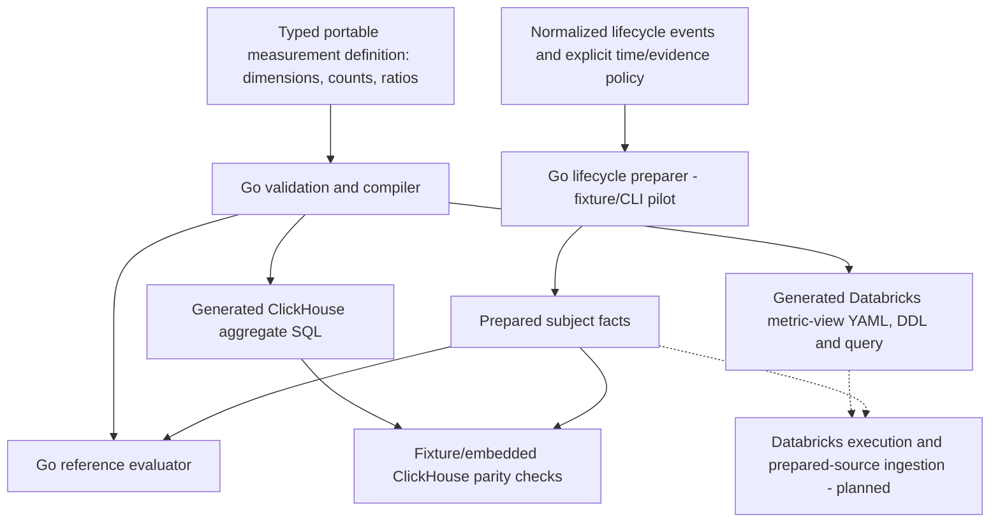
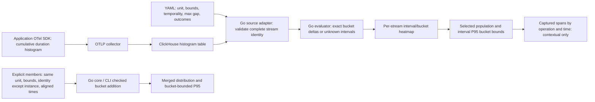
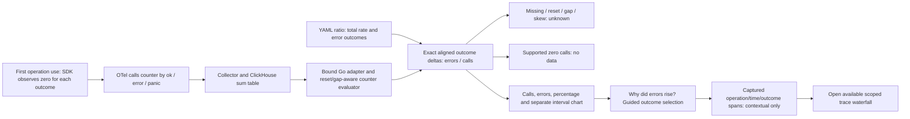
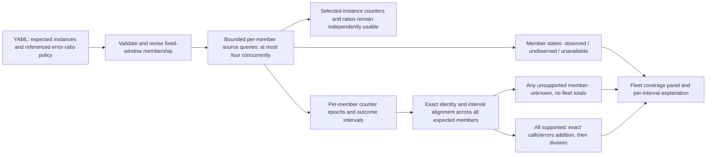
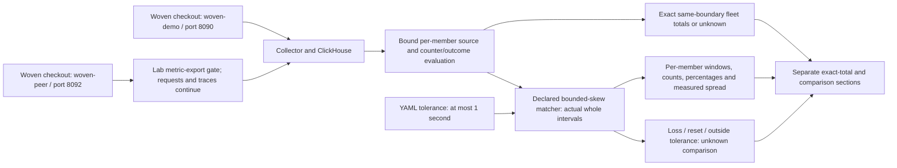

# How goo connects application code to captured evidence

Goo defines how telemetry is interpreted and explored. Applications emit standard
OTel telemetry; goo reads the captured records through an explicit source adapter.
The diagrams separate source/build declarations, the application data path, and
the investigation path. They describe implemented local components unless marked
**production pattern** or **planned**. They are not evidence of a production deployment.

## 1. From source code and YAML to executable services and observation plans

There are two separate compilation/planning paths. Instrumentation changes an
opt-in application build. An operation package configures goo's interpretation of
that application's telemetry; it does not compile or deploy the application.



The build helpers validate annotations before actual weaving. `goo weave` is a
test wrapper; the sample build scripts invoke Orchestrion for executable builds.
Plain Go builds ignore the annotations. Applications configure SDK providers and
exporters; the instrumentation runtime does not install them. The current manifest
scans one source package, not the linked binary or complete dependency graph.
The operation planner currently needs that local source package to remain present.

YAML selects fixed supported adapters and views, with strict validation. It is not
a general IaC apply engine, arbitrary query language, CEL/KCL implementation or
production rollout system. See [annotations](GOO_ANNOTATIONS.md),
[build tooling](INSTRUMENTATION.md) and [operation packages](OPERATION_PACKAGES.md).

## 2. Production service topology and the standard telemetry boundary

This **production pattern** shows where the implemented components fit. Replicated
services, external brokers and downstream services are illustrative deployment
roles. Today's independent checkout/report Go samples and the separate Python
HTTP/gRPC/Redis/consumer lab do not implement this as one distributed application.



Goo is outside the application request path. The collector accepts standard OTLP;
custom goo operation/event attributes travel inside normal OTel spans and events.
Other standard instrumentation can coexist. Automatic HTTP/database/library
instrumentation is not implied by a goo operation annotation.

Each production process needs meaningful resource identity, including distinct
`service.instance.id` values. Replicas and cross-service subject joins need an
explicit aggregation/identity contract; current operation packages bind one
service/environment/instance and instrumentation scope/version. The built-in
subject key retains environment, service, namespace, tenant and ID, so identical
IDs in different tenants or services do not silently become one subject.

The actual Go samples export **traces**, including subject span events. The
checkout sample also exports native OTel metrics for the bounded counter-rate and native histogram
views; the report sample remains trace-only. The collector has logs, metrics and
trace pipelines; the Python lab supplies additional telemetry. Trace propagation,
async span links, sampling, credentials and collector topology are application/
deployment responsibilities. This lab's shared disposable database account and
loopback ports are not a production authorization model. See
[live operation integration](LIVE_OPERATIONS.md) and [subject scope](SUBJECT_NAVIGATION.md).

## 3. From captured records to an investigation

```mermaid
sequenceDiagram
  actor User
  participant UI as Investigation browser
  participant Proxy as Query proxy - Python today
  participant Goo as Go package service
  participant CH as ClickHouse
  User->>UI: Select package and time window; inspect operations
  UI->>Proxy: Same-origin operation request
  Proxy->>Goo: Forward selected package and bounds
  Goo->>Goo: Validate bound plan; freeze span-start window
  Goo->>CH: Bounded SQL with typed values and explicit resource/scope
  CH-->>Goo: Captured completed spans and nested events
  Goo->>Goo: Validate records; deduplicate exact copies; reject conflicts/overflow
  Goo->>Goo: Compare source contract; summarize observed invocations
  Goo-->>Proxy: Rows, exact span evidence, diagnostics, query and evidence basis
  Proxy-->>UI: Captured response
  User->>UI: Select operation/errors; select duration cell
  UI->>UI: Filter exact contributing spans within captured evidence
  User->>UI: Open trace waterfall; inspect declared subject event
  UI->>UI: Follow scoped subject to related event-bearing traces
  Note over UI,CH: These drilldowns reuse the captured response; no new operation fetch
  User->>UI: Refresh observation
  UI->>Proxy: New query; late arrivals may change evidence and basis
```

Overview counts are observed **invocations**, not unique business requests or
subjects. Raw-duration heatmaps use captured span samples, not reconstructed
percentiles. Trace waterfalls preserve observed parent relationships but contain
only matching operation spans in the selected resource/library/span-start window.
Subject navigation relates declared event-bearing invocations; it does not infer
retries, transaction commit or durable completion.

The adapter refuses an oversized observation instead of presenting partial totals
as exact. Unsupported/malformed records and conflicting duplicates fail validation.
Unobserved declarations remain unknown, not zero. The current exporter drops scope
schema URLs, so schema compatibility is explicitly declared rather than observed.
Sampling and capture completeness remain unverified. These evidence checks are
conformance checks against declared contracts, not proof of application correctness.

The content-derived evidence basis includes plan/source revisions, resource binding,
fixed window and returned evidence. It identifies the response being explored; it
is not an immutable custody snapshot. Changing packages clears old evidence and
stale responses cannot repopulate the new package's view. See
[trace drilldown](OPERATION_DRILLDOWN.md) and [package switching](OPERATION_PACKAGES.md).

## 4. Portable measurement compilation is a separate bounded path



This compiler supports a bounded prepared-fact count/ratio model. Lifecycle
preparation handles explicit event/custody/evaluation-time rules in its separate
pilot. The live operation-package UI does not automatically lower to this compiler,
Databricks or durable lifecycle accounting. Generated Databricks artifacts require
prepared sources; there is no validated Databricks deployment or instance execution.
Data ingestion and timestamp representation remain separate portability contracts.
See [portable compiler](PORTABLE_COMPILER.md),
[lifecycle preparation](LIFECYCLE_PREPARATION.md) and
[Databricks compatibility](DATABRICKS_METRIC_VIEWS.md).

## Reading the evidence and the roadmap

Executable local journeys validate source annotations → woven sample → collector
→ ClickHouse → Go adapter → UI exploration. They are linked from the
[journey index](journeys/README.md); current checks and limitations are recorded in
[VALIDATION.md](../VALIDATION.md). These diagrams are architectural documentation,
not additional runtime or production test evidence.

[Native counter interval rates](NATIVE_COUNTERS.md) now supply explicit temporality,
reset, gap and resource semantics in a bounded Go evaluator and operation-rate
view. Metric and span results retain separate bases; their time links are contextual. Automatic fleet discovery,
full distributed-trace retrieval, source-free build manifests, durable subject
records and production deployment automation are further work. Preserve these
boundaries when adapting the diagrams for a particular production deployment.


## 5. Native histogram intervals and bounded investigation

Implemented for the checkout package; this path is separate from the raw-span
heatmap and the portable prepared-count compiler.



No cumulative subtraction crosses an epoch reset or invalid layout/decrease.
Missing intervals remain unknown. Merge inputs are explicitly supplied; the UI
neither discovers fleet membership nor merges percentiles. See
[native histogram semantics](NATIVE_HISTOGRAMS.md) and journey 14 for executed
browser evidence. These semantics do not establish exact metric-to-span attribution.

## 6. From aligned counters to an error investigation

Implemented for the checkout package. Errors are a declared outcome subset of
calls, not a separately fetched population. This is per-instance, not fleet-wide.



No separate numerator query is used for a ratio. Counts and exact fractions are
retained; percentages are presentation values. The guide does not establish an
increase, exact contributors or cause. See [ratio semantics](OPERATION_ERROR_RATIOS.md)
and [journey 15](journeys/README.md#15-from-operation-error-ratios-to-traces).

## 7. Fleet membership and coverage before totals

Implemented fixed-window membership; discovery and automatic time alignment are
planned. The default local fleet now deploys both expected instances; bounded comparisons are separate from exact totals (diagram8).



Observed membership is distinct from supported interval coverage and ingestion
completeness. The live journey separates observed membership from exact coverage; aligned fleet
population arithmetic retains fixture/property/model verification. Live independent
windows are compared separately without claiming an exact combined population. See [fleet semantics](FLEET_COVERAGE.md) and journey 16.

## 8. Two live instances and bounded comparisons

Both sample instances are now deployed in the default lab. This diagram separates
reported-time comparison from exact population aggregation.



Comparisons never shift timestamps or create a common-window population. Host
clock accuracy remains unverified. Journey 17 exercises traffic imbalance,
metric-export loss, recovery and a controlled peer restart. See
[comparison semantics](FLEET_COMPARISONS.md).
