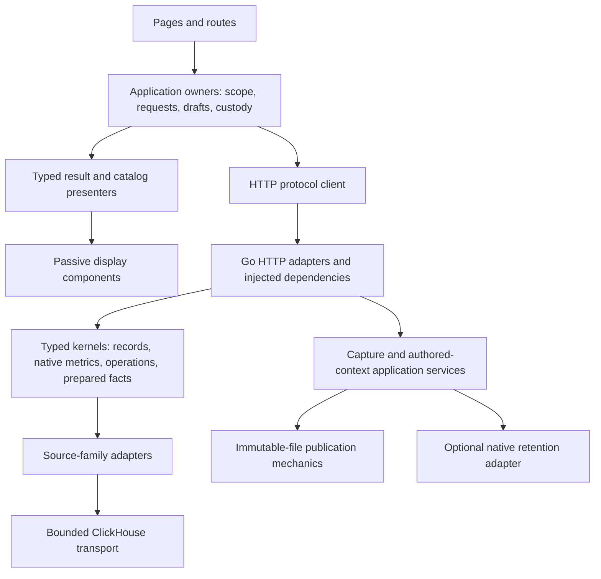

# Architecture refactoring review

Prepared 2026-10-22. **Recommendations, not approved implementation work.** This
source review follows the [consolidated product proposal](PRODUCT_IMPLEMENTATION_PROPOSAL.md)
and [whole-product usability review](WHOLE_PRODUCT_USABILITY_REVIEW.md). The companion
[design refactoring review](DESIGN_REFACTORING_REVIEW.md) examines composition,
interaction and styling adoption in more detail. This review covers
the current working tree, including the in-flight retained catalog, pinned-review
citations and native retry journal. Final runtime validation and release status
belong in [VALIDATION.md](../VALIDATION.md); this review ran no new integration
campaign and makes no performance claim.

The architecture should become easier to change by extracting repeated mechanics
and clarifying application ownership. It does not need a new framework, universal
query engine, microservice split or wholesale database migration. The greatest
near-term benefit comes from a small application composition layer above the
existing typed Go kernels and below the pages, plus narrowly shared transport and
immutable-publication utilities.

## Preserve these existing separations

- `exploration/` validates and executes record questions; `metrics/` owns native
  interval/reset/distribution semantics; `measurements/` composes supported
  measurement families; `measurement/` is the separate prepared-fact portable
  compiler. Similar names do not mean interchangeable semantics.
- `annotations/` contains instrumentation/operation planning and source adapters;
  `workbench/meaning.go` contains authored tags/notes. These are different forms
  of “annotation.” Documentation and dependency names should say which one.
- File captures, authored documents, process-local page capabilities and optional
  XTDB retention have different durability and authority. A unified browser must
  adapt them, not collapse them into one mutable latest object.
- Passive web components own supplied-data rendering and bounded interaction.
  Application adapters own requests, navigation, scope, subscriptions and custody.
- A review revision is historical identity; an await token is a visibility lower
  bound; event time, captured time and evaluation time remain separate clocks.

## Findings and proposed boundaries

| Priority | Code-backed finding | Narrow refactoring and owner | Guardrail |
| --- | --- | --- | --- |
| High | `ui/workspace.js` mixes route/link validation, question conversion, evidence differences and DOM layout; navigation reparents live `#operations` into Saved investigations. | Split pure versioned link/step helpers from the route/layout adapter. Give saved receipts a read-only presenter and explicit continuation, leaving the live operation owner in its own destination. | Keep old hashes and saved artifact IDs valid; opening routes must remain source-free; preserve dirty draft protection. |
| High | `ui/population-workspace.js`, `ui/service-dashboard.js`, `ui/exploration.js` and `ui/measurements.js` each compose scope, result state, charts, continuation and exact evidence. The same components sit inside different nested wrappers. | Share an application-level result composition for two surfaces first: scope/state, result body, actions, optional exact details. Keep record/native/contract presenters as typed adapters. | Do not move execution into a custom element or create a universal result JSON blob. Partial/gap/invalid state belongs beside the affected result. |
| High | Question identity and validation are repeated: `ui/question-session.js` normalizes empty predicate values and absent optional fields, while `ui/service-dashboard.js` uses its own sorted-object comparison and `ui/workspace.js` adds link/step checks and a fallback stable serializer. | Establish named, pure browser protocol helpers for record identity, native question identity, step conversion and link envelope validation. Add shared conformance fixtures against the relevant Go types. | Preserve intentional family differences. Browser validation is an affordance, not server authority; do not use JS normalization to change stored hashes. |
| High | Request policy is spread across `server.py` GET/POST allowlists and body limits, Go `register*` functions, and the path list in `cmd/goo/query_budget.go`. New routes can require policy edits in several places. | Introduce an explicit Go server dependency/configuration value and a reviewed endpoint-policy inventory. Consolidate strict JSON decode/response helpers with per-route limits. Audit execution admission by effect, including reads triggered by GET and comparison/capture routes. | Do not silently put SSE under an ordinary request timeout or treat cancellation capabilities as authentication. Compare status/error compatibility before removing the Python proxy. |
| Medium | `exploration/source.go`, `annotations/clickhouse.go`, `annotations/counters.go`, `annotations/histograms.go` and `prebuilt/clickhouse_http.go` separately construct authenticated ClickHouse HTTP requests. Exploration has its own escaped-parameter encoder and bounded execution settings. | Extract a small internal ClickHouse transport accepting explicit SQL, typed parameter values, context and a bounded policy. Keep SQL generation, row decoding and evidence-basis construction in the source family. | Inventory existing escaping and limits before extraction; do not assume the other paths have a demonstrated bug. Test controls/backslashes, cancellation, non-2xx, oversized responses and family-specific limits. |
| Medium | `workbench/store.go`, `exploration/package_store.go`, `exploration/capture_store.go` and `investigations/store.go` repeat temporary-file write, sync, hard-link publication and directory-sync mechanics. Their validation and hashing are intentionally different. | Extract only an immutable-file publication/read utility with caller-supplied bytes, validated path and maximum size. Each domain retains schema validation, digest computation, parent rules and catalog policy. | Freeze golden IDs first. `investigations.digest` normalizes embedded JSON with `UseNumber`; `workbench.digest` hashes its typed marshal. A single new canonicalizer would change identities. |
| Medium | `cmd/goo/*_http.go` repeatedly reads environment settings and constructs sources; retained-card resolution in `workbench_http.go` directly wires `retention.Store`. | At server startup assemble typed dependencies for telemetry sources, stores, clocks and exact-reference resolution. Inject narrow functions/interfaces only where a consumer needs them. | Keep the current good boundary: `workbench/documents.go` validates card shape and accepts a resolver without importing XTDB. Loading an existing document must not require the native database. |
| Medium | `ui/retention.js` currently owns native API/basis handling, selection saving, document attachment, catalog, reference rendering and pending recovery in a few very long physical lines. Other UI adapters also use dense one-line functions. | Split retention into an application client/basis owner, catalog adapter, citation adapter and recovery adapter; keep `pending-saves.js` pure. Apply a consistent readable formatting convention to touched modules. | Mechanical formatting must be separate from behavior changes. Preserve original retry bodies, request keys, explicit retry, await-token propagation and generation guards. Formatting alone is not evidence of safer ownership. |
| Medium | Async generations/controllers recur independently across population, service, catalog, documents and live adapters. `GooQuestionSession.Session` already supplies a pure record execution lifecycle. | Document and extract a tiny disposable request-owner contract after comparing two real adapters: begin, invalidate, current, dispose. Keep semantic transitions in each owner or existing Session. | Connected DOM alone is insufficient to accept a late response. Do not make a shared helper auto-retry, subscribe or mutate drafts; test obsolete completion and parent/child restoration. |
| Medium | Definition libraries have different persistence paths but repeat page/filter/empty/error/revision display work. Native catalog and file tag catalog are separate capabilities. | Use a shared catalog presenter and explicit store adapters returning stable typed row keys, pagination and search scope. Family grouping requires an explicit declared identity or lineage. | Equal titles are not a family ID; unavailable native search cannot become “no matches”; a merged list cannot invent a global authoritative head or snapshot cursor. |

## A clearer dependency map

This is a proposed module direction, not a required directory migration. Existing
packages can acquire these seams in place.

The diagram omits tests and instrumentation for readability. It deliberately does
not put all families through a common evaluator or all persistence through XTDB.
A shared visual shell needs a supplied-data contract; it does not need to import
query ASTs, source bindings or storage handles.

## Semantics that should not be deduplicated blindly

**Compilers and optimizers.** The prepared-fact compiler in `measurement/compile.go`
and record compiler in `exploration/compiler.go` operate on different source and
expression contracts. Native kernels must retain stream identity, temporality,
complete-export coverage and bucket layout. Share independently proven leaf types
or physical transport; keep backend lowering explicit. DataFusion could later be
an execution target for a supported typed subset, but it does not remove Goo's
semantic validation, evidence or custody obligations. No present source review
justifies introducing it as a refactoring dependency.

**Identity.** `identity/namespace.go` is a useful existing leaf package. Reuse its
missing/value distinction rather than inventing UI sentinel strings. Extend shared
identity types only where the next workflow requires them; do not equate a native
stream with a service name or an observation with its trace ID alone.

**Persistence and clocks.** `exploration/result_snapshots.go` intentionally holds
expiring process-local capabilities; native retention is a separate durable write.
Catalog current-head tags and pinned old-review citations intentionally answer
different questions. The native journal is bounded browser recovery for supported
writes, not a document-draft store or cross-tab coordinator. Refactoring must not
turn the await token into an asserted historical cutoff.

**Shared service extraction.** Keep one deployable Go backend unless independent
scaling or security needs are established. Moving functions out of `cmd/goo` can
improve testability without adding a network hop. Preserve the Python sample and
legacy query compatibility until a measured migration has parity. A future Go
static/proxy entrypoint is reasonable after route/error/SSE parity tests, not a
prerequisite for the first compactness release.

## Incremental sequence aligned with the proposal

1. **Close the current release.** Land the retained catalog/citation/journal with
   its actual checks. Do not mix structural code movement into its final gates.
2. **Product proposal milestones 1–2: extract while simplifying.** Split pure
   route/link helpers; remove live-editor reparenting through a read-only legacy
   receipt presenter; share result composition between recent activity and one
   service view. Keep old links and exact-open behavior. This is the first useful
   architecture round because it directly reduces UI complexity.
3. **Milestone 3: catalog composition.** Share revision-aware rows and catalog
   states while keeping native/file cursors and filtering explicit. Split retention
   adapters as that work touches them, rather than a standalone mass reformat.
4. **Backend mechanics in bounded parallel work.** Start with immutable file
   publication or strict HTTP decoding, one extraction per change. Pin serialized
   identities and route responses first. Then extract ClickHouse transport with
   family-specific policy. These steps do not depend on adding a feature.
5. **Milestones 4–5: protocol and source capability contracts.** Add common browser
   question fixtures and source capability reporting as comparison/discovery grows.
   Ensure unsupported operations are rejected before execution, not simulated by
   visual arithmetic. Replace hard-coded route admission lists with explicit
   reviewed policy as new execution paths are added.
6. **Milestone 6: broader continuity only with a concrete workflow.** Reuse proven
   intent/idempotency concepts for other writes after server support exists;
   inject exact-reference resolution and clocks. Do not extend the local native
   journal's promise to unrelated document writes or migrate every store first.

Each step should delete or retire the old implementation after parity, rather than
leave two active abstraction layers. Migration adapters may remain only with a
named compatibility consumer and removal condition.

## Acceptance evidence and risk controls

| Refactoring | Evidence needed before deleting the old path |
| --- | --- |
| Route/result composition | Existing shared/deep links; no read on mount/stage/disclosure; delayed response rejection; dirty-draft protection; keyboard focus and mobile nesting; refreshed affected storyboard frames. |
| Browser protocol helpers | Golden Go/JS fixtures for empty versus missing, namespace missing/value, exact nanosecond bounds, optional defaults and unsupported fields; preserve versioned links. |
| Immutable file helper | Byte-identical golden IDs and reopen tests; large integer preservation; duplicate publication; truncated/corrupt file rejection; parent mismatch; no overwrite. Do not claim power-loss durability without an actual fault test. |
| ClickHouse transport | Existing embedded and real-source integration journeys plus typed escaping, limits, cancellation, source errors and basis preservation. No benchmark is required merely for code motion; measure if a performance claim is made. |
| HTTP dependency/policy extraction | Method/route/body-limit/error conformance, cancellation ownership, SSE disconnect and no-store behavior; source operations retain bounded admission and timeout policy. |
| Async owner extraction | Hegel state/swarm for edit/run/cancel/dispose/obsolete completion; Quint observed-trace rejection of hidden reads and obsolete publication; browser checks for focus and held-parent restoration. |
| Catalog/citation composition | Same-title distinct revisions, parallel review heads, missing optional store, stale cursor, exact old pinned review after correction, and pending recovery with original intent. |

The current verification approach is an asset: pure Go properties, Hegel state
models, Quint observed traces with rejecting controls, real OTLP journeys and
Bombadil should exercise the shared contract once plus representative adapters.
Do not mirror every implementation detail with another test or duplicate entire
browser campaigns per cosmetic variant. Retain component standalone and nested
composition checks, because a component can pass alone while page layout breaks it.

The most serious refactoring risks are changing content hashes, accepting a stale
response under a new generic owner, flattening native semantics, or hiding the
source of an unavailable result. Smaller files and fewer headings are useful only
if those contracts stay observable.
