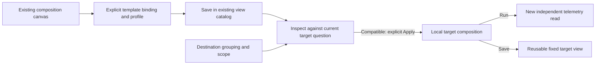

# Author reusable views

Use the existing view composition as the canvas: choose bars or a table, its
measure, and record columns. The records child can use Table or
[List](RECORD_LIST.md) over the same supplied page. Under Preserve, name the view, enable **Reusable template**, choose
its **Data profile**, and Save. Templates use the same immutable
saved-view catalog; they do not create another dashboard or package store.

```json
{"template":{"version":"goo.template/1","group":"destination","profile":"otel.db-client"}}
```

This optional declaration belongs to an ordinary single-query aggregate-and-records
view. The title names the template, and its composition owns presentation. The
saved query is a validation specimen, never a default service, environment, time
window or predicate for another investigation.

## Preview in another scope

Open an ordinary grouped population in the same signal. In Saved exploration views,
choose **Inspect template**. Preview identifies the concrete destination grouping,
profile requirements, kinds, measure and record columns. **Apply template** applies
configuration locally, keeping the target question and held data. Run remains an
explicit independent read, and Save creates a new immutable configuration.

The category binding is explicit: it uses the destination's existing qualified
single grouping, even when that field differs from the specimen's field. It never
adds a grouping, weakens a predicate, computes a new clock or borrows source rows.
Delivery offset starts at zero on expansion. Applying in the UI requires a page-zero
configured root; ordinary record-page inspection keeps that root and remains
supported. Ordinary saved-composition reuse
continues to require its existing exact grouping compatibility.

## Profiles and limits

| Profile | Checked applicability |
| --- | --- |
| Ordinary records | Same signal, one ordinary nonnumeric grouping, supported count/duration display |
| OTel database client spans | Spans with exact nonempty service, reported Client kind and nonempty current `db.system.name` |
| OTel HTTP server spans | Spans with exact nonempty service, reported Server kind and nonempty current `http.request.method` |

Mandatory profile conditions must be explicit conjuncts; appearances beneath OR
cannot establish them. Selecting a profile validates the current question and does
not add filters. Recorded spans do not establish database/HTTP health or complete
upstream telemetry. Fixed record fields retain their qualified keys; a declaration
does not prove those attributes were observed.

The first template supports aggregate and records only. Numeric/histogram,
reported-edge and grouped-time profiles, timelines, capture comparisons, tails and
nonempty local group Find are refused. Nothing is silently removed. A duration
display also requires that measure in the destination question. Shared kinds retain
their own units, support and unknown-data semantics.

The shipped **Database client activity** preset starts from the observed database
operations widget, grouped by `db.operation.name`. It shares profile validation and
expansion with the HTTP preset and authored templates. A supported materialized
HTTP view with numeric bindings may still open, but cannot opt into this first
ordinary reusable-template profile.

## Configuration-only expansion

The existing endpoint accepts one exclusive request arm:

```text
POST /api/view-templates/expand
{ "source": <authored ExplorationView>, "query": <explicit target Query> }
```

The shipped arm remains `{template, version, widget}`. Expansion compiles the
question, checks source/template and destination compatibility, and returns detached
configuration. Equivalent Go wire defaults (omitted false flags or empty predicate
values) do not change question identity; equality-to-empty remains distinct from
missing. Presentation and binding checks remain exact. Expansion performs no
telemetry read or publication. A supplied source ID
must match its content; an unsaved draft can receive a content digest without
being published. Neither is source evidence or execution authority.



See the [executable storyboard](../journeys/296-authored-template-storyboard.md),
[architecture review](reviews/AUTHORABLE_TEMPLATE_ARCHITECTURE_296.md) and
[design review](reviews/AUTHORABLE_TEMPLATE_DESIGN_296.md). General expressions,
team access control, new contributed kind implementations and WYSIWYG layout are
separate work; this is a bounded declarative template over existing kinds.
