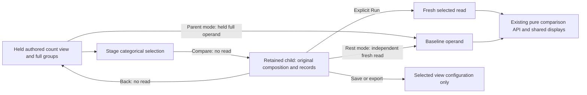

# Compare a selected cohort from an authored view — 307

> Delivered in milestone 307. Executed checks are recorded in
> [VALIDATION.md](../VALIDATION.md).

An ordinary authored count breakdown can use the existing **Facet selection**
actions to compare a selected population. Stage values from Bars/Table or record
fields, then choose **Compare selection to current** or **Compare with rest**.
The action opens a retained child with the original composition, record kind,
columns, qualified fields and fixed scope. It stages configuration only; **Run
population view** performs the comparison's fresh reads.

## Two different questions

| Action | Baseline | Explicit child Run |
| --- | --- | --- |
| Compare selection to current | The held full parent aggregate; selection overlaps it | Reads the selected query once, then computes over the two supplied operands |
| Compare with rest | A new query for the complement inside the same parent scope | Independently reads selected and rest queries, then computes over their supplied operands |

The remainder is a compiled predicate complement, not parent count minus selected
count. Include values are OR within a field; fields and exclusions combine using
the existing selection rules. Missing and present-empty values stay distinct.
Parent predicates, environment policy, grouping and fixed bounds remain intact;
child delivery starts at page zero. Selected and rest predicates are disjoint,
but their observations are separate source reads, not a transactional partition.

The comparison panel maps the common display roles explicitly: **Baseline** is
Held parent or Rest of parent; **Current held** is Selected. Each operand's UTC
read time stays visible. Shared summary and aligned group-count displays retain
exact counts, common scales and unavailable/unknown states.

## Keep the authoring and observation owners

The original parent stays held and paused. Back returns to the same question,
data and selection controls, with renewed action leases and focus; it performs no
source read. Record paging does not replace the held full aggregate used for a
parent comparison. Changing Bars/Table or record presentation is local. Changing
the question, switching to an incompatible measure or adding a captured comparison
retires the temporary pair rather than silently relabeling its operands.

Eligibility requires an admitted full ordinary single-field count result with its
private complete-groups witness and matching question, basis and read clock.
A raw records page cannot supply that authority. Changed-between-reads or otherwise
unattested groups cannot become exact cohort arithmetic. Numeric, status,
reported-edge and grouped-time families, non-count displays and compositions with
an existing captured comparison stay outside this first authored cohort profile.
The original native comparison path retains its existing behavior.

## Save the selected view, not this temporary pair

The child explicitly says **Save stores the selected view; this comparison is not
saved.** Ordinary Save/export retain the selected query and authored presentation.
They omit the held parent, remainder query, comparison result and source clocks.
Reopening stages the selected view for Run and does not restore a paired analysis.
No capture is created automatically. Durable remainder recipes are a separate
next roadmap outcome; a held observation must never be silently replaced by a
fresh baseline question on reopen.

## Shared comparison model

The existing `/api/explore` and pure `/api/compare` operations perform the work.
The latter validates supplied cohorts and produces conservative browser-held
comparison data; it is not another source read or a source attestation. The shared
group-count model now admits different predicates with matching ordinary count
signal, environment, grouping and measure profile. Captured-baseline/template
compatibility still requires its original exact root selector. No endpoint,
persisted view variant, package registry or parallel comparison executor is added.

See [architecture review](reviews/AUTHORED_COHORT_ARCHITECTURE_307.md),
[design review](reviews/AUTHORED_COHORT_DESIGN_307.md),
[composition](RECORD_AGGREGATE_COMPOSITION.md) and
[portable definitions](PORTABLE_VIEWS.md).
