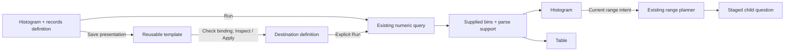

# Reusable numeric distributions

A numeric histogram and its records can share one saved presentation. Choose
**Customize distribution** beside a numeric distribution, run the staged question,
then choose **Histogram** or **Table**. The same supplied bins and exact counts
feed both views. Save the view to reopen its definition; **Run** reads fresh data.

The `histogram` composition role uses a pinned `goo.view/1` declaration with
`category: from` and `value: count`. It stores presentation only. Numeric values,
bin boundaries, support, source clocks and completeness remain in the supplied
histogram dataset. This adds no evaluator, source query or percentile aggregation.
The initial arm is exactly histogram plus records, at page zero.

A reusable `ordinary-histogram` template requires the same signal, qualified
numeric field, integer/decimal type, scale, literal unit, parse policy and binning.
Inspect/Apply preserves the destination's complete question, including predicates,
environment policy, time bounds and page limit. It transfers no source values,
read lease or range-selection authority. Changing the numeric binding to make a
donor fit is not reuse.

These are categorical count bins with unequal numeric widths, not a density plot.
The existing powers-of-two geometry spans the declared numeric domain. Missing,
empty, invalid and out-of-domain values remain explicit parse support, outside
valid bins. A known empty bin differs from unknown coverage. Complete-bin display
requirements do not assert that all records have valid values or that collection
is unsampled.

Selecting a bin or range uses the current accepted destination read and existing
range planner. Planning stages a question; only **Run** reads telemetry. Held
returns, pending edits and retired controls do not grant new selection authority.
Table is passive bin inspection; switch to Histogram for range selection.
Held return preserves local display controls and pauses range actions until a
fresh Run. Saved evidence can still highlight bins locally without source reads.

See [numeric distributions](NUMERIC_HISTOGRAMS.md),
[shared histogram data](SCOPED_HISTOGRAMS.md),
[components](UI_COMPONENTS.md) and [validation](../VALIDATION.md).
