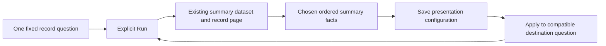

# Author a compact population summary

Milestone 400 adds an optional summary child to the existing fixed-query view
composition. [Validation](../VALIDATION.md) records execution; the
[399 roadmap](ROADMAP_2026_11_10_CHECKPOINT_399.md) defines the finite scope.

Choose a few existing population facts beside records or an ordinary chart,
arrange their order, then save and reuse that presentation. The declaration pins
`measure-summary` version 1 and one to six distinct fields. Defaults show at most
three facts. It consumes `summaryDataset` through `goo-measure-summary`; it does
not add a query, calculation engine or another source owner.

Ordinary logs and spans can use captured count and declared numeric mean, sum,
minimum and maximum. Span-duration summaries also supply mean, minimum, maximum
and existing p50/p95/p99 facts. Recorded span status supplies Error/OK/Unset/unknown
counts and the existing Error fraction. Each selected fact must be supplied by
the parent question. Status fractions retain all captured spans in their
denominator; they are not an application outcome policy. Percentiles remain
empirical summaries of that raw span population.
For ordinary ungrouped queries, [captured-record rate](CAPTURED_RECORD_RATES.md)
is an additional explicit field choice. It retains count/exposure facts and leaves
existing defaults unchanged; unknown sampling and coverage remain unknown.

No grouping is required. Up to two ordinary groupings may remain in the question;
a summary still describes the whole captured population, not the displayed page
or selected group. Records remain a required composition role. Optional ordinary
aggregate, timeline and facet children retain their existing eligibility rules.
Grouped timelines, histograms, native metrics, reported-edge scopes, log patterns,
comparison children and arbitrary expressions remain outside this arm. Template
reuse is the separate [404 arm](UNGROUPED_SUMMARY_TEMPLATES.md).

Field selection, field order, title and visibility are local presentation. Explicit
field lists preserve their authored order. The compact authored view leads with
values; exact support, methods and read facts remain available in disclosures.
An authored summary replaces the automatic summary for that view.

Count zero, no valid numeric input, genuine zero, unavailable values and unknown
coverage remain distinct. A summary does not prove a transactional read with a
record page or complete upstream collection. The source dataset retains its own
fixed question, read time and completeness evidence.

Apply preserves the destination's complete query. A numeric summary requires the
same qualified field, declared type/scale, literal unit and parse policy whenever
numeric facts are selected. Presentation carries no donor values, source leases
or completeness claims. Staging, local edits, Inspect/Apply, reopen and held Back
read no telemetry; Run is explicit. Current configuration publication has its own
ownership and is counted separately from source reads.

[Ungrouped record/summary templates](UNGROUPED_SUMMARY_TEMPLATES.md) (404) add
a separate finite reuse arm for these supplied facts. It retains summary order
and record presentation without grouping, and validates the complete destination
query before Apply. Numeric and specialized template profiles remain excluded.
