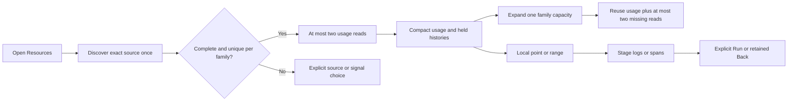

# Automatic container resource defaults

Milestone 210 implements automatic usage in the Resources entrance. Live
acceptance is in progress; the previous manual-entrance journeys are historical.

Opening Resources discovers metadata for the exact opened resource/schema
variant once. The existing pinned receiver profiles validate candidates. A
complete plan with exactly one working-set candidate and/or one CPU-usage
candidate admits at most two native value reads total. Any omitted candidates,
instruments or streams suppress automatic reads. A missing or ambiguous family
stays explicit while an independently unambiguous family can load.

The compact overview shows only loaded usage and its sparse history. Capacity
and source controls remain collapsed. First expansion of a family's controls
loads its unambiguous selected requests/limits, reusing the original held usage
result without rereading it. No sibling capacity loads. Repeated expansion is
local; explicit Load is a fresh read of its selected signals. Failed/canceled
usage requires explicit retry, so expansion cannot silently retry usage under a
two-read capacity budget. Expansion during pending usage is deferred until that
usage succeeds. Manual role edits cancel automatic expansion eligibility.

Other compatible retained resource variants remain explicitly discovered, up to
four. There is no automatic variant scan, cross-schema join, fleet total,
configuration event, continuous sampling or new capture format. Each original
question, read clock, basis and fixed-end freshness policy remains unchanged.
A local point/range or context-stage/Back action does not reread telemetry.
Closing, hiding, disposing or changing scope withdraws pending app ownership;
stale toggle dispatch cannot start capacity reads.

The existing private family owner and view adapter own these effects. Reusable
web components remain supplied-data displays. No server/API or Go numerical
contract changes are required.

