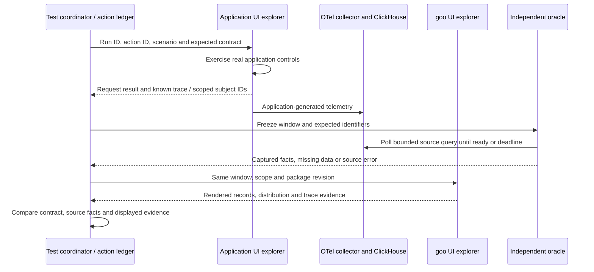

# Bombadil testing spike

Bombadil is a useful additional UI explorer. Playwright remains the executable
storyboard and documentation runner; Hegel checks semantic/state/swarm properties,
and Quint models allowed transitions and validates observed traces. Bombadil adds
generated browser interaction sequences and temporal UI properties.

## Implemented and checked

The development dependency is pinned to **0.7.9**. The specification at
[`verification/bombadil/workspace.ts`](../verification/bombadil/workspace.ts)
explores the four main workspaces through real navigation buttons. It checks
uncaught exceptions, unhandled promise rejections, and agreement between the
single visible panel and selected navigation item. It deliberately has a small
action vocabulary: it does not yet explore queries, package edits or sample apps.
No application behavior or telemetry is mocked. This is a smoke spike, not a
claim of comprehensive product coverage.

[`journeys/cross-app.spec.js`](../journeys/cross-app.spec.js) now implements the
first coordinator: Playwright drives the real report app and observes goo while
a separate Bombadil browser explores goo's four primary workspaces for 30 seconds.
It waits for an actual exploration action before starting the workload. A direct,
bounded read-only ClickHouse adapter finds the application's emitted subject/trace;
after the UI query it independently reads the exact same half-open window and
compares captured span IDs/counts with rendered records. The trace inspector is
also exercised. Unique application-generated report IDs isolate the experiment;
the test never clears telemetry or Redis.

```sh
npm run test:cross-app
# Optional observed-trace validation; Go and sibling observability/quintgo required:
GOO_CROSS_APP_QUINT=1 npm run test:cross-app
```

The report app, collector, ClickHouse and goo must already be running. This
report-only journey does not use the reservation queue, so its standalone command
does not pause background reservation traffic. The default full journey wrapper
still pauses/restores its owned traffic generator as before. Override endpoints
with `GOO_REPORT_URL`, `GOO_QUERY_URL`, and `GOO_TEST_CLICKHOUSE_URL`; the test adapter
accepts `GOO_TEST_CLICKHOUSE_USER`/`GOO_TEST_CLICKHOUSE_PASSWORD` (local lab defaults).
An ingestion timeout or absent checkpoint fails the campaign, rather than proving
healthy absence. Source reads are independent, not a transactional snapshot.

Artifacts are retained under the Playwright test's `cross-app/` directory:
`ledger.json`, direct source SQL/parameters/results, goo's frozen question/basis,
Bombadil trace/screenshots/log and action count. With Quint enabled this also
includes its report, native qobs steps and ITF trace. Documentation screenshots
and the human walkthrough are in [journey 26](journeys/README.md#26-correlate-a-real-application-with-goo-during-generated-ui-exploration).

## Generated workload and two browser actors

The opt-in [generated campaign](../journeys/generated-campaign.spec.js) now drives
real application requests with Bombadil as well as exploring goo navigation.
The [Quint schedule model](../verification/model/browser_campaign.qnt) generates
three issue/inspect pairs, two revisits and a finish checkpoint. Nondeterministic
choices vary where revisits occur and which already inspected result they target.
The coordinator binds each abstract report index to a real returned ID; model
values never substitute for application outcomes or source records.

```sh
# Requires the running lab, Go, and the sibling observability/quintgo module.
npm run test:generated-campaign
GOO_CAMPAIGN_SEED=99 GOO_CROSS_APP_QUINT=1 npm run test:generated-campaign
npm run test:campaign-adapters
```

This uses quint-go `connect.Generate` (`quint run --mbt`) with a positive recorded
seed (default 42). The nine-step generated ITF trace becomes an explicit plan.
Each `issue` launches a fresh six-second Bombadil app actor, whose bounded
[specification](../verification/bombadil/report.ts) submits through the real button
and waits for a ready result. The artifact reader independently requires exactly
one generated submission and one stable captured result ID. It cannot pass on an
unresolved eventual property, an unexecuted action or multiple requests.

A separate goo actor explores navigation for 60 seconds; it must still be active
at every application request. The Playwright observer executes each model-selected
inspection/revisit through normal controls and compares rendered evidence with the
same direct source adapter as journey 26. Revisits close the existing inspector
and clear the prior selection explicitly; navigating to an unchanged hash alone
does not reset UI state. They perform fresh reads, not immutable receipt reopens.

After each completed handler, the driver records actual issued/checked/revisited
counts. `connect.Driver` replays those observations against the original generated
ITF states, rejecting mismatched targets, state projections, order or incomplete
campaigns. This replay is always part of the opt-in generated campaign.
`GOO_CROSS_APP_QUINT=1` additionally runs qobs observed-trace conformance for all five
individual evidence inspections using the existing cross-app model.

Artifacts under `artifacts/bombadil/campaigns/<run-id>/` retain `plan.json`,
seed, generated ITF, partial or complete `observations.json`, each app actor's
trace/screenshots/log, goo's exploration trace, and direct source questions/results.
Optional qobs validation retains a separate ledger/report/ITF per inspection.
The generated campaign archive survives normal Playwright output cleanup.
The documentary application frame is copied unchanged from Bombadil's captured
screenshot; no extra request is made to stage it. See [journey 27](journeys/README.md#27-follow-a-generated-workload-and-revisit-captured-evidence).

The normal browser suite skips this explicitly opt-in campaign, preserving its
existing optional Go verification dependency. This bounded successful-report
campaign does not yet generate retries, faults or arbitrary application behavior.

## Retry, rejection and missing-terminal campaign

The separate opt-in [fault campaign](../journeys/fault-campaign.spec.js) applies
the same generated nine-step schedule to the existing Python HTTP → gRPC → Redis
consumer sample, without changing its instrumentation or deploying new services.
Its three fixed coverage cases are retry, business rejection and stalled work;
the model varies revisit placement/targets. It does not randomize arbitrary faults.

```sh
npm run test:fault-campaign
GOO_CAMPAIGN_SEED=7 npm run test:fault-campaign
```

Use the local Compose lab. This command uses the existing journey wrapper to pause
and restore only its owned background traffic generator and drain active queued
work without deleting stream entries or volumes. Previously stale pending entries
are retained. Endpoints can use the existing sample/query overrides, but this
wrapper still controls only the local lab's queue and traffic generator.

Bombadil chooses the requested scenario through the real app select/button and
captures its returned ID. Acceptance is not completion. The scenario adapter waits
for the actual response so the sample's enabled button cannot generate duplicate
requests while the first is in flight. Each app actor has a fresh browser profile;
the independent goo actor continues exploring navigation.

The source adapter polls for positive captured evidence in fixed bounds, then the
observer searches **Explore spans and logs** by the literal returned ID. Every
displayed record/attribute and full bounded count is compared with an independent
read over exactly that UI question. This uses ordinary Python OTel attributes, not
a goo source manifest or a reservation-specific product renderer.

| Case | Required captured evidence | Test-observed interpretation |
| --- | --- | --- |
| Retry | Two consumer attempts, an error span, a retry log and a confirmed terminal | `confirmed-after-retry`; an attempt error did not prove terminal failure. |
| Rejection | A rejected terminal, one consumer attempt and no error span | `rejected`; business outcome is distinct from transport/span success. |
| Stalled work | A positive stalled log, one consumer attempt and no captured terminal | `unknown-no-terminal`; absence is neither health nor a business rejection. |

These interpretations are test contracts over the raw displayed records, not new
goo SLO/health results or durability guarantees. A present terminal with an empty
outcome is distinct from an absent terminal. Conflicting terminal outcomes remain
unknown. Ingestion timeout/missing required evidence fails the campaign; it cannot
satisfy the stalled case by observing nothing. Source/span/log reads remain separate
and can change as data arrives; no transactional snapshot is claimed.

`connect.Driver` checks actual handler effects against the generated schedule.
Every inspection also passes through qobs/quint-go against
[`fault_observation.qnt`](../verification/model/fault_observation.qnt), which checks
scenario-specific evidence, terminal presence and observed interpretation, plus a
fingerprint of both fixed questions and captured record identities. Fingerprints
are comparisons, not authenticated provenance; raw questions/records remain in the
archive at `artifacts/bombadil/fault-campaigns/<run-id>/`.

Protocol tests reject healthy labels, mismatched fingerprints, invented terminal
values and incorrect terminal-presence flags for each scenario. A Hegel state/swarm
test drives the actual JavaScript projection through a persistent Node process:
duplicate logs and delivery order cannot change interpretation, missing terminals
cannot invent outcomes, and conflicting outcomes must withdraw certainty. These
unit/model fixtures are separate from the real integration evidence in
[journey 28](journeys/README.md#28-investigate-retry-rejection-and-stalled-work).

With the lab running and Chromium installed:

```sh
npm ci
npm run test:bombadil -- --output-path artifacts/bombadil/my-run
# This managed container also needs --no-sandbox; append it when needed.
# CHROME=/path/to/chromium overrides browser discovery.
npx bombadil browser inspect artifacts/bombadil/my-run
```

Use a fresh output directory per run. Reproduction uses the same URL,
specification and browser options, replacing the time/violation stop flags:

```sh
npx bombadil browser test --headless --reproduce artifacts/bombadil/my-run \
  http://localhost:8088 verification/bombadil/workspace.ts
```

Reproduction is best effort and can diverge when live application state changes.
Local exploration does not provide Antithesis's deterministic full-stack runtime.
The upstream CLI also provides best-effort trace shrinking. Preserve original
artifacts before reducing a failure.

## Correlating application actions and goo observations

Yes: the useful unit is an **experiment with two actors and an independent
observer**. A click is not itself a business outcome, and a successful request
does not imply that every downstream operation completed or every span arrived.



The ledger should record run/action IDs, actor, start/end times, intended fault,
request acceptance/result, environment, service, tenant/subject scope and known
trace/span IDs. Correlation must use identifiers actually exposed by the app or
its SDK; adding a test header alone does not guarantee it becomes an OTel attribute.
This protocol applies to any instrumented application, not just reservations.

Freeze a half-open evaluation window after the workload step and use the exact
same question for source and UI checks. Track event time separately from capture
and evaluation times. Poll ingestion with a bounded wall-clock deadline; preserve
`no_data`, source error and sampling uncertainty as distinct results. A lab test
with configured full capture may assert exact fixture counts; arbitrary production
telemetry cannot promise completeness. Count physical captured records only when
that is the declared measure—retries and multiple spans can be legitimate.

Candidate cross-app contracts:

| Application experiment | goo expectation after source readiness |
| --- | --- |
| Known successful request | Its captured trace is discoverable in the correct scope; cross-service expansion retains trace identity. |
| Injected failure or retry | Captured failure/retry evidence remains visible; no assumption of one span per click or automatic business failure. |
| Late telemetry | A refreshed receipt may include newly captured evidence; the original immutable receipt remains unchanged. |
| Collector/export loss | Absence or unknown coverage is visible, rather than invented healthy zeroes. |
| Concurrent package edits and navigation | Delayed responses cannot overwrite newer UI intent or mutate a saved definition. |

## Simultaneous exploration

The inspected browser driver attaches to one target and explicitly observes new
tabs without attaching to them. URL allowlists support navigating multiple origins;
that is not a built-in scheduler for two simultaneously controlled applications.
Custom actions execute within the current page and its origin restrictions.

Journey 26 owns the workload page and ledger while one Bombadil process explores
goo. Journey 27 runs separate Bombadil app and goo processes under a model-driven
coordinator. Its Playwright observer checks the correlated UI evidence; the goo
Bombadil actor currently explores navigation, not that specific trace. A shared
test-only coordinator service for longer-lived independent actors remains future work.
Use separate browser profiles and bounded action vocabularies. Shared-data races
must be intentional; give isolated runs unique identifiers instead of clearing
ClickHouse or Redis. Do not import Node APIs into Bombadil's limited specification
runtime or assume cross-origin DOM access.

Split campaigns into controlled ingestion and observation phases first, then
overlap them to test stale results, live-window movement and late arrival.
Readiness deadlines run outside a busy browser actor so random navigation cannot
starve the observer. A missing trigger is insufficient exercise, not a passing
eventual property. Default HTTP/console properties need review when intentional
application errors are part of the scenario.

For failures retain both actors' traces/screenshots, coordinator ledger, exact
source queries and results, fixed goo question/basis, package revision, application
build, browser/tool versions and fault configuration. Turn a reduced failure into
a deterministic Playwright regression and, when it concerns semantic transitions,
an observed Quint trace with a rejecting negative control. Existing Hegel tests
remain responsible for broad semantic input/state exploration.

## Optional Quint connection

There are two independent directions, both now implemented in bounded campaigns:

1. **Observed-trace validation:** project completed semantic events from the
   ledger into `qobs` records and use `validate.NewChecker` plus an explicit binding
   to check them against a Quint model. Browser clicks, loading states and unrelated
   navigation are not business transitions. The implemented adapter uses one logical
   coordinator thread for causally ordered acceptance/source/display/exploration
   checkpoints; the ledger retains the originating actor role. It does not reconstruct
   distributed causality from timestamps. The [model](../verification/model/cross_app.qnt)
   and [binding](../verification/model/cross_app.yaml) require the same subject,
   trace identity, environment, frozen window, count and span membership at display.
   A completeness gate rejects partial/empty/mixed-run ledgers before model checking.
2. **Model-based generation:** journey 27 uses `connect.Generate` to obtain a
   seeded schedule, maps its actions to actual app submissions and goo evidence
   checks, and uses `connect.Driver` to compare observed handler effects with model
   poststates. Bombadil explores goo navigation concurrently. Its random choices
   are not themselves a claim that a semantic checkpoint executed.

The first model covers accepted → source_ready → displayed → explored for one
successful request. The coordinator enforces wall-clock readiness and actual actor
overlap; the model checks order and matching observations. It does not prove
ingestion liveness, browser scheduling, distributed causality or capture completeness.
The separate fault model above adds bounded retry/rejection/stalled observations.
Saved/refresh, export loss and explicit readiness-timeout transitions remain future
extensions to these coordinated campaigns.

Reuse the patterns in [`verification/model_test.go`](../verification/model_test.go)
and [`verification/operation_navigation_test.go`](../verification/operation_navigation_test.go).
The protocol tests require rejection of wrong trace/subject/scope, changed window,
wrong count/membership, premature display, unexercised/failed explorer, mixed run,
truncated and empty ledgers. These are labelled protocol fixtures; optional live
validation reads the actual browser-generated ledger. Saved-receipt properties
remain in their existing model and have not been added to this coordinator.

## Research sources and scope

Reviewed upstream source commit
[`41f94f51aff970382b0af1cca7439d36790ecd2b`](https://github.com/antithesishq/bombadil/tree/41f94f51aff970382b0af1cca7439d36790ecd2b)
and the installed 0.7.9 CLI on 2026-10-18:

- [Manual: specifications, extractors, custom actions and bounded temporal properties](https://antithesishq.github.io/bombadil/browser/3-specification-language.html)
- [Manual: installation and reproduction limits](https://antithesishq.github.io/bombadil/browser/2-getting-started.html)
- [Browser target attachment](https://github.com/antithesishq/bombadil/blob/41f94f51aff970382b0af1cca7439d36790ecd2b/lib/bombadil-browser/src/browser.rs)
- [CLI options and best-effort shrink](https://github.com/antithesishq/bombadil/blob/41f94f51aff970382b0af1cca7439d36790ecd2b/lib/bombadil-cli/src/browser.rs)

The real-app coordinator, two Bombadil actors, generated schedules and observed
trace checks are implemented for successful reports and the bounded Python retry,
rejection and stalled-work campaign. Broader resource/export-loss/late-capture
generation and longer-lived independent actors remain future work.

## Structured inspection exploration

`npm run test:bombadil:inspection -- --no-sandbox` runs a bounded read-only actor
against the local Explore workspace. It refreshes captured telemetry, opens record
attributes, varies local key/value and scope searches, expands traces, selects
spans and closes the inspector. It checks explicit field counts, at most one
selected span, and uncaught errors/rejections. It creates no saved definitions or
workload. This complements the deterministic [journey 29](journeys/README.md#29-structured-inspection-and-filter-composition)
clipboard, filter population, linked-log action and mobile assertions. It is not
a liveness or capture-completeness guarantee; an empty source limits reachable
inspection actions. Use `CHROME=/usr/bin/chromium` where browser discovery needs it.

The inspection actor now alternates span/log signals, opens same-service time
context, changes its radius and closes it. A new invariant requires at most one
of the trace and surrounding-log inspectors to be visible. These remain read-only
source queries and local actions. Deterministic journey 30 additionally holds a
radius read in flight to assert that old rows disappear before the new scope is
shown, and holds a closed read to verify stale-response isolation.

## Dedicated discovery actions and invariants

`npm run test:discovery-campaign` runs journey 30 with both the dedicated
[discovery actor](../verification/bombadil/discovery.ts) and live-ledger Quint
validation. The driver publishes an isolated, labelled OTLP fixture; the actor
only queries and drafts/validates/previews/uses definitions, without saving,
exporting or issuing workload. Its 50-second required prefix reaches the new
workflows before free exploration; a 60-second run cannot silently pass without
reaching them. The driver additionally requires a duration population of 113
captured spans with only 100 record rows displayed.

| Actions | Invariant |
| --- | --- |
| Quick search, including an initially empty OR composer | Explicit AND semantics retain every requested predicate. |
| Matching trace groups, trace opening/paging/selection | At most one selected span and one visible context inspector. |
| Duration breakdowns | Complete rendered group counts sum to the population, and bins follow the fixed disjoint interval order. |
| Surrounding logs, paging, radius and unlinked-log re-anchoring | Exact same-service predicate; clipped original environment/window; separate anchor selection question/basis; at most 100 displayed rows. |
| Create/build/edit/validate drafts | Captured filters/grouping survive; invalidated drafts disable preview/save/use. |
| Preview and fresh use | Preview question matches its plan with a separate evidence basis; reuse preserves the definition while allowing a fresh window. |
| All actions | Parseable evidence plus no uncaught exceptions or rejected promises. |

The actor's captured context, trace, duration and package questions are assembled
into a second ledger and validated through the Go reference/qobs/quint-go path.
Negative controls reject changed context bounds, trace environment and grouping.
This is optional model integration over actual Bombadil observations, alongside
the Playwright ledger. Prefix coverage, raw trace/screenshots, ledgers and model
summaries are retained together under `artifacts/discovery/<run>/`.

Opening a fresh package draft clears the prior preview/plan/handoff before the
new definition is built. The deterministic journey checks a four-span preview
followed by a different thirteen-span draft; stale evidence cannot carry across.

## Observed-service inventory

`npm run test:inventory-campaign` runs journey 31 and a dedicated 35-second
`verification/bombadil/inventory.ts` actor against its isolated captured fixture.
The required prefix discovers services, searches for a missing pair, clears search
and opens an actual inventory row. Subsequent choices refresh, search and edit
scope. Invariants check exact population/bucket accounting, rendered counts,
fixed drilldown scope and evidence clearing after edits. Browser exception and
promise-rejection properties also apply. The actor queries and inspects only;
it neither emits workload nor saves/exports definitions. The Playwright driver
checks an independent ClickHouse read and records the capture/search/open/package
questions for Quint conformance and three negative controls. Hegel observe/reset
state/swarm checks run separately in the native verification module.

The shared workspace-navigation actor also includes Services. Its existing
selected-navigation/visible-panel invariant applies to all five destinations.

## Immutable general capture inspection

`npm run test:captures-campaign` adds the dedicated read-only
`verification/bombadil/captures.ts` actor to journey 32. Its required prefix reaches
next/previous stored pages, complete distributions and structured record search.
Invariants check fixed question/basis, retained-row page arithmetic, replayed first
page, disabled query editing and distinct component IDs. Paging has an explicit
view busy state independent of catalog loading. The driver checks actual receipt
lineage, restart persistence, late insertion and source-free browser reopen;
its ledger always passes through Quint with four rejecting controls. Hegel
state/swarm separately explores capture/refresh/arrival interactions. The actor
publishes no captures and initiates no source refresh or workload.

## Core measures and charts

`verification/bombadil/core-basics.ts` explores an existing saved duration capture.
It selects a time bar, visits the next stored record page, returns, and inspects
records/distributions. Invariants retain full-population count/sum/p95, fixed
half-open intervals, zero/no-data meaning and the same summary/time-series basis
across pages. It does not save, refresh or generate application work. Run journey
33 with `GOO_CORE_BOMBADIL=1`; its required prefix must complete and the trace is
retained under `artifacts/core-basics/<environment>/`. Native HTTP tests establish
query admission/cancellation, while the journey verifies the proxy cancellation
endpoint; browser navigation alone cannot establish backend query termination.

The companion `core-workflows.ts` actor performs the read-only live handoff, finds
and runs a saved question, discovers signals/dependencies, then cancels a discovery
read. Its invariants preserve the fixed handoff bounds, reused environment/measure
settings, event-time bounds, unique reported edge versus ambiguous/unresolved
parents, cleared cancelled evidence and coherent workspace navigation. Journey 33
with the same opt-in runs both actors, retaining each trace and required prefix.
No definitions/captures or application workloads are written by either actor.

`grouped-measures.ts` explores a saved route breakdown. Its required prefix visits
p95 ranking, local search/clear, next stored record page and return. Invariants
retain full count/sum/p95, missing/empty groups, exact ranking and the unchanged
source basis/groups across pages. After completion it varies count/mean/p95/p99/max.
It never saves or reads live telemetry. Journey 34 retains coverage/trace artifacts.

`npm run test:error-comparison-campaign` runs journey 35 with the saved-only `verification/bombadil/error-comparison.ts` actor. Its required prefix visits remember/errors/latency/mean/share, then varies all five comparison measures. Invariants retain exact population/status accounting, +13.63 pp errors, +90 ms p95 and immutable comparison evidence. No source queries or capture writes are actor actions.

`npm run test:context-campaign` runs journey 36 and the saved-document `verification/bombadil/context-notes.ts` actor. Its prefix remembers exact revision/references, types/applies an unsaved note, reorders and reverts. Invariants retain the stored base/reference IDs and disallow saving unapplied text. Actor actions never save revisions, create deployments or execute telemetry queries.

`verification/bombadil/recipes.ts` explores recipe selection and preview attempts
without an applied question. Invariants prohibit an executable preview or invented
telemetry evidence. Its required prefix attempts all three recipe selections against the
no-population guard; randomized tail actions repeat these source-free previews. It neither runs source queries nor saves documents.
Journey 37 separately covers real applied populations, explicit execution,
wrong-signal rejection, stale-response isolation, captures and narrative handoff.
Run with `GOO_RECIPES_BOMBADIL=1` and `journeys/recipes.spec.js` through the wrapper.

## Streaming and shared display components

Journey 66 optionally runs `verification/bombadil/tail.ts` with
`GOO_TAIL_BOMBADIL=1`. Its isolated ordinary OTel fixture exercises start,
pause/resume, a visible continuity gap, focus-triggered pause and close. Invariants
check bounded unique observation handles, local retained/evicted accounting,
paused row stability and mobile containment. This actor makes no persistence or
workload changes. The curated journey separately validates source failures,
late records, identical duplicates, scope cancellation and Quint rejecting traces.

`inspection.ts` now deterministically opens a real supplied trace, selects two
spans and verifies the reusable waterfall's exact IDs/details before broader
exploration. The `GOO_INSPECTION_BOMBADIL=1` journey asserts a completed waterfall
stage in the emitted actor snapshots, not merely absence of violations.

`time-bars-contract.ts` is shared by core-basics, Services and grouped-measure
actors. It checks supplied exact counts/scale, zero versus positive geometry,
unknown hatching and controlled selection. Core and Services require actual chart
interaction (including preserved keyboard focus). The grouped fixture without a
time bucket is not counted as positive chart coverage. Run
`GOO_CORE_BOMBADIL=1` journey 33 and `GOO_DASHBOARD_BOMBADIL=1` journey 59.
Standalone waterfall/time-bar Playwright fixtures test SSR/SPA display contracts
without application runtime; live campaigns validate their app adapters separately.

The rolling baseline comparison has `verification/bombadil/live-comparison.ts`:
explicit preview, stored-baseline selection, start, freeze and link actions; invariants
for baseline/capture identity and common axis. Its eventual freeze requirement
makes the 30-second journey69 actor campaign positive interaction coverage.
The curated journey separately tests explicit rescale, unavailable source,
unchanged baseline and a displayed snapshot frozen after source population grows.
