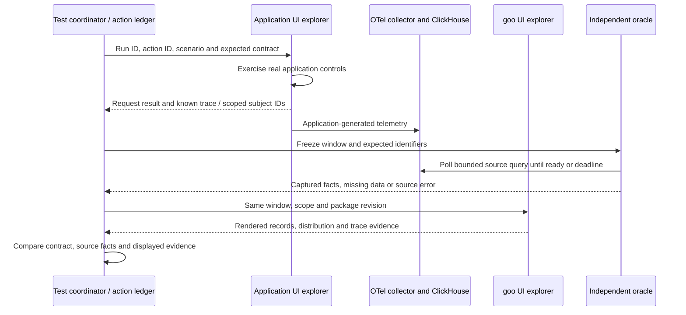

# Bombadil testing spike

Bombadil is a useful additional UI explorer. Playwright remains the executable
storyboard and documentation runner; Hegel checks semantic/state/swarm properties,
and Quint models allowed transitions and validates observed traces. Bombadil adds
generated browser interaction sequences and temporal UI properties.

## Implemented and checked

The development dependency is pinned to **0.7.9**. The specification at
[`verification/bombadil/workspace.ts`](../verification/bombadil/workspace.ts)
explores the four main workspaces through real navigation buttons. It checks
uncaught exceptions, unhandled promise rejections, and agreement between the
single visible panel and selected navigation item. It deliberately has a small
action vocabulary: it does not yet explore queries, package edits or sample apps.
No application behavior or telemetry is mocked. This is a smoke spike, not a
claim of comprehensive product coverage.

[`journeys/cross-app.spec.js`](../journeys/cross-app.spec.js) now implements the
first coordinator: Playwright drives the real report app and observes goo while
a separate Bombadil browser explores goo's four primary workspaces for 30 seconds.
It waits for an actual exploration action before starting the workload. A direct,
bounded read-only ClickHouse adapter finds the application's emitted subject/trace;
after the UI query it independently reads the exact same half-open window and
compares captured span IDs/counts with rendered records. The trace inspector is
also exercised. Unique application-generated report IDs isolate the experiment;
the test never clears telemetry or Redis.

```sh
npm run test:cross-app
# Optional observed-trace validation; Go and sibling observability/quintgo required:
GOO_CROSS_APP_QUINT=1 npm run test:cross-app
```

The report app, collector, ClickHouse and goo must already be running. This
report-only journey does not use the reservation queue, so its standalone command
does not pause background reservation traffic. The default full journey wrapper
still pauses/restores its owned traffic generator as before. Override endpoints
with `GOO_REPORT_URL`, `GOO_QUERY_URL`, and `GOO_TEST_CLICKHOUSE_URL`; the test adapter
accepts `GOO_TEST_CLICKHOUSE_USER`/`GOO_TEST_CLICKHOUSE_PASSWORD` (local lab defaults).
An ingestion timeout or absent checkpoint fails the campaign, rather than proving
healthy absence. Source reads are independent, not a transactional snapshot.

Artifacts are retained under the Playwright test's `cross-app/` directory:
`ledger.json`, direct source SQL/parameters/results, goo's frozen question/basis,
Bombadil trace/screenshots/log and action count. With Quint enabled this also
includes its report, native qobs steps and ITF trace. Documentation screenshots
and the human walkthrough are in [journey 26](journeys/README.md#26-correlate-a-real-application-with-goo-during-generated-ui-exploration).

With the lab running and Chromium installed:

```sh
npm ci
npm run test:bombadil -- --output-path artifacts/bombadil/my-run
# This managed container also needs --no-sandbox; append it when needed.
# CHROME=/path/to/chromium overrides browser discovery.
npx bombadil browser inspect artifacts/bombadil/my-run
```

Use a fresh output directory per run. Reproduction uses the same URL,
specification and browser options, replacing the time/violation stop flags:

```sh
npx bombadil browser test --headless --reproduce artifacts/bombadil/my-run \
  http://localhost:8088 verification/bombadil/workspace.ts
```

Reproduction is best effort and can diverge when live application state changes.
Local exploration does not provide Antithesis's deterministic full-stack runtime.
The upstream CLI also provides best-effort trace shrinking. Preserve original
artifacts before reducing a failure.

## Correlating application actions and goo observations

Yes: the useful unit is an **experiment with two actors and an independent
observer**. A click is not itself a business outcome, and a successful request
does not imply that every downstream operation completed or every span arrived.



The ledger should record run/action IDs, actor, start/end times, intended fault,
request acceptance/result, environment, service, tenant/subject scope and known
trace/span IDs. Correlation must use identifiers actually exposed by the app or
its SDK; adding a test header alone does not guarantee it becomes an OTel attribute.
This protocol applies to any instrumented application, not just reservations.

Freeze a half-open evaluation window after the workload step and use the exact
same question for source and UI checks. Track event time separately from capture
and evaluation times. Poll ingestion with a bounded wall-clock deadline; preserve
`no_data`, source error and sampling uncertainty as distinct results. A lab test
with configured full capture may assert exact fixture counts; arbitrary production
telemetry cannot promise completeness. Count physical captured records only when
that is the declared measure—retries and multiple spans can be legitimate.

Candidate cross-app contracts:

| Application experiment | goo expectation after source readiness |
| --- | --- |
| Known successful request | Its captured trace is discoverable in the correct scope; cross-service expansion retains trace identity. |
| Injected failure or retry | Captured failure/retry evidence remains visible; no assumption of one span per click or automatic business failure. |
| Late telemetry | A refreshed receipt may include newly captured evidence; the original immutable receipt remains unchanged. |
| Collector/export loss | Absence or unknown coverage is visible, rather than invented healthy zeroes. |
| Concurrent package edits and navigation | Delayed responses cannot overwrite newer UI intent or mutate a saved definition. |

## Simultaneous exploration

The inspected browser driver attaches to one target and explicitly observes new
tabs without attaching to them. URL allowlists support navigating multiple origins;
that is not a built-in scheduler for two simultaneously controlled applications.
Custom actions execute within the current page and its origin restrictions.

The implemented coordinator owns the workload page and ledger while one Bombadil
process explores goo. Its Playwright observer checks the correlated UI evidence;
Bombadil currently explores navigation, not that specific trace. Next, two
separate Bombadil processes can explore the app and goo concurrently, coordinated
through a test-only service that holds the ledger and independent source oracle.
Use separate browser profiles and bounded action vocabularies. Shared-data races
must be intentional; give isolated runs unique identifiers instead of clearing
ClickHouse or Redis. Do not import Node APIs into Bombadil's limited specification
runtime or assume cross-origin DOM access.

Split campaigns into controlled ingestion and observation phases first, then
overlap them to test stale results, live-window movement and late arrival.
Readiness deadlines run outside a busy browser actor so random navigation cannot
starve the observer. A missing trigger is insufficient exercise, not a passing
eventual property. Default HTTP/console properties need review when intentional
application errors are part of the scenario.

For failures retain both actors' traces/screenshots, coordinator ledger, exact
source queries and results, fixed goo question/basis, package revision, application
build, browser/tool versions and fault configuration. Turn a reduced failure into
a deterministic Playwright regression and, when it concerns semantic transitions,
an observed Quint trace with a rejecting negative control. Existing Hegel tests
remain responsible for broad semantic input/state exploration.

## Optional Quint connection

There are two independent directions, with the first now implemented as an opt-in:

1. **Observed-trace validation:** project completed semantic events from the
   ledger into `qobs` records and use `validate.NewChecker` plus an explicit binding
   to check them against a Quint model. Browser clicks, loading states and unrelated
   navigation are not business transitions. The implemented adapter uses one logical
   coordinator thread for causally ordered acceptance/source/display/exploration
   checkpoints; the ledger retains the originating actor role. It does not reconstruct
   distributed causality from timestamps. The [model](../verification/model/cross_app.qnt)
   and [binding](../verification/model/cross_app.yaml) require the same subject,
   trace identity, environment, frozen window, count and span membership at display.
   A completeness gate rejects partial/empty/mixed-run ledgers before model checking.
2. **Model-based generation (proposed):** use the existing `connect.Generate` path to obtain
   seeded model traces. A coordinator maps each enabled abstract action to a real
   application or goo interaction, then checks observed postconditions. Bombadil
   can explore UI variations between these semantic checkpoints. Its random choices
   are not themselves a claim that the generated model action executed.

The first model covers accepted → source_ready → displayed → explored for one
successful request. The coordinator enforces wall-clock readiness and actual actor
overlap; the model checks order and matching observations. It does not prove
ingestion liveness, browser scheduling, distributed causality or capture completeness.
Later models can add saved/refresh, retries, missing capture and readiness timeouts.

Reuse the patterns in [`verification/model_test.go`](../verification/model_test.go)
and [`verification/operation_navigation_test.go`](../verification/operation_navigation_test.go).
The protocol tests require rejection of wrong trace/subject/scope, changed window,
wrong count/membership, premature display, unexercised/failed explorer, mixed run,
truncated and empty ledgers. These are labelled protocol fixtures; optional live
validation reads the actual browser-generated ledger. Saved-receipt properties
remain in their existing model and have not been added to this coordinator.

## Research sources and scope

Reviewed upstream source commit
[`41f94f51aff970382b0af1cca7439d36790ecd2b`](https://github.com/antithesishq/bombadil/tree/41f94f51aff970382b0af1cca7439d36790ecd2b)
and the installed 0.7.9 CLI on 2026-10-18:

- [Manual: specifications, extractors, custom actions and bounded temporal properties](https://antithesishq.github.io/bombadil/browser/3-specification-language.html)
- [Manual: installation and reproduction limits](https://antithesishq.github.io/bombadil/browser/2-getting-started.html)
- [Browser target attachment](https://github.com/antithesishq/bombadil/blob/41f94f51aff970382b0af1cca7439d36790ecd2b/lib/bombadil-browser/src/browser.rs)
- [CLI options and best-effort shrink](https://github.com/antithesishq/bombadil/blob/41f94f51aff970382b0af1cca7439d36790ecd2b/lib/bombadil-cli/src/browser.rs)

The real-app coordinator and optional observed-trace check are implemented. Two
Bombadil actors, semantic-action generation from Quint and broader fault campaigns
remain proposals.
