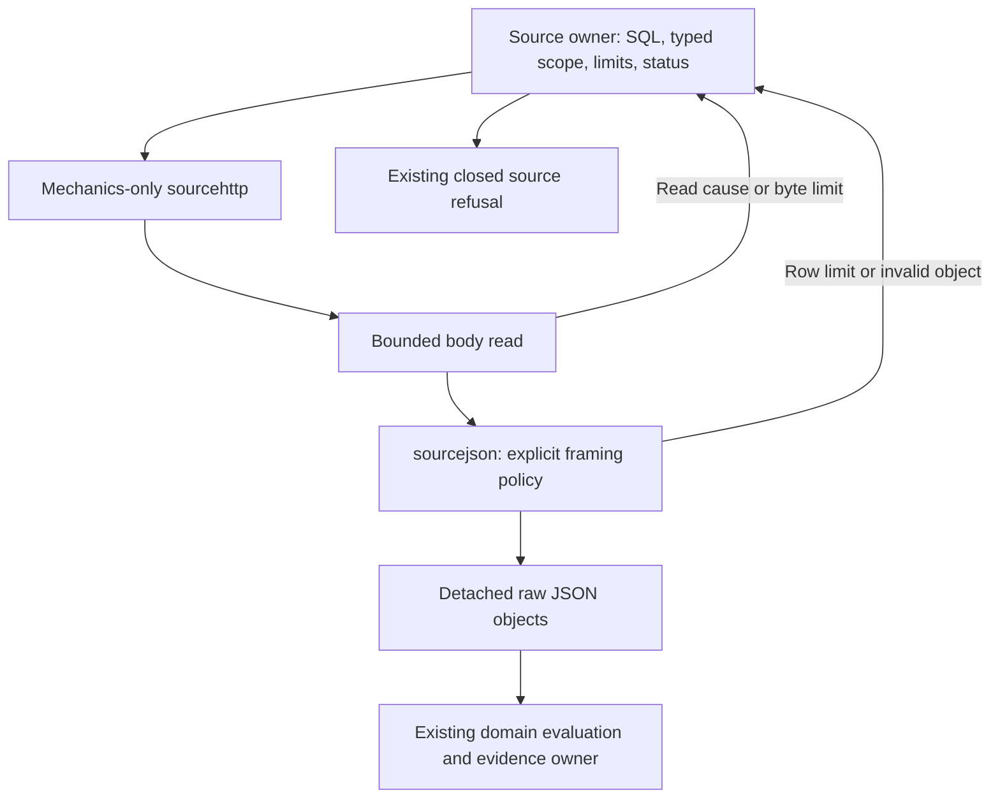

# Bounded source decoding

Record and native measurement sources share a small JSONEachRow framing helper.
It validates object syntax without decoding field maps that would immediately be
discarded. Numeric tokens, duplicate keys and retained row bytes are not rewritten.
The existing source owners still compile SQL, bind typed parameters, check HTTP
status, choose timeouts and classify failures. Domain evaluation, clocks and
lifecycle custody remain outside the decoder.

## Explicit source policies

| Source | Maximum response | Maximum admitted rows | Blank lines | Retained whitespace |
| --- | --- | --- | --- | --- |
| Record exploration | 8 MiB | 1,001 | Skip after trimming | Trim surrounding whitespace |
| Native measurements/discovery | 8 MiB | 10,000 | Reject | Preserve, removing only final LF |

These are read-admission bounds, not display limits or measurement totals.
Neither family silently truncates. A successful empty body returns an empty row
array; failure returns no partial rows. Each retained row owns its bytes, separate
from the buffered body and every other row.

Framing requires one complete JSON object per admitted physical line. Objects
without a final newline and CRLF input retain the existing family behavior.
Arrays, scalars, null, trailing objects or garbage are refused. String syntax and
duplicate-key behavior follow ordinary `encoding/json`; stricter optional-table
availability validation stays in its existing dedicated helper. The decoder never
converts large integers or decimal/exponent tokens to floating point.

## Refusal order and ownership

A body read error retains its original cause and publishes no partial data. Byte
overflow is checked before parsing. Skippable blanks do not consume the record
row allowance. Once the row allowance is full, the next non-skipped physical line
is a budget refusal before its contents are validated. This common rule is an
intentional prerelease cleanup: a malformed 1,002nd record row now yields budget
rather than malformed. Native overflow behavior is unchanged; there is no extra
compatibility flag for the old record ordering.

Source adapters translate byte/row/object outcomes to their existing bounded
refusal messages. Cancellation, deadlines and transport/body causes remain
available through `errors.Is`/`errors.As` and the shared source-failure vocabulary.
HTTP failure is checked before reading a response body. Source requests, read-only
settings, authorization and typed scope are unchanged.

The implementation uses Go's `bytes.Lines`, `bytes.Clone`, `json.Valid` and ordinary
reader/error APIs. It introduces no public query abstraction, executor framework,
new wire format or user configuration. Independent adapter tests, a generated
reference-oracle property, representative allocation benchmarks and actual source
regressions are recorded in [validation](../VALIDATION.md).
