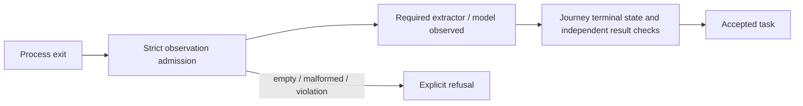

# Observed browser campaigns

A zero process exit is not proof that a browser task ran or finished. The shared
Bombadil adapter separates process termination, observed trace admission and
journey completion.

`startBombadil(...).finish({snapshot: {name, version}})` always returns
`{run, records, states}`. The snapshot selector is optional; when supplied, it
requires that extractor and, optionally, exact model version. A selector cannot
be replaced by a default property or unrelated model.

The shared admission gate requires a successful, unsignalled process and a
nonempty JSONL trace of valid observation rows. Malformed or torn rows, invalid
snapshot descriptors and any recorded violation refuse admission. At least one
snapshot must match the requested selector. It does not judge model DTO fields,
eventual completion, DOM membership or source/write budgets.

Each owning journey must still assert its actual terminal task and independent
results. An observed initial state is admissible evidence, not a completed task.
Core entry, comparison and kept-search/member journeys use the same parser while
retaining their own completion assertions. Other journeys inherit the shared
base gate; their existing model-specific checks remain their own.

`run-result.json` describes process termination with `exited` or `failed`, never
infers a completed campaign from exit zero. Compact journey summaries record
completion only after their assertions pass. The diagnostics tool currently
classifies `exited` as unknown and uses its conservative existing 72-hour policy;
this is not a passed campaign or an active-process pin.

The parser and negative controls live in `journeys/support/bombadil-verdict.js`
and `tests/bombadil-verdict.test.js`. The actual checks and limits are recorded in
[validation](../VALIDATION.md).
