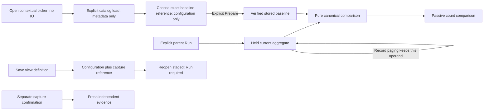

# Compare an authored population with captured evidence

A single-query composition can include a count comparison against one explicitly
chosen immutable explore capture. The current side is its applied whole-population
aggregate; inspecting a newer record page does not replace that operand.

The declaration contains configuration only:

```json
{"comparison":{"version":"goo.view/1",
  "scope":{"kind":"record-query","signal":"spans"},
  "kind":{"name":"captured-count-comparison","version":1},
  "baselineCapture":"<64-character immutable capture ID>",
  "display":{"value":"count"}}}
```

The count means captured span or log records, not unique requests, a rate or
health. Both operands retain their own half-open UTC window, source-read clock,
content basis and unknown upstream sampling. Baseline custody time is separate
from its original source read. Unequal window lengths are visible; raw counts are
not normalized by time. There is no shared transaction or source clock.

## Compatibility

This profile requires exactly one ordinary grouping field. Numeric/histogram,
span-status, split-time, reported-edge and specialized pattern/bucket profiles
are excluded. Both validated root definitions must agree except for fixed windows
and delivery paging. Checked environment policy and scope must agree, including
equivalent named/current-only representations. Filters, grouping, bucket width
and requested measures remain part of the definition.

Reuse checks the source/destination definitions and revalidates the actual
baseline on preparation. A missing or incompatible baseline remains unavailable;
its selector is never rewritten to fit the parent. The rest of the parent remains
usable. A saved reference does not assert that the capture is present or compatible.

## Read and publication effects

Opening a saved definition stages configuration without loading the baseline or
querying telemetry. Beside the applied aggregate, open **Compare with captured
baseline**. Opening or closing this disclosure performs no IO or configuration
change. **Load baseline captures** explicitly searches stored metadata. Choose a
capture from that list, or enter an exact ID and **Set baseline capture**. Selection
changes only the configuration reference; it does not fetch captured rows.

There is one picker: if the aggregate is hidden, it appears beside the visible
comparison; staged or records-only configurations use the Composition settings
fallback. An unsupported status profile offers **Edit span measures**, which reveals
the existing optional-measure controls without changing the query. Stage any measure
change explicitly, Run, and acquire a matching baseline; old captures are immutable.

After choosing a baseline, **Prepare baseline** remains explicit. It loads verified
stored evidence and runs
the existing pure comparison. Explicit Run reacquires the current parent and
prepares the baseline for a visible comparison child. A hidden child does not
start preparation; showing an already prepared pair reuses its held evidence.
Choosing or changing a baseline withdraws the
old pair before preparation; delayed results cannot replace a newer owner.
Existing record selections block preparation. While preparation runs, record
selection/actions wait so completion cannot discard a newly created selection.

| Action | Effect |
| --- | --- |
| Open or close the picker | Local disclosure only |
| Load baseline captures | Read stored catalog metadata |
| Choose/Set a capture | Stage its exact configuration reference |
| Prepare baseline | Read verified stored evidence, then run a pure comparison |
| Run population view | Reacquire current telemetry; prepare a visible configured comparison |

Count differences come from the canonical comparison engine and validator. A
known zero has a known count difference; it is not automatically unknown. Source
read disagreement withholds the difference rather than coloring it healthy.
The passive measure-comparison renderer displays only the configured count.

Saving the exploration view keeps only presentation and the exact capture
reference. It does not create a comparison receipt or capture the current held
result. To preserve new evidence, use the separate capture confirmation, which
makes an independent fresh read and may differ from the held result. Existing
comparison receipt publication still requires two real capture IDs and review of
their actual result.



The [reviewed proposal](AUTHORED_COMPARISON_PROPOSAL.md) records the design history;
[delivery review](reviews/AUTHORED_COMPARISON_REVIEW_290.md) and
[validation](../VALIDATION.md) distinguish source review from executed checks.


## Compare groups — 291

[Groups](GROUP_COUNT_COMPARISON.md) is a local alternative to Summary over the
same prepared pair, with exact aligned counts, bounded search/order/display pages
and a shared scale. Optional `display.view` and `display.order` save presentation
without saving evidence. The original acquisition, eligibility and retirement
rules remain in force.

## Contextual picker ownership — 295

The picker belongs to its current query, held result and application mount. Old
controls and delayed catalog responses cannot configure a different population.
Returning from a retained child renews current controls; older handles stay retired.
Pending record selections, drafts and page/preparation work block conflicting
commands. No new query, capture, comparison algorithm or evidence type is introduced.

See the [contextual storyboard](../journeys/295-contextual-comparison-storyboard.md)
and [design](reviews/CONTEXTUAL_COMPARISON_DESIGN_295.md) and
[architecture](reviews/CONTEXTUAL_COMPARISON_ARCHITECTURE_295.md) reviews.
