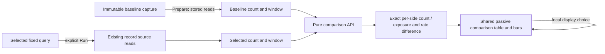

# Compare captured record rates

Milestone 418 adds an explicit **Captured records/s** measure to the existing
captured-baseline comparison. A 120-record baseline over 60 seconds and a
240-record selection over 120 seconds both yield 2 captured records/s. Their
count difference remains 120; their rate difference is zero.

Open **Compare windows** in a population view's settings, choose the comparison
measure and baseline capture, then **Set baseline capture**. These gestures stage
configuration without acquiring telemetry. **Prepare baseline** loads stored
facts and computes the comparison without another source query. Run still
explicitly acquires the selected population and prepares an already configured
baseline comparison from stored facts. The measure persists with the
existing local view definition.

The comparison uses the shared compact table, aligned bars, exact-value details
and independent scope/read facts. Each operand shows its count and elapsed
seconds alongside the rate. No new workspace, query engine or source read is
introduced. The count view remains available as a separate explicit choice.

## Data contract

Rates use each whole population's count and its own declared half-open window:
`count × 1000 / (toMs − fromMs)`. Values and selection-minus-baseline changes are
reduced exact rational strings; plotting converts only bounded geometry to
numbers. Each rate cell retains `rate.count` and `rate.elapsedMs`. These facts
must agree with the supplied count, value and corresponding query window.

The existing `record.rate` field keeps its `rate / records-per-second /
exact-rational` aggregation descriptor and `records/s` unit. Summary snapshots
now admit the existing ordinary single-group count profile, including optional
span-duration measures. Time-series rates remain ungrouped. Specialized pattern,
status, numeric, split-time and reported-edge grouped profiles do not gain a rate
through this extension.

A known empty captured population has a derived zero rate with positive exposure;
it is not unknown. Diagnostic or incompatible comparisons withhold their changes
and do not synthesize zero. Read clocks, capture custody, source bases, scopes and
quality remain independent. Missing optional clocks stay unknown; invalid supplied
rate-comparison clocks refuse. These are captured-record rates, not unsampled
application throughput, unique requests, health or statistical significance.

## Boundaries

Captured comparison declarations accept `display.value: record.rate` only with
summary presentation and no group ordering. Fresh-query rate declarations remain
unsupported; their existing same/adjacent-window compatibility rules are unchanged.

Both captured operands must retain the same ordinary query definition and exact
environment policy; only their windows and documented delivery paging may differ.
Opening a baseline's question stages its whole original scope for an explicit
new read. A comparison's store-local baseline reference remains unsuitable for
portable artifact export; no new cross-store reference authority is created.

[Storyboard and screenshots](journeys/captured-rates.md),
[independent review](reviews/CAPTURED_RATES_REVIEW_418.md), and
[validation](../VALIDATION.md) record actual execution and its limits.
