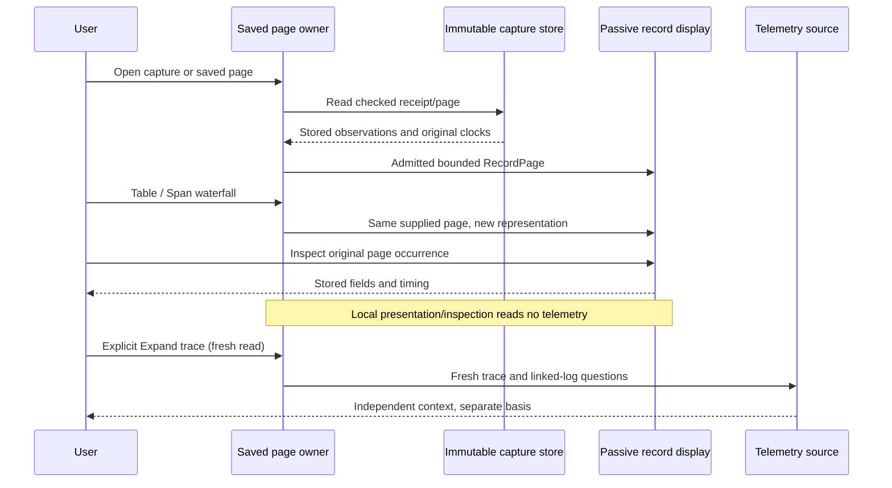

# Inspect a captured span page

Implemented in milestone 360. Execution and actual-frame acceptance
are recorded separately in [validation](../VALIDATION.md).

Open stored span evidence and choose **Span waterfall** in **Captured spans view**.
Table and waterfall represent the same currently supplied immutable page. A bar
inspects that exact captured occurrence locally, including duplicate reported IDs.
**Expand trace (fresh read)** remains a separate action that reads spans and linked
logs in the original fixed environment/window, without the original search filters.

The capture's full population count, retained inspection-record count and current
page length have different meanings. Paging reads retained evidence; it does not
fetch omitted source records. A waterfall never silently combines all stored pages
or broadens the selected population. Receipt-store access is allowed and counted
separately from telemetry reads.

The existing `record-span-waterfall` kind and supplied-page timing model retain
mixed trace fragments, a common duration scale and each fragment's earliest timed
supplied origin. This origin is not the real trace start. Unknown/invalid timing
stays unavailable, while a reported zero stays zero. Missing parents, duplicate
ownership and cycles do not create arbitrary edges. Inclusive durations are not
CPU time, critical-path time or proof of a complete trace.

`SavedRecords` adopts the stored response through the existing checked snapshot
adapter and supplies its admitted `RecordPage` to the existing record interactions.
Visual order never replaces original page position for Inspect or Keep. Pending
record selections prevent a representation change from silently losing them.
Page replacement, departure and disposal retire old callbacks before another page
can publish. Resuming an eligible retained view renews its local actions without
reacquiring telemetry or changing the receipt, query or read clock.

Logs keep their existing representation. This cut adds no trace engine, capture
format, full-trace guarantee or retained-page comparison. The latter remains the
next proposed depth item in the [roadmap](ROADMAP_2026_11_05.md).
