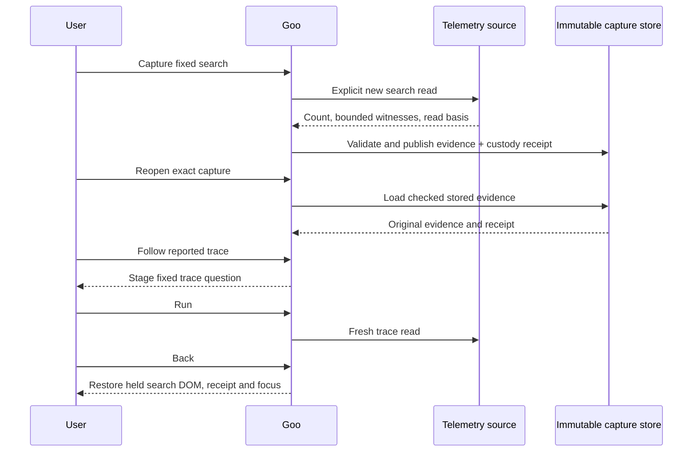
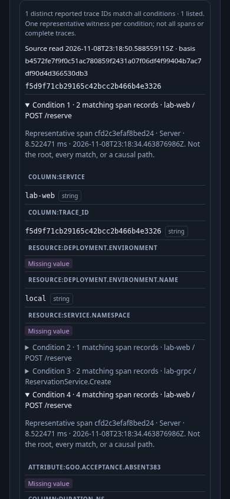
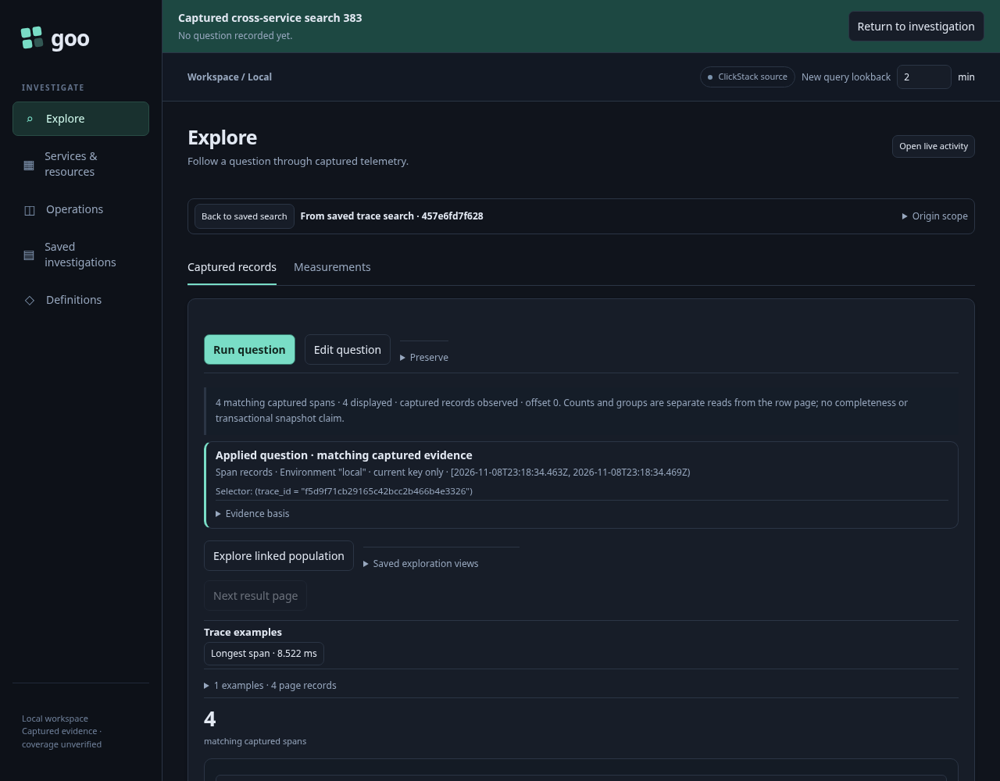

# Captured trace-search evidence

Implemented and exercised in [journey 383](../journeys/383-captured-trace-search-storyboard.md).
See [validation](../VALIDATION.md) for actual checks and limits.

A saved search question is reusable intent. A captured search is immutable evidence
from a separate, explicit read of that fixed request. Capture does not archive the
earlier browser result verbatim: late arrivals can change the matching count and
witnesses. Source read time and basis remain separate from capture custody time.

The capture retains the complete request, compiled plan, read time, basis, state,
full matching reported-trace count, bounded items, `hasMore`, qualified witnesses
and warnings. A bounded list is not the population total or proof of complete
telemetry. One span can satisfy several independent conditions; witnesses do not
establish parent-child order, causality or a unique invocation.

The existing capture store owns publication and immutable reopen. Stored search
evidence is a distinct typed arm, not an ordinary span page. Qualified missing and
empty values remain different. The common envelope's `retainedRecords` counts
listed reported trace IDs for this arm, not span records; `recordsLimited` echoes
the bounded list's `hasMore`. Search evidence has no record-page cursor.
Invalid or incompatible evidence cannot be attached
to a search question card.

Following a reported trace stages its exact fixed environment/window question.
An explicit Run reads fresh telemetry, which can disagree with the earlier search.
Back restores the held search evidence and focus without rereading telemetry or
the capture store. A failed, canceled or late child response cannot replace it.

