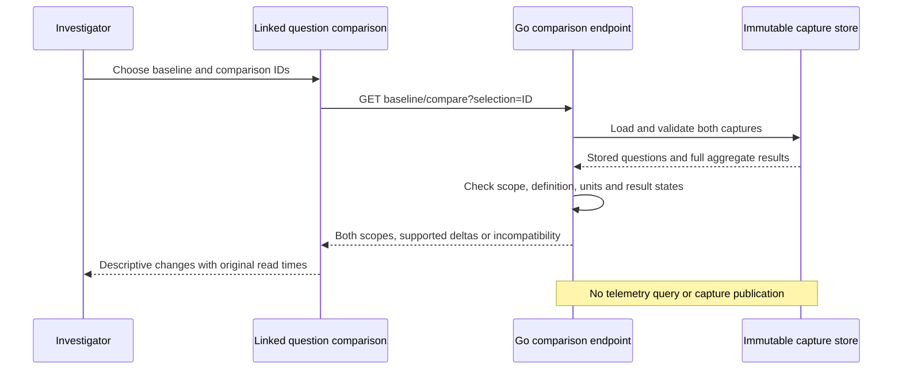
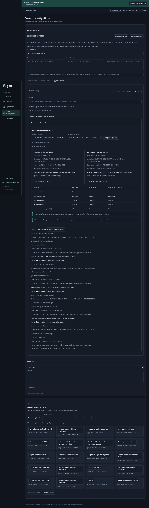
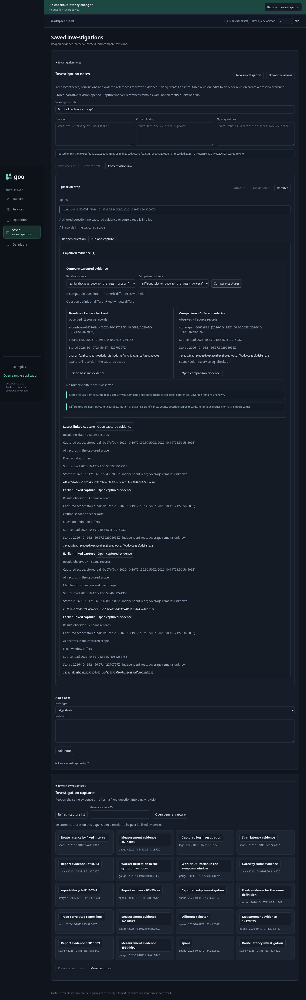
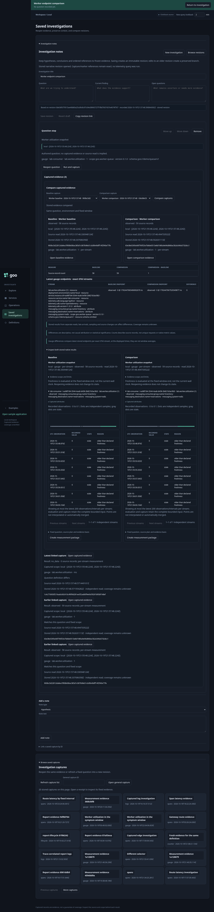

# Compare captured evidence

A question with two or more linked captures offers **Compare captured evidence**.
Choose a baseline and comparison capture, then **Compare captures**. Options include
the capture title, stored source-read time and ID prefix. The initial pair is the
last two links, not a claim that their event windows are newest.

Both sides retain their exact capture ID, fixed window, environment, state,
source-record count, source-read time and custody time. Comparing never rereads
telemetry, saves a revision, refreshes a capture or changes either receipt. Changing
a selection clears the previous comparison; failures clear stale results and can
be retried. Choosing the same ID on both sides disables the UI action.

The Go `GET /captures/{baseline}/compare?selection={capture}` endpoint loads and
validates both immutable captures before comparing. It does not accept caller-held
aggregate values. The existing source-free capture store supplies the evidence.

| Difference | Behavior |
| --- | --- |
| Event window | Display it; compare supported results descriptively |
| Window length | Also warn that count changes are not normalized rates |
| Signal family, environment, filter or typed definition | Display both scopes; withhold numeric deltas |
| Native unit | Explicit unit mismatch; no conversion or numeric delta |
| Empty, unknown or changed-between-reads result | Show stored state; withhold deltas |
| Missing exact OTel gauge stream | Show missing side; no cross-instance matching or zero fill |

Record count subtraction uses arbitrary-precision integers. Span duration mean,
p95 and p99 changes and recorded error-share percentage-point changes use the
existing full-population summary comparison kernel. Inspection row limits never
define totals. Missing summaries are not reconstructed from retained rows.
Recorded error share includes unset/unknown statuses in the total; neither is
silently recoded as OK. Matching windows do not imply a common snapshot.

Native gauges compare the latest stored sample for each exact OTel stream,
including complete resource, scope/version/schema, metric/unit and attribute
identity. The endpoint timestamps and states stay visible. A stale or unknown
endpoint is never replaced by an earlier healthy sample. Gauge changes are exact
decimal differences between displayed endpoint values, not window averages or
fleet aggregates. Source-record count changes remain labeled as record counts.

**Inspect both stored native results** expands the existing saved-result renderer
on each side. Counters, histograms and lifecycle results can be inspected this way;
this slice does not subtract percentile scalars, align intervals, compute fleet
aggregates or define lifecycle cohort deltas. Incompatible pairs can still be
inspected without numerical claims. No statistical significance is inferred.

Storyboard 52 (`journeys/evidence-comparison.spec.js`) ingests standard OTel HTTP
spans into the real collector, captures two windows, compares full latency/error
summaries, refuses changed definitions, handles no data and a failed comparison
request, and checks mobile containment and immutable reopening. A second journey
compares live worker gauge streams and rejects a unit mismatch. Hegel checks
precision, reversed subtraction, incompatibility and immutability. Quint validates
observed comparison/read transitions with rejecting controls; Bombadil explores
compatible and incompatible selections through ordinary controls.

