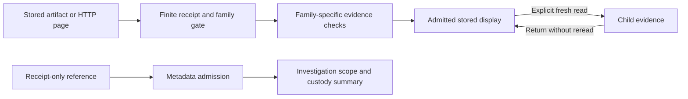

# Capture-family admission

Milestone 387. See [validation](../VALIDATION.md) for completed checks and runtime acceptance.

A stored capture has one receipt, one typed question and exactly one matching
result family. A delivery page does not gain authority merely by including a
capture ID. A receipt-only investigation reference is metadata, not a full page.
The same finite boundary applies to current-only and typed environment questions.

| Family | Result arm | Delivery metadata |
| --- | --- | --- |
| Explore | `explore` | Up to 1,000 retained inspection rows; pages of 100; receipt-bound local cursors |
| Inventory | `inventory` | No record pagination; retainedRecords 0 and recordsLimited false |
| Comparison | `comparison` | No record pagination; independent cohort reads and exact distribution intent |
| Measurement | `measurement` | Retained count equals stored input rows; no record cursors |
| Explanation | `explanation` | Held observed result; saving does not rerun telemetry; no record pages |
| Trace search | `traceSearch` | Retained count equals witness items; recordsLimited follows hasMore; no record cursors |

## One finite gate, existing family semantics

Go checks question, stored artifact and delivery envelopes before dispatching to
the existing family validators. The browser checks full page admission before
using family-specific identities, search witnesses or explanation rendering.
Selected arms must be non-null objects. Any other family arm is forbidden by
presence, including an explicit null. Unknown envelope fields and key aliases do
not silently become omitted fields.

This is not a recursive ban on null values. Missing qualified witness values,
nullable groups and legitimate empty row containers retain their meaning inside
a family. In the saved Explore presentation, null empty rows become an empty
held list only after admission; the original DTO, stored bytes, full count, state
and clocks remain unchanged.

Receipt version, ID, title, custody time, normalized question and parent reference
are checked independently of delivery. Explore changes only result offset/limit
for local paging; the receipt's question stays fixed. Full totals and groups do
not become page totals, and recordsLimited describes source retention rather
than whether another local page exists. A returned page also binds to its
requested ID and cursor before adoption. Pending or failed visits cannot replace
the accepted page address used by held comparisons and citations.

Historical source plans remain evidence. Admission does not introduce a new
current-compiler equality gate. Existing refresh and re-evaluation policies remain
with each family. Source read clocks, immutable custody time and frozen evaluation
time are not merged or ordered by the envelope validator.

## Metadata is a separate capability

`GET /captures/{id}/receipt` returns receipt, definitionRevision, readAt and a
summary. Empty revision/readAt means that metadata is unavailable. A reference
cannot include a result arm or page fields, and a full-page consumer cannot
accept it instead of evidence. Investigation reference summaries support all six
families, including trace-search scope without requiring witness payloads.

Saving an explanation promotes a held observed result. Other capture creation and
refresh paths keep their existing explicit reads. Receipt inspection, offline
reopening and retained return do not authorize telemetry execution.
