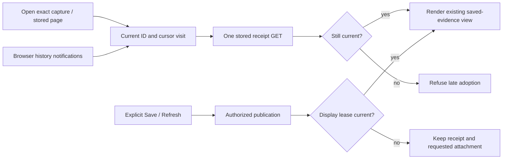

# Saved-capture navigation and pending work

Status: implementation and actual validation are recorded in [VALIDATION.md](../VALIDATION.md).

Opening a general saved capture reads its stored evidence, not live telemetry.
One active visit owns the capture ID, page cursor, request and adoption decision.
Paired browser history notifications join that read or retain its already rendered
page. They do not rebuild an inspector or reset the current stored page.
An explicit different page cursor reads that stored page; revisiting after leaving
verifies the original receipt again. Failed passive notifications do not retry;
explicit Open can retry.

Leaving the hash, moving to another workspace or selecting another evidence owner
retires the visit before aborting its GET. Retirement rejects late successes and
failures, even when the server already completed the read. A departed response
cannot restore its old URL, overwrite status or steal focus. Direct catalog and
exact-ID opening use the same adapter as copied capture links.

Refresh is a separate explicit operation: it rereads the original fixed question
and may publish a new immutable capture. While it runs, passive notifications
retain the existing page and do not start a replacement GET. A departed refresh
cannot adopt its result into another task. Retirement is not rollback of an
already authorized publication or proof that a source query stopped.

Save confirmation likewise separates publication from display adoption. Its
pending display lease retires irreversibly on departure, including leaving and
returning to the same hash. The original authorized save and any explicitly
requested investigation attachment continue through their original completion
and error handling. Display retirement does not skip the attachment or override
its original document authority and conflict checks. When publication succeeds, the still-owned original Save dialog closes even if
its display lease retired. A newer dialog is untouched. A still-owned failed
submission regains actionable controls and its own error message; it cannot alter
a newer task. The new receipt may be preserved without replacing the screen the
user has since chosen. The ordinary
current-task completion still opens the saved capture normally.

These are local ownership rules in the existing capture adapter, not a global
receipt cache or universal navigation manager. Kept observations retain their
[separate current visit and member inspector](KEPT_MATCH_NAVIGATION.md); retained
trace/context Back continues to restore its original kept view without reads.

See [whole-product architecture](reviews/WHOLE_PRODUCT_ARCHITECTURE_332.md),
[design review](reviews/WHOLE_PRODUCT_DESIGN_332.md) and
[executable journey](journeys/332-capture-route.md).
